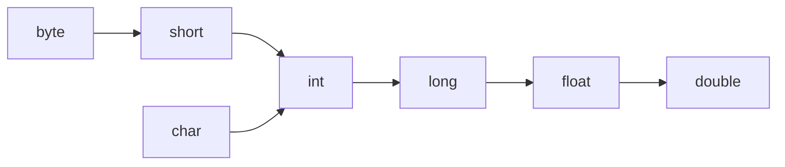
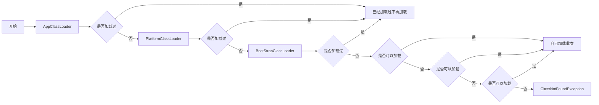

# -1. 基础操作

### ### 

#### 111

##### 1.改名：shift+F6

##### 2.批量注释：选中+Ctrl+/

##### 3.错误自动修正，自动导包：Alt+回车

##### 4.选中单个单词：左键双击

##### 5.复制一行：Ctrl+D   删除一行：Ctrl+Y

##### 6.展开结构大纲：Ctrl+F12 

##### 7.Alt+数字键 有很多的功能

##### 8.自动整理代码：选中后 Ctrl+Alt+L

##### 9.生成一个for循环语句：数字.fori  

##### 10.如果想打印一个数据，直接在数据后面加 .sout

##### 11.如果想用for循环遍历数组，直接在数组名后面加 .fori

##### 12.批量改名：选中 shift+F6

##### 13.将段代码单独抽取到方法中：选中 Ctrl+Alt+M

##### 14.将方法的返回值用一个变量接受：方法名+.var

##### 15.Generate：Alt+Insert 

- **Constructor** 即可自动生成**构造**方法
- **Getter and Setter** 也可以生成对应属性的**get和set**方法
- **Override Methods :** 在子类中重写**父类**的方法
- **toString：**可以重写Object类里的 **toString** 方法，让它输出成员属性

​	所有对象在被打印时都会调用对象的 toString 方法，默认打印对象的地址值

- **equals() and hashCode()** 可以重写Object类里的 **equals( )** 方法，让他比较成员属性

##### 20.光标放到匿名内部类上，Alt+回车 选择 Replace with lambda 可以替换为简化后的Lambda表达式的形式

##### 21.生成一个没有声明的方法：光标放到未生成的方法名上，Alt+回车，点第一个Creat

##### 22.代码包裹：Ctrl + Alt + T

##### 23.代码整体左移：shift+tab

##### 24.整体上下移动：Alt + ↑ / Alt + ↓

##### 25.新开一行：

- **在下面：Shift + Enter**
- **在上面：Ctrl + Shift + Enter**

##### 26.选中一整行：三击鼠标

##### 27.复制全类名：右键 Copy / Paste Special --> Copy Reference

##### 28.实现接口方法：Ctrl + I

##### 29.重写父类方法：Ctrl + O

##### 30.随处搜索：双击 Shift

##### 31.查找用法：Ctrl + Alt +F7

##### 32.打开替换对话框：ctrl+r


# 0. Java 项目层级

##### 1. 项目（Project）

整个工程的最高容器，相当于一个完整软件

- 作用：统一管理全部代码、配置、依赖、资源文件
- 场景：一个项目可以包含多个模块，比如电商项目拆分为用户模块、订单模块、支付模块

##### 2. 模块（Module）

项目下独立的功能单元，可**单独编译、运行、打包**

- 作用：拆分业务，解耦代码；每个模块有独立 `src` 源码目录
- 场景：day01、day02 这种练习文件夹，在 IDEA 里就是一个个模块

##### 3. 包（Package）

模块 **`src`** 下用来分类管理类的文件夹，用 **`.`** 分层命名，包名里的 `.` 就是用来表示包的嵌套层级关系

- 规范：域名倒写，如 `com.demo.user`
- 作用：区分同名类、管理代码分类（实体类、工具类、测试类分开存放）
- 磁盘表现：`com/demo/user` 多级文件夹

##### 4. 类（Class）

最小代码单元，**`.java`** 文件，写业务逻辑、变量、方法

- 规则：一个文件一个 **public class**
- 位置：必须放在某个包内


# 1. 基础语法 

### ###

##### -1. 面向对象编程（OOP）的三大核心特性

**封装，继承，多态**


##### 0. 如果使用的类是 java.lang 包中的内容，则不需要编写导包代码

Java 编译器自动导入（隐式导入）了 **java.lang** 包，但是子包不会被导入

- `Object`：所有类的根父类
- `String`、`StringBuilder`：字符串处理
- `System`：标准输入输出、系统操作
- `Integer`、`Double`、`Boolean`：基本类型的包装类
- `Math`：数学运算
- `Exception`、`Error`、`Throwable`：异常体系
- `Thread`、`Runnable`：线程

​	

##### 1. long 类型的整数数据后面要加 L 结尾

超过 **int** 范围必须加 **L**


##### 2.小数默认是 double 类型，想要设成 float类型需要在结尾加 f


##### 3.Java中整数相除只会得到整数，想要得到小数必须有小数参与运算


##### 4.数据范围从小到大图



**float（浮点数）：**

虽然 float 总字节更少，但依靠**指数偏移**，表示范围远大于 long：

4 字节 32 位，分为三段：

- 1 位符号位
- 8 位指数位
- 23 位尾数位（有效数字）


##### 5. byte , short , char 这三种类型在运算的时候会直接提升为 int 类型


##### 6. Java 存在字面量优化机制，字面量运算会在编译 (javac) 时完成运算

**字面量：**就是代码里直接写出来的固定值

```java
int a = 10 + 20;
```

javac 在编译时就已经算出结果是 30，编译后的字节码等价于：

```java
int a = 30;
```


##### 7. && 和 || 是短路与或


##### 8. 与 的优先级高于 或


##### 9. JavaBean 是一种**符合特定编码规范的普通 Java 类**，主要用于封装数据，常作为实体类、数据载体

通常需要满足以下需求：

1. 类是 public 的

2. 有无参构造方法

    这是很多框架（如 Spring、MyBatis）能通过反射创建对象的前提。

3. 属性私有（private）

4. 通过 getter/setter 访问属性

5. 实现 `Serializable` 接口（可选但常见）


##### 10. 全类名

**包名+类名**


##### 11. switch 

不能接受表达式类型为 **double , float , long , boolean**

底层通常被编译成 **跳转表（tableswitch）** 或 **查找表（lookupswitch）**，本质上是用整数值作为索引去查表

**case** 后面可以编辑多个值，值与值之间可以用**逗号**分隔


##### 12. 用 break 或者 continue 操作外部循环

可以给循环标号，写在循环前面加冒号，再把标号写在break和continue后面

```java
标签名:
for (...) {
    for (...) {
        break 标签名;      // 跳出标签所标记的那层循环
        continue 标签名;   // 跳过标签所标记那层循环的本次迭代
    }
}
```

 


##### 13. 打印数组名，看到是数组的十六进制地址

- **`@`** ：分隔符

- **`[`** ：是数据类型


##### 14. 二维数组中存的是一维数组的堆内存地址


##### 15. 在堆中新建对象时，会生成一个成员方法引用地址存放在新申请的堆内存中


##### 16. 链式编程

如果方法的返回值是对象，则可以继续向下调用方法


##### 17. 计算从1970年1月1日0时0分0秒到现在的毫秒值

```java
long t = System.currentTimeMillis( );
```

返回值类型为 **long**


# 2. 修饰符

##### 1. 权限修饰符（最高在同一个模块内）：

- **private**　　　　**同一个类中**

- **public**　　　　  **任意位置**

（下面两个几乎不怎么用）

- **default**　　　    **同一个类中　　同一个包中**

- **protected**　　   **同一个类中　　同一个包中　　不同包的子类**


##### 2. 静态修饰的成员推荐使用类名调用

在字节码文件中所有的对象名调用全都会改为类名调用，静态成员随着类的加载而加载，存于堆内存的静态变量成员区


##### 3. 工具类中的方法都可以写成 static

这样主方法中就不用再创建工具类对象就可以直接用类名去用工具方法，同时工具类的构造方法可以私有


##### 4.重新认识 main 方法

```
public class HelloWorld {
    public static void main(String[] args) {
    }
}
```

- **public：**被 JVM 调用，访问权限足够大

- **static：**被 JVM 调用，不用创建对象

  因为 main 方法是静态的，所以 main 方法所在类中其他方法也需要是静态的

- **void：**被 JVM 调用，不需要给 JVM 返回值

- **main：**一个通用的名称，虽然不是关键字，但是被 JVM 识别

- **String [] args：**以前用于接收键盘录入数据的，现在没用


# 3. 继承

##### 1. @Override 

用来校验该方法是否为重写的方法，子类中重写的方法权限要大于等于父类


##### 2. java 只支持单继承

不支持多继承，但支持多层继承


##### 3. 子类不可以继承父类的构造方法，必须手动编写构造方法

在子类所有的构造方法中，第一句话默认隐藏了 **super( )** ; 访问父类的空参数构造方法，从而完成父类的初始化操作

**`super.成员变量名`** 访问父类成员变量    **`super.方法名()`** 调用父类成员方法

所有子类的构造方法中如果没有手动添加 super( )，编译时都会自动在第一行添加上super( ) 

如果父类没有空参构造则会直接报错，super( ) 必须放在第一行，super( ) 和 this( )不能同时出现


##### 4. this( ) 必须放在构造方法的第一行


##### 5. 

**基本数据类型变量：数据值不可改变**   

**引用数据类型变量：地址值不可改变**   

**final 修饰成员变量，初始化时机**

1. 在定义的时候完成赋值
2. 在构造方法结束之前完成赋值。


##### 6. final 修饰的变量就变成了常量。常量的命名规范：

1. 如果是一个单词：所有字母大写        MAX
2. 如果是多个单词：所有字母大写，中间使用_分割    MAX_VALUE


##### 7. 抽象方法：

将共性的方法抽取到父类之后，发现该方法的实现逻辑无法在父类中给出具体明确，该方法就可以定义为抽象方法

抽象方法强制子类重写，抽象方法必须定义在抽象类中，抽象类不可以创建对象但还是存在构造方法

抽象类的子类要么重写所有抽象方法，要么也是抽象类


##### 8. 接口的成员特点：

1. **成员变量：**只能是常量，因为默认加入三个关键字 public static final
2. **成员方法：**只能是抽象方法，因为默认加入了两个关键字 public abstract
3. **构造方法：**没有

**接口的子类中构造方法中的 super( ) 访问的是Object中的构造方法**

JDK8 版本后，接口中可以定义非抽象方法，但必须要用 **default** 修饰

​			也可以定义静态方法，用 **static** 修饰，但是只能用接口名调用

JDK9 之后，接口中可以定义私有方法，供接口内部方法调用


# 4. 多态

##### 多态

- **对象多态：**将方法的形参定义为父类类型，这个方法可以接收该父类的任意子类对象

- **行为多态：**同一个接口/方法调用，作用在不同对象上，产生不同的行为

示例：

```java
class Father {
    int num = 10;
    public void show() {
        System.out.println("父类方法");
    }
    public static void staticShow() {
        System.out.println("父类静态方法");
    }
}

class Son extends Father {
    int num = 20;
    @Override
    public void show() {
        System.out.println("子类方法");
    }
    public static void staticShow() {
        System.out.println("子类静态方法");
    }
}

public class Test {
    public static void main(String[] args) {
        Father f = new Son();   // 多态：父类引用指向子类对象
    }
}
```


##### 多态的成员访问特点

下列口诀中，编译代指编译类型，运行代指运行类型

- **成员变量：**

    **编译看左边 (父类)，运行看左边 (父类)**

    ```java
    Father f = new Son();
    System.out.println(f.num);   // 输出 10，不是 20
    ```

    成员变量不参与多态，它是在**编译期**就根据引用类型（Father）确定访问哪一个。`f` 是 `Father` 类型，所以访问的是 `Father` 里的 `num`，结果是 `10`。

    `f` 作为父类引用，编译器只认父类里声明过的字段。父类没有的字段，通过 `f` 根本访问不到

- **成员方法：**

    **编译看左边 (父类)，运行看右边 (子类)**

    ```java
    Father f = new Son();
    f.show();   // 输出 "子类方法"
    ```

    - **编译阶段**：编译器检查 `Father` 里有没有 `show()` 方法
        - 没有 → 编译报错
        - 有 → 编译通过

    - **运行阶段**：JVM 根据对象的**实际类型**（`Son`）去调用方法，所以执行的是子类重写后的 `show()`

        这就是**动态绑定（动态分派）**，也是多态的核心

    **注意**：只有**被重写**的实例方法才有这个效果。如果子类没有重写，那调用的还是父类的实现

- **静态成员：**

    **编译看左边 (父类)，运行看左边 (父类)**

    ```java
    Father f = new Son();
    f.staticShow();   // 输出 "父类静态方法"
    ```

    静态成员属于**类**，不属于对象，所以不存在多态。编译器根据引用类型 `Father` 决定调用哪一个，运行时也不会去查子类

    实际上，`f.staticShow()` 这种写法编译后等价于：

    ```java
    Father.staticShow();
    ```

    所以 **static** 修饰的成员，推荐使用**类名调用**


# 5. 代码块 + 内部类 + Lambda

##### 1. instanceof 

检查某个对象是不是属于某个类


##### 2. 代码块

是用一对 **`{}`** 包裹起来的一段代码

根据**定义位置**和**执行时机**的不同，代码块可以分为几种类型：

| 类型       | 定义位置                      | 执行时机                     | 执行次数          |
| :--------- | :---------------------------- | :--------------------------- | :---------------- |
| 局部代码块 | 方法内部                      | 方法调用到该处时             | 每次执行到都执行  |
| 构造代码块 | 类中、方法外                  | 每次创建对象时，构造方法之前 | 每次 `new` 都执行 |
| 静态代码块 | 类中、方法外，带 **static**   | 类加载时                     | 只执行一次        |
| 同步代码块 | 方法内部，带 **synchronized** | 多线程竞争锁时               | 每次执行到都执行  |


##### 3. 构造代码块

在创建对象的时候被调用执行，无论使用哪一个构造方法创建对象，都要执行构造代码块，且优先于构造方法执行

在字节码文件中，Java会将构造代码块分给每一个构造方法去执行。如果所有构造方法中有相同的代码，就可以考虑把相同的代码抽取到构造代码块中


##### 4. 静态代码块

会随着类的加载而执行，只执行一次，常用于一些初始化的操作


##### 5. 一个类中，需要使用不同的类，但是这两个类名称是相同的，默认只能导入一个，另一个需要带包访问


##### 6. 内部类创建对象的格式：

```java
外部类名.内部类名 对象名 = new 外部类对象().new 内部类对象();
```

内部类访问外部类可以直接访问，反之则不可以


##### 7. 静态内部类创建对象格式：

```java
外部类名.内部类名 对象名 = new 外部类名.内部类对象();
```


##### 8. 匿名内部类格式：

```java
new 父类或接口名(构造参数) {
    // 匿名内部类的类体
    // 通常在这里重写父类或接口中的抽象方法
};
```

匿名内部类常用于方法的参数传递，不用再去重写一个类，在大括号后直接点点儿就能直接调用类内方法


##### **9. Lambda 表达式的简化格式**

注意：Lambda 表达式只能简化**函数式接口**的匿名内部类的写法形式

```java
() -> {}
```

```java
(匿名内部类被重写方法的形参列表) -> {
被重写方法的方法体代码
}
```

作用：简化匿名内部类的代码写法。

注：`->` 是语法形式，无实际含义

##### 逐步简化过程

- **初始状态：标准的匿名内部类**

    ```java
    Runnable r = new Runnable() {
        @Override
        public void run() {
            System.out.println("Hello Lambda");
        }
    };
    ```

- **1. 省去 new Runnable( ) 和 @Override（因为编译器知道）**

    既然你左边声明了 `Runnable r`，编译器完全知道你要 new 的是 `Runnable` 接口
    既然接口里只有一个方法 `run()`，编译器也完全知道你重写的一定是 `run` 方法
    所以，**类名、new 关键字、@Override** 都是废话，可以删掉

    ```java
    Runnable r = () { // 只剩下了括号和花括号
        System.out.println("Hello Lambda");
    };
    ```

    （注：这种写法在真实 Java 中不存在，只是为了演示推导逻辑）

- **2. 省去方法名和返回值类型（因为只有一个方法）**

    既然只有一个 `run` 方法，那方法名 `run` 也不用写了。`run` 方法没有参数，没有返回值，所以 `void` 也不用写
    现在，只剩下**参数列表** `()` 和 **方法体** `{}`

- **3. 引入箭头 `->` 连接参数和方法体**

    Java 设计者觉得，既然参数和方法体分家了，中间需要一个符号连接一下。于是引入了 `->`（Lambda 操作符）

    ```java
    Runnable r = () -> {
        System.out.println("Hello Lambda");
    };
    ```

    这就是最终的 Lambda 表达式

- **4. 进一步简化（如果方法体只有一行）**

    如果方法体只有一行代码，大括号 `{}` 也可以省去：

    ```java
    Runnable r = () -> System.out.println("Hello Lambda");
    ```

**Lambda表达式的简化规则**

1.参数类型可以省略不写。

2.如果只有一个参数，参数类型可以省略，同时(   )也可以省略。

3.如果 Lambda 表达式的方法体代码只有一行代码，可以省略大括号不写，同时要省略分号

   此时，如果这行代码是 return 语句，必须省略 return 不写，同时也必须省略 ";" 不写


##### 10. 方法引用

是 JDK8 开始出现，主要的作用，是对 Lambda 表达式进行进一步的简化

```java
接口名::方法名
```

通过方法的名字来指向一个方法，不用传参，因为参数会自动承接

非静态的方法如果要进行方法引用，则需要创建对象，用 **对象冒冒** 的格式进行方法引用

方法签名必须与目标函数式接口严格匹配，方法引用本质是给函数式接口的唯一抽象方法做实现，入参个数、入参类型、返回值类型必须契合


##### 11. 什么是函数式接口

首先必须是接口、其次接口中**有且仅有一个抽象方法**的形式

可以用 **@FunctionalInterface** 关键字校验


##### 12. 匿名内部类会生成单独的字节码文件，但是 Lambda 表达式不会生成

它用的是 JVM 的 invokedynamic 指令 + 运行时动态生成


# 6. String

#### 1.String 类的构造方法：

##### **1. 基础构造方法**

```java
public String () 		         //创建空白字符串，不含任何内容	
public String (char [] chs)      //根据字符数组，创建字符串对象	
public String (String original)  //根据传入的字符串，创建字符串对象
```

用**双引号**建立的字符串对象可以共享，当创建一个新的String对象时会先搜索字符串常量池，如果有则复用，没有则创建新的	

不用双引号创建的字符串对象，默认不会自动去常量池里共享，但可以通过 **intern( )** 方法手动让它共享


##### **2. 基于 `char[]` 字符数组、指定区间的 String 构造方法**

```java
public String(char[] value, int offset, int count)
```

`value`：源字符数组

`offset`：起始截取下标

`count`：截取字符个数


##### **3. 基于 `byte[]` 字节数组、指定区间的 String 构造方法**

```java
public String(byte[] bytes, int offset, int length)
public String(byte[] bytes, int offset, int length, Charset charset)
```

`bytes`：     源字节数组；

`offset`：   起始截取下标；

`length`：  截取字节数量；

`charset`：字符集对象，用来明确指定把 byte 字节解析成 char / 字符串时使用哪一套编码规则；


#### 2.String 类的常用成员方法

##### 1.比较方法

完全一样结果才是 true，否则为 false

```java
public boolean equals (要比较的字符串)			    
```

忽略大小写的比较

```java
public boolean equalsIgnoreCase (要比较的字符串)
```


##### 2.**转换方法**

将字符串转换为**字符数组**

```java
public char [] toCharArray ()    	  				        
```

将字符串转换为**字节数组**

```java
public byte[] getBytes()
```


##### **3.遍历方法**

根据索引找字符

```java
public char charAt (int index)  				       
```

返回字符串的长度

```java
public int length () ;        					        
```


##### 4.**截取方法**

```java
public String substring (int beginIndex)                //截取到末尾  	
public String substring (int beginIndex, int endIndex)  //根据指定的索引截取字符串。注意：包头不包尾，包左不包右 
```


##### **5.替换方法**

把字符串里所有匹配的单个字符全部替换成新字符

```java
public String replace(char oldChar, char newChar)            
```

替换所有匹配的子字符串

```java
public String replace(CharSequence target, CharSequence replacement)
```

注意：返回值才是替换之后的结果   

​         

##### **6.切割方法**

根据传入的字符串作为规则进行切割。将切割后的内容存入字符串数组中， 并将字符串数组返回

注意返回值是字符串数组

```java
public String [] split (String regex)
```

​			

##### 7.校验方法

```java
public boolean startsWith(String prefix)  //判断字符串是否以指定前缀开头
public boolean endsWith(String suffix)    //判断字符串是否以指定后缀结尾
```


##### 8.处理方法

移除字符串首尾所有 ASCII 码值 ≤ 32（\u0000 ~ \u0020）的空白、控制字符，中间的空格完全保留。

```java
public String trim()
```


#### 3. StringBuilder 

是一个可变字符序列，能够自动扩容，是一个**字符串缓冲区**，可以接收任意类型的值，进到缓冲区后统一拼成字符串

##### **构造方法：**

创建一个空白的字符串缓冲区

```java
public StringBuilder ()	            //创建一个空白的字符串缓冲区
public StringBuilder (String str)	//创建一个字符串缓冲区，并指定初始值		       
```

##### **成员方法：**

**append：**添加数据到缓冲区的尾部，返回值是自己

```java
public StringBuilder append (任意类型)	
```

**reverse：** 反转缓冲区的内容 ，返回值是自己

```java
public StringBuilder reverse ()	
```

**length：** 获取长度	         

```java
public int length () 
```

**toString：** 转换为 String 类型 

```java
public String toString ()             
```


# 7. 泛型

#### 1. 泛型中只能编写引用数据类型

泛型可以统一数字类型，将运行期的错误提升到编译期，如果没有指定泛型类型则默认为 Object 类型，任意类型的方法都可以填进去

**泛型常见的标识符：**

- **E：**Element 	元素

- **T：**Type 	      类型

- **K：**Key		 键

- **V：**Value 	     值

**非静态方法：**

跟着类的泛型去匹配的。类的泛型，是在创建对象的时候确定到具体数据类型

**静态方法：**

调用方法的时候，传入实际参数，在这时候确定到具体的数据类型

注意：静态方法如果想要声明泛型，必须声明出自己独立的泛型，不能使用类上的泛型


#### 2. 泛型接口

1. 实现类，实现接口的时候确定到具体的类型
2. 实现类实现接口，没有指定具体类型，就让接口的泛型，**跟着类的**泛型去匹配


#### 3. 泛型通配符 ？

**?**                       （任意类型）

**? extends E**   （只能接收 E 或者是 E 的子类）

**? super E**        （只能接收 E 或者是 E 的父类）


# 8. Collection + 迭代器

#### 1. Collection 体系⭐⭐⭐⭐⭐

```text
Iterable
  └── Collection
        ├── List
        │     ├── AbstractList
        │     │     ├── ArrayList ⭐动态数组，最常用
        │     │     └── AbstractSequentialList
        │     │           └── LinkedList ⭐双链表
        ├── Set
        │     ├── AbstractSet
        │     │     ├── HashSet ⭐无序集合，效率高
        │     │     │     └── LinkedHashSet ⭐保证插入顺序：哈希表 + 双向链表
        │     │     └── TreeSet ⭐有序集合
        │     └── SortedSet
        │           └── NavigableSet
        │                 └── TreeSet
        │
        └── Queue
              ├── AbstractQueue
              │     └── PriorityQueue ⭐优先队列
              └── Deque
                    ├── ArrayDeque ⭐双端队列
                    └── LinkedList
```


#### 2. ArrayList 集合

使用**空参**构造器创建的集合，在底层创建一个**默认长度为 0** 的数组

添加**第一个**元素时，底层会创建一个新的**长度为 10** 的数组

存满时，会扩容 **1.5 倍**

```java
ArrayList list = new ArrayList ();
```

可以存储任意数据类型，不严谨

```java
ArrayList<String> list = new ArrayList<>();
```

使用泛型技术，限制集合中元素的数据类型，推荐方案

**注意：**集合泛型只能存引用类型，不能存基本数据类型


#### 3. List 集合的增删改查操作

##### 增 add

```java
boolean add (E e)	             //将指定的元素追加到此列表的末尾
void add (int index, E element)  //将指定元素插入此列表中的指定位置
```

##### 删 remove

```java
E remove (int index)	    	 //删除此列表中指定位置的元素
boolean remove (Object o)		 //从该列表中删除指定元素的第一个匹配项（如果存在）
```

##### 改 set

```java
E set (int index, E element)	 //用指定的元素替换此列表中指定位置的元素
```

##### 查 get

```java
E get (int index)				 //返回此列表中指定位置的元素
```

​			  


#### 4. Collection 中的 remove 方法和 contains 方法依赖于 equals


#### 5. forEach 方法

底层是迭代器

```java
default void forEach(Consumer<? super T> action)
```

是 Collection 里的默认方法

- **Consumer** 是消费型函数式接口：唯一抽象方法 **accept(T t)**，这里的 T 是集合中存储的元素类型

    接收入参、无返回值，接收、消费传入的元素，只做处理不产出结果。可以写成 lambda 表达式


#### 6. 迭代器 Iterator

**Iterator** 是 Java 集合框架提供的统一遍历**工具接口**，作用是逐个取出集合中的元素，相当于集合的专属 “遍历指针”

所有单列集合（`ArrayList`、`LinkedList`、`HashSet`）都可以生成迭代器，提供一套标准遍历方式，不用关心集合底层结构

创建一个迭代器对象，泛型必须与集合类型保持一致

```java
Iterator<元素类型> 迭代器名 = 集合对象.iterator();
```

初始化时默认指向第一个元素前面的位置


#### 7. 迭代器的方法

| 方法                           | 作用                       | 说明                                             |
| :----------------------------- | :------------------------- | :----------------------------------------------- |
| **hasNext( )**                 | 判断是否还有下一个元素     | 返回 `boolean`，不移动指针                       |
| **next( )**                    | 取出下一个元素             | 指针后移，无元素时抛 `NoSuchElementException`    |
| **remove( )**                  | 删除刚 `next()` 返回的元素 | 可选操作，默认抛 `UnsupportedOperationException` |
| **forEachRemaining(Consumer)** | 对剩余元素批量执行操作     | Java 8+，一次性消费剩余元素                      |

示例：

```java
Iterator<String> it = list.iterator();
while (it.hasNext()) {      // 先看看还有吗
    String s = it.next();   // 有就取出来
    System.out.println(s);
}
```


#### 8. 并发修改异常：ConcurrentModificationException

集合在迭代遍历（Iterator / 增强 for 循环）过程中，集合自身直接调用 add( )/remove( )/clear( ) 等**修改结构的方法**

集合内部维护的修改计数器 **modCount** 与迭代器内部的预期计数器 **expectedModCount** **数值不一致**

迭代器在执行 **next( )、hasNext( )** 校验时检测到二者不相等，直接抛出该异常

```java
List<String> list = new ArrayList<>(List.of("a", "b", "c"));

for (String s : list) {
    if (s.equals("b")) {
        list.remove(s);   // ❌ 抛 ConcurrentModificationException
    }
}
```

**解决方案：**不允许使用集合的添加或删除方法，就使用迭代器自身的添加或删除

```java
Iterator<String> it = list.iterator();
while (it.hasNext()) {
    String s = it.next();
    if (s.equals("b")) {
        it.remove();   // ✅ 迭代器内部会同步 expectedModCount
    }
}
```

普通的迭代器中没有添加方法，但是 Iterator 的子接口 表迭代器 **listIerator** 中有 **add** 方法，还有 **set** 方法


#### 9.LinkedList 集合

底层基于**双链表**实现的，查询元素慢，增删首尾元素是非常快的

如果增删操作明显多于查询的可以考虑用

里面的get方法是从首部或尾部遍历，并不是直接用索引查找

| 特有方法                  | 说明                             |
| :------------------------ | :------------------------------- |
| public void addFirst(E e) | 在该列表开头插入指定的元素       |
| public void addLast(E e)  | 将指定的元素追加到此列表的末尾   |
| public E getFirst()       | 返回此列表中的第一个元素         |
| public E getLast()        | 返回此列表中的最后一个元素       |
| public E removeFirst()    | 从此列表中删除并返回第一个元素   |
| public E removeLast()     | 从此列表中删除并返回最后一个元素 |


# 9. Set

##### 1. ⭐Set 集合特点：存取无序，无索引，不可以存储重复的。

- 实现类：
    - **TreeSet：保证元素唯一，自带自然升序排序**
    
    - **HashSet：保证元素唯一，效率最高，但不能自然排序和保证存取顺序**
    
    - **LinkedHashSet：保证元素唯一，保证存取顺序**
- 增删改查方法：Collection 接口中的方法
- 遍历方式：三种通用遍历方式


##### 2. ⭐TreeSet

底层是**红黑树**，类实现 **Comparable** 接口（实现**对象自然排序**的核心接口）

往里存元素需要重写 **compareTo** 方法，根据方法的**返回值**，来组织排序规则：

- **负数 ：**左边走

- **正数 ：**右边走

- **0  ：**     不存

参数顺序：

- **正序：**自己操作对象  
- **倒序：**对象操作自己

第一个元素是树根，必须存。每添加一个元素都要调用一次 **compareTo** 方法，知道元素找到自己合适的位置为止

遍历的时候，取出元素的顺序为 **左-中-右**


##### 3.比较器排序

在 TreeSet 接口的构造函数中传入一个 Comparable 接口的实现类对象

```java
TreeSet(Comparator<? super E> comparator)
```

 Comparable 接口是一个函数式接口，可以简化成 lambda 表达式

如果同时具备自然排序和比较器排序，优先按照比较器排序的规则进行操作


##### 4.⭐HashSet 集合

**HashSet** 底层是哈希表加红黑树的结构，在哈希表上挂载着红黑树（JDK8之后，8之前统一链表）

当链表长度**超过 8**，且数组长度 **>=64** 时，自动将链表转成红黑树


如要保证元素唯一，需要同时重写 **hashCode** 和 **equals** 方法

- **public int hashCode(  )：**调用底层 C++ 代码计算出的一个随机数 (常被人称作地址值)

**HashSet** 底层是哈希表加红黑树的结构，在哈希表上挂载着红黑树。元素要挂载在哈希表上的哪一个位置需要看 **hasCode 方法的返回值**

如果哈希表的同一个位置上此时挂载了其他的元素，此时则需要比较内容。相等则不存，不相等则挂载在同一位置

- **哈希值**就是一个 int 类型的随机值，Java 中每个对象都有一个哈希值。


Object 中的 **hash 方法**：

```java
public static int hash(Object... values)
```

可变参数，可以传入任意多个对象 / 基本类型包装类，返回合并后的 **int 哈希值**

核心作用：快速把对象多个属性的哈希值合并成一个整体哈希码，专门用来简化重写 `hashCode()` 方法


##### 5.哈希表存储数据的详细流程

① 创建一个默认**长度 16**，默认加**载因子为 0.75** 的数组，数组名 **table**

② 根据元素的哈希值跟数组的长度计算出应存入的位置（模运算）

③ 判断当前位置是否为 null，如果是 null 直接存入，如果位置不为 null，表示有元素，则调用 equals 方法比较，如果一样，则不存，如果不一样，则存入数组。

④ 当数组存到 **16*0.75=12** 时，就自动扩容，每次扩容成原先的**两倍**


##### 6.⭐LinkedHashSet

每个元素都额外的多了一个双链表的机制记录它前后元素的位置


##### 7.可变参数

可变参数用在形参中可以接收多个数据，本质上是一个数组

```java
数据类型... 参数名称
```

传输参数非常灵活，方便，可以不传输参数，可以传输一个或者多个，也可以传输一个数组

注意事项：

1. 可变参数，在方法中只能有一个
2. 如果方法中除了可变参数，还有其它的参数，需要将可变参数放在最后，优先赋值给普通参数


##### 8. java.util.Collections 集合工具类

**Collections** 并不属于集合，是用来操作集合的工具类，提供了一些用类名调用操作集合的静态方法

**1.**给集合对象批量添加元素

```java
public static <T> boolean addAll(Collection<? super T> c, T... elements)
```

**2.**打乱 List 集合元素的顺序

```java
public static void shuffle(List<?> list)
```

**3.**根据默认的自然排序获取最大 / 小值

```java
public static <T> void max(Collection<T> coll)
public static <T> void min(Collection<T> coll)
```

**4.**将 List 集合中元素按照默认规则排序

```java
public static <T> void sort(List<T> list)
```

**5.**自定义规则排序 List 集合

```java
public static <T> void sort(List<T> list, Comparator<? super T> c)
```


# 10. Map

#### 1.Map 集合⭐⭐⭐⭐⭐

是一种双列集合，每个元素包含两个数据

Map 集合的每个元素的格式：key = value (键值对元素)

```text
Map
  ├── AbstractMap
  │     ├── HashMap ⭐无序
  │     │     └── LinkedHashMap ⭐插入有序
  │     ├── TreeMap ⭐自动排序
  │     ├── WeakHashMap
  │     └── IdentityHashMap
  │
  ├── SortedMap
  │     └── NavigableMap
  │           └── TreeMap
  │
  └── Hashtable
        └── Properties ⭐持久化工具
```

**key（键）：**不允许重复

**value（值）：**允许重复

键和值是一一对应的，每个键只能找到自己对应的值

**key + value** 这个整体 我们称之为 “键值对” 或者 “键值对对象”，在 Java 中使用 **Entry** 对象表示

需要存储一一对应的数据时，就可以考虑使用 Map 集合来做


#### 2.Map 集合的实现类

**HashMap:** 		元素按照键是**无序**，不重复，无索引，值不做要求

**LinkedHashMap:**    元素按照键是**有序**，不重复，无索引，值不做要求

**TreeMap:** 		 元素按照建是**排序**，不重复，无索引的，值不做要求


#### 3.Map接口的方法

**添加**元素（修改：如果键已经存在了，就会使用新值，替换旧值，返回被覆盖掉的旧值，有时会返回默认值null）

```java
public V put(K key,V value)  
```

根据键**删除键值对**元素，返回被删除的键所对应的值

```java
public V remove(Object key)
```

**移除所有**的键值对元素

```java
public void clear()
```

判断集合是否包含**指定的键**

```java
public boolean containsKey(Object key) 
```

判断集合是否包含**指定的值**

```java
public boolean containsValue(Object value)
```

判断集合是否为**空**

```java
public boolean isEmpty()
```

集合的**长度**，也就是集合中键值对的个数

```java
public int size()  
```


#### 4.Entry 内部嵌套接口

**Map.Entry<K,V>** 是 Map 接口内部的**嵌套接口**（nested interface），相当于隐式 static，因此不需要外部 Map 实例也能单独引用

```java
public interface Map<K,V> {
    interface Entry<K,V> {   // 接口成员默认 public static，可省略不写
        // 方法定义
    }
}
```

##### 作用：

- 把 Map 中的一组 **key、value** 封装成一个独立对象
- 一条键值对 ↔ 一个 Entry 对象
- 是遍历 Map 的核心接口（配合 entrySet( ) 使用）

##### 成员方法

| 方法                          | 说明                                                         |
| :---------------------------- | :----------------------------------------------------------- |
| **K  getKey( )**              | 获取键                                                       |
| **V  getValue( )**            | 获取值                                                       |
| **V  setValue(V value)**      | 设置新值，返回修改前的旧值                                   |
| **boolean  equals(Object o)** | 判断两个 Entry 的键与值是否全部相等                          |
| **int  hashCode( )**          | 返回该 Entry 的哈希码，定义为 `Objects.hashCode(key) ^ Objects.hashCode(value)` |

示例：

```java
Map<String, Integer> map = new HashMap<>();
map.put("张三", 20);
map.put("李四", 18);

// entrySet() 返回所有 Entry 的集合，逐条遍历
for (Map.Entry<String, Integer> entry : map.entrySet()) {
    String key = entry.getKey();
    Integer value = entry.getValue();
    System.out.println(key + " = " + value);
}
```

- `Map.Entry` 只是**接口**，不能直接 `new`；真正干活的是各 Map 实现里的具体类

- `Map.Entry<String, Integer>` 是**引用类型（编译期）**，实际指向的对象是**实现类的实例（运行期）**

    例如：

    - `HashMap` → 静态内部类 `HashMap.Node<K,V> implements Map.Entry<K,V>`
    - `TreeMap` → 内部类 `TreeMap.Entry<K,V> implements Map.Entry<K,V>`
    - `LinkedHashMap` → `LinkedHashMap.Entry<K,V>` 继承自 `HashMap.Node`


#### 5. 基于 Map 接口成员方法对 Map 的三种遍历

##### **1.先获取Map中所有的键，再根据键获取所有的值**

```java
Set<K> keySet()
```

根据**键查**找对应的**值**

```java
V get(Object key)
```

代码演示：

```java
Set<String> keySet = map.keySet();
for (String key : keySet) {
    String value = map.get(key);
    System.out.println(key + "---" + value);
}
```


##### **2.一次性获取Map中所有的键值对象，然后再进行遍历**

获取集合中**所有的键值对**对象

```java
Set<Map.Entry<K,V>> entrySet()
```

```java
// 1. 调用entrySet方法，获取所有的键值对对象.
Set<Map.Entry<String, String>> entrySet = map.entrySet();
// 2. 遍历Set集合，获取每一个键值对对象
for (Map.Entry<String, String> entry : entrySet) {
    // 3. 通过键值对对象，获取键和值
    String key = entry.getKey();
    String value = entry.getValue();
    System.out.println(key + "---" + value);
}
```


##### **3.最简单，foreach遍历Map，传入匿名内部类对键值进行操作**

遍历 Map 集合，获取每一组键与值

```java
public default void forEach(BiConsumer<? super K,? super V> action)
```


#### 6.消费型函数式接口 Consumer，BiConsumer

常在**foreach**方法中用作参数

##### Consumer ：

##### **java.util.function.Consumer< T >**

接收一个入参，**没有返回值**，专门用来对传入的数据执行处理、消费操作

唯一抽象方法：

```java
void accept(T t);
```


**BiConsumer：**

**java.util.function.BiConsumer<T, U>**

接收两个入参

唯一抽象方法：

```java
void accept(T t, U u)
```


#### 7.单列集合的底层代码都是双列集合

因为把值藏起来只保留键就是双列集合，HashMap 和 HashSet 的底层的区别是 HashMap 将元素封装为 **Entry 对象**


# 11. Stream 接口

不存数据，只是 “**引用**” 着数据源。**一次性**，用完就废，流的操作**不会修改数据源**

#### 1.获取 Stream 流对象

##### **Collection 集合获取 Stream 流对象**

使用 Collection 接口中的默认方法：获取当前集合对象的 Stream 流

```java
default Stream<E> stream()
```

##### **数组获取 Stream 流对象**

使用 Arrays 数组工具类中的静态方法：将传入的数组封装到 Stream 流对象中

```java
static <T> Stream<T> stream(T[] array)
```

##### **零散的数据获取 Stream 流对象**

使用 Stream 类中的静态方法：把一堆零散的数据封装到 Stream 流对象中

```java
static <T> Stream<T> of(T... values)
```

##### **Map 集合中没有stream( )方法，需要间接获取流对象**

```java
Set<Map.Entry<String, Integer>> entrySet = map.entrySet(); 
Stream<Map.Entry<String, Integer>> stream = entrySet.stream();
```

**Stream **类也有 **foreach** 方法，使用方式和集合类型基本一致


#### 2.Stream 的中间操作

操作后返回Stream对象，可以继续操作


##### **filter**

**用于对流中的数据进行过滤**

形参对象中的方法返回为 false 则排除当前数据

```java
Stream<T> filter(Predicate<? super T> predicate)
```

**java.util.function.Predicate\<T>**

属于**断言型函数式接口**，核心作用为接收一个入参，返回布尔值（true/false），用来做条件判断、过滤校验。

唯一抽象方法 **test** ：

```java
boolean test(T t);
```


##### **limit**

**获取前几个元素**

```java
Stream<T> limit(long maxSize)
```


##### skip

**跳过前几个元素**

```java
Stream<T> skip(long n)
```


##### distinct

**去除流中重复的元素依赖（Map 需要重写 hashCode 和 equals 方法）**

```java
Stream<T> distinct()
```


##### concat：

**合并 a 和 b 两个流为一个流**

注意这个是静态方法，要用Stream类名调用

```java
static <T> Stream<T> concat(Stream a, Stream b)
```


##### **map**

**对流中的每一个元素进行转换**

```java
Stream<R> map(Function<? super T,? extends R> mapper)
```

**java.util.function.Function<T,R>**

唯一抽象方法：

```
R apply(T t);
```

接收一个入参类型 T，经过自定义逻辑处理，返回一个结果类型 R。


#### 3.Stream流的终结方法

Stream流一旦被消费，就不能再使用了

**对此流的每个元素执行遍历操作**

```java
void forEach(Consumer action)
```

**返回此流中的元素数**

```java
long count()
```


#### 4.Stream收集操作

**开始收集 Stream 流，指定收集器，流中是什么数据就用什么容器收集**

```java
R collect(Collector collector)
```


#### 5.Collectors 工具类提供了具体的收集方式，不需要编写匿名内部类

##### **一.把元素收集到 List 集合中**

```java
public static <T> Collector toList()
```

也可以直接在流对象后面.toList( )，但是没有.toSet( )操作


##### **二.把元素收集到 Set 集合中**

```java
public static <T> Collector toSet()
```


##### **三.把元素收集到 Map 集合中**

```java
public static Collector toMap(Function keyMapper , Function valueMapper)
```

**java.util.function.Function<T,R>**

唯一抽象方法：

```java
R apply(T t);
```

接收一个入参类型 T，经过自定义逻辑处理，返回一个结果类型 R

**keyMapper：Function<? super T, ? extends K>**

入参是流中的单个对象 `T`，返回值作为这条数据存入 Map 的 `key`

- `T`：当前遍历的流元素
- 返回值：Map 的 key（类型 K）

规定用对象里的哪一部分当作 Map 的键

**valueMapper：Function<? super T, ? extends V>**

入参依旧是流元素 `T`，返回值作为 Map 的 `value`

- `T`：当前遍历的流元素
- 返回值：Map 的 value（类型 V）

规定用对象里的哪一部分当作 Map 的值


# 12. 异常

#### 1. Throwable

Throwable 是 Java 中所有错误和异常的顶层父类，只有它及其子类的对象，才可以被 JVM 抛出、被 `throw` 手动抛出，也只有它能作为 `catch` 的捕获类型Oracle

**两大直接子类：**

1. **Error**

    JVM 层面的致命级严重问题，程序本身无法捕获修复，出现后程序基本只能终止运行。

2. **Exception**

    程序逻辑层面可预见、理论上可以编写代码捕获处理的异常，又分为两类：

    1. **RuntimeException 运行时异常**

        编译期不强制要求 try-catch/throws，大多是代码书写逻辑错误导致：空指针`NullPointerException`、数组下标越界 `ArrayIndexOutOfBoundsException`、算术除零 `ArithmeticException`、类型强转异常 `ClassCastException` 等

    2. **除 RuntimeException 以外的 Exception（编译时异常）**

        编译器强制要求必须捕获（**try-catch**）或者向上抛出（**throws**），不处理编译直接报错


#### 2. 异常的默认处理流程

① 虚拟机会在出现异常的代码那里自动的创建一个异常对象

② 异常会从方法中出现的点这里抛出给调用者，调用者最终抛出给 JVM 虚拟机

③ 虚拟机接收到异常对象后，先在控制台直接输出异常信息数据

④ 终止 Java 程序的运行


#### 3. 异常处理方式 try...catch...

能够将抛出的异常对象捕获，然后执行异常的处理方案

好处：程序可以继续往下执行

```java
try {
    可能会出现异常的代码
} catch(异常类型1 变量) {
    处理异常的方案
}
```

如果有多个 catch ，最大的异常需要放到最后


#### 4.异常处理方式 throws 抛出

- **throws：**

    用在方法上，作用是声明，声明这个方法中的异常是抛出处理

    ```java
    public void method() throws 异常1, 异常2, 异常3... {
    }
    ```

- **throw：**

    用在方法中，后面跟的是异常对象，用于真正的抛出异常

    ```java
    throw new 异常类名("异常提示信息");  //这里的异常提示信息可以用 getMessage() 方法获取
    ```

在继承关系中，子类重写父类方法，**不能抛出父类中不存在的，或者比父类更大的异常**

如果抛出的异常对象是**运行时异常，就不需要编写 throws**，反之必须写

**使用思路：**看问题是否需要暴露

- 要：抛出异常

- 不要：try...catch 捕获。


#### 5.异常类常用的成员方法

Java 中大多数的异常类都没有自己的成员方法，他们的方法都是从Throwable中继承过来的

**获取异常的错误原因**

```java
public String getMessage ()　　
```

**展示完整的异常错误信息**

```java
public void printStackTrace ()　
```


#### 6.finally代码块

**finally** 代码块一定会跟随着 **try** 代码块编写，且被他包裹的代码块一定会被执行，即使有异常或者 **return** 


# 13. File 类

#### 0. Windows 的文件路径

Windows 路径通常由以下几个部分组成：

- **盘符**：如 `C:` ,`D:`（后面必须跟一个冒号）
- **分隔符**：Windows 原生使用**反斜杠 `\`** 作为目录分隔符
- **路径结构**：`盘符:\一级目录\二级目录\...\文件名.扩展名`

**示例：**

- `C:\Users\Admin\Desktop\test.txt`
- `D:\JavaCode\Project\src\Main.java`


在 Java 代码中写 Windows 路径时，不能直接照抄，因为 Java 字符串中 **`\`** 是**转义字符**

##### 解决方案：

**1. 使用双反斜杠（最常用）**
在 Java 字符串中，用两个 **`\`** 代表一个真实的 **`\`**

```java
String path = "C:\\Users\\Admin\\Desktop\\test.txt";
File file = new File(path);
```

**2. 使用正斜杠（Java 推荐，跨平台）**
Java 在 Windows 上也能自动识别正斜杠 **`/`**。这是最推荐的写法，因为它在 Linux 和 Windows 下都能正常运行

```java
String path = "C:/Users/Admin/Desktop/test.txt";
File file = new File(path);
```

**3. 使用 `File.separator`（最规范，跨平台）**
让 Java 根据当前操作系统自动选择分隔符

```java
String path = "C:" + File.separator + "Users" + File.separator + "Admin" + File.separator + "test.txt";
File file = new File(path);
```


##### 绝对路径 vs 相对路径

- **绝对路径**：从盘符开始，完整的路径。

    - 例如：`D:\Data\file.txt`

- **相对路径**：相对于当前 Java 项目（或工作目录）的路径

    IDEA 默认会把**项目的根目录**作为 **工作目录**

    - 例如：`src\\config\\settings.xml`（先从工作目录找 src 目录）
    - 在 Windows 的 IDEA/Eclipse 中，相对路径通常是从项目根目录开始的


##### 相对路径符号

- **`.` （一个点）**：代表**当前目录**

    ```java
    // 这两种写法在 Java 中通常是等价的
    File file1 = new File("data/info.txt");
    File file2 = new File("./data/info.txt"); 
    ```

- **`..` （两个点）**：代表**上一级目录（父目录）**

    假设你的当前工作目录是：`D:\Workspace\MyProject\src`

    - `..` 就代表 `D:\Workspace\MyProject`
    - `..\..` 就代表 `D:\Workspace`


#### 1.File 类创建对象

创建时路径必须要正确，对象可以是文件或者文件夹，创建时文件或文件夹不必要必须存在，仅仅是一个“抽象路径名”

**根据文件路径创建文件对象**

```java
public File(String pathname)
```

**根据父路径名字符串和子路径名字符串创建文件对象**（说白了就是拆开写）

```java
public File(String parent, String child)
```

**根据父路径对应文件对象和子路径名字符串创建文件对象**

```java
public File(File parent, String child)
```

绝对路径：从盘符根目录开始，一直到某个具体的文件或文件夹

相对路径：相对于当前项目


#### 2.File 类的判断相关方法

判断本 File 实例的路径所代表的

**是否为文件夹**

```java
public boolean isDirectory ()　　
```

**是否为文件**

```java
public boolean isFile ()　　
```

**是否存在**

```java
public boolean exists ()
```


#### 3.File类的获取相关方法

**返回文件的大小（字节数量）**

注意：如果是文件夹对象，返回的结果是错误的

```java
public long length ()
```

**返回文件的绝对路径**

```java
public String getAbsolutePath ()
```

**返回定义文件时使用的路径**

就是创建对象时使用的路径

```java
public String getPath ()
```

**返回文件的名称，带后缀**

```java
public String getName ()
```

**返回文件的最后修改时间（时间毫秒值）**

```java
public long lastModified ()
```


#### 4.File类的创建和删除方法

创建失败统一返回 false

**创建一个新的空的文件**

```java
public boolean createNewFile ()
```

**只能创建一级文件夹**

```java
public boolean mkdir ()
```

**可以创建多级文件夹**

不仅可以创建多级，也可以创建单级

```java
public boolean mkdirs ()
```

**删除由此抽象路径名表示的文件或空文件夹**

```java
public boolean delete ()
```

注意：delete( ) 方法只能删除空文件夹，且不走回收站


#### 5.File类的遍历方法

**获取当前目录下所有的 一级文件对象（直属子项，包括文件和文件夹），返回 File 数组**

```java
public File[] listFiles ()
```

当调用者 File 表示的路径不存在时，返回 null

当调用者 File 表示的路径是文件时，返回 null

当调用者 File 表示的路径是一个空文件夹时，返回一个长度为 0 的数组

当调用者 File 表示的路径是需要权限才能访问的文件夹时，返回 null


# 14. 工具类

#### 1.Math类

**获取参数绝对值** 

```java
public static int abs (int a); 
```

**向上取整** 

```java
public static double ceil (double a); 
```

**向下取整** 

```java
public static double floor (double a); 
```

**四舍五入** 

```java
public static int round (float a); 
```

**获取两个 int 值中的较大/小值** 

```java
public static int max (int a,int b);
public static int min (int a,int b);
```

**返回 a 的 b 次幂的值** 

```java
public static double pow (double a,double b); 
```

**返回值为 double 的随机值，范围 [0.0,1.0)** 

```java
public static double random ();
```


#### 2.System类

**终止当前运行的 Java 虚拟机，非零表示异常终止**

```java
public static void exit (int status)
```

**返回当前系统的时间毫秒值形式**

```java
public static long currentTimeMillis ()
```

返回 1970 年 1 月 1 日 0 时 0 分 0 秒，到现在所经历过的毫秒值

**数组拷贝**

src: 数据源数组   srcPos: 源数组起始索引  dest: 目的地数组   destPos: 目标数组起始索引   length: 需要拷贝的元素个数

```java
public static void arraycopy(Object src, int srcPos, Object dest, int destPos, int length)
```


#### 3.包装类

**byte　　　　Byte**

**short　　　  Short**

**int　　　　   Integer　　*****

**long　　　　Long**

**float　　　    Float**

**double　　   Double**

**boolean　　 Boolean**

**char　　　　Character　*****


##### valueOf：将基本数据类型包装成类

```java
public static Integer valueOf(int i)
```

**手动装箱：**手动调用 Integer.valueOf ( ) 方法，将基本数据类型，手动包装为类

**手动拆箱：**手动调用 Integer 中的 **intValue ()** 方法，将包装类对象，转换为基本数据类型

**自动拆装箱：**基本数据类型和对应的包装类，可以直接运算，内部会自动调用 valueOf 和 intValue 方法、


##### 包装类的常用方法

**得到二进制** 

```java
public static String toBinaryString(int i) 
```

**得到八进制** 

```java
public static String toOctalString(int i) 
```

**得到十六进制** 

```java
public static String toHexString(int i) 
```

**将字符串类型的整数转成 int 类型的整数** 

所有的包装类只有 **Character** 没有 **parse** 方法

```java
public static int parseInt(String s)
```


#### 4.BigDecimal 类

用于解决小数运算中，出现的不精确问题

**创建对象：**

```java
public static BigDecimal valueOf(double val)
```

```java
public BigDecimal(String val)
```

```java
public BigDecimal (double val)  //不推荐，无法保证小数运算的精确
```

**常用成员方法：**

**加法**

```java
public BigDecimal add (BigDecimal b)
```

**减法**

```java
public BigDecimal subtract (BigDecimal b)
```

**乘法**

```java
public BigDecimal multiply (BigDecimal b)
```

**除法**

```java
public BigDecimal divide (BigDecimal b)
public BigDecimal divide (另一个 BigDecimal 对象,精确几位,舍入模式)
RoundingMode.HALF_UP// 四舍五入
RoundingMode.UP		// 进一法
RoundingMode.DOWN	// 去尾法
```

注意：如果使用 BigDecimal 运算，出现了除不尽的情况，就会出现异常


#### 5.Arrays 类

数组操作工具类，专门用于操作数组元素

##### **将数组元素拼接为带有格式的字符串**

```java
public static String toString (类型 [] a)	
```

##### **比较两个数组内容是否相同**

```java
public static boolean equals (类型 [] a, 类型 [] b)
```

##### **查找元素在数组中的索引 (二分查找法)**	

操作的数组必须是排好顺序的

```java
public static int binarySearch (int [] a, int key)
```

##### **对数组进行默认升序排序**	

```java
public static void sort (类型[] a)	
```

##### **对数组进行比较器排序**

```java
public static <T> void sort(T[] a, Comparator<? super T> c)
```


#### 6.Date 类

表示时间的类

##### **构造方法：**

- **将当前时间，封装为 Date 日期对象**

    ```java
    public Date ()
    ```

- **把时间毫秒值转换成 Date 日期对象**

    ```java
    public Date (long time)
    ```

##### **常见方法：**

- **返回从 1970 年 1 月 1 日 00:00:00 走到此刻的总的毫秒数**

    ```java
    public long getTime ()
    ```

- **设置日期对象的时间为当前时间毫秒值对应的时间**

    ```java
    public void setTime (long time)
    ```

    


#### 7. LocalDate，LocalTime，LocalDateTime

官方推荐舍弃 Date + SimpleDateFormat，替换为：

**LocalDate**、**LocalDateTime**、**DateTimeFormatter**，线程安全、API 人性化

1、设计更合理，功能丰富，使用更方便

2、都是不可变对象，修改后会返回新的时间对象，不会丢失最开始的时间

3、线程安全

4、能精确到毫秒、纳秒


**LocalDate：**代表本地日期 (年、月、日、星期)

**LocalTime：**代表本地时间 (时、分、秒、纳秒)

**LocalDateTime：**代表本地日期、时间 (年、月、日、星期、时、分、秒、纳秒)


##### **对象的创建方式：**

**获取系统当前时间对应的该对象**

```java
public static Xxxx now ()     //获取系统当前时间对应的该对象,直接打印为默认格式
public static Xxxx of (...)   //获取指定时间的对象
```

| public static Xxxx of (...) 方法签名                         | 说明                                   |
| :----------------------------------------------------------- | :------------------------------------- |
| public static LocalDateTime of(LocalDate date, LocalTime time) | LocalDate + LocalTime 拼接             |
| public static LocalDateTime of(int year, int month, int dayOfMonth, int hour, int minute) | 年、月、日、时、分                     |
| public static LocalDateTime of(int year, int month, int dayOfMonth, int hour, int minute, int second) | 年、月、日、时、分、秒                 |
| public static LocalDateTime of(int year, int month, int dayOfMonth, int hour, int minute, int second, int nanoOfSecond) | 年、月、日、时、分、秒、纳秒           |
| public static LocalDateTime of(int year, Month month, int dayOfMonth, int hour, int minute) | 年 + Month 枚举 + 日、时、分           |
| public static LocalDateTime of(int year, Month month, int dayOfMonth, int hour, int minute, int second) | 年 + Month 枚举 + 日、时、分、秒       |
| public static LocalDateTime of(int year, Month month, int dayOfMonth, int hour, int minute, int second, int nanoOfSecond) | 年 + Month 枚举 + 日、时、分、秒、纳秒 |


##### **把日期字符串按照指定格式校验并解析为 LocalDateTime 日期对象**

**默认格式：yyyy-MM-dd'T'HH:mm:ss** 

```java
public static LocalDateTime parse(CharSequence text)
```

**手动指定 DateTimeFormatter**

```java
public static LocalDateTime parse(CharSequence text, DateTimeFormatter formatter)
```

**CharSequence** 是字符序列接口，代表一段有序字符序列，是字符串相关顶层父接口

| 类型          | 说明                                 |
| :------------ | :----------------------------------- |
| String        | 不可变字符串，最常用                 |
| StringBuilder | 可变字符缓冲区（线程不安全）         |
| StringBuffer  | 可变字符缓冲区（加同步锁，线程安全） |
| CharBuffer    | NIO 字符缓冲区                       |


##### 按照指定格式化规则转为日期时间字符串

LocalDateTime 类下方法

```java
public String format(DateTimeFormatter formatter)
```


##### **LocalDateTime 转换为 LocalDate、LocalTime**

LocalDateTime 类下方法

```java
public LocalDate toLocalDate();     //提取日期部分
public LocalTime toLocalTime();     //提取时间部分
```


##### 获取年月日时分秒相关的方法

LocalDateTime 类下方法

| 方法名                   | 功能                             |
| ------------------------ | -------------------------------- |
| int getYear()            | 获取年份字段                     |
| Month getMonth()         | 使用 Month 枚举获取月份字段      |
| int getMonthValue()      | 获取 1 到 12 之间的月份字段      |
| int getDayOfMonth()      | 获取日期字段                     |
| DayOfWeek getDayOfWeek() | 获取星期几字段，即枚举 DayOfWeek |
| int getHour()            | 获取小时字段                     |
| int getMinute()          | 获取分钟字段                     |
| int getSecond()          | 获取秒数字段                     |


##### 修改年月日时分秒相关的方法

LocalDateTime、LocalDate、LocalTime 均为**不可变对象**，以下所有修改类方法都不会改变原对象，而是**返回全新的时间对象**

| 方法名                                             | 说明                                                         |
| -------------------------------------------------- | ------------------------------------------------------------ |
| withHour、withMinute、withSecond、withNano         | 指定修改对应时间字段，返回新时间对象                         |
| plusHours、plusMinutes、plusSeconds、plusNanos     | 对对应时间字段进行增加操作，返回新时间对象                   |
| minusHours、minusMinutes、minusSeconds、minusNanos | 对对应时间字段进行减少操作，返回新时间对象                   |
| equals、isBefore、isAfter                          | 对比两个时间对象：判断是否相等、前者是否早于后者、前者是否晚于后者 |


#### 9.DateTimeFormatter 类

用于时间的格式化和解析

**获取格式对象**

**yyyy：** 4 位完整年份，例：2026

**M:**         一位或者两位月份    **MM：**  两位月份（01~12）

**d：**       一位或者两位日期     **dd：**    两位日期（当月几号，01~31）

**HH：**   24 小时制小时

**mm：**  分钟

**ss：**      秒

```java
static DateTimeFormatter ofPattern (格式)
```

**按照指定方式格式化**

```java
public String format(TemporalAccessor temporal)
```

**TemporalAccessor** 为顶层接口，JDK8 全新时间体系的只读时间访问顶层父接口

参数可以填 **LocalDateTime、LocalDate、LocalTime**，返回符合格式的时间字符串


#### 10.ChronoUnit类

是计算时间间隔的工具类

**统一调用格式**

```java
ChronoUnit.常量.between(起始LocalDateTime, 结束LocalDateTime)
```

| ChronoUnit 常量 | 含义            |
| --------------- | --------------- |
| YEARS           | 年              |
| MONTHS          | 月              |
| WEEKS           | 周              |
| DAYS            | 天              |
| HOURS           | 小时            |
| MINUTES         | 分钟            |
| SECONDS         | 秒              |
| MILLIS          | 毫秒            |
| MICROS          | 微秒            |
| NANOS           | 纳秒            |
| HALF_DAYS       | 半天（12 小时） |
| DECADES         | 十年            |
| CENTURIES       | 世纪（百年）    |
| MILLENNIA       | 千年            |
| ERAS            | 纪元            |


# 15. IO

#### 0.IO流

| 分类                     | 流类型     | 抽象父类         | 常用子类             | 适用场景                                           | 注意事项                                     |
| :----------------------- | :--------- | :--------------- | :------------------- | :------------------------------------------------- | :------------------------------------------- |
| **字节流（万能流）**     | 字节输入流 | **InputStream**  | **FileInputStream**  | 所有类型文件（图片、视频、音频、文本等二进制文件） | 传输纯文本时可能乱码（部分字符占用多个字节） |
|                          | 字节输出流 | **OutputStream** | **FileOutputStream** | 同上                                               | 同上                                         |
| **字符流（纯文本专用）** | 字符输入流 | **Reader**       | **FileReader**       | 纯文本文件（txt、java、md 等）                     | 自带编码解码，解决中文乱码问题               |
|                          | 字符输出流 | **Writer**       | **FileWriter**       | 同上                                               | 仅适合文本，不能处理二进制文件               |


#### 1.FileOutputStream 字节输出流

##### 1.构造方法

**输出流关联文件，文件路径以字符串形式给出**

```java
FileOutputStream(String name)   			    //文件存在 → 直接清空
FileOutputStream(String name, boolean append)   //值为true则不清空
```

**输出流关联文件，文件路径以 File 对象形式给出**

```java
FileOutputStream(File file)						//文件存在 → 直接清空
FileOutputStream(File file, boolean append)		//文件存在 → 直接清空
```

注意事项:

1. 关联的文件如果不存在：自动创建
2. 文件已存在：会**清空现有内容**，再开始写入

如果要追加写入，则第二个参数传 **true**

##### 2.成员方法

```java
void write (int b)	                        //写出单个字节
void write (byte [] b)	                    //写出一个字节数组
void write (byte [] b, int off, int len)	//写出字节数组的一部分
```

如果想写一个字符串，则可以用字符串的 **getBytes( )** 方法：

```java
String content = "Hello, 世界!";
byte[] bytes = content.getBytes("UTF-8");
fos.write(bytes);
```

流对象使用完毕后需关闭


#### 2.FileInputStream 字节输入流

##### **构造方法**

```java
FileInputStream(String name)   //输入流关联文件，文件路径以字符串形式给出
FileInputStream(File file)     //输入流关联文件，文件路径以 File 对象形式给出
```

注意：

1. 关联的文件不存在会抛出 **FileNotFoundException** 异常

2. 文件夹的话会拒绝访问

##### 成员方法

```java
int read ()          //读取一个字节并返回，如果到达文件结尾（文件里的数据已经被读完了）则返回 -1
int read (byte [] b) //将读取到字节放到传入的数组，返回读取到的有效字节个数。如果到达文件结尾则返回 -1
```

**一个数组读取文件中全部字节并且不会有残留数据的写法：**

```java
int len;
while( (len = fis.read(bys)) != -1 ) {
    String s = new String(bys, 0, len);
    System.out.print(s);
}
```

其中

**String 中将字符数组指定一段截取为字符串中的 构造 方法：**

```java
public String(char[] value, int offset, int count)
```

- `chs`：字符数组
- `offset = 0`：起始下标
- `len`：要截取的字符数量


#### 3.IO流的异常处理方式（JDK7之后）

```java
try (需要调用close方法的流对象) {
        IO流逻辑代码
    }
catch (异常类名 对象名) {
    异常处理方案
}
```

(   )中的流对象，重写过 **AutoCloseAble** 接口，会自动调用 **close** 方法，就算有异常，也会调用 **close**


#### 4.FileReader 字符输入流

用于读取纯文本文件，解决中文乱码问题

##### 构造方法

```java
FileReader (String fileName)   //字符输入流关联文件，路径以字符串形式给出
FileReader (File file)         //字符输入流关联文件，路径以 File 对象形式给出
```

##### 成员方法

```java
public int read ()              //读取单个字符,如果到达文件结尾（文件里的数据已经被读完了）则返回 -1
public int read (char [] cbuf)  //读取一个字符数组，返回读取到的有效字符个数。如果到达文件结尾则返回 -1
```


#### 5.FileWriter 字符输出流

##### 构造方法

```java
FileWriter (String fileName)                 //字符输出流关联文件，路径以字符串形式给出
FileWriter (String fileName, boolean append) //参数 2：追加写入的开关
FileWriter (File file)                       //字符输出流关联文件，路径以 File 对象形式给出
FileWriter (File file, boolean append)       //参数 2：追加写入的开关
```

##### 成员方法

```java
public void write (int c)                        	//写出单个字符
public void write (char [] cbuf)                 	//写出一个字符数组
public void write (char [] cbuf, int off, int len)  //写出字符数组的一部分
public void write (String str)                   	//写出字符串
public void write (String str, int off, int len) 	//写出字符串的一部分
```

数据不会直接写入文件，而是**先进入缓冲区**，缓冲区数组的长度是**1024**，需要调用 **flush( )** 方法刷过去，刷出后可以继续写出

**flush( )** 方法为 FileWriter 类内部方法

**close( )** 方法在关流之前会**顺便刷出数据**


#### 6.InputStreamReader，OutputStreamWriter

二者是 **字节流与字符流之间的适配桥梁**，依托**适配器模式**，专门解决两套 IO 体系无法直接对接的问题，核心工作就是**编码与解码**。

分别继承自 **Reader** 和 **Writer** 


#### 7.BufferedReader，BufferedWriter

##### BufferedReader

给普通字符输入流增加内存缓冲区，优化文件读取效率；同时提供极具便利性的**按行读取 readLine()** 方法，读取文本首选。

不能单独使用，必须包装一个已有的 **Reader**

```java
// 经典嵌套：文件字节输入流 → 编码转换 → 缓冲字符读取
BufferedReader br = new BufferedReader(
    new InputStreamReader(
        new FileInputStream("a.txt"),
        StandardCharsets.UTF_8
    )
);
```

**构造方法：**

```java
// 使用默认缓冲区大小
public BufferedReader(Reader in)
// 手动指定缓冲区字符容量
public BufferedReader(Reader in, int sz)
```

**成员方法：**

读取一整行文本，返回字符串；读到文件末尾返回 null **(最核心方法)**

```java
public String readLine() throws IOException
```

基础读取方法

```java
// 读取单个字符，返回int，-1代表读到文件末尾
public int read() throws IOException
// 读取字符数组，存入数组指定区间
public int read(char[] cbuf, int off, int len) throws IOException
```

跳过指定数量字符

```java
public long skip(long n) throws IOException
```

判断流是否还能读取

```java
public boolean ready() throws IOException
```

关闭流，释放文件句柄，同时关闭内部包装的下层 Reader 

```java
public void close() throws IOException
```


##### BufferedWriter

给普通字符输出流增加内存缓冲区，优化文件写入效率；同时提供极具便利性的**跨平台换行 newLine()** 方法，文本文件写入首选。 

不能单独使用，必须包装一个已有的 **Writer**

```java
// 经典嵌套：字节文件流→字符转换流→缓冲包装流
new BufferedWriter(
    new OutputStreamWriter(
        new FileOutputStream("a.txt"), StandardCharsets.UTF_8
    )
)
```

**构造方法：**

```java
// 使用默认大小缓冲区
public BufferedWriter(Writer out)
// 指定自定义缓冲区字符容量
public BufferedWriter(Writer out, int sz)
```

**成员方法：**

写入适配当前操作系统的换行符 **(专属核心方法)**

```java
public void newLine() throws IOException
```

基础写入重载方法

```java
// 写入单个字符
public void write(int c) throws IOException
// 将字符数组指定区间的数据写入
public void write(char[] cbuf, int off, int len) throws IOException
// 写入完整字符串
public void write(String str) throws IOException
// 写入字符串指定区间片段
public void write(String str, int off, int len) throws IOException
```

强制刷新缓冲区，将内存中暂存的数据立刻写入磁盘

```java
public void flush() throws IOException
```

刷新缓冲区，关闭流，释放文件句柄，同时关闭内部包装的下层 Writer

```java
public void close() throws IOException
```


#### 8.Properties 集合

直接继承 **Hashtable<Object,Object>**，本质是一个双列集合，属于 Map 家族

**设计的目标是持久化——把键值对保存到文件里，或者从文件里读取配置**

##### 成员方法

**1. setProperty 对应 Map的 put( )**

存入键值对，**key** 与 **value** 强制限定为 **String** 类型，返回值为该 **key** 原先绑定的旧 value，无则返回 null

```java
Object setProperty(String key, String value)
```

**2. getProperty 对应 Map的 get( )**

根据 **key** 查询对应的 **value**，不存在该键返回 null

```java
String getProperty(String key)
```

**3. stringPropertyNames 对应 Map 的 keySet( )**

获取全部 **key** 封装为 **Set** 集合，遍历所有配置键

```java
Set<String> stringPropertyNames()
```


##### Properties 和 IO 有关的方法

**输入**

可以从 **.properties 配置文件**中获取

```java
void load (InputStream inStream)  //从输入字节流读取属性列表（键和元素对）
void load (Reader reader)	      //从输入字符流读取属性列表（键和元素对）  
```

**输出**

第二个参数是注释，写中文会乱码

```java
void store (OutputStream out, String comments)	//将集合的键值对文件写出到文件（字节流）
void store (Writer writer, String comments)     //将集合的键值对文件写出到文件（字符流）
```


# 16. 线程

#### 1.线程和进程

##### **进程** Process

程序的执行过程

- 独立性：每一个进程都有自己的空间，在没有经过进程本身允许的情况下，一个进程不可以直接访问其它的进程空间
- 动态性：进程是动态产生，动态消亡的
- 并发性：任何进程都可以同其它进程一起并发执行
- 多进程同时工作：对于一个 CPU 而言，它是在多个进程间轮换执行的

##### **线程 **Thread

进程中的任务，多线程就是多个任务，**线程共享进程的内存和资源**，**线程同步问题，需要加锁**，

**多线程**的意义：提高效率，可以同时处理多个任务，**一个线程崩溃可能导致整个进程崩溃**


##### **Java 程序默认是多线程的**

1. main 线程
2. 垃圾回收线程


##### Thread 类

Thread 是 Java 线程的核心类，**代表操作系统层面的一条执行线程**，位于 java.lang 包，无需手动导入

**构造方法：**

```java
Thread();
Thread(Runnable target);
Thread(String name);
Thread(Runnable target, String name);
```

**启动与执行:**

向操作系统申请**创建新线程**，JVM 自动执行内部 **run( )**；**只能调用一次，重复调用抛异常**

```java
void start()
```

业务逻辑载体，不用 start( ) 而是单纯调用 **run( )** 只是普通方法串行执行，不会开启新线程

```java
void run()
```


##### Runnable 接口

是一个函数式接口，**唯一抽象方法：run( )**

是**待执行的任务载体**，自身无法独立开启新线程，必须交给 **Thread** 对象装载运行。核心作用为把**要执行的业务逻辑**封装成任务，解耦「线程执行载体（Thread）」和「业务任务代码」。

调用规则：

1. 单独调用 **runnable.run( )**：只是普通同步方法调用，依旧在当前线程串行执行，不会新开线程；
2. 把 **Runnable** 传入 **Thread**，调用 **thread.start( )**：JVM 创建新操作系统线程，自动在新线程中执行 **run( )**


##### Callable 接口

是一个函数式接口，**唯一抽象方法：call( )**

功能：编写线程需要执行的业务逻辑；执行完毕后将结果作为返回值，由 Future 体系缓存

```java
public interface Callable<V> {
    V call() throws Exception;
}
```

运行中抛出的异常会被封装，调用 **get( )** 获取结果时抛出 ExecutionException


##### FutureTask 类

**FutureTask** 类实现了 **RunnableFuture** 接口，**RunnableFuture** 接口又继承了 **Runnable** 接口

**FutureTask** 在构造方法中将传入的 **Callable** 保存为自身成员变量完成封装

当它被线程执行自身的 **run( )** 方法时，内部调用  **callable.call( )** 执行业务逻辑，同时管控状态、保存结果 / 异常，完成运行

- **类结构与继承关系**

    实现 **Runnable**，可以直接放进 `Thread`、线程池执行；实现 **Future\<V>**，可以获取结果

    ```java
    public interface RunnableFuture<V> extends Runnable, Future<V>
    public class FutureTask<V> implements RunnableFuture<V>
    ```

- 内部封装了 **Callable\<V>** 对象

    ```java
    private Callable<V> callable;
    ```


**构造方法：**

1. 传入带返回值的 **Callable** 任务，线程运行时会自动执行 **call( )**

    ```java
    public FutureTask(Callable<V> callable)  
    ```

2. 解决 **Runnable** 没有返回值的尴尬，强行给它塞一个固定的返回值

    底层会通过 **Executors.callable(runnable, result)** 把 **Runnable** 适配成 **Callable**：

    **Runnable** 执行完毕后，调用 **get( )** 固定返回传入的 **result**

    ```java
    public FutureTask(Runnable runnable, V result)  
    ```

    

##### 核心方法 阻塞：get( )

无限**阻塞**，直到任务执行结束拿到结果

```java
V get() throws InterruptedException, ExecutionException
```

**带超时阻塞**，超时没拿到结果直接抛出 **TimeoutException**，业务中推荐使用，**避免无限阻塞**

```java
V get(long timeout, TimeUnit unit) throws InterruptedException, ExecutionException, TimeoutException
```


#### 2.开启线程的方式

##### 1.继承 Thread 类（不推荐使用）

受 Java 单继承机制限制，任务与线程强耦合，代码复用性差

1. 编写一个**自定义类继承 Thread** 类
2. 重写 **run** 方法
3. 将线程任务代码写在 **run** 方法中
4. 创建线程对象
5. 调用 start 方法开启线程，调用 start 方法后会自动调用 run 方法

```java
public class ThreadDemo2 {
    public static void main(String[] args) {
        // 4. 创建线程对象
        MyThread mt = new MyThread();
        // 5. 调用start方法开启线程
        mt.start();

        for (int i = 1; i <= 500; i++) {
            System.out.println("main线程执行任务" + i);
        }
    }
}

// 1. 编写一个类继承Thread类
class MyThread extends Thread {
    // 2. 重写run方法
    @Override
    public void run() {
        // 3. 将线程任务代码写在run方法中
        for (int i = 1; i <= 500; i++) {
            System.out.println("线程任务执行了" + i);
        }
    }
}
```


##### 2.实现 Runnable 接口

1. 编写一个**自定义类实现 Runnable** 接口
2. 重写 **run** 方法
3. 将线程任务代码，写在 **run** 方法中
4. 创建 Runnable 接口的实现类对象
5. 创建线程对象，并将 **Runnable 接口的实现类对象传入**
6. 使用线程对象调用 start 方法开启线程

```java
public class ThreadDemo3 {
    public static void main(String[] args) {
        // 4. 创建Runnable接口的实现类对象
        MyRunnable mr = new MyRunnable();
        // 5. 创建线程对象, 并将Runnable接口的实现类对象传入
        Thread t1 = new Thread(mr);
        Thread t2 = new Thread(mr);
        // 6. 使用线程对象调用start方法开启线程
        t1.start();
        t2.start();
    }
}

// 1. 编写一个类实现Runnable接口
class MyRunnable implements Runnable {
    // 2. 重写run方法
    @Override
    public void run() {
        // 3. 将线程任务代码, 写在run方法中
        for (int i = 1; i <= 500; i++) {
            System.out.println("自己的线程任务" + i);
        }
    }
}

```


##### 3.实现 Callable 接口

1. 编写一个类实现 Callable 接口
2. 重写 call 方法**（此方法存在返回值）**
3. 将线程任务代码写在 call 方法中
4. 创建线程资源对象
5. 创建线程任务对象，封装线程资源
6. 创建线程对象，传入线程任务
7. 使用线程对象调用 start 开启线程

```java
public class ThreadDemo4 {
    public static void main(String[] args) throws ExecutionException, InterruptedException {
        // 4. 创建线程资源对象
        MyCallable mc = new MyCallable();
        // 5. 创建线程任务对象, 封装线程资源
        FutureTask<Integer> task1 = new FutureTask<>(mc);
        FutureTask<Integer> task2 = new FutureTask<>(mc);
        // 6. 创建线程对象, 传入线程任务
        Thread t1 = new Thread(task1);
        Thread t2 = new Thread(task2);

        // 7. 使用线程对象调用start开启线程
        t1.start();
        t2.start();

        Integer result1 = task1.get();
        System.out.println("task1 返回的结果为:" + result1);

        Integer result2 = task2.get();
        System.out.println("task2 返回的结果为:" + result2);
    }
}

// 1. 编写一个类实现Callable接口
class MyCallable implements Callable<Integer> {

    // 2. 重写call方法 (此方法存在返回值)
    @Override
    public Integer call() throws Exception {
        // 3. 将线程任务代码写在call方法中
        int sum = 0;
        for (int i = 1; i <= 100; i++) {
            sum += i;
        }
        return sum;
    }
}

```


#### 3. Thread 类线程相关方法

**返回此线程的名称**

```java
String getName ()
```

**设置线程的名字（构造方法也可以设置名字）**

```java
void setName (String name)
```

**获取当前线程的对象**

```java
static Thread currentThread ()
```

**让线程休眠指定的时间，单位为毫秒**

```java
static void sleep (long time)
```

**设置线程的优先级**

优先级为 **1-10** ，默认为**5**。优先级越高，强到cpu的概率越高

线程调度方式分为两种，为抢占式调度和非抢占式调度。抢占式调度有随机性，非抢占式调度是随机执行

```java
setPriority(int newPriority)	
```

**获取线程的优先级**

```java
final int getPriority()
```

**设置为守护线程（Daemon Thread）**

Java 线程分为两大类：**用户线程（非守护线程，默认）**、**守护线程**。

守护线程是依附于用户线程运行的后台服务线程；

JVM 的退出规则：只要所有用户线程全部执行完毕，无论守护线程是否还在运行，JVM 都会直接强制终止所有守护线程，进程直接退出。

```java
final void setDaemon(boolean on)
```


#### 4.线程同步

##### **同步技术：**

将多条语句操作共享数据的代码给锁起来，让任意时刻只能有一个线程可以执行

有以下三种方法实现线程同步：

- **同步代码块**
- **同步方法**
- **Lock 锁**


##### 同步代码块

执行同步操作需要**锁对象**，只有拿到锁的线程才能对资源进行操作

锁对象可以是任意对象，但是要确保多个线程使用的是同一把锁，通常会把该类的字节码对象作为一个锁

```java
synchronized(锁对象) {
    //多条语句操作共享数据的代码
}
```


##### 同步方法

在方法的返回值类型前面加入 **synchronized** 关键字

```java
public synchronized void method() {
    //多条语句操作共享数据的代码
}
```

方法分为静态和非静态。静态方法的锁对象是字节码对象，非静态方法的锁对象是 this


##### Lock 锁

使用 Lock 锁，我们可以更清晰的看到哪里加了锁，哪里释放了锁

Lock 是接口，无法直接创建对象

**ReentrantLock（可重入锁）**

属于**显式 Lock 锁**，用来替代 `synchronized` 同步锁，手动控制上锁、解锁，功能更灵活

核心特点是可重入。同一个线程拿到锁之后，可以重复多次获取这把锁，不会自己阻塞自己

每次 **lock()** 必须对应同等次数 **unlock()** 解锁

**构造方法**

创建一个 ReentrantLock 的实例

```java
public ReentrantLock ()
```

**成员方法**

```java
void lock ()	//加锁
void unlock ()	//释放锁
```

示例：

```java
public class TicketDemo {
    public static void main(String[] args) {
        // 创建同一个任务对象，保证3个线程操作的是同一个 tickets 变量
        TicketTask task = new TicketTask();

        // 创建3个线程模拟3个窗口
        new Thread(task, "窗口1").start();
        new Thread(task, "窗口2").start();
        new Thread(task, "窗口3").start();
    }
}

class TicketTask implements Runnable {
    private int tickets = 100; // 共享数据

    // 1. 创建 Lock 锁对象（必须是同一个对象，所以设为成员变量）
    private final ReentrantLock lock = new ReentrantLock();

    @Override
    public void run() {
        while (true) {
            // 2. 手动加锁（相当于进入同步代码块）
            lock.lock();
            try {
                // 3. 操作共享数据的业务逻辑
                if (tickets > 0) {
                    try {
                        Thread.sleep(10); // 模拟卖票耗时
                    } catch (InterruptedException e) {
                        e.printStackTrace();
                    }
                    System.out.println(Thread.currentThread().getName() + " 卖出了第 " + tickets + " 张票");
                    tickets--;
                } else {
                    break; // 票卖完了，跳出循环
                }
            } finally {
                // 4. 手动解锁（【极其重要】必须放在 finally 中，防止业务代码抛异常导致死锁）
                lock.unlock();
            }
        }
    }
}
```


#### 5.线程池

系统创建一个线程的成本是比较高的，因为它涉及到与操作系统交互。

当程序中需要创建大量生存期很短暂的线程时，频繁的创建和销毁线程，就会严重耗费系统资源。

将线程对象交给线程池维护，可以降低系统成本，从而提升程序的性能。


##### Executors（Java 线程池工具类）

专门用来快速创建各类预设配置的 **ThreadPoolExecutor** 线程池实例。 

**ThreadPoolExecutor** 是 Java 线程池最底层、真正的核心实现类，**Executors** 工具类里面所有线程池，底层本质都是直接 new 这个类。

**静态方法：**

创建一个默认的线程池

```java
static ExecutorService newCachedThreadPool ()
```

创建一个指定最多线程数量的线程池

```java
static ExecutorService newFixedThreadPool(int nThreads)
```


##### ExecutorService 接口

继承 **Executor** 接口，线程池框架的顶层抽象，用于管理和调度异步任务的执行

```text
Executor (接口)
   ↑
ExecutorService (接口)        
   ↑
AbstractExecutorService (抽象类)
   ↑
ThreadPoolExecutor (类)    
```


##### 自定义线程池

**ThreadPoolExecutor**

```java
ThreadPoolExecutor(int corePoolSize,
                   int maximumPoolSize, 
                   long keepAliveTime, 
                   TimeUnit unit,
                   BlockingQueue<Runnable> workQueue, 
                   ThreadFactory threadFactory,
                   RejectedExecutionHandler handler)
```

| 参数                | 类型                         | 含义                                               | 约束/说明                      |
| :------------------ | :--------------------------- | :------------------------------------------------- | :----------------------------- |
| **corePoolSize**    | **int**                      | 核心线程数量（"正式员工"）                         | 不小于 0                       |
| **maximumPoolSize** | **int**                      | 最大线程数量（"正式员工 + 临时工"）                | 不小于 0，且要大于核心线程数量 |
| **keepAliveTime**   | **long**                     | 空闲时间（超过该时间则销毁临时线程）               | 不小于 0                       |
| **unit**            | **TimeUnit**                 | 时间单位                                           | 与 keepAliveTime 配合使用      |
| **workQueue**       | **BlockingQueue\<Runnable>** | 任务队列（指定排队人数）                           | 不为 null                      |
| **threadFactory**   | **ThreadFactory**            | 线程对象工厂，专门负责给线程池创建 Thread 线程对象 | 不为 null                      |
| **handler**         | **RejectedExecutionHandler** | 拒绝策略                                           | 不为 null                      |

| 策略选项                               | 说明                                                   |
| -------------------------------------- | ------------------------------------------------------ |
| ThreadPoolExecutor.AbortPolicy         | 丢弃任务并抛出 RejectedExecutionException 异常（默认） |
| ThreadPoolExecutor.DiscardPolicy       | 丢弃任务，但是不抛出异常，这是不推荐的做法             |
| ThreadPoolExecutor.DiscardOldestPolicy | 抛弃队列中等待最久的任务，然后把当前任务加入队列中     |
| ThreadPoolExecutor.CallerRunsPolicy    | 调用任务的 run () 方法，绕过线程池直接执行             |

线程任务数量 > 排队线程数量 + 核心线程数量 就会创建临时线程

**成员方法：**

**submit( )** 是线程池父接口 ExecutorService 定义的方法，ThreadPoolExecutor 实现了该接口，因此线程池对象可以直接调用

```java
// 1. 传入 Runnable 任务，无返回值
Future<?> submit(Runnable task);

// 2. Runnable + 结果对象，线程执行完毕后可以获取传入的 result
Future<T> submit(Runnable task, T result);

// 3. 传入 Callable 任务，支持拿到线程执行的返回结果
Future<T> submit(Callable<T> task);
```

示例：

```java
public class ThreadPoolSumDemo {

    public static void main(String[] args) throws Exception {

        // 创建线程池：核心2、最大4、有界队列10
        ThreadPoolExecutor executor = new ThreadPoolExecutor(
                2,
                4,
                60L, TimeUnit.SECONDS,
                new ArrayBlockingQueue<>(10),
                Executors.defaultThreadFactory(),
                new ThreadPoolExecutor.CallerRunsPolicy()
        );

        // 提交 4 个计算任务
        Future<Integer> f1 = executor.submit(() -> 1 + 2 + 3 + 4 + 5);          // 15
        Future<Integer> f2 = executor.submit(() -> 6 * 7);                      // 42
        Future<Integer> f3 = executor.submit(() -> 100 - 30 - 20);              // 50
        Future<Integer> f4 = executor.submit(() -> (int) Math.pow(2, 10));      // 1024

        // 获取结果并累加
        int total = f1.get() + f2.get() + f3.get() + f4.get();
        System.out.println("总和 = " + total);   // 15 + 42 + 50 + 1024 = 1131

        // 关闭线程池
        executor.shutdown();
        if (!executor.awaitTermination(10, TimeUnit.SECONDS)) {
            executor.shutdownNow();
        }
        System.out.println("线程池已关闭");
    }
}
```


# 17. 网络编程

#### 1.网络编程基础

##### 基本通信架构

目前的通信架构有 2 种形式：

- **CS 架构**（Client 客户端 / Server 服务端）

- **BS 架构** (Browser 浏览器 / Server 服务端)


##### 控制台命令

- **ipconfig：**查看本机 IP 地址

- **ping：**       检查网络是否连通


##### 网络通信三要素

- IP地址
- 端口号
- 通信协议


#### 2.InetAddress 对象

为了方便我们对 IP 地址的获取和操作，Java 提供了一个类 **InetAddress** 供我们使用

InetAddress：此类表示 Internet 协议（IP）地址

**确定主机名称的 IP 地址。主机名称可以是机器名称，也可以是 IP 地址**

```java
static InetAddress getByName (String host)    //参数为IP地址或者主机名称
```

**获取此 IP 地址的主机名**

```java
String getHostName ()
```

**返回该 InetAddress 对象中的 IP 地址字符串**

```java
String getHostAddress ()
```


#### 3.UDP 协议

UDP 是面向无连接通信协议。速度快，有大小限制一次最多发送 64K，数据不安全，易丢失数据

##### UDP 协议发送数据

① 找快递公司　　　        创建发送端的 **DatagramSocket** 对象

② 打包礼物　　　　        数据打包 (DatagramPacket)

③ 快递公司发送包裹　    发送数据

④ 付钱走人　　　　        释放资源

##### UDP 协议接收数据

① 找快递公司　　　        创建接收端的 **DatagramSocket** 对象

② 接收箱子　　　　        接收打包好的数据

③ 从箱子里面获取礼物　解析数据包

④ 签收走人　　　　        释放资源


##### DatagramSocket 类

##### 构造方法

```java
DatagramSocket () 				//构造一个数据报套接字并将其绑定到本地主机上的任何可用端口（不推荐！）
DatagramSocket (int port)		//构造一个数据报套接字并将其绑定到本地主机上的指定端口
```

**成员方法**

**发送数据包**

```java
public void send(DatagramPacket p) throws IOException
```

**接收数据包**

有阻塞作用，直至收到数据

```java
public synchronized void receive(DatagramPacket p) throws IOException
```

**关闭套接字**

```java
public void close()
```


##### DatagramPacket 类

**构造方法**

**构造一个数据报包，用于将长度为 length 的数据包发送到指定主机上的指定端口号**

```java
DatagramPacket(byte [] buf, int length, InetAddress address, int port) 
```

**成员方法**

**获取数据包发送/接收方 InetAddress**

```java
public InetAddress getAddress()
```

**获取对方端口号**

```java
public int getPort()
```

**设定将要发送的数据长度**

```java
public void setLength(int length)
```

**返回本次 `receive()` 实际读到的数据字节数量**

```java
public int getLength()
```


#### 4.TCP协议

TCP 协议是 面向连接 的通信协议

速度慢，没有大小限制，数据安全。通过三次握手建立连接，通过四次挥手断开连接

**三次握手：**

1.客户端向服务器发出连接请求，等待服务器确认

2.服务器向客户端返回一个响应，告诉客户端收到了请求

3.客户端向服务器再次发出确认信息，连接建立

**四次挥手：**

1.客户端向服务器发出取消连接请求

2.服务器向客户端返回一个响应，表示收到客户端取消请求

​                   服务器将最后的数据处理完毕

3.服务器向客户端发出确认取消信息

4.客户端再次发送确认消息，连接取消

##### 客户端

1. 创建 **Socket** 对象指定 ip 和端口

2. 通过 **Socket** 对象获取传输数据的流对象

3. 通过**流对象**收发数据

    需要先创建**本地的流对象**将要上传的文件读入字节数组中，再将字节数组通过**网络流对象**写出给服务端

    传输结束后要手动关闭输出流

4. 释放资源

##### 服务端

1. 创建 **ServerSocket** 对象指定端口

2. 响应客户端发送的请求

3. 通过 **Socket** 对象获取传输数据的流对象

4. 通过流对象收发数据

5. 释放资源


##### Socket 类（服务端套接字）

**构造方法**

```java
public Socket()
public Socket(InetAddress address, int port) throws IOException
public Socket(InetAddress address, int port, InetAddress localAddr, int localPort) throws IOException
```

**成员方法**

**获取输入流，读取对方发来的数据**

```java
public InputStream getInputStream() throws IOException
```

**获取输出流，向对方发送数据**

```java
public OutputStream getOutputStream() throws IOException
```

**对当前TCP 连接单向关闭输出流**

```java
public void shutdownOutput() throws IOException
```


##### ServerSocket 类（客户端套接字）

**构造方法**

```java
public ServerSocket() throws IOException
public ServerSocket(int port) throws IOException  //绑定指定端口
```

**成员方法**

**接收客户端连接**

```java
public Socket accept() throws IOException
```

没有客户端连接时线程阻塞；连接到达后返回服务端与客户端通信的 Socket

**关闭监听**

```java
public void close() throws IOException
```

**获取正在监听的端口号**

```java
public int getLocalPort()
```


# 18. Java 高级特性

#### 1.枚举enum

枚举是 Java 中的一种特殊类型，一般用来做**信息的标记和分类**，代码可读性高，入参约束严谨，代码优雅

```java
权限修饰符 enum 枚举类名 {    
    枚举项1,枚举项2,枚举项3… 
}
```

- 每一个枚举项其实就是该枚举的一个**对象**

    

- 通过**枚举类名**去访问指定的枚举项

    

- 所有枚举类都是 **Enum** 的子类

    

- 枚举也是类， 可以定义成员变量

    

- 枚举类的**第一行**必须是**枚举项**，最后一个枚举项后的分号是可以省略的

    但是如果枚举类有其他的东西，这个分号就不能省略（建议不要省略）

    

- 枚举类也可以有抽象方法，但是枚举项必须重写该方法


- Java 枚举项规范**全部大写**，多个单词用下划线 **_** 分隔    


- 枚举类可以有构造器，但必须是 **private** 的，它默认也是 **private**

    写构造方法的意义：给常量绑定数据

    枚举常量可以在声明时**传入参数**，由构造方法接收，从而让每个常量"携带自己的数据"

    ```java
    public enum Season {
        SPRING("春天", 1),
        SUMMER("夏天", 2),
        AUTUMN("秋天", 3),
        WINTER("冬天", 4);
    
        private final String cnName;
        private final int code;
    
        // 构造方法，供上面的常量声明时调用
        Season(String cnName, int code) {
            this.cnName = cnName;
            this.code = code;
        }
    }
    ```


- 写成员方法的意义：给常量绑定行为

    最强大的用法：每个常量重写自己的方法

    枚举常量可以写成**匿名子类**，各自实现抽象方法，实现"一个常量一种行为"


举例

代码实例

```java
public enum Season {
    SPRING,SUMMER,AUTUMN,WINTER
}
```

使用示例

```java
public static void main(String[] args) {
    Season s = Season.SPRING;
    System.out.println(s);
}
```


#### 2.类加载器

**将类的字节码载入方法区中**

字节码文件（`.class` 文件）是 Java "一次编写，到处运行" 的关键载体。它的核心作用是：把 Java 源码翻译成一种与平台无关的中间格式，让 JVM 能够加载并执行它

加载时机：用到就加载（创建对象，调用类的静态成员，初始化继承体系，使用反射加载类的字节码）

##### 类加载器的加载过程：**加载 → 链接 → 初始化**

**加载：**

- 通过包名 + 类名，获取这个类，准备用流进行传输
- 将类加载到内存中
- 加载完毕创建一个 class 对象

**链接**

1. **验证**：验证类是否符合 JVM 规范，安全性检查
2. **准备**：为 static 变量分配空间，设置默认值
3. **解析**：将常量池中的符号引用解析为直接引用（地址）

**初始化：**

根据程序员程序编码制定的主观计划去初始化类变量和其他资源


##### 类加载器的分类

抽象父类：**ClassLoader**

1. **Bootstrap class loader（启动类加载器）**

    虚拟机内置类加载器，由 C++ 实现，代码中获取该加载器对象结果为`null`

2. **Platform class loader（平台类加载器）**

    负责加载 JDK 中部分特殊模块，加载 **lib\modules** 路径下的类

    JDK9 及以前为 **Extension Class Loader（扩展类加载器）**，加载`jre\lib\ext`目录下的类

3. **Application class loader（应用程序类加载器）**

    负责加载开发者自身编写的业务代码类

4. **自定义类加载器**

    其父加载器默认是应用程序类加载器（Application）


**返回加载当前这个 Class 对象的类加载器实例**

`java.lang.Class` 实例方法，可以用 **类名.class** 获取

```java
public ClassLoader getClassLoader()
```

**获取父类加载器**

```java
public final ClassLoader getParent()
```


#### 3.双亲委派模式

1. 子加载器接收加载请求，优先向上委派父加载器处理；
2. 一路逐层向上委派，直到最顶层的 Bootstrap 启动类加载器；
3. 上级加载器在自身加载范围中找到目标类并加载，直接返回；
4. 整条上级链路全都加载失败后，当前子加载器才自行尝试加载该类。



#### 4.反射

**框架技术的灵魂**

- 是在**运行状态**中，对于任意一个类，都能够知道这个类的所有属性和方法

    对于任意一个对象，都能够调用它的任意属性和方法

- 这种**动态获取信息**以及**动态调用对象**方法的功能称为 Java 语言的反射机制

1. 获取类的字节码对象
2. 反射类中的构造方法，随后创建对象
3. 反射类中的成员变量，完成赋值和获取
4. 反射类中的成员方法，调用成员方法

##### 五大反射类

| **反射类**      | 作用                                       |
| :-------------- | :----------------------------------------- |
| **Class**       | 反射的入口对象，承载一个类完整的字节码信息 |
| **Constructor** | 封装类的构造方法，依靠它反射实例化对象     |
| **Method**      | 封装类的成员方法，运行时执行目标方法       |
| **Field**       | 封装类的成员变量，实现字段读取与赋值       |
| **Modifier**    | 解析类、方法、变量的权限修饰符             |


##### 反射获取类的字节码对象

3种方式

```java
Class.forName("全类名");
类名.class
对象.getClass();
```


##### **Class 类中获取构造器对象的方法**

返回所有_公共_构造方法对象的数组

```java
Constructor<?>[] getConstructors ()
```

返回所有构造方法对象的数组（暴力反射）

```java
Constructor<?>[] getDeclaredConstructors ()
```

返回单个公共构造方法对象

```java
Constructor<T> getConstructor (Class<?>... parameterTypes)  //可变参数，依次传入构造方法形参对应的字节码 Class 对象
```

返回单个构造方法对象

```java
Constructor<T> getDeclaredConstructor (Class<?>... parameterTypes)
```


##### **Constructor 类中的方法**

根据指定的构造方法创建对象

```java
T newInstance (Object...initargs)    
```

设置为 true，表示取消访问检查

```java
setAccessible (boolean flag)           
```


##### Class 类中获取成员变量对象的方法

返回所有公共成员变量对象的数组

```java
Field [] getFields ()
```

返回所有成员变量对象的数组（暴力反射）

```java
Field [] getDeclaredFields ()
```

返回单个公共成员变量对象

```java
Field getField (String name)　　　　　　　　//参数是成员变量的名字
```

返回单个成员变量对象

```java
Field getDeclaredField (String name)	 //参数是成员变量的名字
```

开发中禁止暴力反射，否则会出现逻辑异常


##### Field 类中的成员方法

赋值

```java
void set(Object obj, Object value)       //obj是对象名
```

获取值

```java
Object get(Object obj)					 //obj是对象名
```


**Class 类中获取成员方法对象的方法**

返回所有公共成员方法对象的数组，包括继承的

```java
Method [] getMethods ()
```

返回所有成员方法对象的数组，不包括继承的（暴力反射）

```java
Method [] getDeclaredMethods ()
```

返回单个公共成员方法对象

```java
Method getMethod (String name, Class<?>... parameterTypes)			//name为方法名
```

返回单个成员方法对象

```java
Method getDeclaredMethod (String name, Class<?>... parameterTypes)  //name为方法名
```

parameterTypes 为可变参数，依次填写目标方法每一个形参对应的类型字节码 Class 对象，用来区分重载方法


##### Method 类中的运行方法

```java
Object invoke (Object obj, Object... args)
```

参数1：调用这个方法的目标对象实例，静态方法不需要实例，直接填 null

参数2：可变参数，传入调用方法时需要的实际参数值，按顺序对应目标方法的形参，基本数据类型会自动装箱


##### 伪泛型

Java 的泛型仅在**编译期**做类型检查、语法校验，编译**生成字节码时**会把泛型标记全部抹除，恢复成原生类型（Object / 边界限定类型），运行时 JVM 看不到泛型参数，这种机制叫作**类型擦除**，业界统称 Java 泛型是**伪泛型**

核心意义是：在"编译期提供类型安全 + 代码复用"和"运行期兼容旧版本"之间做取舍


#### 5.注解 Annotation

注解的主要作用：对程序进行标注。

注释是给人看的，注解是给虚拟机看的，通过注解可以给类增加额外的信息。编译器或 JVM 可以根据注解来完成对应的功能

JDK 中常见注解：

- **@Override**：表示方法的重写

- **@Deprecated**：表示修饰的方法已过时

- **@SuppressWarnings ("all")**：压制警告

自定义注解单独存在意义不大，一般会跟**反射**结合起来使用


##### 格式

注解属性的本质是方法，没有形参，有默认值（可选）

```java
public @interface 注解名称 {
    public 属性类型 属性名() default 默认值;
}
```

```java
@注解名称(属性名 = 属性值)  //多个之间用逗号隔开
public 返回值类型 方法名(形参列表){
    //方法体
}
```


举例：

自定义注解

```java
public @interface MyAnno {
    public String msg() default "hello";
}
```

给类打上注解

```java
@MyAnno(msg = "执行打印这条消息")
public class DemoClass {
}
```

反射代码读取注解、实现业务逻辑

```java
import java.lang.annotation.Annotation;

public class Test {
    public static void main(String[] args) {
        //1.获取Class对象
        Class<DemoClass> clazz = DemoClass.class;

        //2.判断这个类上是否存在@MyAnno注解
        boolean hasAnno = clazz.isAnnotationPresent(MyAnno.class);
        if(hasAnno){
            //3.拿到注解实例
            MyAnno myAnno = clazz.getAnnotation(MyAnno.class);
            //4.读取注解属性msg
            String msg = myAnno.msg();

            // ==========在这里写业务逻辑，利用注解的值干活==========
            System.out.println("读取到注解msg：" + msg);
            if(msg.equals("执行打印这条消息")){
                System.out.println("执行自定义逻辑：=====hello world=====");
            }
        }
    }
}
```

利用到反射类的两个函数：

- **isAnnotationPresent：**判断该元素上是否存在指定注解，返回 true/false

    ```java
    public boolean isAnnotationPresent(Class<? extends Annotation> annotationClass)
    ```

- **getAnnotation：**获取指定类型的注解对象；找不到返回 null

    ```java
    public <T extends Annotation> T getAnnotation(Class<T> annotationClass)
    ```

    

##### 属性类型：

- 基本数据类型
- String
- Class
- 注解
- 枚举
- 以上类型的一维数组


##### **注意：**

注解可以用在任意位置。在使用注解时，如果注解的属性没有给出默认值，需要手动给出。如果数组中**只有一个属性值**，在使用时 **{ } 是可以省略**的


##### **特殊的属性 value**

如果只有一个属性名字为 value 没有赋值，使用时直接给出值，不需要写属性名


##### 元注解 

元注解就是用在注解上注解

- **@Target**	

    ```java
    @Target		//指定了注解能在哪里使用，用来标识注解使用的位置，如果没有使用该注解标识，则自定义的注解可以使用在任意位置
    ```

    可使用的值定义在 **ElementType** 枚举类中，常用值如下

    | ElementType 取值   | 作用目标 |
    | ------------------ | -------- |
    | **TYPE**           | 类，接口 |
    | **FIELD**          | 成员变量 |
    | **METHOD**         | 成员方法 |
    | **PARAMETER**      | 方法参数 |
    | **CONSTRUCTOR**    | 构造方法 |
    | **LOCAL_VARIABLE** | 局部变量 |

- **@Retention**

    ```java
    @Retention	//可以理解为保留时间 (生命周期)
    ```

    可使用的值定义在 **RetentionPolicy** 枚举类中，常用值如下

    | RetentionPolicy 取值 | 说明                                                       |
    | -------------------- | ---------------------------------------------------------- |
    | **SOURCE**           | 注解只作用在源码阶段，生成的字节码文件中不存在             |
    | **CLASS**            | 注解作用在源码阶段，字节码文件阶段，运行阶段不存在，默认值 |
    | **RUNTIME**          | 注解作用在源码阶段，字节码文件阶段，运行阶段               |


#### 动态代理

**动态代理**是一种在**程序运行时**动态创建代理对象的技术。代理对象会“包装”真实的目标对象，并在调用目标方法的前后，插入额外的逻辑

##### 核心机制

- **基于接口**：代理对象和目标对象必须实现**同一个接口**
- **核心类**：**Proxy** 和 **InvocationHandler**
- **原理**：运行时动态生成一个实现了指定接口的字节码类，所有方法调用都会转发到 **InvocationHandler** 的 **invoke( )** 方法。

##### Proxy 类：

提供了使用动态代理方式**创建对象的 API**

```java
static Object newProxyInstance (ClassLoader loader, Class<?>[] interfaces, InvocationHandler h)
```

- 参数一：用于指定用哪个**类加载器**，去加载生成的实现类

- 参数二：存放**目标类所实现的全部接口的 Class 字节码对象**。JDK 动态代理只能代理实现了接口的类，所以必须拿到目标对象所实现接口的字节码。在运行时动态生成的代理类，会强制实现数组里的所有接口，代理类复刻接口中所有方法签名

- 参数三：用来指定生成的实现类中不同方法的实现方案

##### **InvocationHandler** 接口： 

函数式接口，唯一抽象方法 **invoke**：

```java
Object invoke(Object proxy, Method method, Object[] args) throws Throwable;
```

- proxy：	生成的代理对象，一般放在这里不用

- method：    代理的方法

- args：	   调用方法的时候，传入的实际参数

##### 关键步骤

1. 定义业务接口
2. 编写目标类（实现该接口）
3. 实现 **InvocationHandler**，在 **invoke( )** 中编写增强逻辑（如日志、事务、权限校验）
4. 使用 **Proxy.newProxyInstance( )** 生成代理对象

```java
// 1. 接口
interface UserService {
    void save(String name);
}

// 2. 目标类
class UserServiceImpl implements UserService {
    @Override
    public void save(String name) {
        System.out.println("保存用户: " + name);
    }
}

// 3. InvocationHandler 实现
class LogHandler implements InvocationHandler {
    
    private Object target;
    
    public LogHandler(Object target) { 
        this.target = target; 
    }

    @Override
    public Object invoke(Object proxy, Method method, Object[] args) throws Throwable {
        System.out.println("【日志】方法 " + method.getName() + " 开始执行");
        
        Object result = method.invoke(target, args);  // 调用目标方法
        
        System.out.println("【日志】方法执行结束");
        return result;
    }
}

// 4. 使用
public class Main {
    
    public static void main(String[] args) {
        
        UserService target = new UserServiceImpl();
        
        UserService proxy = (UserService) Proxy.newProxyInstance(
            target.getClass().getClassLoader(),
            target.getClass().getInterfaces(),
            new LogHandler(target)
        );
        
        proxy.save("张三");
    }
}
```


# EX1. 工厂方法

工厂方法是一种**创建型设计模式**，它定义了一个用于创建对象的接口，但让子类决定实例化哪个类

工厂方法让类的实例化推迟到子类中进行


#### 基础角色

| 角色                        | 职责                       |
| :-------------------------- | :------------------------- |
| Product（抽象产品）         | 定义产品接口               |
| ConcreteProduct（具体产品） | 实现产品接口               |
| Creator（抽象工厂）         | 声明工厂方法，返回 Product |
| ConcreteCreator（具体工厂） | 实现工厂方法，返回具体产品 |


#### 基础实现

##### 产品

```java
// 抽象产品
interface Product {
    void use();
}

// 具体产品 A
class ProductA implements Product {
    public void use() {
        System.out.println("使用产品 A");
    }
}

// 具体产品 B
class ProductB implements Product {
    public void use() {
        System.out.println("使用产品 B");
    }
}
```

##### 工厂

```java
// 抽象工厂
abstract class Factory {
    // 工厂方法
    public abstract Product createProduct();
    
    // 模板方法，可复用业务逻辑
    public void doSomething() {
        Product p = createProduct();
        p.use();
    }
}

// 具体工厂 A
class FactoryA extends Factory {
    public Product createProduct() {
        return new ProductA();
    }
}

// 具体工厂 B
class FactoryB extends Factory {
    public Product createProduct() {
        return new ProductB();
    }
}
```

##### 使用

```java
public class Client {
    public static void main(String[] args) {
        Factory factory = new FactoryA();
        factory.doSomething();
    }
}
```


#### Java 中的实际例子

创建一个迭代器对象

```java
List<String> list = new ArrayList<>();
Iterator<String> it = list.iterator(); // 由具体集合中的对象类型决定返回哪种迭代器
```


#### 优缺点

**优点**

- 解耦：调用方只依赖抽象产品
- 符合开闭原则：新增产品无需修改已有代码
- 可复用工厂中的通用逻辑（如模板方法中的流程）

**缺点**

- 类数量膨胀，每加一个产品就要加一个工厂类
- 增加系统抽象层次，理解成本上升


#### 适用场景

- 无法预知需要创建哪类对象（由运行环境或配置决定）
- 类希望由其子类指定创建的对象
- 需要把对象创建和使用分离，便于扩展和测试
