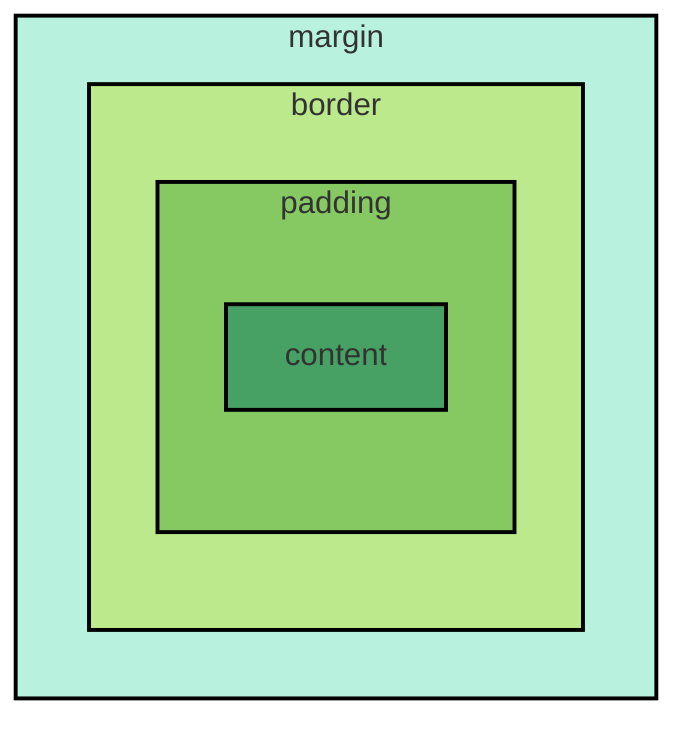
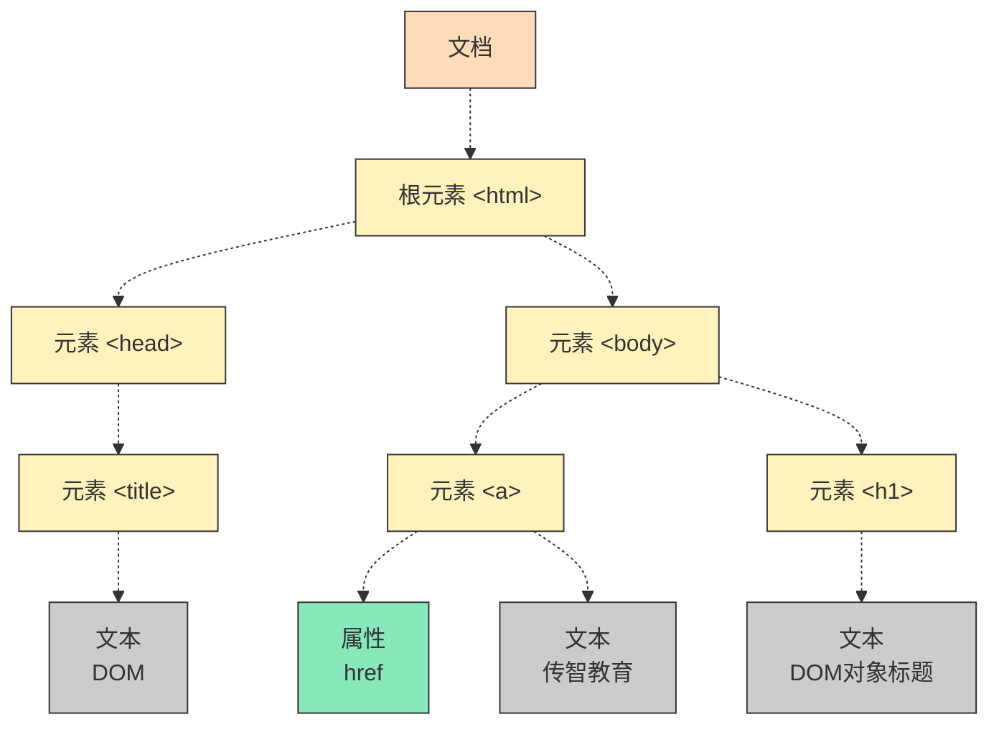

# day0

1. **AI自动生成代码：alt+p** 

2. **编码设定：**

    ```text
    Setting → Editor → File Encodings
    ```

    默认为 **ISO-8859-1**，需要将其修改为 **UTF-8**

3. **虚拟机挂起失败命令：**

    ```bash
    sudo sed -i 's/^SELINUX=enforcing/SELINUX=permissive/' /etc/selinux/config
    ```

    


# day1

### Web 基础

#### 1.Web 基础

代码通过浏览器转换成用户看到的网页。

浏览器对代码进行解析渲染的部分，称为**浏览器内核**

Web 标准也称网页标准，由一系列的标准组成，大部分由 W3C（World Wide Web Consortium，万维网联盟）负责制定。

三个组成部分：

- **HTML：**负责网页的结构（页面元素和内容）。
- **CSS：**负责网页的表现（页面元素的外观、位置等页面样式，如：颜色、大小等）。
- **JavaScript：**负责网页的行为（交互效果）。


**URL（Uniform Resource Locator）统一资源定位符：**

用于定位互联网上**每一个资源的完整地址**，资源可以是网页、图片、css 文件、接口、视频等。

组成：**协议://主机名:端口/路径?查询参数#锚点**


#### 2.HTML

**HTML**（HyperText Markup Language）：超文本标记语言。

◆ 超文本：超越了文本的限制，比普通文本更强大。除了文字信息，还可以定义图片、音频、视频等内容。

◆ 标记语言：由标签 "<标签名>" 构成的语言

​	➤ HTML 标签都是预定义好的。

​	➤ HTML 代码直接在浏览器中运行，HTML 标签由浏览器解析。

```html
<html>
    <head>
        <title>
            
        </title>
        <style>
            
        </style>
    </head>
    
    <body>
        
    </body>
</html>
```

| 标签         | 作用     | 属性 / 说明                                                  |
| ------------ | -------- | ------------------------------------------------------------ |
| **\<head>**  | 网页头部 | 存放浏览器识别信息（CSS 样式、字符编码、网页标题等），里面内容不会直接展示在页面上 |
| **\<body>**  | 网页主体 | 所有浏览者可见的文字、图片、视频、按钮等内容都写在这里       |
| **\<title>** | 网页标题 | 写在 **\<head>** 内部，设置浏览器标签页显示的标题，不会显示在页面正文 |
| **\<style>** | 样式标签 | 写在 **\<head>** 内部，用来书写 CSS 样式代码，控制页面元素外观 |

**语法特点：**

1.标签名不区分大小写

2.属性值可以用单引号也可以用双引号

3.结构不严谨


#### 3.CSS

 **CSS**（Cascading Style Sheet）：层叠样式表，用于控制页面的样式 (表现)


##### CSS 引入方式：

- **行内样式**：写在标签的 style 属性中（配合 JavaScript 使用）

```html
<span style="color: gray;">2024年05月15日 20:07</span>
```


- **内部样式**：写在 **style** 标签中（可以写在页面任何位置，但通常约定写在 **head** 标签中）

```html
<style>
    span {
        color: gray;
    }
</style>
```

里面的选择器会选中当前页面所有匹配该选择器的元素，为它们设置大括号内的样式


- **外部样式**：写在一个单独的 **.css** 文件中（需要通过 **link 标签**在网页中引入）

.css：

```css
span {
    color: gray;
}
```

html：

```html
<link rel="stylesheet" href="css/news.css">
```


##### 颜色表示形式

| 表示方式       | 属性值        | 说明                                  | 示例                                             |
| -------------- | ------------- | ------------------------------------- | ------------------------------------------------ |
| 关键字         | 颜色英文单词  | red、green、blue                      | red、green、blue...                              |
| rgb 表示法     | rgb(r,g,b)    | 红绿蓝三原色，取值：0‑255             | rgb(0,0,0)、rgb(255,0,0)                         |
| rgba 表示法    | rgba(r,g,b,a) | 红绿蓝三原色，a 表示透明度，取值：0‑1 | rgba(0,0,0,0.3)、rgba(255,0,0,0.5)               |
| 十六进制表示法 | #rrggbb       | #开头，将数字转换成十六进制表示       | #000000、#ff0000，简写(两位数字相同)：#000、#f00 |


**CSS 选择器是用来选取需要设置样式的元素（标签）的**

| 选择器         | 写法                          | 示例                     | 示例说明                                      |
| -------------- | ----------------------------- | ------------------------ | --------------------------------------------- |
| **元素选择器** | 元素名称 {...}                | h1 {...}                 | 选择页面上所有的 `<h1>`标签                   |
| **类选择器**   | .class 属性值 {...}           | .cls {...}               | 选择页面上所有 class 属性为 cls 的标签        |
| **id 选择器**  | #id 属性值 {...}              | #hid {...}               | 选择页面上 id 属性为 hid 的标签               |
| 分组选择器     | 选择器 1, 选择器 2 {...}      | h1,h2 {...}              | 选择页面上所有的 `<h1>` 和 `<h2>`标签         |
| 属性选择器     | 元素名称 [属性] {...}         | input[type] {...}        | 选择页面上有 type 属性的 `<input> `标签       |
| 属性选择器     | 元素名称 [属性名 ="值"] {...} | input[type="text"] {...} | 选择页面上 type 属性为 text 的 `<input>` 标签 |
| 后代选择器     | 元素 1 元素 2 {...}           | form input {...}         | 选择 `<form>` 标签内的所有 `<input>` 标签     |

示例：

其中优先级： id 选择器 > 类选择器 > 元素选择器

```html
<!DOCTYPE html>
<html lang="zh-CN">
<head>
    <meta charset="UTF-8">
    <title>选择器示例</title>
    <style>
        /* 1.元素选择器：选中所有h1标签 */
        h1 {
            color: blue;
            font-size:24px;
        }

        /* 2.类选择器： .cls 匹配 class="cls" */
        .cls {
            color: green;
            font-weight:bold;
        }

        /* 3.id选择器：#hid 匹配 id="hid" */
        #hid {
            color: red;
            font-size:28px;
        }
    </style>
</head>
<body>
    <!-- 元素选择器作用于此 -->
    <h1>我是h1标题，受元素选择器控制</h1>

    <!-- 类选择器，多个标签可以共用同一个class -->
    <div class="cls">我使用 class="cls"</div>
    <p class="cls">我也使用 class="cls"</p>

    <!-- id选择器：同一个 id 属性值，在整个 HTML 页面里面，只能给一个标签使用 -->
    <div id="hid">我使用 id="hid"</div>
</body>
</html>

```


#### 4.盒子模型

- **盒子**

    页面中所有的元素（标签），都可以看做是一个盒子，由盒子将页面中的元素包含在一个矩形区域内，通过盒子的视角更方便的进行页面布局

- **盒子模型组成**

    **内容区域（content）、内边距区域（padding）、边框区域（border）、外边距区域（margin）**



| 区域     | 属性           | 简写参数规则                                                 |
| :------- | :------------- | :----------------------------------------------------------- |
| 内容区域 | width / height | 1 个参数，px / % /auto，设置内容宽高                         |
| 内边距   | padding        | 1‑4 个参数，顺时针：上、右、下、左，只接受长度单位 (px/em)，不能写颜色、样式 |
| 边框     | border         | 复合属性固定 3 参数：宽度、样式、颜色，不支持四方向简写，style 必须写（solid/dashed/dotted/none），缺一不可 |
| 外边距   | margin         | 1‑4 个参数，顺时针：上、右、下、左，支持 px、auto、负数，不能写颜色 |


- **布局标签**：

    网页开发中，会使用 div 和 span 这两个没有语义的布局标签。

    特点：

    - **\<div>** 标签：
        - 一行只显示一个（独占一行）
        - 宽度默认是父元素的宽度，高度默认由内容撑开
        - 可以设置宽高（width、height）
    - **\<span>** 标签：
      - 一行可以显示多个
      - 宽度和高度默认由内容撑开
      - 不可以设置宽高（width、height）


#### 5.JavaScript

简称 **JS**，是一门跨平台、面向对象的脚本语言，是用来控制网页行为，实现页面的交互效果。 JavaScript 和 Java 是完全不同的语言，不论是概念还是设计。但是基础语法类似。

组成：

- **ECMAScript**：规定了 JS 基础语法核心知识，包括变量、数据类型、流程控制、函数、对象等。
- **BOM**：浏览器对象模型，用于操作浏览器本身，如：页面弹窗、地址栏操作、关闭窗口等。
- **DOM**：文档对象模型，用于操作 HTML 文档，如：改变标签内的内容、改变标签内字体样式等。


##### 内部脚本

将 JS 代码定义在 HTML 页面中

- **JavaScript 代码必须位于 \<script> \</script> 标签之间**
- 在 HTML 文档中，可以在**任意地方**，放置任意数量的 **\<script>**
- 一般会把脚本置于 **\<body>** 元素的底部，可改善显示速度

```html
<body>
    <!-- 页面内容 -->

    <script>
        alert('Hello World');
    </script>
</body>
```

##### 外部脚本

将 JS 代码定义在外部 JS 文件中，然后引入到 HTML 页面中

```javascript
alert('Hello World');
```

```html
<script src="js/demo.js"></script>
```


# day2

### 正文排版

#### 1.正文排版

| 标签               | 作用   | 属性 / 说明                                        |
| ------------------ | ------ | -------------------------------------------------- |
| `<h1>~<h6>`        | 标题   | h1 最大，h6 最小；h1 页面仅使用 1 次，自带上下间距 |
| `<p>`              | 段落   | 定义文本段落，段落之间存在间距                     |
| `<b>` / `<strong>` | 加粗   | `<strong>` 具有强调语义                            |
| `<u>` / `<ins>`    | 下划线 | `<ins>` 具有强调语义                               |
| `<i>` / `<em>`     | 倾斜   | `<em>` 具有强调语义                                |
| `<s>` / `<del>`    | 删除线 | `<del>` 具有强调语义                               |
| `<br>`             | 换行   | 单标签，强制换行                                   |

| CSS 属性           | 作用                                                       | 常用取值                                          |
| ------------------ | ---------------------------------------------------------- | ------------------------------------------------- |
| **font‑size**      | 文字字号                                                   | `px`、`em`；网页正文普遍`16px`                    |
| **line‑height**    | **行高**（一行文字整体高度，包含文字 + 上下空白，≠行间距） | 数字、px、百分比；正文常用`1.6‑1.8`               |
| **letter‑spacing** | **字间距**（单个汉字 / 字母之间距离）                      | px，正数拉开，负数收紧                            |
| **word‑spacing**   | **单词间距**（只对英文单词生效，中文无效）                 | px                                                |
| **text‑indent**    | 首行缩进                                                   | `2em`代表缩进 2 个汉字，只对块级元素生效          |
| **text‑align**     | 文本水平对齐                                               | `left`左，`center`居中，`right`右对齐             |
| **color**          | 文字颜色                                                   | 十六进制、rgb、颜色英文单词                       |
| **font‑weight**    | 字体粗细                                                   | `normal`正常，`bold`加粗；数字 400 正常，700 加粗 |
| **font‑family**    | 字体                                                       | 微软雅黑、SimSun 宋体、sans‑serif 无衬线          |

| 标签                | 作用     | 属性 / 说明                                                  |
| :------------------ | -------- | ------------------------------------------------------------ |
| `<video src="...">` | 视频标签 | `src`：指定视频 url（绝对路径 / 相对路径）`controls`：是否显示播放控件`width`：宽度（像素 / 父元素百分比）`height`：高度（像素 / 父元素百分比） |
| ``   | 图片标签 | `src`：图片资源地址`width`：图片宽度`height`：图片高度`alt`：图片加载失败时的替代文本 |
| `<audio src="...">` | 音频标签 | `src`：指定音频 url（绝对路径 / 相对路径）`controls`：是否显示播放控件 |

**资源路径写法**

- **绝对路径**
    - 绝对磁盘路径（D:/xxx.jpg）
    - 绝对网络路径（[https://xxx.jpg](https://link.wtturl.cn/?target=https%3A%2F%2Fxxx.jpg&scene=im&aid=582478&lang=zh)）
- **相对路径**
    - 当前目录：./（可以省略）
    - 上一级目录：../

| 字符实体               | 属性 / 说明 |
| ---------------------- | ----------- |
| &amp;nbsp; | 空格        |
| &amp;lt               | <           |
| &amp;gt;               | >           |

| CSS 属性        | 作用     |
| --------------- | -------- |
| **line‑height** | 设置行高 |
| **text‑inden**  | 首行缩进 |


#### 2. flex弹性布局

**flex** 是 **flexible Box** 的缩写，意为 "弹性布局"，是一种一维的布局模型。flex 布局可以为元素之间提供强大的空间分布和对齐能力

通过给父容器添加 flex 的相关属性，来控制子元素的位置和排列方式

| 属性                                            | 取值              | 含义                                |
| ----------------------------------------------- | ----------------- | ----------------------------------- |
| **display**                                     | **flex**          | 使用 flex 布局                      |
| **flex‑direction**（设置主轴）                  | **row**           | 主轴方向为 x 轴，水平向右。（默认） |
|                                                 | **column**        | 主轴方向为 y 轴，垂直向下。         |
| **justify‑content**（子元素在主轴上的对齐方式） | **flex‑start**    | 从头开始排列                        |
|                                                 | **flex‑end**      | 从尾部开始排列                      |
|                                                 | **center**        | 在主轴居中对齐                      |
|                                                 | **space‑around**  | 平分剩余空间                        |
|                                                 | **space‑between** | 先两边贴边，再平分剩余空间          |

示例：

```css
.box {
            display: flex;
            flex-direction: row;
            justify-content: space-between;
            width: 600px;
            height: 200px;
            border: 2px solid #333;
        }
```


#### 3.表单标签

##### 表单

在网页中主要负责数据采集功能，如 注册、登录等数据采集。

标签： **\<form>**


##### 表单项

不同类型的 input 元素、下拉列表、文本域等。

- **\<input>：**      定义表单项，通过 type 属性控制输入形式（text/password/...）
| type 取值                | 描述                                 |
| ------------------------ | ------------------------------------ |
| text                     | 默认值，定义单行的输入字段           |
| password                 | 定义密码字段                         |
| radio                    | 定义单选按钮                         |
| checkbox                 | 定义复选框                           |
| file                     | 定义文件上传按钮                     |
| date/time/datetime‑local | 定义日期 / 时间 / 日期时间           |
| hidden                   | 定义隐藏域                           |
| submit / reset / button  | 定义提交按钮 / 重置按钮 / 可点击按钮 |

- `<select>`：    定义下拉列表
- `<textarea>`：定义文本域
注意：表单项要想能够采集数据，必须得设置 name 属性，表示当前表单项的名字

`<label>` 标签:
作用：表单标签，绑定 input 表单元素，点击文字就能选中输入框 / 单选框 / 复选框，提升体验


##### 属性

- **action**：规定当提交表单时向何处发送表单数据，**URL**
- **method**：规定用于发送表单数据的方式。**GET**、**POST**

对比两种表单提交方式：

| 对比项   | GET              | POST                 |
| -------- | ---------------- | -------------------- |
| 数据位置 | URL 查询字符串   | HTTP 请求体          |
| 是否可见 | 地址栏可见       | 地址栏不可见         |
| 数据大小 | 有限制           | 基本无限制           |
| 安全性   | 差，明文露在 url | 较好                 |
| 适用场景 | 搜索查询         | 登录、注册、上传文件 |


#### 4.表格标签

| 标签         | 描述                                                         |
| ------------ | ------------------------------------------------------------ |
| **\<table>** | 定义表格整体                                                 |
| **\<thead>** | 用于定义表格头部 (可选)                                      |
| **\<tbody>** | 定义表格中的主体部分 (可选)                                  |
| **\<tr>**    | 表格的行，可以包裹多个 `<td>`                                |
| **\<td>**    | 表格单元格 (普通)，可以包裹内容；如果是表头单元格，可以替换为 `<th>` |


# day3

### JS

#### 1.JS基本语法

##### 变量声明（**let** 关键字）

JS 中用 **let** 关键字来声明变量（**弱类型**语言，变量可以存放不同类型的值）

变量名需要遵循如下规则：

- 只能用 字母、数字、下划线（_）、美元符号（$）组成，且数字不能开头
- 变量名严格区分大小写，如 name 和 Name 是不同的变量
- 不能使用关键字，如：let、var、if、for 等


##### 常量声明

JS 中用 **const** 关键字来声明常量 。一旦声明，常量的值就不能改变（不可以重新赋值）


##### 数据类型

JavaScript 的数据类型分为：**基本数据类型 **和 **引用数据类型**（对象）

基本数据类型：

- **number**：数字（整数、小数、NaN (Not a Number)）
- **boolean**：布尔。true，false
- **null**：对象为空。JavaScript 是大小写敏感的，因此 null、Null、NULL 是完全不同的
- **undefined**：当声明的变量未初始化时，该变量的默认值是 undefined
- **string**：字符串，单引号、双引号、反引号皆可，推荐使用单引号

使用 **typeof** 运算符可以获取数据类型：

```html
<script>
    let a = 20;
    alert(typeof a); //获取数据类型
</script>
```


##### 模板字符串

模板字符串语法：

- **\```**（反引号，英文输入模式下按键盘的 tab 键上方波浪线～那个键）
- 内容拼接变量时，使用 **${ }** 包住变量

```html
<script>
    let name = 'Tom';
    let age = 18;
    console.log('大家好，我是新入职的' + name + '，今年' + age + '岁了，请多多关照');
    console.log(`大家好，我是新入职的${name}，今年${age}岁了，请多多关照`);
</script>
```


##### 函数

通过 **function** 关键字进行定义

```js
function sayHello(name) {
  return "你好，" + name;
}
```

由于 JS 是弱类型语言，形参、返回值都不需要指定类型。在调用函数时，实参个数与形参个数可以不一致，但是建议一致

**匿名函数**

匿名函数是指一种没有名称的函数，可以通过两种方式定义：**函数表达式** 和 **箭头函数**

**1. 函数表达式**：

```js
let add = function(a, b){
  return a + b;
}
```

**2. 箭头函数**：

```js
let add = (a, b) => {
  return a + b;
}
```

匿名函数定义后，可以通过变量名直接调用，此时该变量的类型其实就是一个函数

```js
let result = add(10,20);
alert(result);
```


##### 自定义对象

定义格式：用一个大括号，里面的多个属性用逗号分隔

```js
let 对象名 = {
    属性名1: 属性值1,
    属性名2: 属性值2,
    属性名3: 属性值3,
    方法名: function (形参列表) {}
}
```

自定义对象里面的方法定义时，冒号和 function 可以省略

注意：在箭头函数中，this 并不指向当前对象，而指向当前对象的父级


#### 2.json（JavaScript Object Notation）

**JavaScript Object Notation**    **JavaScript 对象标记法**

是 JS 对象标记法书写的文本，本质上是一个 js 字符串

由于其语法简单，层次结构鲜明，现多用于作为**数据载体**，在网络中进行数据传输（前后端交互）


##### JS 中用来完成 **JSON 字符串 ↔ JS 对象** 互转的两个核心方法

| 方法                 | 转换方向              |
| -------------------- | --------------------- |
| **JSON.parse()**     | JSON 字符串 ➜ JS 对象 |
| **JSON.stringify()** | JS 对象 ➜ JSON 字符串 |


#### 3.DOM

**Document Object Model**    文档对象模型

浏览器加载 HTML 页面后，会把整个 HTML 文档里所有标签、属性、文本、注释

在内存中全部转成 **JS 可以操作的对象**，这套**对象体系**就是 **DOM**

将标记语言的各个组成部分封装为对应的对象：

- **Document**：整个文档对象
- **Element**：元素对象
- **Attribute**：属性对象
- **Text**：文本对象
- **Comment**：注释对象

```html
<html>
    <head>
        <title>DOM</title>
    </head>
    <body>
        <h1>DOM对象标题</h1>
        <a href="https://itcast.cn">传智教育</a>
    </body>
</html>
```



获取 DOM 对象

- 根据 CSS 选择器来获取 DOM 元素，获取匹配到的第一个元素：

    ```js
    document.querySelector('选择器')
    ```

- 根据 CSS 选择器来获取 DOM 元素，获取匹配到的所有元素：

    ```js
    document.querySelectorAll('选择器')
    ```

注意：得到的是一个 NodeList 节点集合，是一个伪数组（有长度、有索引的数组）


#### 4.事件监听

##### **事件**：

HTML 事件是发生在 HTML 元素上的 "事情"

**鼠标事件** 

- **click:**   鼠标点击 

- **mouseenter:**   鼠标移入 

- **mouseleave:**   鼠标移出

**键盘事件** 

- **keydown:**   键盘按下触发 

- **keyup:**   键盘抬起触发

**焦点事件** 

- **focus:**   获得焦点触发 

- **blur:**   失去焦点触发

**表单事件** 

- **input:**   用户输入时触发 

- **submit:**   表单提交时触发


##### **事件监听**：

JavaScript 可以在事件触发时，就立即调用一个函数做出响应，也称为 事件绑定或注册事件

语法：

```js
事件源.addEventListener (' 事件类型 ', 事件触发执行的函数);
```

事件监听三要素 

➤ 事件源：哪个 dom 元素触发了事件，要获取 dom 元素 

➤ 事件类型：用什么方式触发，比如：鼠标单击 click 

➤ 事件触发执行的函数：要做什么事


##### ES Module（ESM）

即 JS 模块化：把 JS 拆分成多个 js 文件，每个文件是独立模块，变量不会污染全局作用域，可以互相导入导出复用代码

> 浏览器引入：`<script type="module" src="xxx.js"></script>`

**命名导入导出**

```js
// 导出
export const PI = 3.14
export function add(a,b){}
// 导入
import { PI, add } from './math.js'
```

**默认导入导出（一个模块只能 1 个）**

```js
// 导出
export default function minus(a,b){}
// 导入，自定义名字，不加{}
import myMinus from './math.js'
```


# day4

### Vue + Ajax

#### 1.Vue

**Vue** 是一款用于构建用户界面的**渐进式（按需引入，一点点使用；想用多少就用多少）**的 JavaScript 框架，能基于数据渲染出用户看到的界面

**框架：**就是一套完整的项目解决方案，用于快速构建项目


##### MVVM

Vue 采用 **MVVM** 思想：

- **M（Model 模型）** = Vue 的数据模型（data、reactive、ref），存放业务数据，纯 JS 对象 / 变量
- **V（View 视图）** = 页面模板（HTML）
- **VM（ViewModel）** = Vue 实例，充当中间桥梁，**不用手动操作 DOM**，模型变 → 视图自动变；视图输入变 → 模型自动变（双向绑定）


##### 响应式数据

Vue 的响应式数据是经过**响应式系统代理**包装的 JavaScript 数据

在读取数据时进行依赖收集，修改数据时触发依赖的副作用，实现**数据变更自动更新视图**


##### 数据模型

Vue 的数据模型就是 **data** 里定义的变量，是页面渲染的数据源，Vue 通过响应式机制把它和视图绑定在一起，改数据页面自动更新


##### **插值表达式**

常见于 Vue，不能出现在标签内部

- **作用：**

    **把 Vue 实例中的数据（JS 表达式）动态地渲染到 HTML 页面上**

    ```html
    {{ 表达式 }}
    ```

    - 外层：**双大括号 {{ }}**，这就是插值语法标记
    - 括号内部：**JS 表达式**，不是语句

##### **数据驱动视图**

- 准备数据
- 通过插值表达式渲染页面


##### **准备**

- 引入 Vue 模块（官方提供）（注意 script 中的 type 属性为 module）
- 创建 Vue 程序的应用实例，控制视图的元素
- 准备元素 (div)，被 Vue 控制


##### 创建 Vue 应用实例

Vue 应用实例用来管理整个 Vue 应用，做全局配置，最后把应用挂载到页面 DOM 上启动运行

```html
<div id="app">
  <h1>{{message}}</h1>
</div>

<script type="module">
import { createApp } from 'https://unpkg.com/vue@3/dist/vue.esm-browser.js';
//内嵌组件
createApp({
  data() {
    return {
      message: "Hello Vue"
    }
  }
}).mount("#app");
</script>
```

- **HTML 部分**

    ```html
    <div id="app">
      <h1>{{message}}</h1>
    </div>
    ```

    - **\<div id="app">：**Vue 的挂载容器，Vue 会接管这个 DOM 内部
    - **{{message}}：**Vue 的**插值语法**，把 data 里 message 的值渲染到页面

- **script 标签 type="module"**
    - 声明这是 **ES Module** 模块，支持 **import 导入**，浏览器原生支持
    - 必须加，否则 import 语法报错

- **import 导入 Vue**

    ```js
    import { createApp } from 'https://unpkg.com/vue@3/dist/vue.esm-browser.js';
    ```

    - 从 unpkg CDN 远程加载 Vue3 的浏览器 ESM 版本
    - 解构拿到 createApp：Vue3 创建应用实例的核心 API

- **createApp 创建应用**

    ```js
    createApp({
      data() {
        return {
          message: "Hello Vue"
        }
      }
    })
    ```

    - **createApp(选项对象)：**传入组件选项
    - **data( )：**选项式 API，必须是函数，返回响应式数据对象；里面的属性可以直接在模板使用
    - **message：**这里 message 就是响应式变量，模板里 {{message}} 读取它

- **.mount("#app")**
    - 挂载方法，选择器 **#app** 对应上面 **id="app"** 的 div
    - 作用：**把 Vue 实例挂载到 DOM**，开始渲染模板


##### 常用指令

- 指令：HTML 标签上带有 **v‑ 前缀**的特殊属性，不同的指令具有不同的含义，可以实现不同的功能

```html
<p v-xxx="..."> ... </p>
```

| 指令                          | 作用                                                  |
| ----------------------------- | ----------------------------------------------------- |
| **v‑for**                     | 列表渲染，遍历容器的元素或者对象的属性                |
| **v‑bind**                    | 为 HTML 标签绑定属性值，如设置 href ，css 样式等      |
| **v‑if / v‑else‑if / v‑else** | 条件性的渲染某元素，判定为 true 时渲染，否则不渲染    |
| **v‑show**                    | 根据条件展示某元素，区别在于切换的是 display 属性的值 |
| **v‑model**                   | 在表单元素上创建双向数据绑定                          |
| **v‑on**                      | 为 HTML 标签绑定事件                                  |


##### v‑for

- 作用：列表渲染，遍历容器的元素或者对象的属性

- 语法：

    ```html
    <tr v-for="(item,index) in items" :key="shturl."> 
        {{item}}
    </tr>
    ```

- 参数说明：

    - **items** 为遍历的数组

    - **item** 为遍历出来的元素

    - **index** 为索引 / 下标，从 0 开始；可以省略

        省略 index 语法：

        ```html
        <tr v-for="item in items" :key="shturl."> 
            {{item}}
        </tr>
        ```

- **key**：

    - 作用：给元素添加的唯一标识，便于 vue 进行列表项的正确排序复用，提升渲染性能
    - 推荐使用 id 作为 key（唯一），不推荐使用 index 作为 key（会变化，不对应）

注意：遍历的数组，必须在 data 中定义；要想让哪个标签循环展示多次，就在哪个标签上使用 v‑for


##### v‑bind

- 作用：用来把属性值当成 **JS 表达式** 执行； 不加 v-bind，属性值就是**纯字符串字面量**

- 语法：**v‑bind : 属性名 = " 属性值 "**

    ```html
    
    ```

- 简化：**: 属性名 = " 属性值 "**

    ```html
    
    ```

    

##### v‑if

- 语法：**v‑if = " 表达式 "**

    表达式值为 true，显示；false，隐藏

- 原理：基于条件判断，来控制创建或移除元素节点（条件渲染）

- 场景：要么显示，要么不显示，不频繁切换的场景（不符合条件不会渲染）

- 其它：可以配合 v‑else‑if /v‑else 进行链式调用条件判断


##### v‑show

- 语法：**v‑show = " 表达式 "**

    表达式值为 true，显示；false，隐藏

- 原理：基于 CSS 样式 display 来控制显示与隐藏（所有选项均会渲染）

- 场景：频繁切换显示隐藏的场景


##### v‑model

- 作用：在表单元素上使用，**双向数据绑定**（**模型 (JS 数据) ⇋ 视图 (页面表单)**，把**表单控件的值**和**JS 里的数据**绑在一起，**改一边，另一边自动跟着变**
- 语法：**v‑model = " 变量名 "**

```html
<input type="text" id="name" v‑model="searchForm.name">
```

注意：v‑model 中绑定的变量，必须在 data 中定义

```js
createApp({
  data() {
    return {
      //定义数据模型，采集员工搜索表单数据
      searchForm: {
        name: '',
        gender: '',
        job: ''
      }
    }
  }
}).mount('#container')
```


##### v‑on

- 作用：为 html 标签绑定事件（添加事件监听）

- 语法：

    - **v‑on : 事件名 = "方法名"**

    - 简写为 

        **@事件名 = "..."**
        
        ```vue
        <div id="app">
          <button type="button" v‑on:click="handle">点我</button>
          <button type="button" @click="handle">再点我</button>
        </div>
        ```

```js
const app = createApp({
  data() {
    //...
  },
  // 注意方法与data平级
  methods: {
    handle() {
      console.log('试试就试试');
    }
  },
}).mount('#app');
```

注意：methods 函数中的 this 指向 Vue 实例，可以通过 this 获取到 data 中定义的数据


#### 2.Ajax

##### 概念

- **介绍**：**Asynchronous JavaScript And XML**，异步的 JavaScript 和 XML

​	XML：（英语：Extensible Markup Language）可扩展标记语言，本质是一种数据格式，可以用来存储复杂的数据结构。

- **作用**
    1. **数据交换**：通过 Ajax 可以**给服务器发送请求，并获取服务器响应的数据**
    2. **异步交互**：可以在不重新加载整个页面的情况下，与服务器交换数据并更新部分网页的技术，如：搜索联想、用户名是否可用的校验等等。


##### 同步与异步

- **同步**：客户端发出请求后**阻塞等待**，服务器处理的时间内客户端不能做别的操作，收到响应后才继续执行。
- **异步**：客户端发送请求后**不会阻塞**，可继续执行其他任务；服务器处理完毕返回响应后，再处理返回结果。


##### Axios

- 介绍：

    **Axios 对原生的 Ajax 进行了封装**，简化书写，快速开发

    是一个基于 Promise 的 HTTP 客户端库，用于在浏览器和 Node.js 中发送 HTTP 请求(比如向服务器请求数据、提交表单等)

    网页需要从服务器获取数据,或者向服务器提交数据。浏览器原生提供了 **fetch** 和 **XMLHttpRequest** 两种方式，但它们用起来比较麻烦，比如:

    - 需要手动把响应转成 JSON
    - 错误处理不直观（即使服务器返回 404/500，fetch 也不会 reject）
    - 没有超时控制
    - 不支持请求/响应拦截器
    - 老浏览器兼容性差

    Axios 把这些都封装好了，用起来更简单、更强大

- 官网：https://www.axios-http.cn/

- 步骤：
    - 引入 Axios 的 js 文件（参照官网）
    
    - 使用 Axios 发送请求，并获取响应结果
    
        ```js
        //引入 Axios 的 js 文件
        <script src="https://unpkg.com/axios/dist/axios.min.js"></script>
        
        axios({
          method: 'GET',
          url: 'https://web-server.itheima.net/emps/list'
        }).then((result) => {
          console.log(result.data);
        }).catch((err) => {
          alert(err);
        });
        ```
    
        参数说明：
    
        - **method** ：请求方式，GET/POST
        - **url** ：请求路径
        - **data** ：请求数据 (POST)
        - **params** ：发送请求时携带的 url 参数 如：**...?key=val**
    
        **then：**成功回调函数，参数 result 是响应回来的数据
    
        **catch：**失败回调函数，参数 err 是失败回调


##### Axios‑请求方式别名

- 为了方便起见，Axios 已经为所有支持的请求方法提供了别名
- 格式：**axios.请求方式(url [, data [, config] ] )**

```js
axios.get('https://mock.apifox.cn/m1/3083103-0-default/emps/list').then((result) => {
  console.log(result.data);
}).catch((err) => {
  console.log(err);
});
axios.post('https://mock.apifox.cn/m1/3083103-0-default/emps/update','id=1').then((result) => {
  console.log(result.data);
}).catch((err) => {
  console.log(err);
});
```

可以直接 **.thenc** 自动生成两个回调


##### async & await

- 可以通过 **async**、**await** 可以让异步变为同步操作，因为有些代码必须要等到返回上一步的返回结果才能调用

    async 就是来声明一个异步方法，await 是用来等待异步任务执行

```js
methods: {
  async search(){
    //根据用户输入的搜索条件，基于axios发送异步请求(https://web‑server.itheima.net/emps/list)到服务端...
    let result = await axios.get('https://web‑server.itheima.net/emps/list?name=xxx&gender=xxx&job=xxx');
    this.employees = result.data.data;
  }
}
```

可读性强、便于维护

注意：**await 关键字只在 async 函数内有效**，await 关键字取代 then 函数，等待获取到请求成功的结果值


##### Vue 生命周期

- 生命周期：指一个对象从创建到销毁的整个过程。
- 生命周期的**八个阶段**：每触发一个生命周期事件，会自动执行一个生命周期方法 (钩子，Vue底层自动调用)

| 状态          | 阶段周期   |
| ------------- | ---------- |
| beforeCreate  | 创建前     |
| created       | 创建后     |
| beforeMount   | 载入前     |
| mounted       | 挂载完成   |
| beforeUpdate  | 数据更新前 |
| updated       | 数据更新后 |
| beforeUnmount | 组件销毁前 |
| unmounted     | 组件销毁后 |

**典型应用场景：**

在页面加载完毕时，发起异步请求，加载数据，渲染页面


# day5

### Maven + JUnit

#### 1.Maven

**Maven** 是一款用于管理和构建 Java 项目的项目工程管理规范 + 执行工具，是 apache 旗下的一个开源项目，它基于**项目对象模型（POM）**的概念，通过一小段描述信息来管理项目的构建。

- **依赖管理**：方便快捷的管理项目依赖的资源（jar 包）
- **项目构建**：标准化的跨平台（Linux、Windows、MacOS）的自动化项目构建方式
- **统一项目结构**：提供标准、统一的项目结构

官网：http://maven.apache.org/


##### 项目对象模型（POM，Project Object Model）

对应文件就是 **pom.xml**，是 Maven 项目的**核心配置文件**

它把整个项目抽象成一个对象模型，里面记录项目自身信息：项目名称、版本、打包方式、构建配置、插件、以及所有依赖声明。Maven 就是读取这个 xml 文件，来完成项目构建、依赖下载管理。一个 Maven 项目必须要有 pom.xml


##### 依赖管理模型（Dependency）

**\<dependency>** 是写在 pom.xml 里面的标签，代表一个外部依赖（第三方 jar 包）

 每个 dependency 通过 **groupId、artifactId、version** 三个坐标，定位仓库里的 jar 包。告诉 Maven 本项目需要引入哪个第三方库


##### 仓库

用于存储资源，管理各种 jar 包。

- **本地仓库**：自己计算机上的一个目录。
- **中央仓库**：由 Maven 团队维护的全球唯一的。 仓库地址：https://repo1.maven.org/maven2/
- **远程仓库** (私服)：一般由公司团队搭建的私有仓库。

如果本地仓库没有，则会联网下载到本地仓库


#### 2.Maven项目目录结构

**1. src：源代码目录，存放项目所有源码**

- **main**：写正式业务代码，程序运行要用，打包**会被打进 jar 包**
    - **java**：专门存放项目正式、上线运行的 Java 源代码（.java 文件），是 Maven 标准的主 Java 源代码目录

    - **resources**：存放测试环境专用**配置文件**，只有运行单元测试的时候，才会读取这个目录下的配置

**2. test**：写 Junit 单元测试，只本地测试用，打包不会包含这部分代码

- **java**：存放单元测试的 Java 代码（Junit 测试类）IDE 标记：**绿色**，代表测试源码根目录

    只有被标记为绿色，测试类才能被识别运行

**3. target**：全部由 Maven 自动生成，存放**编译后的 class、jar 包**。 可以随时删除，执行 mvn compile 会重新生成

- **classes**：是 Maven 编译 src/main/java 之后的输出目录，里面存放**编译生成的 .class 字节码文件**和**复制过来的资源文件**

**4. pom.xml**：Maven 项目的灵魂，所有 jar 包依赖都在这里配置。没有这个文件就不是 Maven 项目


#### 3.Maven项目导入

- 方式1：**File** -> **Project Structure** -> **Modules** -> **Import Module** -> 选择 **maven 项目的 pom.xml**
- 方式2：**Maven 面板** -> **+(Add Maven Projects)** -> 选择 **maven 项目的 pom.xml**

建议将要导入的 maven 项目复制到你的项目目录下

建议选择 maven 项目的 **pom.xml 文件**进行导入


#### 4.Maven标签

| project 直接子标签       | 作用                             |
| ------------------------ | -------------------------------- |
| **modelVersion**         | POM 模型版本，固定值 4.0.0，必填 |
| **parent**               | 继承父 POM，SpringBoot 项目使用  |
| **groupId**              | 组织 ID，Maven 坐标              |
| **artifactId**           | 模块 ID，Maven 坐标              |
| **version**              | 项目版本，Maven 坐标             |
| **packaging**            | 打包方式：jar/war/pom，默认 jar  |
| **name**                 | 项目名称，IDE 展示               |
| **description**          | 项目描述                         |
| **url**                  | 项目主页地址                     |
| **licenses**             | 开源许可证信息                   |
| **developers**           | 开发者信息                       |
| **contributors**         | 贡献者信息                       |
| **scm**                  | 源码管理 (Git) 配置              |
| **properties**           | 定义 Maven 变量                  |
| **dependencies**         | 所有依赖集合                     |
| **dependencyManagement** | 依赖版本管理，控制子模块依赖版本 |
| **modules**              | 聚合工程，声明子模块             |
| **build**                | 构建配置：插件、资源、输出名     |
| **profiles**             | 多环境配置 (开发 / 测试 / 生产)  |
| **repositories**         | Maven 仓库配置                   |
| **pluginRepositories**   | 插件仓库配置                     |


#### 5.Maven依赖配置

##### 依赖：

指当前项目运行所需要的 jar 包，一个项目中可以引入多个依赖。

##### 配置：

1. 在 pom.xml 中编写 **\<dependencies>** 标签
2. 在 **\<dependencies>** 标签中 使用 **\<dependency>** 引入坐标
3. 定义坐标的 **groupId（组织名）**, **artifactId（模块名）**, **version（版本号）**
4. 点击刷新按钮，引入最新加入的坐标

如果不知道依赖的坐标信息，可以到 https://mvnrepository.com/ 中搜索

##### 依赖传递：

A 依赖 B，B 又依赖 C，Maven 会自动把 C 也引入到 A 项目里，这个现象就是依赖传递

##### 排除依赖：

主动断开依赖的资源，被排除的资源无需指定版本，在 **\<dependency>** 标签里面用 **\<exclusions>** 标签排除

##### 注意事项：

- 一旦依赖配置变更了，记得重新加载
- 引入的依赖本地仓库不存在，记得联网


#### 6.Maven生命周期

##### Build lifecycle & phases

构建生命周期 & 阶段

- **lifecycle**：生命周期，一套完整的项目构建流程
- **phases**：阶段，生命周期里面一步一步的执行步骤

Maven 的生命周期就是为了对所有的 maven 项目构建过程进行抽象和统一

**Maven 中有 3 套相互独立的生命周期：**

- **clean**：清理工作
- **default**：核心工作，如：编译、测试、打包、安装、部署等
- **site**：生成报告、发布站点等

| 生命周期类型 | 生命周期阶段                                                 |
| ------------ | ------------------------------------------------------------ |
| **clean**    | pre-clean、**clean**、post-clean                             |
| **default**  | validate、initialize、generate-sources、process-sources、generate-resources、process-resources、**compile**、process-classes、generate-test-sources、process-test-sources、generate-test-resources、process-test-resources、test-compile、process-test-classes、**test**、prepare-package、**package**、verify、**install**、deploy |
| **site**     | pre-site、site、post-site、site-deploy                       |

- **clean**：移除上一次构建生成的文件
- **compile**：编译项目源代码
- **test**：使用合适的单元测试框架运行测试 (junit)
- **package**：将编译后的文件打包，如：jar、war 等
- **install**：安装项目到本地仓库

在同一套生命周期中，**当运行后面的阶段时，前面的阶段都会运行**

**执行指定生命周期的两种方式：**

- 在 idea 中，右侧的 maven 工具栏，选择 **Lifecycle** 选项，选中对应的生命周期，双击执行

- 在命令行中，通过命令执行，在含有 **xml** 的目录输入 **cmd** 

    ```shell
    # 打包
    mvn package
    
    # 打包，跳过单元测试
    mvn package -DskipTests
    ```


#### 6.Maven测试

##### 测试

是一种用来促进鉴定软件的正确性，完整性，安全性和质量的过程


##### 阶段划分

**单元测试，集成测试，系统测试，验收测试**

|   测试类型   | 介绍                                                         | 目的                                         | 测试人员      |
| :----------: | ------------------------------------------------------------ | -------------------------------------------- | ------------- |
| **单元测试** | 对软件的基本组成单位进行测试，最小测试单位                   | 检验软件基本组成单位的正确性                 | 开发人员      |
| **集成测试** | 将已分别通过测试的单元，按设计要求组合成系统或子系统，再进行的测试 | 检查单元之间的协作是否正确                   | 开发人员      |
| **系统测试** | 对已经集成好的软件系统进行彻底的测试                         | 验证软件系统的正确性、性能是否满足指定的要求 | 测试人员      |
| **验收测试** | 交付测试，是针对用户需求、业务流程进行的正式的测试           | 验证软件系统是否满足验收标准                 | 客户 / 需求方 |


##### 测试方法

**白盒测试，黑盒测试，灰盒测试**

| 测试方法     | 核心特点                                                     | 测试目的                     |
| ------------ | ------------------------------------------------------------ | ---------------------------- |
| **白盒测试** | 清楚软件内部结构、代码逻辑                                   | 验证代码、逻辑的正确性       |
| **黑盒测试** | 不清楚软件内部结构、代码逻辑                                 | 验证软件的功能、兼容性等方面 |
| **灰盒测试** | 结合白盒测试和黑盒测试的特点，既关注软件内部结构，又考虑外部功能表现 | 兼顾内部逻辑与外部功能的验证 |


#### 7. JUnit

最流行的 Java 测试框架之一，提供了一些功能，方便程序进行单元测试（第三方公司提供）

| 对比项       | main 方法测试                  | JUnit 单元测试                                             |
| ------------ | ------------------------------ | ---------------------------------------------------------- |
| 代码分离     | 测试代码与源代码未分开，难维护 | 测试代码与源代码分开，便于维护                             |
| 测试相互影响 | 一个方法测试失败，影响后面方法 | 各个测试相互独立互不影响                                   |
| 自动化与报告 | 无法自动化测试，得到测试报告   | 可根据需要进行自动化测试，可自动分析测试结果，产出测试报告 |


##### 测试步骤：

1. 在 pom.xml 中引入依赖

```xml
<dependency>
    <groupId>org.junit.jupiter</groupId>
    <artifactId>junit-jupiter</artifactId>
    <version>5.9.1</version>
</dependency>
```

2. 在 **test/java** 目录下，创建测试类，并编写对应的测试方法，并在方法上声明 **@Test** 注解

```java
@Test
public void testGetAge(){
}
```

3. 运行单元测试（测试通过：绿色；测试失败：红色）

**注意：**

- Junit 单元测试类命名规范为：**xxxxxTest**【规范】

- Junit 单元测试的方法，必须声明为 **public**


##### 断言

JUnit 提供了一些辅助方法，用来帮我们确定被测试的方法是否按照预期的效果正常工作

工具类 **Assertions** 中提供了一系列断言方法

| 断言方法                                                     | 描述                                       |
| ------------------------------------------------------------ | ------------------------------------------ |
| Assertions.**assertEquals**(Object exp, Object act, String msg) | 检查两个值是否相等，不相等就报错。         |
| Assertions.**assertNotEquals**(Object unexp, Object act, String msg) | 检查两个值是否不相等，相等就报错。         |
| Assertions.**assertNull**(Object act, String msg)            | 检查对象是否为 null，不为 null，就报错。   |
| Assertions.**assertNotNull**(Object act, String msg)         | 检查对象是否不为 null，为 null，就报错。   |
| Assertions.**assertTrue**(boolean condition, String msg)     | 检查条件是否为 true，不为 true，就报错。   |
| Assertions.**assertFalse**(boolean condition, String msg)    | 检查条件是否为 false，不为 false，就报错。 |
| Assertions.**assertThrows**(Class expType, Executable exec, String msg) | 检查两个对象引用是否相等，不相等，就报错。 |

上述方法形参中的最后一个参数 msg，表示错误提示信息，可以不指定（有对应的重载方法）


##### 注解

| 注解                   | 说明                                                         | 备注                               |
| ---------------------- | ------------------------------------------------------------ | ---------------------------------- |
| **@Test**              | 测试类中的方法用它修饰才能成为测试方法，才能启动执行         | 单元测试                           |
| **@ParameterizedTest** | 参数化测试的注解（可以让单个测试运行多次，每次运行时仅参数不同） | 用了该注解，就不需要 @Test 注解了  |
| **@ValueSource**       | 参数化测试的参数来源，赋予测试方法参数                       | 与 **@ParameterizedTest** 配合使用 |
| **@DisplayName**       | 指定测试类、测试方法显示的名称 （默认为类名、方法名）        |                                    |
| **@BeforeEach**        | 用来修饰一个实例方法，该方法会在每一个测试方法执行之前执行一次。 | 初始化资源 (准备工作)              |
| **@AfterEach**         | 用来修饰一个实例方法，该方法会在每一个测试方法执行之后执行一次。 | 释放资源 (清理工作)                |
| **@BeforeAll**         | 用来修饰一个**静态**方法，该方法会在所有测试方法之前只执行一次。 | 初始化资源 (准备工作)              |
| **@AfterAll**          | 用来修饰一个**静态**方法，该方法会在所有测试方法之后只执行一次。 | 释放资源 (清理工作)                |

```java
@ParameterizedTest
@ValueSource(ints = {2,4,6,8})
void testEvenNumber(int num){
    assertTrue(num % 2 == 0);
}
```


#### 8.依赖范围

依赖的 jar 包，默认情况下，可以在任何地方使用。可以通过 **`<scope>...</scope>`** 设置其作用范围

```xml
<dependency>
    <groupId>org.junit.jupiter</groupId>
    <artifactId>junit-jupiter</artifactId>
    <version>5.9.3</version>
    <scope>test</scope>
</dependency>
```

作用范围： 

➤ 主程序范围有效（main 文件夹范围内） 

➤ 测试程序范围有效（test 文件夹范围内） 

➤ 是否参与打包运行（package 指令范围内）

| scope 值            | 主程序 | 测试程序 | 打包（运行） | 范例        |
| ------------------- | ------ | -------- | ------------ | ----------- |
| **compile**（默认） | Y      | Y        | Y            | log4j       |
| **test**            | -      | Y        | -            | junit       |
| **provided**        | Y      | Y        | -            | servlet‑api |
| **runtime**         | -      | Y        | Y            | jdbc 驱动   |


#### 9.常见问题

有时依赖会爆红

产生原因：由于网络原因，依赖没有下载完整导致的，在 maven 仓库中生成了 **xxx.lastUpdated** 文件，该文件不删除，不会再重新下载

解决方案：

1. 根据 maven 依赖的坐标，找到仓库中对应的 xxx.lastUpdated 文件，删除，删除之后重新加载项目即可

2. 通过命令（**del /s *.lastUpdated**）批量递归删除指定目录下的 xxx.lastUpdated 文件，删除之后重新加载项目即可

    ```cmd
    del /s *.lastUpdated
    ```

    - **del：**删除文件命令
    - **/s：**递归，包含所有子文件夹
    - ***.lastUpdated：**所有后缀为 **.lastUpdated** 的文件


# day6

## Spring+http

**静态资源：**

服务器上存储的不会改变的数据，通常不会根据用户的请求而变化，比如图片、视频等（负责页面展示）

**动态资源：**

服务器端根据用户请求和其他数据动态生成的，内容可能会在每次请求时都发生变化，比如：**Spring 框架等资源**

**B/S 架构：**

Browser/Server，浏览器 / 服务器架构模式。客户端只需浏览器，应用程序的逻辑和数据都存在服务器端（维护方便 / 体验一般）

**C/S 架构：**

Client/Server，客户端 / 服务器架构模式。需要单独开发维护客户端（体验不错，开发维护麻烦）


### 1.Spring

Spring 是开源、轻量级的 Java 企业级开发框架，核心是 **IoC 容器** + **AOP**，用来解耦组件，简化 Java 后端开发

官网：https://spring.io

#### Spring 生态圈（Spring 全家桶）

Spring 发展至今已经形成一套开发生态圈，由多个子项目组成，每个子项目负责特定功能

1. **Spring Framework（Spring 框架）** 提供核心能力：依赖注入、事务管理、Web 应用、数据访问、消息等底层核心支持，是整个 Spring 生态的基础。
2. **Spring Boot** 以**约定大于配置**的思想构建 Spring 应用，快速搭建、运行 Spring 项目，简化配置。
3. **Spring Cloud** 提供分布式系统常用组件工具集，用于搭建、部署微服务。
4. **Spring Data** 统一的数据访问方案，支持关系型数据库、非关系型数据库、Map‑Reduce 等数据操作。
5. **Spring Security** 全面、可扩展的认证与授权框架，做应用安全防护。

> 以上统称为**Spring 全家桶**，还有其他更多子项目

| 对比项       | Spring Framework（Spring 框架）                              | Spring Boot                                   |
| ------------ | ------------------------------------------------------------ | --------------------------------------------- |
| **定位**     | Spring 生态底层核心框架，提供基础能力                        | 基于 Spring Framework，用于快速开发的脚手架   |
| **核心功能** | 提供依赖注入、事务管理、Web、数据访问、消息等全套底层 API    | 在 Spring 基础上封装，**约定大于配置**        |
| **配置方式** | 大量 XML / 注解配置，**配置繁琐**                            | 自动配置，极大减少配置文件                    |
| **开发效率** | 搭建项目步骤多，开发慢                                       | 快速搭建项目，开箱即用，开发效率高            |
| **入门难度** | 门槛高，需要掌握大量配置                                     | 门槛低，快速上手                              |
| **服务器**   | 需要手动部署外部 Tomcat                                      | **内置 Tomcat/Jetty**，直接运行 main 方法启动 |
| **依赖管理** | 手动管理版本，处理依赖冲突                                   | 自动管理依赖版本，无需手动控制                |
| **关系**     | Spring Boot 底层就是 Spring Framework，Boot 不能脱离 Framework 独立工作 | **封装 Spring Framework**，简化它的使用       |

Spring Boot 可以帮助我们非常快速的构建应用程序、简化开发、提高效率


#### 启动类

启动类就是 SpringBoot 项目的**程序入口**，整个项目从这里执行

##### **@SpringBootApplication**

标记这是 SpringBoot 启动类，三合一：开启自动配置、组件扫描、配置类

```java
@SpringBootConfiguration
@EnableAutoConfiguration
@ComponentScan(excludeFilters = { @Filter(type = FilterType.CUSTOM, classes = TypeExcludeFilter.class),
		@Filter(type = FilterType.CUSTOM, classes = AutoConfigurationExcludeFilter.class) })
public @interface SpringBootApplication {
```

1. **@SpringBootConfiguration：**该注解与 **@Configuration** 注解作用相同，用来声明当前也是一个配置类，支持通过 @Bean 注解向 IOC 容器注册 Bean 对象

2. **@ComponentScan（组件扫描）**：默认扫描启**动类所在包及其全部子包**，将 **@Component** 等组件注解修饰的类加载到 IOC 容器

3. **@EnableAutoConfiguration（开启自动配置）**：依据项目引入的 jar 包依赖，自动加载框架预设的配置类，自动装配对应的 Bean，减少手动配置

     底层：

    ```java
    @AutoConfigurationPackage
    @Import(AutoConfigurationImportSelector.class)
    public @interface EnableAutoConfiguration {}
    ```

    **@Import(AutoConfigurationImportSelector.class)：**导入**ImportSelector 接口实现类**

    AutoConfigurationImportSelector 执行接口方法：**String[] selectImports(...)**，会读取 jar 包中的资源文件，返回一批配置类的全类名数组

    **spring‑boot‑autoconfigure‑xxx.jar → META‑spring/org.springframework.boot.autoconfigure.AutoConfiguration.imports**

    文件里面存放大量自动配置类的全限定类名，封装到 String 数组中由 @Import 导入 IOC 容器。文件中定义的配置类非常多，而且每个配置类中又可以定义很多的bean，在声明bean对象时，上面有加一个以 @Conditional 开头的注解，这种注解的作用就是按照条件进行装配，只有满足条件之后，才会将bean注册到Spring的IOC容器中


##### main方法

运行启动类 main 方法执行 **SpringApplication.run( )** ，由于引入了 **spring‑boot‑starter‑web** 依赖携带嵌入式 Tomcat，SpringBoot 自动装配检测到该依赖后自动创建并启动 TomcatWeb 服务器

```java
@SpringBootApplication
public class SpringbootWebQuickstartApplication {
    public static void main(String[] args) {
        SpringApplication.run(SpringbootWebQuickstartApplication.class, args);
    }
}
```


##### SpringMVC

SpringMVC 是 Spring 框架里面做 Web 开发（写后端接口）的模块，专门用来处理 HTTP 请求

简单流程（浏览器 ↔ 后端）：

1. 前端浏览器发 HTTP 请求
2. 请求进到服务器，交给 SpringMVC
3. SpringMVC 根据 **@RequestMapping**，找到匹配的 Controller 方法
4. 执行 Controller，得到返回的 Java 对象
5. SpringMVC 把 Java 对象转成 **JSON**，封装成 HTTP 响应返回浏览器


##### Tomcat

是开源的 Web 服务器（**Servlet 容器**），用来接收浏览器发来的 HTTP 请求，把请求交给后端 Java 程序处理，再把结果返回给浏览器

Tomcat 实现了 Servlet 规范，可以执行 Servlet 代码。 SpringMVC 底层就是基于 Servlet

**Servlet 规范：**

是 JavaEE（Jakarta EE）定义的一套JavaWeb 接口标准，规定：Java 程序如何接收、处理 HTTP 请求

**嵌入式 Tomcat**

被打包进 **spring‑boot‑starter‑web** 依赖里面，**不需要额外安装**，项目启动时跟着程序一起启动，监听 8080 端口


##### **起步依赖（starter）**

把做某一类功能需要的一堆 **jar 包**，打包成一个**统一依赖**。只需要引入这一个 starter，所有相关 jar 自动全部导入，不用自己一个个写版本、一个个导入

- **spring‑boot‑starter‑web**：包含了 web 应用开发所需要的常见依赖
- **spring‑boot‑starter‑test**：包含了单元测试所需要的常见依赖
- 官方提供的 **starter**：https://docs.spring.io/spring‑boot/docs/3.1.3/reference/htmlsingle/#using.build‑systems.start


#### 常用注解

##### 0.@SpringBootApplication

启动类中已解释


##### 1. @RestController

1. 标记在类上，把当前类变成 **RESTful 接口控制器**
2. 类中所有方法的返回值，不再走视图解析器，直接序列化为 **JSON** 返回给前端

```java
@Target(ElementType.TYPE)
@Retention(RetentionPolicy.RUNTIME)
@Documented
@Controller
@ResponseBody
public @interface RestController {
}
```

**@Controller**

把当前类交给 Spring 容器管理，成为控制器组件

默认行为：把返回值当成视图名，跳转页面

**@ResponseBody**

覆盖 @Controller「视图跳转」的默认行为

将方法的返回值，不交给视图解析器，**直接转为 JSON 字符串**，写回到 HTTP 响应体（Response Body）返回给浏览器 / 前端


##### 2. @RequestMapping

用来映射请求地址，建立 **URL** 和 **Java** 方法之间的**映射关系**

① 写在类上：给当前控制器所有接口加统一前缀

```java
@RestController
@RequestMapping("/api/user") // 类级别：统一前缀
public class UserController {
    // 完整地址：/api/user/list
    @RequestMapping("/list")
    public List<User> list(){...}
}
```

② 写在方法上：映射具体接口地址

```java
// 访问：/api/user/add
@RequestMapping("/add")
public String add(){...}
```

| 衍生注解           | 等价的 @RequestMapping 写法                    | 对应 HTTP 请求方式  |
| ------------------ | ---------------------------------------------- | ------------------- |
| **@GetMapping**    | @RequestMapping(method = RequestMethod.GET)    | GET（查询数据）     |
| **@PostMapping**   | @RequestMapping(method = RequestMethod.POST)   | POST（新增数据）    |
| **@PutMapping**    | @RequestMapping(method = RequestMethod.PUT)    | PUT（修改全部数据） |
| **@DeleteMapping** | @RequestMapping(method = RequestMethod.DELETE) | DELETE（删除数据）  |


##### 3. @SpringBootTest

SpringBoot 的单元测试注解，写在测试类上面，会在单元测试运行时，加载 springboot 环境

```java
@SpringBootTest
class UserMapperTest {
    //测试方法
}
```

注意：测试类所在包需要与引导类包名相同 (或放在引导类所在包的子包下)


### 2.http

##### **HyperText Transfer Protocol**：

**超文本传输协议**

规定了浏览器和服务器之间数据传输的规则

特点：

1. 基于 TCP 协议：面向连接，安全
2. 基于请求‑响应模型的：一次请求对应一次响应
3. HTTP 协议是无状态的协议：对于事务处理没有记忆能力。每次请求‑响应都是独立的。

- 缺点：多次请求间不能共享数据。
- 优点：速度快


##### 请求数据格式

- **请求行**： 请求数据第一行 （请求方式、资源路径、协议）

- **请求头**： 第二行开始，格式 **key : value**

| Host                | 请求的主机名                                             |
| ------------------- | -------------------------------------------------------- |
| **User‑Agent**      | 浏览器版本                                               |
| **Accept**          | 表示浏览器能接收的资源类型                               |
| **Accept‑Language** | 表示浏览器偏好的语言，服务器可以据此返回不同语言的网页； |
| **Accept‑Encoding** | 表示浏览器可以支持的压缩类型                             |
| **Content‑Type**    | 请求主体的数据类型。                                     |
| **Content‑Length**  | 请求主体的大小（单位：字节）                             |

- **请求体**：POST请求，存放请求参数，和请求头**空行**分开

```txt
POST /brand HTTP/1.1
Accept: application/json, text/plain, */*
Accept-Encoding: gzip, deflate, br
Accept-Language: zh-CN,zh;q=0.9
Content-Length: 161
Content-Type: application/json;charset=UTF-8
Cookie: Idea-8296eb32=841b16f0-0cfe-495a-9cc9-d5aaa71501a6; JSESSIONID=0FDE4E430876BD9C5C955F061207386F
Host: localhost:8080
User-Agent: Mozilla/5.0 (Windows NT 10.0; Win64; x64) AppleWebKit/537.36 (KHTML, like Gecko) Chrome/...

{"status":1,"brandName":"黑马","companyName":"黑马程序员","id":"","description":"黑马程序员"}
```

**注意：**

Web 服务器 (Tomcat) 对 HTTP 协议的请求数据进行**解析**，并进行了封装 ( **HttpServletRequest**，这个对象里面封装了所有的请求信息)，**在调用 Controller 方法的时候传送给了该方法**。这样，就使得程序员不必直接对协议进行操作，让 web 开发更加便捷


##### 响应数据格式

- **响应行**：响应数据第一行 (协议、状态码、描述)

- **响应头**：第二行开始，格式 key: value

| 状态码分类 | 说明 |
| ---- | ---- |
| 1xx | 响应中‑临时状态码，表示请求已经接收，告诉客户端应该继续请求或者如果它已经完成则忽略它。 |
| 2xx | 成功‑表示请求已经被成功接收，处理已完成。 |
| 3xx | 重定向‑重定向到其他地方；让客户端再发起一次请求以完成整个处理。 |
| 4xx | 客户端错误‑处理发生错误，责任在客户端。如：请求了不存在的资源、客户端未被授权、禁止访问等。 |
| 5xx | 服务器错误‑处理发生错误，责任在服务端。如：程序抛出异常等等。 |


| 状态码  | 英文描述                        | 解释                                                         |
| ------- | ------------------------------- | ------------------------------------------------------------ |
| **200** | **OK**                          | **客户端请求成功，即处理成功，这是我们最想看到的状态码**     |
| **302** | **Found**                       | **指示所请求的资源已移动到由 Location 响应头给定的 URL，浏览器会自动重新访问到这个页面** |
| 304     | Not Modified                    | 告诉客户端，你请求的资源至上次取得后，服务端并未更改，你直接用你本地缓存吧。隐式重定向 |
| 400     | Bad Request                     | 客户端请求有语法错误，不能被服务器所理解                     |
| 403     | Forbidden                       | 服务器收到请求，但是拒绝提供服务，比如：没有权限访问相关资源 |
| **404** | **Not Found**                   | **请求资源不存在，一般是 URL 输入有误，或者网站资源被删除了** |
| 405     | Method Not Allowed              | 请求方式有误，比如应该用 GET 请求方式的资源，用了 POST       |
| 428     | Precondition Required           | 服务器要求有条件的请求，告诉客户端要想访问该资源，必须携带特定的请求头 |
| 429     | Too Many Requests               | 指示用户在给定时间内发送了太多请求（“限速”），配合 Retry‑After (多长时间后可以请求) 响应头一起使用 |
| 431     | Request Header Fields Too Large | 请求头太大，服务器不愿意处理请求，因为它的头部字段太大。请求可以在减少请求头域的大小后重新提交。 |
| **500** | **Internal Server Error**       | **服务器发生不可预期的错误。服务器出异常了，赶紧看日志去吧** |
| 503     | Service Unavailable             | 服务器尚未准备好处理请求，服务器刚刚启动，还未初始化好       |

| 响应头字段 | 说明 |
| ---- | ---- |
| Content‑Type | 表示该响应内容的类型，例如 text/html，application/json。 |
| Content‑Length | 表示该响应内容的长度（字节数）。 |
| Content‑Encoding | 表示该响应压缩算法，例如 gzip。 |
| Cache‑Control | 指示客户端应如何缓存，例如 max‑age=300 表示可以最多缓存 300 秒。 |
| Set‑Cookie | 告诉浏览器为当前页面所在的域设置 cookie。 |


- **响应体**：最后一部分，存放响应数据

```js
HTTP/1.1 200 OK
Content-Type: application/json
Transfer-Encoding: chunked
Date: Tue, 10 May 2022 07:51:07 GMT
Keep-Alive: timeout=60
Connection: keep-alive

[{id: 1, brandName: "阿里巴巴", companyName: "腾讯计算机系统有限公司", description: "玩玩玩"}]
```


**响应数据设置**

方式一：基于 **HttpServletResponse** 封装

```java
@RequestMapping("/response")
public void response(HttpServletResponse response) throws IOException {
    // 1.设置响应状态码
    response.setStatus(401);
    // 2.设置响应头
    response.setHeader("itheima","itheima");
    // 3.设置响应体
    response.getWriter().write("<h1>Hello Response</h1>");
}
```

方式二：基于 **ResponseEntity** 封装

```java
@RequestMapping("/response")
public ResponseEntity<String> response() {
    return ResponseEntity.status(401)      // 1.设置响应状态码
            .header("group", "itcast")     // 2.设置响应头
            .body("<h1>Hello Response</h1>"); // 3.设置响应体
}
```


# day7

### SpringBoot 标准分层+分层解耦

#### 1.SSM/SpringBoot 标准分层

##### 三层架构

- **controller**：控制层，接收前端发送的请求，对请求进行处理，并响应数据
- **service**：业务逻辑层，处理具体的业务逻辑
- **dao**：数据访问层 **(Data Access Object)**（持久层），负责数据访问操作，包括数据的增、删、改、查

 

##### 概念

**耦合**：衡量软件中各个层 / 各个模块的依赖关联程度

**内聚**：软件中各个功能模块内部的功能联系

**软件设计原则**：高内聚低耦合

- **高内聚：** 一个模块 / 类内部，所有功能高度相关，只做一件事

- **低耦合：** 模块与模块之间尽量减少依赖，不要写死强关联，最好能解耦。修改 A 模块，尽量不要影响到 B 模块

    

**控制反转**： Inversion Of Control，简称 **IOC**。对象的创建控制权由程序自身转移到外部（容器），这种思想称为控制反转

**依赖注入**： Dependency Injection，简称 **DI**。容器为应用程序提供运行时，所依赖的资源，称之为依赖注入

**Bean 对象**： IOC 容器中创建、管理的对象，称之为 **Bean**


##### IOC 详解

**Inversion of Control  控制反转**

把对象的创建、管理的权力，交给 Spring 容器，而不是程序员自己 new 对象

这样，业务代码只依赖某个接口，如果该接口下有新的实现类，则可实现这个接口并声明为该接口的 bean，不用修改业务代码

**IOC 带来的好处：**

1. 解耦：类和类之间不再硬编码 new，修改代码改动小
2. 对象统一交给 Spring 管理，方便 AOP、事务处理
3. 便于单元测试，可以替换对象

| 注解            | 说明                  | 位置                                                |
| --------------- | --------------------- | --------------------------------------------------- |
| **@Component**  | 声明 bean 的基础注解  | 不属于以下三类时，用此注解                          |
| **@Controller** | @Component 的衍生注解 | 标注在控制层类上                                    |
| **@Service**    | @Component 的衍生注解 | 标注在业务层类上                                    |
| **@Repository** | @Component 的衍生注解 | 标注在数据访问层类上（由于与 mybatis 整合，用的少） |

- 声明 **bean** 的时候，可以通过注解的 value 属性**指定 bean 的名字**，如果没有指定，**默认为类名首字母小写**

- 前面声明 bean 的四大注解，要想生效，还需要被组件扫描注解 **@ComponentScan** 扫描，默认扫描**启动类（带@SpringBootApplication）所在的包以及它下面所有子包**

- 该注解虽然没有显式配置，但是实际上已经包含在了启动类声明注解 **@SpringBootApplication** 中，默认扫描的范围是**启动类所在包及其子包**


##### DI 详解

**Dependency Injection** **属性注入**

基于 **@Autowired** 进行依赖注入的常见方式有如下三种：

**① 属性注入（快速开发）**

```java
@RestController
public class UserController {
    @Autowired
    private UserService userService;
    //......
}
```

- 优点：代码简洁、方便快速开发。

- 缺点：隐藏了类之间的依赖关系、可能会破坏类的封装性

    private本意是私有成员，只能在类内部访问，外部不能直接赋值。但 @Autowired 是 Spring 利用 Java 反射机制，直接绕过类的 set 方法、构造方法，强行给private私有属性赋值

**② 构造函数注入（官方推荐）**

```java
@RestController
public class UserController {
    private final UserService userService;
    @Autowired
    public UserController(UserService userService) {
        this.userService = userService;
    }
}
```

若构造函数只有一个，则 @Autowired 可省略

- 优点：能清晰地看到类的依赖关系、提高了代码的安全性
- 缺点：代码繁琐、如果构造参数过多，可能会导致构造函数臃肿

**③ setter 注入（最少使用）**

```java
@RestController
public class UserController {
    private UserService userService;
    @Autowired
    public void setUserService(UserService userService) {
        this.userService = userService;
    }
}
```

- 优点：保持了类的封装性，依赖关系更清晰
- 缺点：需要额外编写 setter 方法，增加了代码量


**若有多个相同类型的 bean**

如注入的类型是接口，但这个接口下有多个实现类，即有多个相同类型的 bean

@Autowired 注解，默认是按照类型进行注入的。 如果存在多个相同类型的 bean，则会报错

- **方案一：@Primary**

要用哪个实现类，就在哪个实现类上写注解

```java
@Primary
@Service
public class UserServiceImpl implements UserService {
    @Override
    public List<User> list(){
        //省略……
    }
}
```
```java
@RestController
public class UserController {
    @Autowired
    private UserService userService;
}
```

- **方案二：@Qualifier**

协助 @Autowired 使用，在注解中指定 **Bean** 的名字

```java
@RestController
public class UserController {
    @Autowired
    @Qualifier("userServiceImpl")
    private UserService userService;
}
```

- **方案三：@Resource**

单独使用，在注解中指定 **Bean** 的名字

```java
@RestController
public class UserController {
    @Resource(name = "userServiceImpl")
    private UserService userService;
}
```


# day8

### 数据库

#### 1.数据库

- **数据库：DataBase（DB）**，是存储和管理数据的仓库
- **数据库管理系统：DataBase Management System (DBMS)**，操纵和管理数据库的大型软件
- **SQL：StructuredQuery Language**，操作关系型数据库的编程语言，定义了一套操作关系型数据库统一标准

| 分类 | 全称                       | 说明                                                   |
| ---- | -------------------------- | ------------------------------------------------------ |
| DDL  | Data Definition Language   | 数据定义语言，用来定义数据库对象 (数据库，表，字段)    |
| DML  | Data Manipulation Language | 数据操作语言，用来对数据库表中的数据进行增删改         |
| DQL  | Data Query Language        | 数据查询语言，用来查询数据库中表的记录                 |
| DCL  | Data Control Language      | 数据控制语言，用来创建数据库用户、控制数据库的访问权限 |

- **关系型数据库：**建立在关系模型基础上，由多张相互连接的二维表组成的数据库。

    特点：

    - 使用表存储数据，格式统一，便于维护。
    - 使用 SQL 语言操作，标准统一，使用方便，可用于复杂查询


#### 2.MySQL

- MySQL 连接

    语法：**mysql -u 用户名 -p 密码 [-h 数据库服务器 IP 地址 -P 端口号]**

    方括号内参数可选，端口号默认为3306


#### 3. DDL（定义语言）

##### **数据库操作**

```sql
-- 查询所有数据库
show databases;

-- 查询当前数据库
select database();

-- 使用/切换数据库
use 数据库名;

-- 创建数据库
create database [if not exists] 数据库名 [default charset utf8mb4];

-- 删除数据库
drop database [if exists] 数据库名;
```

上述语法中的 database，也可以替换成 **schema** 。如：create schema db01

MySQL8 版本中，默认字符集为 **utf8mb4**


##### **表创建**

基础字段：**id**、**create_time**、**update_time**

```sql
create table tablename(
    字段1 字段类型 [约束] [comment 字段1注释],
    ......
    字段2 字段类型 [约束] [comment 字段2注释]
)[comment 表注释];
```


##### 表结构的查询、修改、删除

```sql
show tables; -- 查询当前数据库的所有表
desc 表名; -- 查询表结构
show create table 表名; -- 查询建表语句

alter table 表名 add 字段名 类型(长度) [comment 注释] [约束]; -- 添加字段
alter table 表名 modify 字段名 新数据类型(长度); -- 修改字段类型
alter table 表名 change 旧字段名 新字段名 类型(长度) [comment 注释] [约束]; -- 修改字段名与字段类型
alter table 表名 drop column 字段名; -- 删除字段
alter table 表名 rename to 新表名; -- 修改表名

drop table [if exists] 表名; -- 删除表
```


##### **约束**

约束是作用于表中字段上的规则，用于限制存储在表中的数据 

目的：保证数据库中数据的正确性、有效性和完整性

| 约束     | 描述                                             | 关键字          |
| -------- | ------------------------------------------------ | --------------- |
| 非空约束 | 限制该字段值不能为 null                          | **not null**    |
| 唯一约束 | 保证字段的所有数据都是唯一、不重复的             | **unique**      |
| 主键约束 | 主键是一行数据的唯一标识，要求非空且唯一         | **primary key** |
| 默认约束 | 保存数据时，如果未指定该字段值，则采用默认值     | **default**     |
| 外键约束 | 让两张表的数据建立连接，保证数据的一致性和完整性 | **foreign key** |

多种约束之间用空格分开


##### **数据类型**

| 类型        | 大小 (byte) | 有符号 (SIGNED) 范围                                  | 无符号 (UNSIGNED) 范围                                    | 描述              |
| ----------- | ----------- | ----------------------------------------------------- | --------------------------------------------------------- | ----------------- |
| **tinyint** | 1           | (-128，127)                                           | (0，255)                                                  | 小整数值          |
| smallint    | 2           | (-32768，32767)                                       | (0，65535)                                                | 大整数值          |
| mediumint   | 3           | (-8388608，8388607)                                   | (0，16777215)                                             | 大整数值          |
| **int**     | 4           | (-2147483648，2147483647)                             | (0，4294967295)                                           | 大整数值          |
| **bigint**  | 8           | (-2^63，2^63‑1)                                       | (0，2^64‑1)                                               | 极大整数值        |
| float       | 4           | (-3.402823466 E+38，3.402823466351 E+38)              | 0 和 (1.175494351 E‑38，3.402823466 E+38)                 | 单精度浮点数值    |
| double      | 8           | (-1.7976931348623157 E+308，1.7976931348623157 E+308) | 0 和 (2.2250738585072014 E‑308，1.7976931348623157 E+308) | 双精度浮点数值    |
| decimal     |             |                                                       |                                                           | 小数值 (精度更高) |

| 类型    | 备注                                                |
| ------- | --------------------------------------------------- |
| float   | float (5,2)：5 表示整个数字长度，2 表示小数位个数   |
| double  | double (5,2)：5 表示整个数字长度，2 表示小数位个数  |
| decimal | decimal (5,2)：5 表示整个数字长度，2 表示小数位个数 |

数值类型的选取原则：在满足业务需求的前提下，尽可能选择占用磁盘空间小的数据类型

**字符串类型**

| 类型       | 大小                  | 描述                          |
| ---------- | --------------------- | ----------------------------- |
| char       | 0‑255 bytes           | 定长字符串                    |
| varchar    | 0‑65535 bytes         | 变长字符串                    |
| tinyblob   | 0‑255 bytes           | 不超过 255 个字符的二进制数据 |
| tinytext   | 0‑255 bytes           | 短文本字符串                  |
| blob       | 0‑65 535 bytes        | 二进制形式的长文本数据        |
| text       | 0‑65 535 bytes        | 长文本数据                    |
| mediumblob | 0‑16 777 215 bytes    | 二进制形式的中等长度文本数据  |
| mediumtext | 0‑16 777 215 bytes    | 中等长度文本数据              |
| longblob   | 0‑4 294 967 295 bytes | 二进制形式的极大文本数据      |
| longtext   | 0‑4 294 967 295 bytes | 极大文本数据                  |

char 是定长字符串，varchar 是变长字符串

如果一个字段的长度是固定的，建议使用 char；

如果一个字段的长度不是固定的，建议使用 varchar；

**日期类型**

| 类型          | 大小 (byte) | 范围                                       | 格式                    | 描述                     |
| ------------- | ----------- | ------------------------------------------ | ----------------------- | ------------------------ |
| **date**      | 3           | 1000‑01‑01 至 9999‑12‑31                   | **YYYY‑MM‑DD**          | 日期值                   |
| **time**      | 3           | -838:59:59 至 838:59:59                    | **HH:MM:SS**            | 时间值或持续时间         |
| **year**      | 1           | 1901 至 2155                               | **YYYY**                | 年份值                   |
| **datetime**  | 8           | 1000‑01‑01 00:00:00 至 9999‑12‑31 23:59:59 | **YYYY‑MM‑DD HH:MM:SS** | 混合日期和时间值         |
| **timestamp** | 4           | 1970‑01‑01 00:00:01 至 2038‑01‑19 03:14:07 | **YYYY‑MM‑DD HH:MM:SS** | 混合日期和时间值，时间戳 |

**now( )** 函数获取当前系统时间


#### 4. DML（操作语言）

##### insert

```sql
-- 指定字段添加数据，值和字段名一一对应
insert into 表名(字段名1, 字段名2) values (值1, 值2);

-- 全部字段添加数据
insert into 表名 values (值1, 值2, ...);

-- 批量添加数据（指定字段）
insert into 表名 (字段名1, 字段名2) values (值1, 值2), (值1, 值2);

-- 批量添加数据（全部字段）
insert into 表名 values (值1, 值2, ...), (值1, 值2, ...);
```

1．插入数据时，指定的字段顺序需要与值的顺序是一一对应的

2．字符串和日期型数据应该包含在引号中（单引号、双引号都可以） 

3．插入的数据大小 / 长度，应该在字段的规定范围内


##### update

```sql
-- 修改数据
update 表名 set 字段名1 = 值1 , 字段名2 = 值2 , .... [ where 条件 ] ;
```

修改语句的条件可以有，也可以没有，如果没有条件，则会修改整张表的所有数据


##### delete

```sql
-- 删除数据
delete from 表名 [where 条件];
```

1. DELETE 语句的条件可以有，也可以没有，如果没有条件，则会删除整张表的所有数据
2. DELETE 语句不能删除某一个字段的值 (如果要操作，可以使用 UPDATE，将该字段的值置为 NULL)


#### 5. DQL（查询语言）

关键字：**SELECT**

```sql
select
    字段列表
from
    表名列表
where
    条件列表
group by
    分组字段列表
having
    分组后条件列表
order by
    排序字段列表
limit
    分页参数
```

- 基本查询**（select...from...）**
- 条件查询**（where）**
- 分组查询**（group by）**
- 排序查询**（order by）**
- 分页查询**（limit）**


##### 基础查询

```sql
-- 查询多个字段
select 字段1,字段2,字段3 from 表名;

-- 查询所有字段(通配符)，项目开发中不推荐
select * from 表名;

-- 为查询字段设置别名，as关键字可以省略（可以不用引号，如果别名中间有空格，则必须加引号）
select 字段1 [as 别名1], 字段2 [as 别名2] from 表名;

-- 去除重复记录
select distinct 字段列表 from 表名;
```


##### 条件查询

关键字：**WHERE**

```sql
-- 条件查询
select 字段列表 from 表名 where 条件列表 ;
```

| 比较运算符              | 功能                                       |
| ----------------------- | ------------------------------------------ |
| **>**                   | 大于                                       |
| **>=**                  | 大于等于                                   |
| **<**                   | 小于                                       |
| **<=**                  | 小于等于                                   |
| **=**                   | 等于                                       |
| **<> 或！=**            | 不等于                                     |
| **between ... and ...** | 在某个范围之内 (含最小、最大值)            |
| **in(...)**             | 在 in 之后的列表中的值，多选一             |
| **like 占位符**         | 模糊匹配 (_匹配单个字符，% 匹配任意个字符) |
| **is (not) null**       | 是(不是) null                              |

| 逻辑运算符     | 功能                         |
| -------------- | ---------------------------- |
| **and 或 &&**  | 并且（多个条件同时成立）     |
| **or 或 \|\|** | 或者（多个条件任意一个成立） |
| **not 或！**   | 非，不是                     |


##### 分组查询

**聚合函数**：将一列数据作为一个整体，进行纵向计算

| 函数  | 功能     |
| ----- | -------- |
| count | 统计数量 |
| max   | 最大值   |
| min   | 最小值   |
| avg   | 平均值   |
| sum   | 求和     |

1. null 值不参与所有聚合函数的运算。
2. 统计数量可以使用：count (*)  count (字段)  count (常量)，推荐使用 count (\*)

关键字：**GROUP BY**

```sql
-- 分组查询
select 字段列表 from 表名 [where 条件列表] group by 分组字段名 [having 分组后过滤条件];
```

**where** 与 **having** 的区别：

1. 执行时机不同：where 是分组之前进行过滤，不满足 where 条件，不参与分组；而 having 是分组之后对结果进行过滤
2. 判断条件不同：where 不能对聚合函数进行判断，而 having 可以

注意：

1. 分组之后，查询的字段一般为聚合函数和分组字段，查询其他字段无任何意义
2. 执行顺序：where > 聚合函数 > having


##### 排序查询

关键字：**ORDER BY**

```sql
-- 排序查询
select 字段列表 from 表名 [where 条件列表] [group by 分组字段名 having 分组后过滤条件] order by 排序字段 排序方式;
```

排序方式：升序（asc），降序（desc）；默认为升序 asc，是可以不写的

注意：如果是多字段排序，当第一个字段值相同时，才会根据第二个字段进行排序


##### 分页查询

关键字：**LIMIT**（方言）

```sql
-- 分页查询
select 字段 from 表名 [where 条件] [group by 分组字段 having 过滤条件] [order by 排序字段] limit 起始索引,查询记录数;
```

- 起始索引从 0 开始
- 分页查询是数据库的方言，不同的数据库有不同的实现，MySQL 中是 LIMIT
- 如果起始索引为 **0**，**起始索引可以省略**，直接简写为 limit 10
- 注意：项目开发中，前端传递过来的是页码，需要转换为起始索引。公式： **(页码 - 1) * 每页展示记录数**


#### 6. SQL 函数

##### 1. case

SQL 里的条件判断，分两种写法：简单 CASE、搜索 CASE

1. **简单 case**（匹配等于，类似 switch），只能做等于判断

```sql
case 字段
    when 值1 then 结果1
    when 值2 then 结果2
    else 默认结果
end
```

2. **搜索 case**（可以写条件，相当于 if‑else，更常用）

```sql
case
    when 条件1 then 结果1
    when 条件2 then 结果2
    else 默认结果
end
```

结果：当 when 的条件成立时，这一行该 case 表达式最终返回输出的值（查询出来展示在表格里的值）


##### 2. if

```sql
if(条件表达式, 条件为真时返回的值, 条件为假时返回的值)
```

判断条件表达式：

- 表达式结果不为 0 且不为 NULL → 视为真，返回第 2 个参数
- 表达式结果为  0 或 NULL → 视为假，返回第 3 个参数

返回值类型：会自动适配，字符串 / 数字都可以


# day9

## JDBC + MyBatis

### 1. JDBC

**JDBC : (Java DataBase Connectivity)**

就是使用 Java 语言操作关系型数据库的一套 API

- sun 公司官方定义的一套操作所有关系型数据库的规范，即接口
- 各个数据库厂商去实现这套接口，提供数据库驱动 jar 包
- 我们可以使用这套接口（JDBC）编程，真正执行的代码是驱动 jar 包中的实现类


##### 步骤：

- 准备工作：创建一个 maven 项目，引入依赖；并准备数据库表 user

    以下这是 MySQL 官方提供的 JDBC 驱动包，Java 程序靠它才能和 MySQL 数据库通信

```xml
<dependency>
    <groupId>com.mysql</groupId>
    <artifactId>mysql-connector-j</artifactId>
    <version>8.0.33</version>
</dependency>
```

- 代码实现：编写 JDBC 程序，操作数据库

```java
//1. 注册驱动
Class.forName("com.mysql.cj.jdbc.Driver");
```

**com.mysql.cj.jdbc.Driver：**MySQL8.x 的 JDBC 驱动入口类，是数据库驱动的全类名，告诉 Spring 用哪一个驱动程序去连接 MySQL

利用反射方法，执行 **com.mysql.cj.jdbc.Driver 类**里面的静态代码块，静态代码块内部自动把驱动注册给 **DriverManager**，之后**DriverManager.getConnection( )** 才能连接 MySQL 数据库。

```java
//2. 获取连接
String url = "jdbc:mysql://localhost:3306/web01";
String username = "root";
String password = "1234";
Connection connection = DriverManager.getConnection(url, username, password);
```

**JDBC URL（连接字符串）**

告诉 Java 程序，要连接哪一台机器上的哪个 MySQL 数据库

```plaintext
jdbc:mysql://[主机地址]:[端口]/[数据库名称]?[时区]&useSSL=false
```

- `[主机地址]`：数据库 IP，本机写 `localhost` 或 `127.0.0.1`

- `[端口]`：MySQL 端口，默认 `3306`

- `[数据库名称]`：你创建的库名（不是表名）

- `[时区]`: 告诉驱动Java 和数据库两边，统一用哪个地区的时间标准

- `useSSL=false`: SSL 是一套网络加密传输协议

    useSSL=false ： 关闭 JDBC 和 MySQL 之间的 SSL 加密通信

**java.sql.DriverManager：**

驱动管理器，JDBC 工具类，核心作用：获取数据库连接对象 **Connection**

核心方法

**getConnection(String url, String user, String password)**

- 参数 1：url 数据库连接地址，定位要连接哪一台机器、哪个数据库
- 参数 2：数据库账号，一般 root
- 参数 3：数据库密码
- 返回值：Connection 数据库连接对象

**Connection 数据库连接对象**

代表 Java 程序和 MySQL 数据库之间的网络连接，相当于 Java 与数据库之间的通道，由DriverManager.getConnection获取

核心方法

1. **createStatement( )：** 创建 **Statement** SQL 执行对象

2. **prepareStatement(String sql)：** 创建预编译对象 **PreparedStatement**，解决 SQL 注入

3. **close( )：** 关闭数据库连接，释放网络资源

```java
//3. 获取SQL语句执行对象
Statement statement = connection.createStatement();
```

**Statement：**SQL 语句执行对象。由 Connection 连接对象创建。

作用：把 SQL 语句发送给 MySQL 数据库执行

核心方法

1. **ResultSet executeQuery(String sql)：** 

    参数：要执行的 SELECT 查询语句 

    返回值：ResultSet 结果集，封装查询出来的数据

2. **int executeUpdate(String sql)：**

​	参数：要执行的 INSERT、DELETE、UPDATE 增、删、改语句 

​	返回值：int，代表受影响的行数，有多少行数据被修改

3. **close()** 关闭 Statement，释放资源

```java
//4. 执行SQL
int i = statement.executeUpdate("update user set age = 25 where id = 1");
```

```java
//5. 释放资源
statement.close();
connection.close();
```


##### ResultSet 结果集对象

**ResultSet** 是 JDBC 中封装查询返回数据的对象，执行 **executeQuery( )** 得到，代表数据库查询返回的表格数据

```java
ResultSet rs = statement.executeQuery() 
```

- **next( ) :** 将光标从当前位置向前移动一行，并判断当前行是否为有效行，返回值为 boolean

    true: 有效行，当前行有数据    

    false: 无效行，当前行没有数据 

- **getXxx(...) :** 获取数据，可以根据列的编号获取，也可以根据列名获取（推荐）

```java
ResultSet rs = stmt.executeQuery(sql);

while (rs.next()) {
    User user = new User();
    user.setId(rs.getInt("id"));
    user.setUsername(rs.getString("username"));
    user.setPassword(rs.getString("password"));
    user.setName(rs.getString("name"));
    user.setAge(rs.getInt("age"));

    System.out.println(user);
}
```


##### 预编译SQL

1. **静态SQL（参数硬编码）**

SQL 语句完整写死在字符串里，参数直接拼接 / 硬编码写在 SQL 文本中，执行的时候整条 SQL 直接发给数据库

对应对象：**Statement**

```java
Statement statement = connection.createStatement();
int i = statement.executeUpdate("update user set age = 25 where id = 1");
System.out.println("SQL执行完毕，影响的记录数为：" + i);
```

2. **预编译SQL（参数动态传递）**

对应对象：**PreparedStatement**

预编译语句对象，是 **Statement** 的子类。 SQL 中使用 **?** 作为占位符，先把 SQL 模板发送给数据库做编译，之后再给 **?** 设置参数，参数和 SQL 逻辑分开

```java
PreparedStatement pstmt = conn.prepareStatement("SELECT * FROM user WHERE username = ? AND password = ?");
pstmt.setString(1, "daqiao");
pstmt.setString(2, "123456");
ResultSet resultSet = pstmt.executeQuery();
```

- 优势一：可以防止 SQL 注入，更安全 SQL 

    注入：通过控制输入来修改事先定义好的 SQL 语句，以达到执行代码对服务器进行攻击的方法。

- 优势二：性能更高

    MySQL 每收到一条，都完整走一遍流程：**语法解析检查 → 优化 SQL → 编译 SQL → 执行 SQL**

    SQL 模板只发送一次给 MySQL。MySQL 完成语法解析、优化、编译，**把编译后的结果缓存保存下来**。 后面多次执行，只需要传不同参数（1、2、3），直接复用缓存好的编译结果，**不需要重复解析编译**，直接执行


### 2.MyBatis

#### 1. MyBatis

MyBatis 是一款优秀的 **持久层 框架**，用于 简化 JDBC 的开发

- 准备工作 

    1. 创建 springboot 工程，引入 Mybatis 相关依赖 
    2. 准备数据库表、实体类 

    3. **application.properties** 中配置数据库连接信息

        在 resources 中的 **SpringBoot 的核心配置文件：application.properties** 中配置数据库的连接信息：

        ```properties
        #配置数据库的连接信息
        spring.datasource.url=jdbc:mysql://localhost:3306/web01
        spring.datasource.driver-class-name=com.mysql.cj.jdbc.Driver
        spring.datasource.username=root
        spring.datasource.password=1234
        
        #配置mybatis的日志输出，讲日志打印在控制台
        mybatis.configuration.log-impl=org.apache.ibatis.logging.stdout.StdOutImpl
        ```

        - **spring.datasource.url**：数据库连接地址
        - **spring.datasource.driver‑class‑name**：数据库驱动类全类名
        - **spring.datasource.username** ：数据库账号
        - **spring.datasource.password**：数据库密码

- 定义 **Mapper 接口 (@Mapper)**，编写 SQL

    - 定义抽象方法，每一个方法对应要执行的 SQL 语句（写在方法的注解上）
    - **MyBatis 会动态生成这个接口的实现类，不用自己写实现类。**调用接口方法，底层就会执行对应的 SQL，完成数据库操作

    - 配合`@Mapper`注解，SpringBoot 会把 Mapper 接口交给 Spring 容器管理，**直接可以`@Autowired`注入使用**
    - **方法的返回值就是查到的数据，会自动封装成实体类对象**，若有多条语句则返回值需要设置成集合

    ```java
    @Mapper 
    public interface UserMapper {
        @Select("select * from user")
        public List<User> findAll();
    }
    ```


##### Executor 接口

所在包：**org.apache.ibatis.executor**

**Executor** 是核心的 SQL 执行器接口，底层所有数据库操作（增删改查、事务、缓存）最终都委托给 Executor 来完成

它的核心设计采用了模板方法模式，通过抽象类 BaseExecutor 固化执行流程，再由不同子类实现具体的数据库交互细节


#### 2. 对比 JDBC 和 Mybatis

| 对比维度                   | JDBC                                                         | MyBatis                                                      |
| -------------------------- | ------------------------------------------------------------ | ------------------------------------------------------------ |
| 硬编码问题                 | 数据库 url、账号密码、SQL 语句直接写在 Java 代码里，属于**硬编码**。修改配置就要改 Java 源码，需要重新编译。 | 数据库连接信息写在 application.properties 配置文件，SQL 写在 Mapper 注解 /xml 文件，和 Java 代码分离，修改不用改源码。 |
| 代码繁琐程度               | 需要手写加载驱动、创建连接、创建 Statement、手动从 ResultSet 取出每一列数据、封装实体类，代码量大，重复代码多。 | 只需要定义 Mapper 接口，写 SQL；自动把查询结果封装成实体对象，不用手动解析 ResultSet，消除大量重复模板代码。 |
| 资源管理（连接释放、性能） | 频繁建立和释放连接，用完之后马上关闭，资源浪费，性能差，没有连接池。 | 底层使用数据库连接池，可以实现数据库连接的复用，自动管理数据库连接，自动完成资源的获取、回收释放，不用手动 close，性能更高。 |


#### 3. 数据库连接池

- 数据库连接池是个容器，负责分配、管理数据库连接 (Connection)

- 它允许应用程序重复使用一个现有的数据库连接，而不是再重新建立一个

- 释放空闲时间超过最大空闲时间的连接，来避免因为没有释放连接而引起的数据库连接遗漏

- 优势： 

    1．资源重用

    2．提升系统响应速度 

    3．避免数据库连接遗漏

标准接口：**DataSource**

官方 (sun) 提供的数据库连接池接口，由第三方组织实现此接口。

功能：获取连接 

```java
Connection getConnection () throws SQLException;
```

SpringBoot 默认连接池：**Hikari** 


#### 4. Mybatis 中的 **# 号**与 **$ 号**：

| 符号       | 说明                                                         | 场景                       | 优缺点                |
| ---------- | ------------------------------------------------------------ | -------------------------- | --------------------- |
| **#{...}** | 占位符。执行时，会将 #{...} 替换为 **？**，生成**预编译 SQL** | 参数值传递                 | 安全、性能高 （推荐） |
| **${...}** | 拼接符。直接将参数拼接在 SQL 语句中，存在 SQL 注入问题       | 表名、字段名动态设置时使用 | 不安全、性能低        |

Mybatis 中 **#{ }**不能直接写在单引号里面，会变成字符串字面量，不会预编译

当参数是实体类时， **#{xxx}** 取值本质是调用 **getter**，所以必须要有 getter

- 错误写法：

    ```sql
    e.name like '%#{name}%'
    ```

- 正确写法：

    用 **concat 函数**拼接字符串

    ```sql
    e.name like concat('%',#{name},'%')
    ```

    


#### 5. 增删改

增、删、改**返回值都是 int**，表示受影响的数据库行数；查询返回实体对象 / 集合

| 操作 | MyBatis 注解 | 说明                 |
| ---- | ------------ | -------------------- |
| 新增 | **@Insert**  | 执行 insert 插入语句 |
| 删除 | **@Delete**  | 执行 delete 删除语句 |
| 修改 | **@Update**  | 执行 update 更新语句 |

**@Options**

MyBatis 注解，给 Mapper 方法配置 **SQL 附加参数**

最主要用途：获取 **MySQL 自增主键**并回填实体

- **useGeneratedKeys = true**：开启获取数据库自动生成的自增主键。
- **keyProperty = "id"**：填 Java 实体类属性名，将数据库返回的主键值回填到该实体属性。

```java
@Insert("insert into emp(name) values(#{name})")
@Options(useGeneratedKeys = true, keyProperty = "id")
void insert(Emp emp);
```

调用后：emp.getId( ) 直接拿到数据库自增 id，不需要方法返回值接收

注意：

1. **keyProperty** 写**实体属性名**，不是数据库表字段名
2. 仅适用于 MySQL **自增主键**，Oracle 序列不适用
3. Mapper 方法返回值永远是**受影响行数**，主键是回填到传入的参数对象


#### 6. 查

##### 注解：**@Select**


##### **@Param** ：作用是为接口的方法形参起名字

在字节码文件中，形参名称不会被保留

```java
@Select("select * from user where username=#{username} and password=#{password}")
public User findByUsernameAndPassword(@Param("username") String username, @Param("password") String password);
```

官方骨架创建的 springboot 项目中，接口编译时会保留方法形参名（保留了 **\<parameters> true \</parameters>** 配置），@Param 注解便可省略 ()


##### **resultType 属性：**

**自动映射：**指定查询返回结果的类型，写实体全类名，告诉 MyBatis 把数据库查询出来的行数据封装成什么对象

```xml
<select id="findAll" resultType="com.itheima.pojo.Emp">
    select * from emp
</select>
```


##### **resultMap：**

**手动映射：**手动指定数据库列 → Java 实体属性的对应关系，与 select 同级

```xml
<resultMap id="mapId" type="实体全类名">
    <id column="数据库主键列名" property="Java实体主键属性"/>
    <result column="数据库普通列名" property="Java实体普通属性"/>
</resultMap>
```

- **id：**resultMap 的唯一名字，给 select 标签的 resultMap 属性引用，同一个 mapper 内不能重名
- **type：**Java 实体类全限定名，要封装成什么对象（和 resultType 写的类名一样）


##### **内部子标签**

1. **\<id>：** 映射主键

```xml
<id column="数据库主键列名/别名" property="实体主键属性名"/>
```

- **column：**数据库表的列名
- **property：**Java 实体类的属性名


2. **\<result>：** 映射普通字段

```xml
<result column="数据库普通列名/别名" property="实体普通属性名"/>
```

- **column：**数据库列名
- **property：**Java 实体属性名


3. **\<collection>：**一对多映射

用于实体中**List 集合属性**，一个对象对应多条关联数据，标签内部继续使用 `<id>`、`<result>` 配置集合内部对象的字段映射

```xml
<collection property="外层实体集合属性名" ofType="集合内元素实体全类名">
    <id column="关联表主键列别名" property="集合内实体主键属性"/>
    <result column="关联表普通列别名" property="集合内实体普通属性"/>
</collection>
```

- **property：**外层 Java 实体的集合属性名
- **ofType：**集合里面元素的实体全类名，写 List 中存放的对象类型，不要写 List


4. **\<association>**：一对一映射

用于实体中**单个对象属性**，一个对象对应另一个关联对象，标签内部同样使用 `<id>`、`<result>` 配置关联对象字段映射

```xml
<association property="外层实体对象属性名" javaType="关联对象实体全类名">
    <id column="关联表主键列别名" property="关联对象主键属性"/>
    <result column="关联表普通列别名" property="关联对象普通属性"/>
</association>
```

- **property：**外层 Java 实体的对象属性名
- **javaType：**关联对象的实体全类名


|                  | resultType              | resultMap                                        |
| ---------------- | ----------------------- | ------------------------------------------------ |
| 用法             | 属性，写在`<select>`上  | 独立标签，先定义，select 通过 resultMap 属性引用 |
| 映射方式         | 自动映射，列名 = 属性名 | 手动指定 column→property                         |
| 适用场景         | 名字一致，简单查询      | 列名和属性不一致；一对一、一对多关联查询         |
| 能不能做关联查询 | 不行                    | 支持`<association>`一对一，`<collection>`一对多  |


select 字段：

```xml
<select id="方法名" resultMap="mapId">
    SQL语句
</select>
```


### 3.XML 映射配置

在 Mybatis 中，既可以通过注解配置 SQL 语句，也可以通过 XML 配置文件配置 SQL 语句。

**默认规则：** 

- XML **映射文件的名称与 Mapper 接口名称一致**，并且将 XML 映射文件和 Mapper 接口放置在 **resources 相同包下**（**同包同名**）

- XML 映射文件的 **namespace 属性**与 **Mapper 接口全限定名**一致

- XML 映射文件中 sql 语句的 **id** 与 Mapper 接口中的**方法名一致**，并保持**返回类型一致**

示例：

Mapper 接口部分：

```java
@Mapper
public interface UserMapper {
    public List<User> findAll();
}
```

xml 映射部分：

```java
<mapper namespace="com.itheima.mapper.UserMapper">
    <select id="findAll" resultType="com.itheima.pojo.User">
        select id, username, password, name, age from user
    </select>
</mapper>
```

- **namespace：绑定 Mapper 接口**，namespace 的值必须写 Mapper 接口的全类名（包名 + 接口名）
- **id：**mapper 接口中的**抽象方法名**，必须和接口方法名完全一致
- **resultType=" "：** **返回值类型**，写实体类的**全限定类名（包名 + 类名）**, select 标签独有


##### 映射文件基本结构

```xml
<?xml version="1.0" encoding="UTF-8" ?>
<!DOCTYPE mapper
        PUBLIC "-//mybatis.org//DTD Mapper 3.0//EN"
        "https://mybatis.org/dtd/mybatis-3-mapper.dtd">

<mapper namespace="org.mybatis.example.BlogMapper">
	...
</mapper>
```

使用 Mybatis 的注解，主要是来完成一些简单的增删改查功能。如果需要实现复杂的 SQL 功能，建议使用 XML 来配置映射语句

官方说明：https://mybatis.net.cn/getting-started.html


如果没有按照同包同名的规则配置 xml 文件，则可以在 **application.properties** 文件中配置命令

```properties
#指定XML映射配置文件的位置
mybatis.mapper-locations=classpath:文件名/*.xml
```

因为 java 文件和 resource 文件在编译后都会形成 class 文件，所以这里填的是类路径


##### yml 配置文件

**yml** 和 **yaml** 区别：本质完全一样，仅仅是文件后缀名不同。**SpringBoot 配置文件名必须是 application 才会自动加载**

- 格式：
    - 数值前边必须有空格，作为分隔符
    - 使用缩进表示层级关系，缩进时，不允许使用 Tab 键，只能用空格（idea 中会自动将 Tab 转换为空格）
    - 缩进的空格数目不重要，只要相同层级的元素左侧对齐即可
    - \# 表示注释，从这个字符一直到行尾，都会被解析器忽略

配置数据库的连接信息：

```yml
spring:
  datasource:
    url: jdbc:mysql://localhost:3306/web01
    driver-class-name: com.mysql.cj.jdbc.Driver
    username: root
    password: 1234
```

定义对象 / Map 集合：

```yml
user:
  name: 张三
  age: 18
  password: 123456
```

定义数组 / List/Set 集合：

```yml
hobby:
  - java
  - game
  - sport
```

注意：在 yml 格式的配置文件中，如果配置项的值是**以 0 开头**的，值需要**使用 ' ' 引**起来，因为以 0 开头在 yml 中表示 8 进制的数据


### 4.动态 SQL

随着用户的输入或外部条件的变化而变化的 SQL 语句，我们称为 动态 SQL


##### **\<if>**：

如果 **test 属性**中的条件成立，就把标签体内的 SQL 片段拼接到最终的 SQL 语句中，否则直接忽略


##### **\<where>**：

根据查询条件，来生成 where 关键字，并会自动去除条件前面**多余的 and 或 or**

```java
<select id="list" resultType="com.itheima.pojo.Emp">
    SELECT e.*, d.name AS deptName FROM emp e LEFT JOIN dept d ON e.dept_id = d.id
    <where>
        <if test="name != null and name != ''">
            e.name like concat('%',#{name},'%')
        </if>
        <if test="gender != null">
            and e.gender = #{gender}
        </if>
        <if test="begin != null and end != null">
            and e.entry_date between #{begin} and #{end}
        </if>
    </where>
    order by e.update_time desc
</select>
```


##### \<set>：

和 \<where> 用法雷子，update 用，自动生成 set，去掉末尾多余逗号


##### \<trim>：

用于**动态地添加或去除 SQL 语句片段的前缀和后缀**。它常被用来替代 \<where> 和 \<set> 标签，或者在构建动态插入语句时，智能地处理多余的逗号、AND、OR 等符号，防止生成语法错误的 SQL

| 属性                | 作用                                                         |
| :------------------ | :----------------------------------------------------------- |
| **prefix**          | 如果标签内包含内容，则在整段内容前面添加指定的前缀           |
| **suffix**          | 如果标签内包含内容，则在整段内容后面添加指定的后缀           |
| **prefixOverrides** | 如果整段内容以指定的字符串开头，则将其去除（忽略大小写，多个值用 `|` 分隔） |
| **suffixOverrides** | 如果整段内容以指定的字符串结尾，则将其去除（多个值用 `|` 分隔） |


##### \<foreach> ：

1. **collection**: 集合名称
2. **item**: 集合遍历出来的元素 / 项
3. **separator**: 每一次遍历使用的分隔符
4. **open**: 遍历开始前拼接的片段
5. **close**: 遍历结束后拼接的片段

```java
public void insertBatch(List<EmpExpr> exprList);
```

```java
<insert id="insertBatch">
    insert into emp_expr (emp_id, begin, end, company, job) values
    <foreach collection="exprList" item="expr" separator=",">
        (#{expr.empId}, #{expr.begin}, #{expr.end}, #{expr.company}, #{expr.job})
    </foreach>
</insert>
```


### 5. 静态 SQL 片段复用 \<sql> 

**\<sql>** 是 MyBatis 中用于**定义可复用 SQL 片段**的标签，通常配合 `<include>` 使用

定义片段

```xml
<sql id="片段唯一标识">
    任意 SQL 文本
</sql>
```

引用片段

```xml
<include refid="片段唯一标识"/>
```

执行时，`<include>` 被**静态替换**为片段内容
