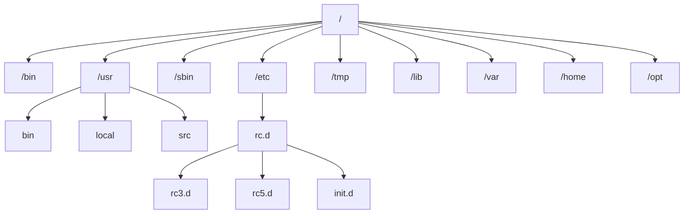

# 0.

### 1.开发规范

#### 1.RESTful

**REST（REpresentational State Transfer）**，**表述性状态转换**，它是一种软件架构风格

| 传统风格 url                                                 | 请求方式 | 含义                |
| ------------------------------------------------------------ | -------- | ------------------- |
| [http://localhost:8080/user/getById?id=1](https://link.wtturl.cn/?target=http%3A%2F%2Flocalhost%3A8080%2Fuser%2FgetById%3Fid%3D1&scene=im&aid=582478&lang=zh) | GET      | 查询 id 为 1 的用户 |
| [http://localhost:8080/user/saveUser](https://link.wtturl.cn/?target=http%3A%2F%2Flocalhost%3A8080%2Fuser%2FsaveUser&scene=im&aid=582478&lang=zh) | POST     | 新增用户            |
| [http://localhost:8080/user/updateUser](https://link.wtturl.cn/?target=http%3A%2F%2Flocalhost%3A8080%2Fuser%2FupdateUser&scene=im&aid=582478&lang=zh) | POST     | 修改用户            |
| [http://localhost:8080/user/deleteUser?id=1](https://link.wtturl.cn/?target=http%3A%2F%2Flocalhost%3A8080%2Fuser%2FdeleteUser%3Fid%3D1&scene=im&aid=582478&lang=zh) | GET      | 删除 id 为 1 的用户 |

| REST 风格 url                                                | 请求方式   | 含义                |
| ------------------------------------------------------------ | ---------- | ------------------- |
| [http://localhost:8080/users/1](https://link.wtturl.cn/?target=http%3A%2F%2Flocalhost%3A8080%2Fusers%2F1&scene=im&aid=582478&lang=zh) | **GET**    | 查询 id 为 1 的用户 |
| [http://localhost:8080/users](https://link.wtturl.cn/?target=http%3A%2F%2Flocalhost%3A8080%2Fusers&scene=im&aid=582478&lang=zh) | **POST**   | 新增用户            |
| [http://localhost:8080/users](https://link.wtturl.cn/?target=http%3A%2F%2Flocalhost%3A8080%2Fusers&scene=im&aid=582478&lang=zh) | **PUT**    | 修改用户            |
| [http://localhost:8080/users/1](https://link.wtturl.cn/?target=http%3A%2F%2Flocalhost%3A8080%2Fusers%2F1&scene=im&aid=582478&lang=zh) | **DELETE** | 删除 id 为 1 的用户 |

1. REST 是风格，是约定方式，约定不是规定，可以打破
2. 描述功能模块通常使用复数形式 (加 s)，表示此类资源，而非单个资源。如：users、books...


### 2.Apifox

- 介绍：Apifox 是一款集成了 Api 文档、Api 调试、Api Mock、Api 测试的一体化协作平台。
- 作用：接口文档管理、接口请求测试、Mock 服务。
- 官网： https://apifox.com/


### 3.前后端联调测试：Nginx 反向代理

反向代理是一种网络架构，通过代理服务器为后端的服务器做代理，客户端的请求直接请求代理服务器，然后转发给后端的服务器

- **正向代理**：代理**客户端**，浏览器→代理→外网服务器，服务器不知道真实用户是谁。
- **反向代理**：代理**服务端**，浏览器→反向代理→后端业务服务器，用户不知道真实后端是谁。

优势：

- **安全**：后端真实服务器**对外隐藏**，客户端不能直接访问后端服务
- **灵活**：统一入口，方便做路由转发
- **负载均衡**：请求分发到多台后端服务器，提升并发能力

流程：

1. 前端浏览器发起请求 `http://localhost:90/api/depts`，请求发送给 Nginx 代理服务器（90 端口）
2. Nginx 接收请求，按照配置做反向代理，将请求转发给后端 Tomcat 业务服务器
3. Tomcat 处理业务，把响应结果返回 Nginx
4. Nginx 再把响应返回给前端浏览器

客户端不会直接访问后端 Tomcat，全部交互经过代理

示例配置：

```nginx
server {
    listen 90;
    #省略...
    location ^~ /api/ {
        rewrite ^/api/(.*)$ /$1 break;
        proxy_pass http://localhost:8080;
    }
}
```

1. **location**：定义请求路径匹配规则
2. **`^~ /api/`**：前缀匹配，只匹配以`/api/`开头的请求路径，优先级较高
3. **rewrite**：路径重写，修改请求 URI
    - `rewrite ^/api/(.*)$ /$1 break;`
    - `^/api/(.*)$`正则捕获`/api/`后面的全部内容；`$1`代表捕获到的分组内容
    - `break`：重写完成，不再继续匹配后面 location
4. **proxy_pass**：反向代理转发，把处理后的请求转发给后端 Tomcat 服务


### 4.SpringMVC

**SpringMVC** 是 Spring 框架里面做 Web 开发（写后端接口）的模块，专门用来处理 HTTP 请求

简单流程（浏览器 ↔ 后端）：

1. 前端浏览器发 HTTP 请求

2. 请求进到服务器，交给 SpringMVC

3. SpringMVC 根据 **@RequestMapping**，找到匹配的 Controller 方法

4. 如果 Controller 方法的参数是一个对象

    Spring 会使用 **ServletModelAttributeMethodProcessor** 这个参数解析器来处理没有 @RequestBody 等注解的复杂对象参数

    - **实例化对象**：Spring 首先会通过反射调用 该对象类的无参构造函数，创建一个空的对象实例
    - **获取请求参数**：Spring 拿到前端传来的所有键值对 (Key-Value)
    - **属性赋值 (Setter 注入)**：Spring 会遍历请求中的参数名 (Key)，去该类中寻找同名的属性，并调用该属性对应的 setter 方法将值赋进去

5. 执行 Controller，得到返回的 Java 对象

6. SpringMVC 把 Java 对象转成 **JSON**，封装成 HTTP 响应返回浏览器


### 5.Spring 配置类 @Configuration

配置类是 Spring 框架（尤其是 Spring Boot）中**最核心的装配机制之一**。它本质上就是一个加了 **@Configuration** 注解的 Java 类，用来**替代传统的 XML 配置文件**，以纯 Java 代码的方式定义 Bean、组织依赖、开启功能

1. **Spring 容器启动时会扫描它**，并把它内部声明的 **Bean** 注册到 **IoC 容器**中

    示例：

    ```java
    @Configuration
    public class MybatisConfig {
        @Bean
        public MybatisPlusInterceptor mybatisPlusInterceptor() {
            // ...
       }
    }
    ```

    等价于：

    ```xml
    <beans>
        <bean id="mybatisPlusInterceptor" class="com.baomidou.mybatisplus.extension.plugins.MybatisPlusInterceptor"/>
    </beans>
    ```

2. 用 **@Import** 把另一个配置类（或普通类）导入进来，合并生效。这让你能把配置拆成多个模块，再在一个主配置里聚合

3. 经常作为“开关”的载体，配合 **@Enable*** 系列注解使用


#### 全配置 vs 轻量配置

- **@Configuration（全配置）：**Spring 会用 **CGLIB 动态代理** 增强这个类
- **@Component + @Bean（轻量配置）：**不会代理，就是普通类


#### CGLIB 代理

**CGLIB**（Code Generation Library）是一个**字节码生成库**

它可以在运行时动态生成一个类的**子类**，并在这个子类中**拦截父类方法的调用**，从而实现代理增强

它解决了 JDK 自动代理的类必须实现接口的缺点，能**代理没有实现接口的类**，从而进行增强

原理：

```java
@Configuration
public class AppConfig {
    @Bean
    public A a() { return new A(); }

    @Bean
    public B b() {
        return new B(a()); // 调用 a()
    }
}
```

如果没有代理，`b()` 里的 `a()` 就是普通方法调用，会**又 new 一个 A**，破坏单例

加了 `@Configuration` 后，Spring 用 CGLIB 生成子类，**拦截 `a()` 方法**：

- 第一次调用：创建 A，放入容器
- 之后调用：直接从容器返回同一个 A

从而保证**在配置类内部互相调用 `@Bean` 方法时，依然能保持单例语义**。


#### @ConfigurationProperties(prefix = "指定前缀")

将配置文件（如 application.yml 或 application.properties）中的配置项，自动批量地“映射”并绑定到一个 Java 类的属性上

对比 **@Value**，有**批量绑定，支持复杂类型，松散绑定**的优势


### 6.全局异常处理器

全局异常处理器是 SpringMVC 提供的统一异常处理方案

核心注解：**@RestControllerAdvice + @ExceptionHandler** 

作用：统一捕获 Controller 层抛出的异常，不用每个接口写大量try‑catch，返回统一格式 JSON，前端不用处理五花八门的异常返回

1. **@RestControllerAdvice** 

    加在**类**上，代表这是全局异常处理类。 等价于 **@ControllerAdvice + @ResponseBody** ，直接返回 JSON

2. **@ExceptionHandler**

    标记在**方法**上，告诉 Spring：当抛出指定类型异常时，就执行这个方法，代替原生异常抛出，自定义返回结果

    可以写多个方法处理不同异常。优先匹配精确异常类型，最后用 **Exception.class 做兜底**捕获所有未知异常

```java
@Slf4j
@RestControllerAdvice
public class GlobalExceptionHandler {
    @ExceptionHandler(Exception.class)
    public Result HandleException(Exception e) {
        log.error("程序出错了",e);
        return Result.error("出错了，请联系管理员");
    }
}
```


# 1. 增删改查

### 1.结果封装

- 实体类属性名 和 数据库表查询返回的字段名一致，mybatis 会自动封装
- 如果实体类属性名 和 数据库表查询返回的字段名不一致，不能自动封装

**数据库下划线字段**和 **Java 实体驼峰**属性名称不一致，无法自动封装


##### 手动结果映射

```java
@Results({
    @Result(column = "create_time", property = "createTime"),
    @Result(column = "update_time", property = "updateTime")
})
@Select("select id, name, create_time, update_time from dept order by update_time desc")
public List<Dept> findAll();
```

**@Results：**容器注解，用来包裹一组 @Result 映射，写在 Mapper 查询方法上

**@Result：**单条映射规则

- **column**：数据库表字段
- **property**：Java 实体类属


##### 起别名

在 SQL 语句中，对不一样的列名起别名，别名和实体类属性名一样

```java
@Select("select id, name, create_time createTime, update_time updateTime from dept ...")
public List<Dept> findAll();
```


##### 开启驼峰命名

在 yml 文件中配置以下字段，如果字段名与属性名符合驼峰命名规则，mybatis 会自动通过驼峰命名规则映射

```yml
mybatis:
  configuration:
    map-underscore-to-camel-case: true
```


### 2.请求映射注解

属于 **SpringMVC** 核心注解

把浏览器URL请求 + 请求方式绑定到后端 Controller 方法上。

| 注解                | 请求方式                            | 使用场景                |
| :------------------ | :---------------------------------- | :---------------------- |
| **@RequestMapping** | 全部方式**（GET/POST/PUT/DELETE）** | 类上统一前缀 / 通用匹配 |
| **@GetMapping**     | 仅 **GET**                          | 查询数据、列表、详情    |
| **@PostMapping**    | 仅 **POST**                         | 新增、登录、提交表单    |
| **@PutMapping**     | 仅 **PUT**                          | 修改、更新数据          |
| **@DeleteMapping**  | 仅 **DELETE**                       | 删除数据                |

##### @RequestMapping 公共路径抽取

把 Controller 里所有接口都重复写的**共同 URL 前缀**，提取到**类上面**，方法上只写剩余部分，简化代码

```java
@RestController
@RequestMapping("/depts")  // 公共路径抽取到类上
public class DeptController {
    @GetMapping("/{id}")   // 实际完整路径： /depts/{id}
    public Result getInfo(@PathVariable Integer id){...}

    @DeleteMapping("/{id}")// 实际完整路径： /depts/{id}
    public Result delete(@PathVariable Integer id){...}
}
```

1. 最终完整请求地址 = **类上路径 + 方法上路径**；
2. 类上只能用普通 @RequestMapping，不能写 @GetMapping/@PostMapping


### 3.请求参数接收注解

#### 1.Query 参数接收（@RequestParam）

Query 参数（查询参数），放在URL 问号 **?** 后面，属于 URL 的一部分，用于向服务器传递键值对数据

完整 URL 格式：

```url
http://域名/path?key1=value1&key2=value2
```

- **?：**分隔路径和 query 参数
- **key=value：**参数键值对
- **&：**多个参数之间分隔符

特点：

1. **明文在地址栏可见**，不适合传密码、敏感数据
2. 数据**长度有限制**，不宜传递大量内容
3. 属于**GET 请求**最常用传参方式；POST 也可以带 Query
4. 会被浏览器历史、日志记录
5. 参数值需要**URL 编码**，中文 / 空格 / 特殊符号自动转义


##### 方式一：

通过原始的 **HttpServletRequest 对象**获取请求参数

```java
@DeleteMapping("/depts")
public Result delete(HttpServletRequest request){
    String idStr = request.getParameter("id");
    int id = Integer.parseInt(idStr);
    System.out.println("根据ID删除部门：" + id);
    return Result.success();
}
```

拿到的参数永远是字符串，需要手动类型转换


##### 方式二：

通过 Spring 提供的 **@RequestParam** 注解，将请求参数绑定给方法形参

```java
@DeleteMapping("/depts")
public Result delete(@RequestParam("id") Integer deptId){
    System.out.println("根据ID删除部门：" + deptId);
    return Result.success();
}
```

@RequestParam 注解 **required** 属性默认为 true，代表该参数必须传递，如果不传递将报错。如果参数可选，可以将属性改为 false


##### 方式三：

如果**请求参数名**与**形参变量**名相同，直接定义方法形参即可接收。（省略 @RequestParam）

```java
@DeleteMapping("/depts")
public Result delete(Integer id){
    System.out.println("根据ID删除部门：" + id);
    return Result.success();
}
```

**注意：List 接收**多参数必须写 @RequestParam，去掉注解无法封装


#### 2. json 参数接收（@RequestBody）

JSON 参数一般放在 HTTP **请求体 Body** 里，是 **POST / PUT** 请求最常用的数据格式

请求头必须携带：

```txt
Content-Type: application/json
```

- JSON 格式的参数，通常会使用一个实体对象进行接收
- 规则：**JSON 数据的键名与方法形参对象的属性名相同**，并需要使用 **@RequestBody** 注解标识

```java
@PostMapping("/depts")
public Result add(@RequestBody Dept dept){
    System.out.println("添加部门：" + dept);
    deptService.add(dept);
    return Result.success();
}
```

**JSON 用实体类接收，字段 / 对象数量不一致时**

1. JSON 字段比实体类多（前端传额外字段，实体没有对应属性）

    默认报错：Unrecognized field "xxx" , not marked as ignorable 无法识别字段

    - 类上加注解，忽略未知字段（最常用），多余json字段直接丢弃，不报错

        ```java
        @JsonIgnoreProperties(ignoreUnknown = true)
        public class Emp {
        	...
        }
        ```

    - 全局配置（SpringBoot），所有实体统一忽略未知字段

        ```yml
        spring:
          jackson:
            deserialization:
              fail-on-unknown-properties: false
        ```

2. JSON 字段比实体类少（json 缺少某些属性）

    不会报错，缺失的属性直接赋值为 Java 默认值：

    - 引用类型：（String、Integer、对象）：null
    - 基本类型： int →0，boolean→false

    注意：基本类型 int，如果 json 不传该字段，会变成 0，分不清是前端传 0 还是没传；所以实体**尽量用包装类 Integer**，不要 int


#### 3.路径参数接收（@PathVariable）

路径参数：通过请求 URL 直接传递参数，使用 **{...}** 来标识该路径参数，不是 **?** 后面，需要使用 **@PathVariable** 获取

```java
@GetMapping("/depts/{id}")
public Result getInfo(@PathVariable("id") Integer deptId){
    System.out.println("根据ID查询部门数据：" + deptId);
    Dept dept = deptService.getInfo(id);
    return Result.success(dept);
}
```

简写：

当URL **占位符名字** {id} 和**方法参数变量名** id 完全一样时，@PathVariable 的**属性值**可以不写

```java
@GetMapping("/depts/{id}")
public Result getInfo(@PathVariable Integer id){
    System.out.println("根据ID查询部门数据: " + id);
    Dept dept = deptService.getInfo(id);
    return Result.success(dept);
}
```


# 2. 日志

- **JUL**：

    这是 JavaSE 平台提供的官方日志框架，也被称为 JUL。配置相对简单，但不够灵活，性能较差

- **Log4j**：

    一个流行的日志框架，提供了灵活的配置选项，支持多种输出目标

- **Logback**：

    基于 Log4j 升级而来，提供了更多的功能和配置选项，性能优于 Log4j

- **Slf4j**（Simple Logging Facade for Java）：

    简单日志门面，提供了一套日志操作的标准接口及抽象类，允许应用程序使用不同的底层日志框架


#### 1.配置文件

配置文件名：**logback.xml**

该配置文件是对 Logback 日志框架输出的日志进行控制的，可以来配置输出的格式、位置及日志开关等

常用的两种输出日志的位置：

- 控制台

```xml
<appender name="STDOUT" class="ch.qos.logback.core.ConsoleAppender">
    ...
</appender>
```

- 系统文件

```xml
<appender name="FILE" class="ch.qos.logback.core.rolling.RollingFileAppender">
    ...
</appender>
```

开启日志（ALL），关闭日志（OFF）

```xml
<root level="ALL"> 
    <appender-ref ref="STDOUT" /> 
    <appender-ref ref="FILE" /> 
</root>
```


#### 2.日志级别

日志级别指的是日志信息的类型，日志都会分级别，常见的日志级别如下（级别由低到高）

| 日志级别  | 说明                                                         | 记录方式                                                     |
| --------- | ------------------------------------------------------------ | ------------------------------------------------------------ |
| **trace** | 追踪，记录程序运行轨迹 【使用很少】                          | log.trace("...")                                             |
| **debug** | 调试，记录程序调试过程中的信息，实际应用中一般将其视为最低级别 【使用较多】 | log.debug("...")                                             |
| **info**  | 记录一般信息，描述程序运行的关键事件，如：网络连接、io 操作 【使用较多】 | [log.info](https://link.wtturl.cn/?target=https%3A%2F%2Flog.info&scene=im&aid=582478&lang=zh)("...") |
| **warn**  | 警告信息，记录潜在有害的情况 【使用较多】                    | log.warn("...")                                              |
| **error** | 错误信息 【使用较多】                                        | log.error("...")                                             |

可以在配置文件中的 level 属性中，灵活的控制输出那些类型的日志。（**大于等于**配置的日志级别的日志才会输出）

```xml
<root level="info">
    <appender-ref ref="STDOUT" />
    <appender-ref ref="FILE" />
</root>
```


#### 3.@Slf4j

**@Slf4j** 是 **Lombok** 提供的注解，编译期自动生成日志对象，不用手写日志声明代码

在类上写上 **@Slf4j** 注解

```java
@Slf4j
public class LogExample {
}
```

编译之后自动生成一行**静态常量：private static final Logger log**

**log** 对象就可以直接调用  **log.trace() / log.debug() / log.info() / log.warn() / log.error()** 打印各个级别日志

**LoggerFactory.getLogger(LogExample.class)**：把当前类的 class 传入，日志输出会打印出这个类名，方便定位日志来自哪个 Java 类

```java
public class LogExample {
    private static final org.slf4j.Logger log = org.slf4j.LoggerFactory.getLogger(LogExample.class);
}
```


# 3. 多表关系

#### 一对多：

在数据库表中多的一方，添加字段，来关联一的一方的主键


#### 外键约束

可以在创建表时 或 表结构创建完成后，为字段添加外键约束。 具体语法如下：

```sql
-- 创建表时指定
create table 表名(
    字段名 数据类型,
    ...
    [constraint] [外键名称] foreign key (外键字段名) references 主表 (字段名)
);
```

**constraint ：约束**，给这个外键约束起一个名字

[ ] 代表可选：constraint 外键名 可以省略；写了就自定义约束名字，方便后续删除外键

```sql
-- 建完表后，添加外键
alter table 表名 add constraint 外键名称 foreign key (外键字段名) references 主表(字段名);
```

##### 物理外键

使用 foreign key 定义外键关联另外一张表

- 缺点：

1. 影响增、删、改的效率（需要检查外键关系）
2. 仅用于单节点数据库，不适用与分布式、集群场景
3. 容易引发数据库的死锁问题，消耗性能

##### 逻辑外键

业务代码 (Java) 来维护关联关系，通过逻辑外键，就可以很方便的解决上述问题


#### 一对一

一对一关系，多用于单表拆分，将一张表的基础字段放在一张表中，其他字段放在另一张表中，以提升操作效率

实现：**在任意一方加入外键，关联另外一方的主键**，并且设置外键为**唯一的 (UNIQUE)**


#### 多对多

建立第三张中间表，中间表至少包含两个外键，分别关联两方主键


#### 多表查询

##### 连接查询

查询的数据分布在多张不同的表里，把多张表通过关联字段合并到一起查询

-  **内连接：**相当于查询 A、B 交集部分数据 

    - **隐式内连接**（常见）

        from 后多个表用**逗号**隔开，连接条件写在where，没有join关键字

        ```sql
        select 字段列表 from 表1 , 表2 where 连接条件 ...;
        ```

    - **显式内连接**

        使用 **[inner] join ... on**，inner可以省略，连接条件写在 **on** 后面

        ```sql
        select 字段列表 from 表1 [inner] join 表2 on 连接条件 ... ;
        ```

- **外连接 ：**

    - 左外连接：查询左表**所有**数据 (**包括**两张表**交集**部分数据) 

        ```sql
        select 字段列表 from 表1 left [outer] join 表2 on 连接条件 ...;
        ```

    - 右外连接：查询右表**所有**数据 (**包括**两张表**交集**部分数据)

        ```sql
        select 字段列表 from 表1 right [outer] join 表2 on 连接条件 ...;
        ```

##### 子查询

SQL 语句中**嵌套 select 语句**，称为**嵌套查询**，又称子查询

子查询外部的语句可以是 insert /update/delete /select 的任何一个，最常见的是 select

```sql
select * from t1 where column1 = (select column1 from t2 ...);
```

分类：

1. **标量子查询**：子查询返回的结果为单个值
2. **列子查询**：子查询返回的结果为一列
3. **行子查询**：子查询返回的结果为一行
4. **表子查询**：子查询返回的结果为多行多列


一旦为表指定了别名，就要通过别名来指定字段名，而**不能再使用表名**了


# 4. 分页查询

#### 原始分页查询

mapper 层

```java
//统计符合条件的总记录数
@Select("select count(*) from emp e ... ")
public Long count();

//查询结果列表
@Select("select e.* from emp e ... limit #{start},#{pageSize}")
public List<Emp> list(Integer start , Integer pageSize);
```

service 层

```java
public PageResult<Emp> page(Integer page, Integer pageSize) {
    //1. 获取总记录数
    Long total = empMapper.count();
    //2. 获取数据列表
    Integer start = (page - 1) * pageSize;
    List<Emp> empList = empMapper.list(start, pageSize);
    //3. 封装分页结果
    return new PageResult<Emp>(total, empList);
}

```


#### PageHelper 

PageHelper 是 MyBatis 的分页插件，基于 **MyBatis 拦截器 (Interceptor)** 实现

##### 依赖

```xml
<!-- 分页插件PageHelper -->
<dependency>
    <groupId>com.github.pagehelper</groupId>
    <artifactId>pagehelper-spring-boot-starter</artifactId>
    <version>1.4.7</version>
</dependency>
```


#####  Page 分页对象

| 参数           | 含义                | 默认值 | 使用说明                                                     |
| -------------- | ------------------- | ------ | ------------------------------------------------------------ |
| **pageNum**    | 页码                | -      | **必传**，从 1 开始                                          |
| **pageSize**   | 每页条数            | -      | **必传**，每页展示多少条                                     |
| **count**      | 是否执行 count 查询 | true   | true：额外执行 count SQL 查询总记录数；false：不查总数，无 total |
| **reasonable** | 分页合理化          | null   | true：页码≤1 自动修正为第 1 页；页码 > 总页数自动修正为最后一页；false：越界返回空数据 |
| **orderBy**    | 排序语句            | null   | 示例：`create_time desc, id asc`；自带 SQL 注入校验，不要直接接收前端原始参数 |


##### PageMethod 基础分页方法

```java
public abstract class PageMethod {
    // 为每个线程维护一份独立的 Page 对象副本，线程之间互不干扰
    protected static final ThreadLocal<Page> LOCAL_PAGE = new ThreadLocal<Page>();
    protected static boolean DEFAULT_COUNT = true;

    // 把当前线程的分页参数（Page 对象）存放到 ThreadLocal 中
    protected static void setLocalPage(Page page) {
        LOCAL_PAGE.set(page);
    }

    // 移除本地变量
    public static void clearPage() {
        LOCAL_PAGE.remove();
    }
    
    // 还有一些获取分页参数的方法
    
    // public static <E> Page<E> startPage(...)
    
    // public static <E> Page<E> offsetPage(...)
}
```

**PageHelper** 类继承了 **PageMethod** 类，是分页插件的核心类


##### mapper 层

使用了 pagehelper 的分页查询在 sql 语句中没有 limit 字段

```xml
<select id="selectRoomTypeList">
    select id, name, bed_count, price, ...
    from room_type
    <where>
        ...
    </where>
</select>
```

分页完全由 **MyBatis 拦截器**在运行时处理

Mapper 调用最终进入 MyBatis：

```java
Executor.query(...)
```


##### PageInterceptor 分页拦截器

当拦截器执行时，它会检查 ThreadLocal 里有没有分页参数

- 如果有，就对当前这条 SQL 进行改写（加上 **LIMIT** 等）

- 如果没有，或者参数已经被消费过了（**PageHelper** 会在查询结束后清理 `ThreadLocal`），它就不会进行分页处理，直接放行

    **所以 pagehelper 只对紧随其后的第一条 MyBatis 查询自动分页**

```java
@Intercepts({
    @Signature(
        type = Executor.class,
        method = "query",
        args = {...}
    )
})
```


# 5. 日期参数

#### @DateTimeFormat

Spring 框架提供，**接收前端传来的字符串日期 → 转换成 Java Date 对象（入参解析），**只处理 GET 请求，url 参数 ，**pattern** 指定前端传过来字符串日期格式

写法1：写在实体类属性上

```java
public class Emp {
    @DateTimeFormat(pattern = "yyyy‑MM‑dd")
    private Date birthday;
}
```

写法2：直接写在 **Controller 方法参数**中

```java
@RequestMapping("/test")
public void test(@DateTimeFormat(pattern = "yyyy‑MM‑dd") Date birthday){
}
```


# 6. 事务管理

#### 1.事务

是一组操作的集合，它是一个不可分割的工作单位

事务会把所有的操作作为一个整体一起向系统提交或撤销操作请求，即这些操作 要么同时成功，要么同时失败

> 注意：默认 MySQL 的事务是自动提交的。也就是说，当执行一条 DML 语句，MySQL 会立即隐式的提交事务4


#### 2.事务控制

主要三步操作：**开启事务、提交事务 / 回滚事务**

```java
-- 开启事务
start transaction; / begin;

-- 1. 保存员工基本信息
insert into emp values (39, 'Tom', '123456', '汤姆', 1, '13300001111', 1, 4000, '1.jpg', '2023-11-01', 1, now(), now());
-- 2. 保存员工的工作经历信息
insert into emp_expr(emp_id, begin, end, company, job) values (39,'2019-01-01', '2020-01-01', '百度', '开发'),
                                                             (39,'2020-01-10', '2022-02-01', '阿里', '架构');

-- 提交事务(全部成功) / 回滚事务(有一个失败)
commit; / rollback;
```


#### 3. Spring 事务管理‑控制事务

- 注解：**@Transactional**
- 作用：将当前方法交给 spring 进行事务管理，方法执行前，开启事务；成功执行完毕，提交事务；出现异常（默认运行时异常），回滚事务
- 位置：业务（service）层的方法上、类上、接口上

配置日志信息，查看spring事务管理的底层日志

```yml
logging:
  level:
    org.springframework.jdbc.support.JdbcTransactionManager: debug
```


##### rollbackFor 属性

**rollbackFor** 属性用于控制出现何种异常类型，回滚事务

```java
@Transactional(rollbackFor = {Exception.class})
@Override
public void save(Emp emp) {
    ...
}
```


##### propagation 属性

**事务传播行为**：指的就是当一个事务方法被另一个事务方法调用时，这个事务方法应该如何进行事务控制。

```java
@Transactional
public void a(){
    //……
    userService.b();
    //……
}

@Transactional(propagation = Propagation.REQUIRED)
public void b(){
    //……
}
```

| 属性值            | 含义                                                         |
| ----------------- | ------------------------------------------------------------ |
| **REQUIRED**      | **【默认值】**需要事务，有则加入，无则创建新事务             |
| **REQUIRES_NEW**  | 需要新事务，无论有无，总是创建新事务                         |
| **SUPPORTS**      | 支持事务，有则加入，无则在无事务状态中运行                   |
| **NOT_SUPPORTED** | 不支持事务，在无事务状态下运行，如果当前存在已有事务，则挂起当前事务 |
| **MANDATORY**     | 必须有事务，否则抛异常                                       |
| **NEVER**         | 必须没事务，否则抛异常                                       |


#### 4.事务四大特性（ACID）

| 特性       | 英文            | 核心含义                                                     |
| ---------- | --------------- | ------------------------------------------------------------ |
| **原子性** | **A**tomicity   | 事务是不可分割的最小单元，要么全部成功，要么全部失败         |
| **一致性** | **C**onsistency | 事务完成时，必须使所有的数据都保持一致状态                   |
| **隔离性** | **I**solation   | 数据库系统提供的隔离机制，保证事务在不受外部并发操作影响的独立环境下运行 |
| **持久性** | **D**urability  | 事务一旦提交或回滚，它对数据库中的数据的改变就是永久的       |


# 7. 文件上传

#### 文件上传

是指将本地图片、视频、音频等文件上传到服务器，供其他用户浏览或下载的过程

springboot 默认上传文件最大为 1MB，超过 1MB 就会报错

```html
<form action="/upload" method="post" enctype="multipart/form-data">
    姓名: <input type="text" name="name" > <br>
    年龄: <input type="text" name="age" > <br>
    图像: <input type="file" name="file" > <br>
    <input type="submit" value="上传文件" name="submit">
</form>
```

- **action="/upload"**：表单提交地址，对应后端接口路径

- **method="post"**：文件上传**必须用 post**，get 无法携带文件数据

- **enctype="multipart/form-data"**：文件上传必备，代表表单**以二进制流形式传输文件**，不设置该属性后端接收不到文件

- **\<input type="file" name="file">**：文件选择框，name="file"，**后端参数名**必须和这个 name **保持一致**

```java
@Slf4j
@RestController
public class UploadController {
    @PostMapping("/upload")
    public Result handleFileUpload(String name, Integer age, MultipartFile file){
        log.info("文件上传:{}", file);
        return Result.success();
    }
}
```

- **@PostMapping**("/upload")：接收 POST 请求，路径匹配表单action="/upload"

- **MultipartFile**：可以获取文件名、文件大小、文件流，执行保存文件操作

    MultipartFile file：SpringBoot 封装的文件对象，参数名 file 必须和前端 input 的 name="file" 一致，用来接收上传的文件


#### UUID

**Universally Unique Identifier，通用唯一识别码**，生成一串**全世界几乎不会重复**的字符串

格式：**xxxxxxxx‑xxxx‑xxxx‑xxxx‑xxxxxxxxxxxx**

由 32 个十六进制字符 + 4 个 " **-** " 分隔符组成，总长 36 位

```java
// 获取UUID对象
UUID uuid = UUID.randomUUID();
// 转为字符串（带横杠）
String uuidStr = uuid.toString();
// 去掉横杠，常用做文件名
String simpleUuid = uuid.toString().replace("-","");
```


#### OSS 对象存储服务

**Object Storage Service 对象存储服务**

文件存在云端，永久保存；返回 HTTPS 的 URL，浏览器直接访问图片；扩容不用管磁盘


##### 1. SDK

**Software Development Kit** **软件开发工具包**

包括辅助软件开发的依赖（jar 包）、代码示例等，都可以叫做 SDK


##### 2. Bucket

Bucket 存储空间是用户用于存储对象（Object，就是文件）的容器，所有的对象都必须隶属于某个存储空间


##### 3.AccessKey

是阿里云账号的身份凭证，相当于你账号的 “用户名 + 密码”，程序通过它来访问阿里云的各种服务（OSS、ECS 等）

由两部分组成：

1. **AccessKeyId（AK）**：身份标识，相当于账号名
2. **AccessKeySecret（SK）**：密钥，相当于密码，不能泄露

 **配置AccessKey**

- 以管理员身份打开CMD命令行，执行如下命令，配置系统的环境变量

```shell
set OSS_ACCESS_KEY_ID=xxxxxxxxxxxxxxxxxxxxxxxxxxxxxxxxxxxxxxxxxxxx
```

```shell
set OSS_ACCESS_KEY_SECRET=xxxxxxxxxxxxxxxxxxxxxxxxxxxxxxxxxxxxxxxxxx
```

- 执行如下命令，让更改生效

```Shell
setx OSS_ACCESS_KEY_ID "%OSS_ACCESS_KEY_ID%"
```

```shell
setx OSS_ACCESS_KEY_SECRET "%OSS_ACCESS_KEY_SECRET%"
```

- 执行如下命令，验证环境变量是否生效

```Shell
echo %OSS_ACCESS_KEY_ID%
```

```shell
echo %OSS_ACCESS_KEY_SECRET%
```


##### 参数配置化

```yml
aliyun:
  oss:
    endpoint: OSS 访问域名（外网访问节点）
    bucketName: 存储空间名称（Bucket 名字）
    region: 地域 ID
```

```java
@Data
@Component
@ConfigurationProperties(prefix = "aliyun.oss")
public class AliyunOSSProperties {
    private String endpoint;
    private String bucketName;
    private String region;
}
```


# 8. 会话技术

#### 概述

- 会话：用户打开浏览器，访问 web 服务器的资源，会话建立，直到有一方断开连接，会话结束。在一次会话中可以包含多次请求和响应
- 会话跟踪：一种维护浏览器状态的方法，服务器需要识别多次请求是否来自于同一浏览器，以便在同一次会话的多次请求间共享数据


#### 1.Cookie

Cookie 是客户端会话跟踪技术，数据**保存在浏览器（客户端）**本地，用来解决 HTTP 无状态问题，让服务器识别多次请求是否来自同一个浏览器

##### 工作原理

1. 浏览器第一次访问服务器，服务器创建 Cookie，通过**响应头：Set‑Cookie** 把 Cookie 发给浏览器
2. 浏览器收到 Cookie，把 Cookie 保存在本地（内存 / 磁盘）
3. **之后浏览器每次访问该服务器，会自动在请求头带上 Cookie 发送给服务器**，服务器读取 Cookie 识别客户端身份

##### 分类

- **会话 Cookie（默认 maxAge=-1）**：**内存**保存，浏览器关闭直接消失

- **持久 Cookie（maxAge>0）**：保存到本地**硬盘**，到设置的秒数才过期，关闭浏览器依然存在

##### 特点

优点：HTTP 协议中支持的技术

缺点：

- 移动端 APP 无法使用 Cookie
- 不安全，用户可以直接查看、修改、伪造 Cookie 里面的内容，浏览器完全由用户掌控，数据可以被篡改，且用户可以自己禁用 Cookie
- 浏览器的同源策略限制 Cookie，故Cookie 不能跨域


#### 2.Session

Session 是服务端会话跟踪技术，数据保存在**服务器端**，用来弥补 Cookie 的不足

- 浏览器这边没有业务数据，只有一串会话编号 **JSESSIONID**，避免客户端篡改、泄露敏感数据，安全性更高
- 存在服务器端，不受 Cookie 容量限制，可以存放更多会话数据

##### 工作原理

1. 浏览器第一次访问服务器，服务器会创建 **Session 对象**，生成唯一的 **JSESSIONID**（Session 编号）
2. 服务器把 JSESSIONID 通过**Cookie** 响应给**浏览器保存**
3. 浏览器后续访问该服务器，自动携带带有 JSESSIONID 的 Cookie
4. 服务器拿到 JSESSIONID，在服务器内存中找到对应的 Session 对象，识别是同一个客户端

底层 **Session 依赖 Cookie**实现，JSESSIONID 就是存放在 Cookie 里

##### 特点：

- 优点：存储在服务端，安全
- 缺点：
    - 服务器集群环境下无法直接使用 Session
    - 移动端 APP 无法使用 Cookie
    - 浏览器的同源策略限制 Cookie，故Cookie 不能跨域


#### 3. JWT 令牌

全称：**JSON Web Token**（https://jwt.io/）

定义了一种简洁的、自包含的格式，用于在通信双方以 **json** 数据格式安全的传输信息，在请求头的 **Authorization** 中携带

##### **组成：** 

- **Header (头)**，记录令牌类型、签名算法等

- **Payload (有效载荷)**，携带一些自定义信息、默认信息等

- **Signature (签名)**，防止 Token 被篡改、确保安全性。将 header、payload 融入，并加入指定秘钥，通过指定签名算法计算而来

Header 和 Payload 都是 **Base64 编码**

##### **Base64：**

是一种基于 64 个可打印字符**（A‑Z a‑z 0‑9 + /）**来表示二进制数据的编码方式

##### 依赖

```xml
<dependency>
    <groupId>io.jsonwebtoken</groupId>
    <artifactId>jjwt</artifactId>
    <version>0.9.1</version>
</dependency>
```

用户登录成功后，系统会自动下发 JWT 令牌，浏览器存到存到 **localStorage（本地存储）**。然后在后续的每次请求中，都需要在**请求头 header 中携带**到服务端，请求头的名称为 **token** ，值为 登录时下发的 JWT 令牌。如果检测到用户未登录，则直接响应 **401** 状态码

##### 示例：

生成 JWT 令牌：

```java
public static String generateToken(Map<String, Object> claims) {
      		// 获取JWT构建器
    return  Jwts.builder()
            // 指定签名算法HS256，传入密钥        
            .signWith(SignatureAlgorithm.HS256, SECRET_KEY)
            // 把自定义map数据放入JWT的payload载荷
            .addClaims(claims)
            // 设置过期时间：当前时间+12小时
            .setExpiration(new Date(System.currentTimeMillis() + EXPIRATION_TIME))
            // 拼接，生成字符串格式JWT令牌
            .compact();                   
}
```

解析 JWT 令牌：

```java
public static Claims parseToken(String token) throws Exception {
            // 获取解析器
    return  Jwts.parser()
            // 设置解密密钥，必须和生成密钥一致
            .setSigningKey(SECRET_KEY)
            // 解析token字符串，校验签名、校验过期时间
            .parseClaimsJws(token)
            // 获取payload中的claims载荷数据
            .getBody();
}
```


#### 4.过滤器（Filter）

**Filter 过滤器**，是 JavaWeb 三大组件 (Servlet、**Filter**、Listener) 之一

过滤器可以把对资源的请求拦截下来，从而实现一些特殊的功能。过滤器一般完成一些通用的操作，比如：登录校验、统一编码处理、敏感字符处理等

执行流程：

**放行前 --> 放行 --> 资源 --> 放行后**


- 定义 Filter：定义一个类，**实现 Filter 接口**，并实现其所有方法。
- 配置 Filter：Filter 类上加 **@WebFilter** 注解，配置拦截路径。引导类上加 **@ServletComponentScan** 开启 Servlet 组件支持

```java
@WebFilter(urlPatterns = "/*")//拦截所有请求
@Slf4j
public class DemoFilter implements Filter {

    // 初始化方法，web服务器启动时执行
    @Override
    public void init(FilterConfig filterConfig) throws ServletException {
        log.info("init 初始化的方法运行了...");
    }

    //拦截到请求之后执行，会执行多次
    @Override
    public void doFilter(ServletRequest servletRequest, 
                         ServletResponse servletResponse, 
                         FilterChain filterChain) throws IOException, ServletException {
        log.info("拦截到请求了...");
        //放行，把请求交给过滤器链里下一个 Filter；没有下一个 Filter，就交给目标 Controller/Servlet
        filterChain.doFilter(servletRequest, servletResponse);
    }

    // 销毁方法，web服务器关闭时执行
    @Override
    public void destroy() {
        log.info("destroy 销毁的方法运行了...");
    }
}
```

- ServletRequest：封装客户端请求信息的对象

- ServletResponse：封装服务端响应信息的对象 。Servlet 体系里，响应不是通过方法 return 返回，而是通过 response 对象「共享容器」写出去

- FilterChain：过滤器链，调用 **doFilter( )** 放行请求；不调用则直接拦截


##### 拦截路径

Filter 可以根据需求，配置不同的拦截资源路径：

| 拦截路径     | urlPatterns 值 | 含义                                |
| ------------ | -------------- | ----------------------------------- |
| 拦截具体路径 | /login         | 只有访问 /login 路径时，才会被拦截  |
| 目录拦截     | /emps/*        | 访问 /emps 下的所有资源，都会被拦截 |
| 拦截所有     | /*             | 访问所有资源，都会被拦截            |


##### 过滤器链 

过滤器链：一个请求可以经过多个 Filter，多个 Filter 依次执行，形成一条链式调用，就是过滤器链

执行顺序：

匹配精度高优先；精度一样，**类名字母顺序**决定执行先后


#### 5.拦截器（Interceptor）

是一种动态拦截方法调用的机制，类似于过滤器。Spring 框架中提供的，主要用来动态拦截控制器方法的执行，需要实现 **HandlerInterceptor** 接口

作用：拦截请求，在指定的方法调用前后，根据业务需要执行预先设定的代码

完整请求流程：

**preHandle( ) → Controller方法执行 → postHandle( ) → 视图渲染 → afterCompletion( )**

| 阶段                | 功能                                                    |
| ------------------- | ------------------------------------------------------- |
| **preHandle**       | controller 之前，拦截放行（true 放行，false 拦截）      |
| **postHandle**      | controller 跑完，视图还没渲染，可以修改模型、修改视图名 |
| **视图渲染**        | 填充模板生成 HTML 页面                                  |
| **afterCompletion** | 页面已经生成输出完毕，做清理工作                        |

```java
@Component
public class DemoInterceptor implements HandlerInterceptor {
    //preHandle
    @Override
    public boolean preHandle(HttpServletRequest req, HttpServletResponse resp, Object handler) throws Exception {
        return true;
    }

    //postHandle
    @Override
    public void postHandle(HttpServletRequest req, HttpServletResponse resp, Object handler, ModelAndView mv) throws Exception {
        System.out.println("preHandle...");
    }

    //afterCompletion
    @Override
    public void afterCompletion(HttpServletRequest req, HttpServletResponse resp, Object handler, Exception ex) throws Exception {
        System.out.println("afterCompletion...");
    }
}
```

配置类：

```java
@Configuration
public class WebConfig implements WebMvcConfigurer {
    @Autowired
    DemoInterceptor demoInterceptor;

    @Override
    public void addInterceptors(InterceptorRegistry registry) {
        registry.addInterceptor(demoInterceptor)
                .addPathPatterns("/**") //拦截所有请求
                .excludePathPatterns("/login"); //放行登录接口
    }
}
```


#### 6.过滤器与拦截器的区别

**浏览器发起请求 → Web 服务器 (Tomcat) → Filter 过滤器 → Interceptor 拦截器 → Controller 控制器，处理完成后按原路返回响应给浏览器**

**接口规范不同：**

- 过滤器Filter是JavaEE规范中提供的技术，要实现Filter接口。
- 拦截器Interceptor是Spring中提供的技术，要实现HandlerInterceptor接口。

**拦截范围不同：**

- 过滤器的拦截范围更大，它可以拦截Web服务器中所有的资源。
- 拦截器只能拦截Spring中的资源。


# 9. AOP

**Aspect Oriented Programming（面向切面编程、面向方面编程）**。可简单理解为就是面向特定方法编程，底层依靠动态代理技术

优势： 

- 减少重复代码 
- 代码无侵入 
- 提高开发效率 
- 维护方便


#### 核心概念：

- **连接点：JoinPoint**    可以被 AOP 控制的方法（暗含方法执行时的相关信息）
- **通知：Advice**    指那些重复的逻辑，也就是共性功能（最终体现为一个方法）
- **切入点：PointCut**    匹配连接点的条件，通知仅会在切入点方法执行时被应用
- **切面：Aspect**    描述通知与切入点的对应关系（通知 + 切入点）
- **目标对象：Target**    通知所应用的对象

```java
@Aspect //切面类    
@Component
public class RecordTimeAspect {
	//通知方法
    @Around("execution(* com.itheima.service.impl.*.*(..))")
    public Object recordTime(ProceedingJoinPoint pjp) throws Throwable {
        //1. 记录方法运行的开始时间
        long begin = System.currentTimeMillis();
        //2. 执行原始的方法
        Object result = pjp.proceed();
        //3. 记录方法运行的结束时间，记录耗时
        long end = System.currentTimeMillis();
        log.info("方法 {} 执行耗时: {}ms", pjp.getSignature() ,end-begin);
        return result;
    }
}
```

- **@Aspect：**声明切面类，需搭配 @Component 使用


#### 通知注解：

根据通知方法执行时机的不同，将通知类型分为以下常见的五类：

| 通知类型     | 注解            | 执行时机                                 |
| ------------ | --------------- | ---------------------------------------- |
| **环绕通知** | **@Around**     | 目标方法前、后均执行                     |
| 前置通知     | @Before         | 目标方法执行前执行                       |
| 后置通知     | @After          | 目标方法执行后执行，无论是否异常都会执行 |
| 返回后通知   | @AfterReturning | 目标方法执行后执行，有异常不执行         |
| 异常后通知   | @AfterThrowing  | 目标方法发生异常后执行                   |

注意：

@Around 环绕通知需要自己调用 **ProceedingJoinPoint.proceed ( )** 来让原始方法执行，其他通知不需要考虑目标方法执行

@Around 环绕通知方法的返回值，必须指定为 **Object**，来接收原始方法的返回值


#### 连接点：

在通知中用 **JoinPoint** 抽象了连接点，用它可以获得方法执行时的相关信息，如目标类名、方法名、方法参数等


##### JoinPoint：

适用：**@Before、@After、@AfterReturning、@AfterThrowing**

```java
@Before("execution(* com.itheima.service.DeptService.*(..))")
public void before(JoinPoint joinPoint) {
    String className = joinPoint.getTarget().getClass().getName(); //获取目标类名
    Signature signature = joinPoint.getSignature(); //获取目标方法签名
    String methodName = joinPoint.getSignature().getName(); //获取目标方法名
    Object[] args = joinPoint.getArgs(); //获取目标方法运行参数
}
```


##### ProceedingJoinPoint：

适用：只能用于 **@Around** 环绕通知

是 JoinPoint 的子类，在 JoinPoint 的全部能力之上，新增两个核心方法，用来手动执行目标方法

```java
@Around("execution(* com.itheima.service.DeptService.*(..))")
public Object around(ProceedingJoinPoint joinPoint) throws Throwable {
    String className = joinPoint.getTarget().getClass().getName(); //获取目标类名
    Signature signature = joinPoint.getSignature(); //获取目标方法签名
    String methodName = joinPoint.getSignature().getName(); //获取目标方法名
    Object[] args = joinPoint.getArgs(); //获取目标方法运行参数
    
    Object res = joinPoint.proceed(); //执行原始方法,获取返回值(环绕通知)
    
    return res;
}
```

- **proceed( )：**调用一次，目标方法执行一次；不调用，目标方法完全不执行
- **proceed(Object[] args)：**可以修改传入目标方法的参数

方法必须声明 throws Throwable，proceed( ) 会抛出业务方法产生的异常


#### @PointCut

将公共的切点表达式抽取出来，需要用到时引用该切点表达式即可

```java
@Pointcut("execution(* com.itheima.service.impl.DeptServiceImpl.*(..))")
public void pt(){}
```

- private：仅能在当前切面类中引用该表达式
- public：在其他外部的切面类中也可以引用该表达式

```java
@Around("pt()")
public Object recordTime(ProceedingJoinPoint joinPoint) throws Throwable {
```


#### 通知顺序

当有多个切面的切入点都匹配到了目标方法，目标方法运行时，多个通知方法都会被执行

执行顺序：

- 不同切面类中，默认按照切面类的**类名字母排序**
    - 目标方法前的通知方法：字母排名靠前的先执行
    - 目标方法后的通知方法：字母排名靠前的后执行
- 用 **@Order (数字)** 加在切面类上来控制顺序
    - 目标方法前的通知方法：数字小的先执行
    - 目标方法后的通知方法：数字小的后执行


#### 切入点表达式

描述切入点方法的一种表达式，用来决定项目中的哪些方法需要加入通知。

可以加上逻辑与或

##### 1. execution(……)：

主要根据方法的返回值、包名、类名、方法名、方法参数等信息来匹配，语法为：

```java
execution(访问修饰符?  返回值  包名.类名.?方法名(方法参数) throws 异常?)
```

**其中带 ? 的表示可以省略的部分：**

1. **访问修饰符：**比如：public、protected
2. **包名 / 类名：**但强烈不建议省略，因为省略后会全项目去查找该方法，损耗性能
3. **throws 异常：**注意是方法上声明抛出的异常，不是实际抛出的异常

**可以使用通配符描述切入点：**

- **" \* "**

    单个独立的任意符号，可以通配任意**返回值**、**包名**、**类名**、**方法名**、任意类型的一个**参数**，也可以通配**包、类、方法名的一部分**

    ```java
    execution(* com.*.service.*.update*(*))
    ```


- **" .. "**

    多个连续的任意符号，可以通配任意层级的包，或任意类型、任意个数的参数

    ```java
    execution(* com.itheima..DeptService.*(..))
    ```


**书写建议**

- 所有业务方法名在命名时尽量规范，方便切入点表达式快速匹配。如：findXxx，updateXxx。

- 描述切入点方法通常基于接口描述，而不是直接描述实现类，增强拓展性。

- 在满足业务需要的前提下，尽量缩小切入点的匹配范围。如：包名尽量不使用`..`，使用`*`匹配单个包。


##### 2. @annotation(……) ：

**@annotation(全注解类名)**，用于匹配被指定自定义注解标记的方法

1. 先自定义注解

    ```java
    @Target(ElementType.METHOD) // 只能打在方法上
    @Retention(RetentionPolicy.RUNTIME)
    public @interface MyLog {
    }
    ```

2. 业务方法打上注解

    ```java
    @MyLog   //打上自定义注解
    public void delete() {
        //业务逻辑
    }
    ```

3. AOP 切面使用 **@annotation** 定义切入点

    ```java
    @Around("@annotation(com.itheima.anno.MyLog)")
    public Object around(ProceedingJoinPoint pjp) throws Throwable{
        System.out.println("方法执行前");
        Object res = pjp.proceed();
        System.out.println("方法执行后");
        return res;
    }
    ```


# 10. ThreadLocal\<T> 

**ThreadLocal\<T>** 让**同一个变量**在每个线程中都拥有一份**独立的副本**，从而避免多线程环境下的共享冲突，实现线程安全

ThreadLocal 通过将数据与当前线程绑定，提供了一种“隐式传参”机制，优雅地解决了跨层级调用中“**层层传参**”带来的代码臃肿与侵入性问题，实现了无侵入的线程内**上下文共享**

##### 常用方法：

- 设置当前线程的线程局部变量的值

    ```java
    void set(T value)
    ```

- 读取当前线程对应的线程局部变量的值

    ```java
    T get()
    ```

- 删除当前线程保存的局部变量

    ```java
    void remove()
    ```


##### **ThreadLocalMap** 

**ThreadLocalMap** 是 **ThreadLocal** 的 静态内部类，是一个定制化的哈希表容器，**ThreadLocal 对象**作为 **key**，**业务数据**作为 **value**

一个线程对象中存储一个 ThreadLocalMap，用于存储本线程所有 ThreadLocal 对象对应的值

```java
public class Thread implements Runnable {

	/* 属于本线程的所有 ThreadLocal 存储值。该 Map 由 ThreadLocal类 负责维护。 */
    ThreadLocal.ThreadLocalMap threadLocals = null;
```

Thread‑1、Thread‑2、Thread‑3…… 每个线程各自持有自己的 **ThreadLocalMap**，线程与线程的数据互不影响


# 11. SpringBoot 原理

#### 1. SpringBoot 配置优先级（低 -> 高）

1. application**.yaml**（忽略）
2. application**.yml**
3. application**.properties**
4. java **系统属性**（-Dxxx=xxx）
5. **命令行参数**（--xxx=xxx）

外部配置项的优先级高于内部配置文件


#### 2. bean 作用域

Spring 支持五种作用域，后三种在 web 环境才生效：

| 作用域        | 说明                                              |
| ------------- | ------------------------------------------------- |
| **singleton** | 容器内同名称的 bean 只有一个实例（单例）（默认）  |
| **prototype** | 每次使用该 bean 时会创建新的实例（非单例 / 多例） |
| request       | 每个请求范围内会创建新的实例（web 环境中，了解）  |
| session       | 每个会话范围内会创建新的实例（web 环境中，了解）  |
| application   | 每个应用范围内会创建新的实例（web 环境中，了解）  |


##### **@Scope**

如果要在 bean 上指定作用域，则需要添加 **@Scope("作用域")** 注解

默认 IOC 容器中的对象都是单例的（singleton），在项目启动时创建，创建完毕后会将该 bean 存入 IOC 容器中


##### **@Lazy：**

延迟初始化，延迟到第一次使用的时候再来创建这个 bean


##### 有状态 Bean 和 无状态 Bean

- **无状态：**

    对象**没有可变的实例成员变量**，只有方法，方法的变量都在方法栈（局部变量）

    多个线程同时调用这个 Bean，**不会互相干扰，线程安全**

- **有状态：**

    对象内部存在**可变的成员实例变量**，成员变量会保存、修改数据

    多线程并发访问时，多个线程会读写同一个成员变量，**发生线程安全问题，数据错乱**


#### 3.第三方 bean

如果要管理的 bean 对象来自于第三方（不是自定义的），是无法用 @Component 及衍生注解声明 bean 的，就需要用到 **@Bean 注解**

- 一般如果是项目中自定义的类，使用 **@Component** 及其衍生注解
- 如果是引入第三方依赖中的类，使用 **@Bean** 注解

若要管理的第三方 bean 对象，建议对这些 bean 进行集中分类配置，可以通过 **@Configuration** 注解声明一个**配置类**

```java
@Configuration
public class CommonConfig {

    @Bean //将方法返回值交给IOC容器管理,成为IOC容器的bean对象
    public AliyunOSSOperator abc(AliyunOSSProperties aliyunOSSProperties){
        return new AliyunOSSOperator(aliyunOSSProperties);
    }
}
```

**指定该方法的返回值为要声明的这个 bean 的类型，在方法中构造这个对象并返回**，启动时就会调用这个方法并将返回值交给 IOC 容器

如果 bean 声明时需要依赖另外一个 bean 对象，则可以在方法的**形参中声明**，容器就会根据类型自动装配（其实是省略了 @Autowired）

通过 @Bean 注解的 name 或 value 属性可以声明 bean 的名称，如果不指定，**默认 bean 的名称就是方法名**


#### 4.自动配置

##### @ComponentScan

是 Spring 的注解，自动扫描指定包下的类，把加了 @Component/@Service/@Repository/@Controller 的类注册为 Spring Bean

```java
// basePackages 是个数组
@ComponentScan(basePackages = "com.example.demo")
// 多个包
@ComponentScan(basePackages = {"com.example.a","com.example.b"})
```


##### @Import

告诉 Spring 容器，**把指定的类加载到 IoC 容器中**。它通常写在 @Configuration 配置类上，或者直接写在启动类上

@Import 最强大的地方在于，它的括号里不仅可以填普通的类，还可以填**特殊接口的实现类**，从而引发不同的行为

它支持三种类型：

1. **导入普通类（直接注册为 Bean）**

    你可以直接把任何普通的 Java 类（哪怕没加 @Component、@Service）写进 @Import 里

    - **行为**：Spring 会把这个类实例化，并注册到容器中，**Bean 的名称默认是全限定类名**（如 com.example.MyService）

    - **场景**：引入第三方的工具类，你不想或不能去修改它的源码加 @Component

    - **代码示例**：

        ```java
        @Configuration
        @Import({MyUtils.class, UserService.class})
        public class AppConfig { }
        ```

2. **导入配置类（@Configuration 类）**

    如果括号里填的是一个被 @Configuration 标记的类

    - **行为**：相当于把这个配置类里的所有 @Bean 方法都合并到了当前配置类中一起解析
    - **场景**：拆分复杂的配置，比如一个主配置类导入多个子模块的配置类（比如 WebConfig、DbConfig）

3. ##### ⭐导入 ImportSelector 接口的实现类（动态批量导入）

    这是高级框架（如 Spring Boot 自动装配）最常用的方式

    - **行为**：Spring 会调用这个实现类里面的 **selectImports( )** 方法

        ​	    这个方法**返回一个字符串数组**，数组里面装的是类的全限定名。Spring 会把这些返回的类全部注册为 Bean

    - **特点**：它可以根据条件（比如配置文件、环境变量）**动态决定**要导入哪些类（“按需加载”）

    - **代码示例**：

        ```java
        public class MyImportSelector implements ImportSelector {
            @Override
            public String[] selectImports(AnnotationMetadata importingClassMetadata) {
                // 这里可以根据条件判断，返回不同的类名
                return new String[]{"com.example.BeanA", "com.example.BeanB"};
            }
        }
        
        @Configuration
        @Import(MyImportSelector.class) // 动态导入了 BeanA 和 BeanB
        public class AppConfig {}
        ```

    - **典型代表**：Spring Boot 的 **@EnableAutoConfiguration** 底层就是导入了一个叫 **AutoConfigurationImportSelector** 的类，它读取 META-INF/spring.factories 文件，把里面几百个自动配置类全导进来

4. **⭐ 导入 ImportBeanDefinitionRegistrar 接口的实现类（手动注册 Bean）**

    - **行为**：Spring 会调用它的 **registerBeanDefinitions( )** 方法

        ​	   这个方法里你可以拿到 **BeanDefinitionRegistry**（Bean 定义注册表）

        ​	   你可以用代码的方式，极其精细地手动向容器注册 Bean（甚至修改已有 Bean 的属性）

    - **场景**：当你需要**批量注册接口的动态代理对象**时（比如 MyBatis）

    - **典型代表**：MyBatis 的 **@MapperScan** 底层就是导入了一个叫 **MapperScannerRegistrar**（实现了该接口）的类。它扫描你指定的包，发现所有接口，然后利用工厂模式（FactoryBean）为每个接口生成动态代理类，注册到 Spring 容器中。所以你不需要写实现类就能注入 Mapper

5. **@EnableXXX 注解**

    Spring / SpringBoot 里**批量开启某套功能**的注解，底层就是**封装@Import**，通过 @Import 导入一批配置类 / ImportSelector 实现类，一次性向 IOC 容器导入大量 Bean


##### @Conditional

按照一定的条件进行判断，在满足给定条件后才会注册对应的 bean 对象到 Spring IOC 容器中

位置：方法、类

@Conditional 本身是一个父注解，派生出大量的子注解：

- **@ConditionalOnClass：**判断环境中是否有对应**字节码**文件，才注册 bean 到 IOC 容器
- **@ConditionalOnMissingBean：**判断环境中没有**对应的 bean**（类型 或 名称），才注册 bean 到 IOC 容器
- **@ConditionalOnProperty：**判断**配置文件中有对应属性和值**，才注册 bean 到 IOC 容器


#### 5.自定义 starter

而在 springboot 中，官方提供的起步依赖 或 第三方提供的起步依赖，基本都会包含两个模块：

**自动配置功能：**

**spring-boot-starter**  或  **xxx-spring-boot-starter** 这个模块主要是**依赖管理**的功能：

```
Maven:org.springframework.boot:spring-boot-autoconfigure:3.2.6
```

**依赖管理功能：**

**spring-boot-autoconfigure** 或 **xxxx-spring-boot-autoconfigure** 主要是起到**自动配置**的作用，自动配置的核心代码就在这个模块中编写

```
Maven: org.springframework.boot:spring-boot-starter:3.2.6
```


在自定义一个起步依赖starter的时候，按照规范需要定义两个模块：

1. **starter模块**（进行依赖管理[把程序开发所需要的依赖都定义在starter起步依赖中]）
2. **autoconfigure模块**（自动配置）

将来在项目当中进行相关功能开发时，只需要引入一个起步依赖就可以了，因为它会将autoconfigure自动配置的依赖给传递下来


##### 举例实现：

- 第1步：创建自定义starter模块 aliyun-oss-spring-boot-starter（进行依赖管理）
    - 把阿里云OSS所有的依赖统一管理起来
- 第2步：创建autoconfigure模块 aliyun-oss-spring-boot-autoconfigure
    - 在starter中引入autoconfigure （我们使用时只需要引入starter起步依赖即可）
- 第3步：在 autoconfigure 模块 aliyun-oss-spring-boot-autoconfigure 中完成自动配置
    - 定义一个自动配置类，在自动配置类中将所要配置的bean都提前配置好
    - 定义配置文件，把自动配置类的全类名定义在配置文件（META-INF/spring/xxxx.imports）中


# 12. Maven高级

#### 1. Maven 的 \<packaging> 打包类型

- **jar:** 普通模块打包，springboot 项目基本都是 jar 包 (内嵌 tomcat 运行) 

- **war:** 普通 web 程序打包，需要部署在外部的 tomcat 服务器中运行 

- **pom:** 父工程或聚合工程，该模块不写代码，仅进行依赖管理


#### 2.继承

继承描述的是两个工程间的关系，与java中的继承相似，子工程可以继承父工程中的配置信息，常见于依赖关系的继承

在父工程中配置各个工程共有的依赖，**子工程会自动继承父工程的依赖**

- 实现：

```XML
<parent>
    <groupId>...</groupId>
    <artifactId>...</artifactId>
    <version>...</version>
    <relativePath>....</relativePath>
</parent>
```

与java语言类似，Maven 不支持多继承

而所有的springboot项目都有一个统一的父工程，就是 **spring-boot-starter-parent**

- 在子工程中，配置了继承关系之后，坐标中的 **groupId** 是可以省略的，因为会自动继承父工程的 
- **relativePath** 指定父工程的pom文件的相对位置（如果不指定，将从本地仓库/远程仓库查找该工程）
    - **../** 代表的上一级目录


#### 3.版本锁定

在maven中，可以在父工程的pom文件中通过 **\<dependencyManagement>** 来统一管理依赖版本

- 父工程：

```XML
<!--统一管理依赖版本-->
<dependencyManagement>
    <dependencies>
        <!--JWT令牌-->
        <dependency>
            <groupId>io.jsonwebtoken</groupId>
            <artifactId>jjwt</artifactId>
            <version>0.9.1</version>
        </dependency>
    </dependencies>
</dependencyManagement>
```

- 子工程：

```XML
<dependencies>
    <!--JWT令牌-->
    <dependency>
        <groupId>io.jsonwebtoken</groupId>
        <artifactId>jjwt</artifactId>
    </dependency>
</dependencies>
```

在父工程中所配置的 **\<dependencyManagement>** 只能统一管理依赖版本，并不会将这个依赖直接引入进来

子工程要使用这个依赖，还是需要引入的，只是此时就无需指定 **\<version>** 版本号了，父工程统一管理。变更依赖版本，只需在父工程中统一变更


#### 4.聚合

**聚合：** 将多个模块组织成一个整体，同时进行项目的构建

**聚合工程：** 一个不具有业务功能的 “空” 工程（有且仅有一个 pom 文件）

用于快速构建项目（无需根据依赖关系手动构建，直接在聚合工程上构建即可）

maven 中可以通过 **\<modules>** 设置当前聚合工程所包含的子模块名称

```xml
<!--聚合-->
<modules>
    <module>../tlias-pojo</module>
    <module>../tlias-utils</module>
    <module>../tlias-web-management</module>
</modules>
```

聚合工程中所包含的模块，在构建时，会自动根据模块间的依赖关系设置构建顺序，与聚合工程中模块的配置书写位置无关


maven 中**继承**与**聚合**的联系与区别 

- 联系：

    继承与聚合都属于设计型模块，打包方式都为 **pom**，常将两种关系制作到同一个 pom 文件中

- 区别： 

    1．继承用于简化依赖配置、统一管理依赖版本，是在子工程中配置继承关系 

    2．聚合用于快速构建项目，是在父工程 (聚合工程) 中配置聚合的模块


#### 5.自定义属性 \<properties>

定义在 pom.xml 中，用来定义变量，统一管理版本号、字符编码、自定义配置等，通过  **${属性名}**  引用。 可以写在父 pom

语法示例：

```xml
<properties>
    <!-- 自定义版本变量 -->
    <spring.version>6.0.12</spring.version>
    <mybatis.version>3.5.13</mybatis.version>
    <!-- maven内置属性：项目编码 -->
    <project.build.sourceEncoding>UTF-8</project.build.sourceEncoding>
</properties>
```

使用：${spring.version}

```xml
<dependency>
    <groupId>org.springframework</groupId>
    <artifactId>spring‑context</artifactId>
    <version>${spring.version}</version>
</dependency>
```


# 13. Vue

### 1. Vue 工程化

#### 1. Node.js 

基于 Chrome V8 引擎，运行在服务器端的 JavaScript 运行时环境

以前 JS 只能在浏览器里跑；Node.js 让 JS 脱离浏览器，直接在电脑 / 服务器操作系统上执行

##### npm ：

**Node Package Manager Node 包管理器：**

用来下载、管理开源代码包（库 / 框架）的工具，安装 Node.js 之后自带 npm


#### 2. Vue 项目创建

##### 项目创建

创建一个工程化的 Vue 项目，执行命令：

```cmd
npm create vue@3.3.4
```

执行上述指令，将会安装并执行 **create-vue**，它是 Vue 官方的项目**脚手架工具**

```cmd
Project name: --------------------》项目名称，默认值: vue-project，可输入想要的项目名称
Add TypeScript? ------------------》是否加入 TypeScript 组件？默认值: No
Add JSX Support? -----------------》是否加入 JSX 支持？默认值: No
Add Vue Router …------------------》是否为单页应用程序开发添加 Vue Router 路由管理组件？默认值: No
Add Pinia …-----------------------》是否添加 Pinia 组件来进行状态管理？默认值: No
Add Vitest …----------------------》是否添加 Vitest 来进行单元测试？默认值: No
Add an End-to-End …---------------》是否添加端到端测试？默认值 No
Add ESLint for code quality?------》是否添加 ESLint 来进行代码质量检查？默认值: No
```


##### 依赖下载

项目创建完毕后需要进入该项目文件夹中输入 cmd 执行以下命令：

```cmd
npm install
```

来下载项目的依赖，整个过程需要联网


### 3. Vue 项目结构

- **node_modules：**下载的第三方包存放目录

- **src：**源代码存放目录（写代码的文件夹）
  
    - **assets**：
    
        **静态资源目录**，存放图片、字体、**css 样式文件**、图标等
    
    - **components**：
    
        用来存放通用**公共组件**（可复用.vue组件），比如按钮、弹窗、头部导航等
    
    - **App.vue**：
    
        **根组件**，是所有组件的挂载起点。**项目中所有其他组件，最终都会嵌套在 App.vue 里面**
    
        - **\*.vue 组件**：
    
            是 Vue 项目中的**组件文件**，在 Vue 项目中也称为单文件组件（SFC，Single-File Components）
    
            Vue 的单文件组件会将一个组件的脚本 (JS)、模板（HTML）和样式（CSS）封装在同一个文件里（*.vue）
    
            vue 组件结构：
    
            ```vue
            <!-- 定义JS，控制模板部分的数据和行为 -->
            <script setup>
            	...
            </script>
            
            <!-- 模板部分，控制的是页面的结构（HTML） -->
            <template>
            	...
            </template>
            
            <!-- 当前组件的CSS样式 -->
            <style scoped>
            	...
            </style>
            ```
    
    - **main.js**：**入口文件，整个项目的 JS 入口**，程序最先执行的文件
    
        ```js
        // 1. 从vue模块导入createApp函数
        import { createApp } from 'vue'
        // 2. 导入根组件App
        import App from './App.vue' 
        // 3. 导入全局css样式
        import './assets/main.css'
        // 4. 创建Vue应用实例，并挂载到id为app的DOM元素上
        createApp(App).mount('#app') //核心入口代码，链式调用，从左到右依次执行
        ```
    
        核心工作：
    
        1. 导入 Vue
        2. 创建 Vue 实例
        3. 挂载根组件 **App.vue** 到页面 **DOM** 节点上
        4. 全局注册插件、全局组件、全局指令等
    
- **index.html：**
  
   项目的宿主 HTML 页面，是浏览器最先加载的原生 html 文件，不属于 Vue 组件。Vue 所有组件最终都渲染到这个页面里

- **package.json：**

    项目配置文件，包括项目名、版本号、依赖包、版本等

- **vite.config.js：**

    Vue 的配置信息，如端口号等


### 4. Vue 项目启动

##### 1.命令行启动

执行以下命令：

```cmd
npm run dev
```

打开浏览器，在浏览器地址栏访问 http://localhost:5173 就可以访问到 vue 项目

命令行一旦关掉，这个服务也就停了


##### 2. vscode 启动

左下角 npm 脚本 → package.json → dev vite  点击后面的三角形运行按钮


### 5. API 风格

#### 1.选项式 API

可以用包含多个选项的对象来描述组件的逻辑，如：data，methods，mounted 等。

选项定义的属性都会暴露在函数内部的 **this** 上，它会指向当前的组件实例

```vue
<script>
export default {
  data() { //声明响应式对象
    return {
      count: 0
    }
  },
  methods: { //声明方法，可以通过组件实例访问
    increment: function() {
      this.count++ ;
    }
  },
  mounted() { //声明钩子函数
    console.log('Vue mounted ...');
  }
}
</script>

<template>
  <button @click="increment">count:{{ count }}</button>
</template>
```

- **data：**声明响应式对象，return{ } 这个整体就叫**响应式对象**，对象里面的每一个属性，自动成为**响应式数据**

- **methods：**用来存放组件内的**方法**（函数），多用于事件处理、业务逻辑

    - methods 的值是一个对象，对象的每一个属性就是一个方法函数

    - **this**：methods 里面函数的 this 自动绑定到**当前组件实例**，可以直接通过 this.xxx 访问 data 里的响应式数据

- **mounted：**是 Vue 的生命周期**钩子函数**，组件 DOM 挂载完成之后自动执行

    - 挂载：Vue 把组件模板渲染成真实 DOM，放到页面上

    


#### 2.组合式 API

是 Vue3 提供的一种基于函数的组件编写方式，通过使用函数来组织和复用组件的逻辑

它提供了一种更灵活、更可组合的方式来编写组件

```vue
<script setup>
import { ref,onMounted } from 'vue';
const count = ref(0);  //声明响应式变量
function increment(){  //声明函数
  count.value++;
}
onMounted(()=>{ //声明钩子函数
  console.log('Vue Mounted ...');
})
</script>

<template>
  <button @click="increment">count:{{ count }}</button>
</template>

```

- **setup：**是一个标识，告诉 Vue 需要进行一些处理，让我们可以更简洁的使用组合式 API
- **ref ( )：**接收一个内部值，返回一个响应式的 ref 对象，此对象只有一个指向内部值的属性 value

- **onMounted：**组合式 API 生命周期钩子，组件挂载完成后执行回调，只执行一次
- 在 Vue 中的组合式 API 使用时，是没有 this 对象的，this 对象是 undefined


### 6. 在根组件下引入其他 vue 组件

根组件代码：

```vue
<!-- 定义JS，控制模板部分的数据和行为(JS) -->
<script setup>
import 组件名 from '目录位置'
</script>

<!-- 模板部分，控制的是页面的结构(HTML) -->
<template>
  <组件名></组件名>
</template>
```


### 7. ElementPlus

Element: 是饿了么团队研发的，基于 Vue3, 面向设计师和开发者的组件库。

组件：组成网页的部件，例如 超链接、按钮、图片、表格、表单、分页条等等。

官网: https://element-plus.org/zh-CN/#/zh-CN


##### 步骤

准备工作：

1. 创建 vue 项目

2. 参照官方文档，安装 Element Plus 组件库（在当前工程的目录下）

    ```cmd
    npm install element-plus@2.4.4 --save
    ```

3. main.js 中引入 Element Plus 组件库（参照官方文档）

    ```js
    //引入ElementPlus
    import ElementPlus from 'element-plus'
    import 'element-plus/dist/index.css'
    
    createApp(App).use(ElementPlus).mount('#app')
    ```

    


### 8. Vue Router

Vue Router 是 Vue 官方的客户端路由解决方案

客户端路由的作用是在单页应用 (SPA) 中将浏览器的 URL 和用户看到的内容绑定起来。当用户在应用中浏览不同页面时，URL 会随之更新，但页面不需要从服务器重新加载

https://router.vuejs.org/zh/

**Vue 中的路由：**

**URL** 和**组件**之间之间的对应关系

**组成：**

- **Router 实例：**路由实例，基于 createRouter 函数创建，维护了应用的路由信息
- **\<router-link>:** 路由链接组件，浏览器会解析成 \<a>
    - **to 属性：**后面加路径，访问该实例会去请求对应的 Router 实例
- **\<router-view>:** 动态视图组件，用来渲染展示与路由路径对应的组件


### 9. 请求工具类

在使用 axios 请求数据时，会有请求路径难以维护，数据解析繁琐的问题

为解决上述问题，我们在前端项目开发时，通常会定义一个请求处理的工具类 request

```js
// axios 二次封装的请求工具类,用于统一管理项目中的 HTTP 请求

//把 axios 这个 npm 包默认导出的内容，引入到当前文件，并命名为 axios
import axios from 'axios'

//创建一个独立的 axios 实例， 统一配置默认值，隔离配置，避免污染全局
const request = axios.create({
  baseURL: '/api',
  timeout: 600000
})

//axios的响应 response 拦截器
request.interceptors.response.use(
  (response) => { //成功回调
    return response.data
  },
  (error) => { //失败回调
    return Promise.reject(error)
  }
)

export default request
```


### 10. Watch 侦听

作用：侦听一个或多个**响应式数据源**，并在**数据源变化时**调用传入的回调函数

用法：

1. 导入 watch 函数
2. 执行 watch 函数，传入要侦听的响应式数据源（ref 对象）和回调函数；

```js
import { ref, watch } from 'vue'
const a = ref('')
watch(a, (newVal , oldVal) => { //侦听a的变化
  console.log(`a的值为：newVal: ${newVal}, oldVal: ${oldVal}`);
})
```


**侦听对象的全部属性：**

第三个可选参数，常见两个选项：

- **deep (boolean)：**是否深度侦听，默认浅层侦听

    ref 包裹对象时，默认只能侦听 ref.value 整体替换；修改对象内部属性不会触发 watch。开启 deep:true，会递归遍历对象内部所有属性，内部属性修改也触发监听

- **immediate (boolean)：**是否在侦听创建时立即触发回调函数

    watch 默认只有数据变化才执行回调。immediate 设为 true，在 watch 创建的一瞬间，立刻执行一次回调函数（页面初始化就执行）

```js
import { ref, watch } from 'vue'
const user = ref({name:'', age:10})
watch(user, (newVal , oldVal) => {  //侦听user对象中的全部属性的变化
  console.log(`a的值为：newVal: ${newVal}, oldVal: ${oldVal}`);
}, {deep: true})
```

```js
// 同时开启deep和immediate写法
watch(user, (newVal , oldVal) => {
  console.log(`newVal: ${newVal}, oldVal: ${oldVal}`);
}, {deep: true, immediate: true})
```


### 11. localStorage

localStorage 是浏览器提供的本地存储机制（5MB）

 存储形式为 key-value 形式，键和值都是字符串类型。

API 方法：

- localStorage.setItem(key, value)
- localStorage.getItem(key)
- localStorage.removeItem(key)
- localStorage.clear()


# 14. 项目部署

## 1.Nginx

Nginx 是一款轻量级的 Web 服务器 / 反向代理服务器及电子邮件（IMAP/POP3）代理服务器

其特点是占有内存少，并发能力强，在各大型互联网公司都有非常广泛的使用

官网：https://nginx.org/


#### 前端项目部署：

部署：将打包好的 dist 目录下的文件，复制到 nginx 安装目录的 html 目录下

启动：双击 nginx.exe 文件即可，Nginx 服务器默认占用 80 端口号


#### Nginx 常用指令

Windows 下执行命令需要进入 nginx 安装目录，cmd 中操作；Linux 一般直接全局可用

##### 1. 启动 Nginx

```shell
nginx
```

Windows：也可以双击 **nginx.exe**

##### 2. 停止 Nginx

```shell
# 优雅停止（处理完当前连接再关闭，推荐）
nginx -s quit

# 强制立即停止，直接断开所有连接
nginx -s stop
```

##### 3. 重载配置（修改 nginx.conf 后，**不重启服务**）

```shell
nginx -s reload
```

##### 4. 测试配置文件语法（修改配置必执行，防止出错）

```shell
nginx -t
```


## 2.虚拟机

**Virtual Machine**

指通过软件模拟的具有完整硬件系统功能、运行在完全隔离环境中的完整计算机系统

VMware 在安装后，会在本机生成两张网卡：

- **VMware Network Adapter VMnet8**

    对应 NAT 模式的虚拟网卡，负责 **Windows ↔ Linux 虚拟机** 通信

- **VMware Network Adapter VMnet1**

    仅主机模式网卡


#### 挂载Linux系统

- 打开Vmware虚拟机，打开  **编辑**  ->  **虚拟网络编辑器(N)...**

- 选择 **NAT模式**，然后选择右下角的 **更改设置**

- 设置子网IP为 **192.168.100.0**，然后选择 **应用** -> **确定**（VMnet8 子网：**192.168.100.0/24**）

- 解压 CentOS7 镜像双击 **.vmx** 文件，选择以 **Vmware Workstation **打开这个文件

    CentOS（Community Enterprise Operating System，社区企业操作系统），是基于 RHEL7（Red Hat Enterprise Linux 7）源码重新编译的免费开源企业级 Linux 发行版


#### SSH 连接工具

**SSH（Secure Shell）**，建立在应用层基础上的安全协议

Linux服务器一般都是在远程的机房部署的

我们要操作服务器，不会每次都跑到远程的机房里面操作，而是会直接通过SSH连接工具进行连接操作


## 3. Linux

### 1. Linux 目录结构



| 目录      | 含义                                         |
| --------- | -------------------------------------------- |
| /bin      | 存放二进制可执行文件                         |
| /boot     | 存放系统引导时使用的各种文件                 |
| /dev      | 存放设备文件                                 |
| **/etc**  | 存放系统配置文件                             |
| /home     | 存放系统用户的文件                           |
| /lib      | 存放程序运行所需的共享库和内核模块           |
| /opt      | 额外安装的可选应用程序包所放置的位置         |
| **/root** | 超级用户目录                                 |
| /sbin     | 存放二进制可执行文件，只有 root 用户才能访问 |
| /tmp      | 存放临时文件                                 |
| **/usr**  | 存放系统应用程序                             |
| /var      | 存放运行时需要改变数据的文件，例如日志文件   |

#### Linux 文件权限

权限串一共 **10 位字符**，格式：

```shell
【第1位】【属主3位】【属组3位】【其他用户3位】
```

第 1 位：文件类型

- `-` ：普通文件
- `d` ：目录文件夹
- `l` ：软链接

后面 9 位，每 3 个一组：

- `r` ：= read 读 (4)
- `w` ：= write 写 (2)
- `x` ：= execute 执行 (1)

> 数字权限：r=4，w=2，x=1，可以相加，例如 rw- = 6，r-x=5


### 2. Linux 命令

Linux 命令格式：

```shell
command [-options] [parameter]
```

- 说明：
    - **command：**命令名
    - **[-options]：**选项，可用来对命令进行控制，也可以省略（可选）
    - **[parameter]：**参数，可以是零个、一个或多个（可选）
- 使用技巧：
    - **Tab** 键自动补全
    - 连续两次 **Tab** 键，给出操作提示
    - 使用上下箭头快速调出曾经使用过的命令
    - 使用 **clear** 命令或 **Ctrl+L** 快捷键实现清屏
    - **histroy** 显示历史指令


#### 目录操作命令

##### ls

显示指定目录下的内容

- 语法：

    ```shell
    ls [-al] [dir]
    ```

- 选项：

    - **`-a`**：显示所有文件及目录（. 开头的隐藏文件也会列出）
    - **`-l`**：除文件名称外，同时将文件类型 (d 表示目录，- 表示文件)、权限、拥有者、文件大小等信息详细列出

由于我们使用 ls 命令时经常需要加入 - l 选项，所以 Linux 为 **`ls -l`** 命令提供了 **`ll`** 的简写方式


##### cd

用于切换当前工作目录，即进入指定目录

- 语法：

    ```shell
    cd [dirName]
    ```

- 说明：

    - **`.`** 表示目前所在的目录
    - **`..`** 表示目前目录位置的上级目录
    - **`~`** 表示用户的 home 目录

- 举例：

    - **`cd ..`** 切换到当前目录的上级目录
    - **`cd ~`** 切换到用户的 home 目录
    - **`cd /usr/local`** 切换到 /usr/local 目录
    - **`cd -`** 切换到上一次所在目录
    
- 备注: 

    - root用户        /root
    - 其他用户        /home/xxx


##### mkdir

创建目录

- 语法：

    ```shell
    mkdir [-p] dirName
    ```

- 说明：

    - **`-p`**：确保目录名称存在，不存在的就创建一个。通过此选项，可以实现多层目录同时创建

- 举例：

    - `mkdir itcast`：在当前目录下，建立一个名为 itcast 的子目录
    - `mkdir -p itcast/test`：在 itcast 目录中创建 test 子目录，若 itcast 目录不存在，则建立一个


##### rm

删除文件或者目录

- 语法：

    ```shell
    rm [-rf] name
    ```

- 说明：

    - `-r`：将目录及目录中所有文件（目录）逐一删除，即递归删除
    - `-f`：无需确认，直接删除

- 举例：

    - `rm -r itcast/`：删除名为 itcast 的目录和目录中所有文件，删除前需确认
    - `rm -rf itcast/`：无需确认，直接删除名为 itcast 的目录和目录中所有文件
    - `rm -f hello.txt`：无需确认，直接删除 hello.txt 文件


#### 文件操作命令

##### cat

用于显示文件的所有内容

- 语法：

    ```shell
    cat [-n] fileName
    ```

- 说明：

    - `-n`：由 1 开始对所有输出的行数编号

- 举例：

    - `cat /etc/profile` 查看 /etc 目录下的 profile 文件内容


##### more

以分页的形式显示文件内容

- 语法：

    ```shell
    more 文件名
    ```

- 操作说明：

    - 回车键：向下滚动一行
    - 空格键：向下滚动一屏
    - `b`：返回上一屏
    - `q`：或 Ctrl+C：退出 more

- 举例：

    - `more /etc/profile`  以分页方式显示 `/etc` 目录下的 `profile` 文件内容


##### head

查看文件开头的内容

- 语法：

    ```shell
    head [-n] 文件名
    ```

- 说明：

    - **`-n`**：输出文件开头的 n 行内容

- 举例：

    - `head 1.log` 默认显示 1.log 文件开头的 10 行内容
    - `head -20 1.log` 显示 1.log 文件开头的 20 行内容


##### tail

查看文件末尾的内容

- 语法：

    ```shell
    tail [-nf] 文件名
    ```

- 说明：

    - **`-n`**：输出文件末尾的 n 行内容
    - **`-f`**：动态读取文件末尾内容并显示，通常用于日志文件的内容输出

- 举例：

    - `tail 1.log`：默认显示 1.log 文件末尾 10 行的内容
    - `tail -20 1.log`：显示 1.log 文件末尾 20 行的内容
    - `tail -f 1.log`：动态读取 1.log 文件末尾内容并显示 (实时刷新)


#### 拷贝移动命令

##### cp

用于复制文件或目录

- 语法：

    ```shell
    cp [-r] source dest
    ```

    - **`source`**：源（要复制的文件 / 目录，可以写多个）
    - **`dest`**：目标（复制到哪里）

- 选项：

    - **`-r`**：如果复制的是目录需要使用此选项，此时将复制该目录下所有的子目录和文件

- 举例：

    - `cp hello.txt itcast/`：将 hello.txt 复制到 itcast 目录中
    - `cp hello.txt ./hi.txt`：将 hello.txt 复制到当前目录，并改名为 hi.txt
    - `cp -r itcast/ ./itheima/`：将 itcast 目录和目录下所有文件复制到 itheima 目录下
    - `cp -r itcast/* ./itheima/`：将 itcast 目录下所有文件复制到 itheima 目录下


##### mv

为文件或目录重命名、或将文件或目录移动到其它位置（第二个参数是已存在的目录执行移动）

- 语法：

    ```shell
    mv source dest
    ```

- 举例：

    - `mv hello.txt hi.txt` 将 hello.txt 改名为 hi.txt
    - `mv hi.txt itheima/` 将文件 hi.txt 移动到 itheima 目录中
    - `mv hi.txt itheima/hello.txt` 将 hi.txt 移动到 itheima 目录中，并改名为 hello.txt
    - `mv itcast/ itheima/` 如果 itheima 目录不存在，将 itcast 目录改名为 itheima
    - `mv itcast/ itheima/` 如果 itheima 目录存在，将 itcast 目录移动到 itheima 目录中


#### 打包压缩命令

##### tar

对文件进行打包、解包、压缩、解压

- 语法:

    ```shell
    tar [-zcxvf] fileName [files]
    ```

    - **`fileName`**：打包后的包名（打包时） / 要解压的包名（解压时）
    - **`[files]`**：需要打包的源文件 / 目录（解压时不需要写）

    包文件后缀为 **`.tar`** 表示只是完成了打包，并没有压缩

    包文件后缀为 **`.tar.gz`** 表示打包的同时还进行了**压缩**

- 选项:

    - **`-z`**: 

        **gzip**，通过 gzip 命令处理文件，gzip 可以对文件**压缩**或者**解压**

    - **`-c`**: 

        **create**，即创建新的包文件

    - **`-x`**: 

        **extract**，实现从包文件中还原文件

    - **`-v`**: 

        **verbose**，显示命令的执行过程

    - **`-f`**: 

        **file**，用于指定包文件的名称


#### 文本编辑命令

##### vi/vim

vi 命令是 Linux 系统提供的一个文本编辑工具，可以对文件内容进行编辑，类似于 Windows 中的记事本

- 语法：

    ```shell
    vi fileName
    ```

- 说明： 

    1. vim 是从 vi 发展来的一个功能更加强大的文本编辑工具，在编辑文件时可以对文本内容进行着色 (更常用)

    2. 要使用 vim 命令，需要我们自己完成安装

        可以使用下面的命令来完成安装：

        ```shell
        yum install vim
        ```

    ```mermaid
    flowchart TD
        A["vim filename"] --> B["命令模式"]
        B -- i,a,o --> C["插入模式"]
        C -- ESC --> B
        B -- : --> D["底行模式"]
        D -- ESC --> B
    ```

    - **命令模式（默认模式）：**

        打开文件`vim filename`，直接进入命令模式

        - 不能直接输入文字
        - 作用：执行命令，移动光标、复制、粘贴、删除、撤销等操作

        | 命令模式指令 | 含义                                         |
        | ------------ | -------------------------------------------- |
        | gg           | 定位到文本内容的第一行                       |
        | G            | 定位到文本内容的最后一行                     |
        | dd           | 删除光标所在行的数据                         |
        | ndd          | 删除当前光标所在行及之后的 n 行数据          |
        | u            | 撤销操作                                     |
        | i 或 a 或 o  | 进入插入模式（进入后光标所处的位置不同而已） |

    - 插入模式（编辑模式）：

        - 用来**输入、修改文本内容**，相当于记事本的编辑状态

    - 底行模式（末行模式）：

        - 在界面最下方输入命令，执行保存、退出、查找、替换、设置行号等**文件级操作**

        | 底行模式命令   | 含义                                     |
        | -------------- | ---------------------------------------- |
        | **: wq**       | 保存并退出                               |
        | **: q!**       | 不保存退出                               |
        | **: set nu**   | 显示行号                                 |
        | **: set nonu** | 取消行号显示                             |
        | **: n**        | 定位到第 n 行，如 :10 就是定位到第 10 行 |


#### 查找命令

##### find

在指定目录下查找文件

- 语法：

    ```shell
    find dirName -option fileName
    ```

    - **`dirName`**：搜索起始目录（从哪个文件夹开始找；写 `.` 代表当前目录）

    - **`-option`**：查找条件选项（最常用 `-name`）

        | 选项      | 含义                           |
        | --------- | ------------------------------ |
        | `-name`   | 按**文件名**匹配（大小写敏感） |
        | `-iname`  | 按文件名匹配（**忽略大小写**） |
        | `-type f` | 只查找**普通文件**             |
        | `-type d` | 只查找**目录文件夹**           |

    - **`fileName`**：匹配的文件名 / 文件名通配符

- 举例：

    - `find . -name "*.log"`　在当前目录及其子目录下查找.log 结尾文件
    - `find /itcast -name "*.log"`　在 /itcast 目录及其子目录下查找.log 结尾的文件


##### grep

从指定文件中查找指定的文本内容

- 语法：

    ```shell
    grep [-inAB] word fileName
    ```

- 选项：

    - **`-i`**：检索的关键字忽略 (ignore) 大小写
    - **`-n`**：显示关键字所在的这一行的行号
    - **`-A`**：输出关键字所在行及之后 (After) 的几行记录（如:`-A5` 表示输出关键字所在行之后的 5 行记录）
    - **`-B`**：输出关键字所在行及之前 (Before) 的几行记录（如:`-B5` 表示输出关键字所在行之前的 5 行记录）

- 举例：

    - `grep Hello HelloWorld.java`　查找 HelloWorld.java 文件中出现的 Hello 字符串的位置
    - `grep hello *.java`　查找当前目录中所有.java 结尾的文件中包含 hello 字符串的位置


### 3.防火墙操作

| 操作说明       | 命令                                                         |
| -------------- | ------------------------------------------------------------ |
| 查看防火墙状态 | **systemctl status firewalld、firewall-cmd --state**         |
| 关闭防火墙     | **systemctl stop firewalld**                                 |
| 开启防火墙     | **systemctl start firewalld**                                |
| 永久关闭防火墙 | **systemctl disable firewalld**                              |
| 开放指定端口   | **firewall-cmd --zone=public --add-port=端口号/协议 --permanent** |
| 关闭指定端口   | **firewall-cmd --zone=public --remove-port=端口号/协议 --permanent** |
| 立即生效       | **firewall-cmd --reload**                                    |
| 查看开放的端口 | **firewall-cmd --zone=public --list-ports**                  |

注意:

- **systemctl** 是管理 Linux 中服务的命令，可以对服务进行启动、停止、重启、查看状态等操作
- **firewall-cmd** 是 Linux 中专门用于控制防火墙的命令
- 为了保证系统安全，生产服务器的防火墙不建议关闭


### 4. Linux 中的特殊符号

##### `|`：管道符

```shell
命令1 | 命令2
```

把左边命令的输出结果，作为右边命令的输入


##### `>` 与 `>>`：重定向符号

```shell
命令 > 文件名
命令 >> 文件名
```

将前面的文本内容，输出到后面的文件中（`>`：覆盖重定向，`>>`：追加重定向）


## 4.软件安装

Linux 四种软件安装方式

| 安装方式         | 特点                                                         |
| ---------------- | ------------------------------------------------------------ |
| 二进制发布包安装 | 软件已经针对具体平台编译打包发布，只要解压，修改配置即可     |
| rpm 安装         | 软件已经按照 redhat 的包管理规范进行打包，使用 rpm 命令进行安装，不能自行解决库依赖问题 |
| yum 安装         | 一种在线软件安装方式，本质上还是 rpm 安装，自动下载安装包并安装，安装过程中自动解决库依赖问题 (安装过程需要联网) |
| 源码编译安装     | 软件以源码工程的形式发布，需要自己编译打包                   |


## 5.系统全局环境变量配置文件

##### /etc/profile


**重新加载profile文件**

为了使更改的配置立即生效，需要重新加载profile文件，执行命令:

```Shell
source /etc/profile
```


# 15. Docker

Docker 是**容器化平台**

可以把应用程序 + 它依赖的库、配置、环境打包成一个**镜像（image）**，然后在隔离的**容器（container）**里运行

- 一次打包，到处运行
- 解决：**“在我电脑上能跑，放到服务器就报错”**（环境不一致问题）

容器本身的底层文件，存在宿主机的  **/var/lib/docker**

容器里面的路径，不能直接在宿主机文件管理器打开，只能进入容器内部才能访问

```shell
docker exec -it 容器名或容器ID bash
```


### 镜像和容器

当我们利用 Docker 安装应用时，Docker 会自动搜索并下载应用**镜像（image）**

- **镜像（image）：**

    不仅包含应用本身，还包含应用运行所需要的**环境、配置、系统函数库**，它在运行时就有自己独立的环境，就可以跨系统运行

- **容器（container）：**

    Docker 会在运行镜像时创建的一个**隔离环境**，**一个镜像可以创建多个容器**，容器名为唯一标识

- **镜像仓库：**

    存储和管理镜像的平台，Docker 官方维护了一个公共仓库：**DockerHub**

示例：

```shell
docker run -d \
--name mysql \
-p 3307:3306 \
-e TZ=Asia/Shanghai \
-e MYSQL_ROOT_PASSWORD=123 \
mysql:8
```

- `docker run`：创建并运行一个容器，`-d` 让容器在后台运行

- `--name mysql`：给容器起名字，**容器名称必须唯一**

- `-p 3307:3306`：设置端口映射，格式：`宿主机端口:容器内部端口`

    - 宿主机对外端口：3307；容器里面 mysql 端口：3306

- `-e KEY=VALUE`：设置环境变量

    - `-e TZ=Asia/Shanghai`：设置容器时区为上海
    - `-e MYSQL_ROOT_PASSWORD=123`：设置 root 账号密码为 123

- `[repository]:[tag]`

    - `repository`：镜像名

    - `tag`：镜像的版本

    没有指定 `tag` 时，默认是`latest`，代表最新版本的镜像


### Docker 常见命令

##### 1. 根据Dockerfile构建镜像

**docker build**

```shell
docker build -t mynginx:v1 .
```

- `-t` 给镜像打标签（格式：镜像名:版本号）
- 最后的 `.` 代表Dockerfile文件在当前目录


##### 2. 从镜像仓库拉取镜像到本地

**docker pull**

```shell
docker pull nginx:1.20.2
```

- nginx是镜像名称
- 1.20.2是镜像版本，不写版本号默认拉取latest最新版


##### 3. 推送本地镜像到远程镜像仓库

**docker push**

```shell
docker push mynginx:v1
```

- mynginx:v1 是本地已经打好标签的镜像名，需要提前登录仓库


##### 4. 把本地镜像导出为tar压缩包，用于离线迁移

**docker save**

```shell
docker save -o nginx.tar nginx:1.20.2
```

- -o 指定输出文件
- nginx.tar 是导出后的压缩包文件名
- nginx:1.20.2是要导出的镜像


##### 5. 从tar压缩包导入镜像到本地

**docker load**

```shell
docker load -i nginx.tar
```

- -i 指定要导入的tar压缩包文件


##### 6. 查看本地所有镜像

**docker images**

```shell
docker images
docker images -q
```

- 不加参数列出所有镜像信息
- -q 参数只输出镜像ID


##### 7. 删除本地镜像

**docker rmi**

```shell
docker rmi 镜像ID/镜像名:tag
docker rmi -f 镜像ID
```

- 镜像ID/镜像名:tag 指定要删除的镜像
- -f 强制删除镜像（镜像有容器依赖时使用）


##### 8. 使用镜像创建并启动容器

**docker run**

```shell
docker run -d --name nginx -p 80:80 nginx:1.20.2
```

- -d 后台守护进程运行容器
- --name 指定容器名称
- -p 宿主机端口:容器内部端口，做端口映射
- nginx:1.20.2 启动容器所使用的镜像


##### 9. 查看容器

**docker ps**

```shell
docker ps
docker ps -a
docker ps -q
```

- 不加参数只查看正在运行的容器
- -a 查看全部容器（包含已经停止的）
- -q 只输出容器ID


##### 10. 停止正在运行的容器

**docker stop**

```shell
docker stop 容器ID/容器名
```

- 容器ID或者容器名称，任选其一填写


##### 11. 启动已经停止的容器

**docker start**

```shell
docker start 容器ID/容器名
```

- 容器ID或者容器名称，任选其一填写


##### 12. 删除容器

**docker rm**

```shell
docker rm 容器ID/容器名
docker rm -f 容器ID/容器名
```

- 容器ID或者容器名称
- `-f`：强制删除容器，容器正在运行时也可以直接删除


##### 13. 查看容器日志

**docker logs**

```shell
docker logs 容器名
docker logs -f 容器名
```

- 不加-f，一次性输出全部日志
- -f 实时跟踪打印容器日志


##### 14. 进入正在运行的容器内部执行命令

**docker exec**

```shell
docker exec -it nginx /bin/bash
```

- `-i`：保持标准输入打开
- `-t`： 分配一个终端
- nginx是容器名
- /bin/bash 进入容器后使用bash终端


##### 补充：

默认情况下，每次重启虚拟机我们都需要手动启动Docker和Docker中的容器。通过命令可以实现开机自启：

```PowerShell
# Docker开机自启
systemctl enable docker

# Docker容器开机自启
docker update --restart=always [容器名/容器id]
```


### 数据卷

容器提供程序的运行环境，但是 **程序运行产生的数据、程序运行依赖的配置都应该与容器解耦**

**数据卷**是一个虚拟目录，是容器内目录与宿主机目录之间映射的桥梁，将宿主机上的数据本体挂载到容器里

常见命令：

| 命令                      | 说明                   |
| ------------------------- | ---------------------- |
| **docker volume create**  | 创建数据卷             |
| **docker volume ls**      | 查看所有数据卷         |
| **docker volume rm**      | 删除指定数据卷         |
| **docker volume inspect** | 查看某个数据卷的详情   |
| **docker volume prune**   | 清除所有未使用的数据卷 |

在执行 **docker run** 命令时，使用 **`-v 数据卷:容器内目录`** 形式可以完成数据卷挂载（数据卷不存在，会自动创建）

数据卷名字不能以 **`/`** 或 **`./`** 开头，如：`html` ` conf`

**宿主机目录固定：`/var/lib/docker/volumes/数据卷名/_data`**


### 本地目录挂载

把宿主机上自己指定的一个目录 / 文件，直接挂载映射到容器里面的某个路径

```shell
docker run -d --name 容器名 -p 宿主机端口:容器端口 -v 宿主机目录或文件:容器内目录或文件 镜像名
```

注意：

- 本地目录必须以 **`/`** 或 **`./`**开头，如果直接以名称开头，会被识别为数据卷而非本地目录

- ```shell
    -v mysql:/var/lib/mysql
    ```

    会被识别为一个数据卷，数据卷叫 mysql

- ```shell
    -v ./mysql:/var/lib/mysql
    ```

    会被识别为当前目录下的 mysql 目录


### 自定义镜像

镜像就是包含了应用程序、程序运行的**系统函数库**、运行配置等文件的文件包，这时该镜像就不再依赖于宿主机的操作系统

构建镜像的过程其实就是把上述文件打包的过程

##### 层（Layer）

添加**安装包、依赖、配置**等，每次操作都形成新的一层

##### 基础镜像（BaseImage）

应用依赖的**系统函数库**、环境、配置、文件等

##### 入口（Entrypoint）

镜像运行入口，一般是程序**启动的脚本**和参数


#### Dockerfile

由于制作镜像的过程中，需要逐层处理和打包，比较复杂，所以Docker就提供了自动打包镜像的功能

我们只需要将打包的过程，每一层要做的事情用固定的语法写下来，交给Docker去执行即可

这种记录镜像结构的文件就称为**Dockerfile**

常见指令如下：

| 指令           | 说明                                           | 示例                            |
| -------------- | ---------------------------------------------- | ------------------------------- |
| **FROM**       | 指定基础镜像                                   | FROM centos:7                   |
| **ENV**        | 设置环境变量，可在后面指令使用                 | ENV key=value                   |
| **COPY**       | 拷贝本地文件到镜像的指定目录                   | COPY ./jdk17.tar.gz /tmp        |
| **RUN**        | 执行 Linux 的 shell 命令，一般是安装过程的命令 | RUN tar -zxvf /tmp/jdk17.tar.gz |
| **EXPOSE**     | 指定容器运行时监听的端口，是给镜像使用者看的   | EXPOSE 8080                     |
| **ENTRYPOINT** | 镜像中应用的启动命令，容器运行时调用           | ENTRYPOINT java -jar xx.jar     |

我们可以基于CentOS7基础镜像，利用Dockerfile描述镜像结构

```shell
# 使用 CentOS 7 作为基础镜像
FROM centos:7

# 添加 JDK 到镜像中
COPY jdk17.tar.gz /usr/local/
RUN tar -xzf /usr/local/jdk17.tar.gz -C /usr/local/ && rm /usr/local/jdk17.tar.gz

# 设置环境变量
ENV JAVA_HOME=/usr/local/jdk-17.0.10
ENV PATH=$JAVA_HOME/bin:$PATH

# 创建应用目录
RUN mkdir -p /app
WORKDIR /app

# 复制应用 JAR 文件到容器
COPY app.jar app.jar

# 暴露端口
EXPOSE 8080

# 运行命令
ENTRYPOINT ["java", "-jar", "/app/app.jar"]
```

- `FROM centos:7`：指定基础镜像为 centos7
- `COPY jdk17.tar.gz /usr/local/`：把本地的 jdk 压缩包复制进镜像
- `RUN tar ... && rm ...`：解压 jdk 压缩包，解压完成后删除压缩包，减小镜像体积
- `ENV`：配置 JAVA_HOME 和 PATH 环境变量，让容器内可以使用 java 命令
- `RUN mkdir -p /app`：创建 /app 目录
- `WORKDIR /app`：设置后续命令的工作目录为 /app
- `COPY app.jar app.jar`：将本地的 springboot 打包 jar 复制到镜像的 /app 目录
- `EXPOSE 8080`：声明容器要对外开放 8080 端口（仅声明，不会实际开放端口）
- `ENTRYPOINT ["java", "-jar", "/app/app.jar"]`：容器启动时执行的命令，运行 jar 包

注意：docker build 只会把当前目录（上下文）里面的文件打包发给 docker 引擎，不能去外面别的目录拉文件，所以一定要放在同一文件夹下

编写好了Dockerfile之后，可以利用下面命令来构建镜像：

```shell
 docker build -t myImage:1.0 .
```

- `-t` ：是给镜像起名，格式依然是repository:tag的格式，不指定tag时，默认为latest 
-  `.` ：是指定Dockerfile所在目录，如果就在当前目录，则指定为"."


### 网络

默认情况下，所有容器都是以 **bridge** 方式连接到 Docker 的一个**虚拟网桥**上

加入自定义网络的容器才可以通过**容器名**互相访问，Docker的网络操作命令如下：

| 命令                          | 说明                     |
| ----------------------------- | ------------------------ |
| **docker network create**     | 创建一个网络             |
| **docker network ls**         | 查看所有网络             |
| **docker network rm**         | 删除指定网络             |
| **docker network prune**      | 清除未使用的网络         |
| **docker network connect**    | 使指定容器连接加入某网络 |
| **docker network disconnect** | 使指定容器连接离开某网络 |
| **docker network inspect**    | 查看网络详细信息         |


### DockerCompose

Docker Compose 通过一个单独的 **docker-compose.yml** 模板文件（YAML 格式）来定义**一组相关联的应用容器**，帮助我们实现多个相互关联的 Docker 容器的快速部署

##### Docker Compose 的命令格式：

```shell
docker compose [OPTIONS] [COMMAND]
```

| 类型     | 参数或指令  | 说明                          |
| -------- | ----------- | ----------------------------- |
| Options  | **-f**      | 指定 compose 文件的路径和名称 |
| Options  | **-p**      | 指定 project 名称             |
| Commands | **up**      | 创建并启动所有 service 容器   |
| Commands | **down**    | 停止并移除所有容器、网络      |
| Commands | **ps**      | 列出所有启动的容器            |
| Commands | **logs**    | 查看指定容器的日志            |
| Commands | **stop**    | 停止容器                      |
| Commands | **start**   | 启动容器                      |
| Commands | **restart** | 重启容器                      |
| Commands | **top**     | 查看运行的进程                |

示例：

```yaml
services:   # 定义所有容器服务（核心块）
  mysql:     # 服务名：mysql，在同一个网络里，其他容器可以直接用域名 mysql 访问它
    image: mysql:8     # 使用镜像：mysql8
    container_name: mysql   # 容器名称，docker ps 能看到这个名字
    ports:       # 端口映射 主机端口:容器内部端口
      - "3307:3306" # 宿主机3307端口 → 容器内mysql的3306端口
    environment:    # 环境变量，传给mysql容器
      TZ: Asia/Shanghai       # 设置时区 上海时区，解决时间差问题
      MYSQL_ROOT_PASSWORD: 123  # mysql root账号密码为123
    volumes:       # 数据卷挂载：宿主机目录 : 容器内目录，持久化数据
      - "/usr/local/app/mysql/conf:/etc/mysql/conf.d" # mysql自定义配置文件挂载
      - "/usr/local/app/mysql/data:/var/lib/mysql"    # 数据库数据文件挂载（最重要！容器删了数据还在宿主机）
      - "/usr/local/app/mysql/init:/docker-entrypoint-initdb.d" # 初始化sql脚本目录，容器首次启动自动执行里面的sql
    networks:       # 加入自定义网络 tlias-net
      - tlias-net

  tlias:    # SpringBoot后端服务
    build:        # 不是直接拉镜像，而是在本地构建镜像
       context: . # 构建上下文：当前yml文件所在目录
       dockerfile: Dockerfile # 构建使用的Dockerfile文件名（同目录下）
    container_name: tlias-server # 后端容器名
    ports:
      - "8080:8080" # 宿主机8080映射容器8080，后端服务端口
    networks:
      - tlias-net
    depends_on:   # 依赖：启动tlias之前，先启动mysql容器
      - mysql

  nginx: # Nginx前端+反向代理
    image: nginx:1.20.2 # 使用nginx1.20.2镜像
    container_name: nginx
    ports:
      - "80:80" # 宿主机80端口映射容器80，浏览器访问80端口
    volumes:
      - "/usr/local/app/nginx/conf/nginx.conf:/etc/nginx/nginx.conf" # 挂载nginx主配置
      - "/usr/local/app/nginx/html:/usr/share/nginx/html" # 前端静态页面存放目录
    depends_on: # 启动nginx前，先启动tlias后端容器
      - tlias
    networks:
      - tlias-net

networks: # 自定义网络配置
  tlias-net:
    name: itheima # 网络名字叫 itheima
```

