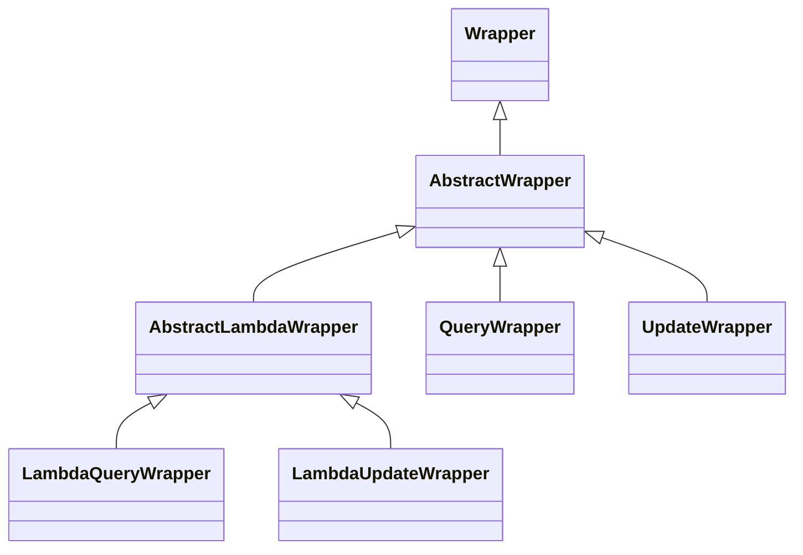
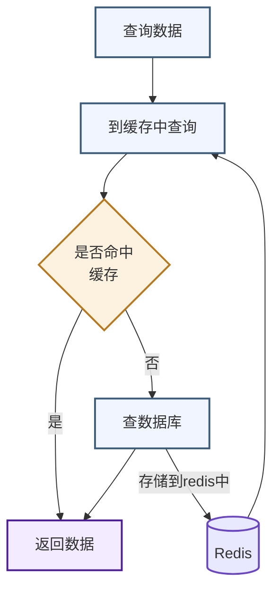
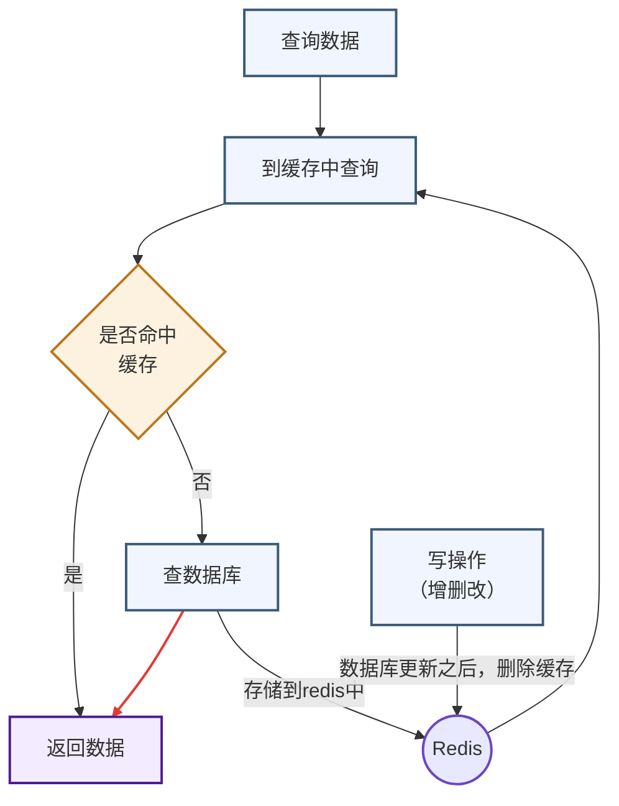
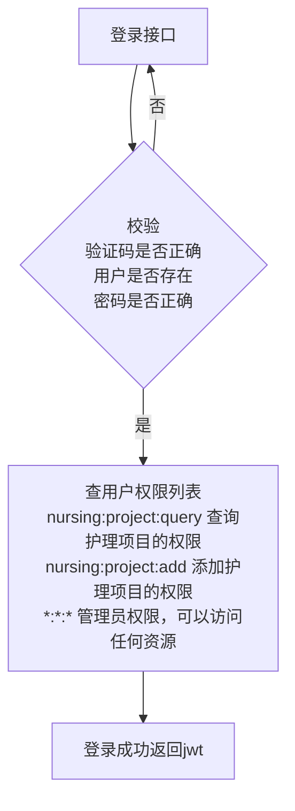
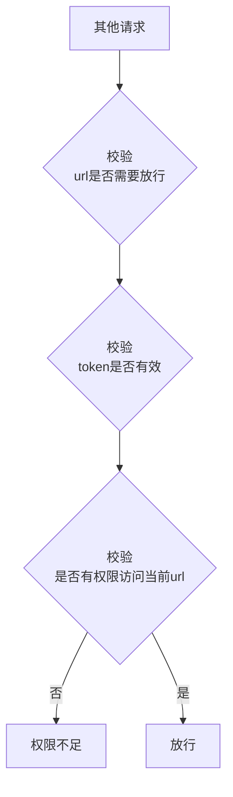
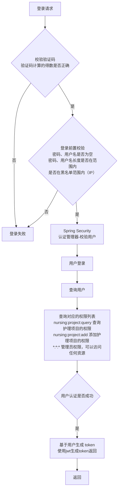

# 0. 

## 0. 浏览器控制台

#### 1. 元素

- **作用**：前端开发最常用的面板。它展示了当前网页的 **DOM 树**（即解析后的 HTML 结构）
- **使用场景**：
    - 右键网页点击“检查”，直接定位到对应的 HTML 标签
    - 在右侧面板实时修改 CSS 样式（修改颜色、边距等），立刻在页面上看到效果（刷新后消失）
    - 查看元素绑定的事件、盒模型尺寸等


#### 2. 控制台

- **作用**：一个交互式的命令行环境，也是前端报错的展示区
- **使用场景**：
    - **看报错**：网页白屏或按钮点不动时，最先看这里，通常会有红色的错误提示（如 `404` 找不到资源，或 `undefined` 代码异常）
    - **打日志**：开发者在代码里写的 `console.log('数据')` 会打印在这里，方便排查变量
    - **执行代码**：你可以直接在这里输入 JavaScript 代码（如 `document.body.style.background = 'red'`）并回车，直接修改当前页面


#### 3. 源代码/来源

- **作用**：网页的“代码仓库”和“调试器”
- **使用场景**：
    - 查看当前页面加载的所有 HTML、CSS、JavaScript 文件，甚至能查看到 Webpack/Vite 打包前的源码
    - **断点调试**：在 JavaScript 代码的行号上点击打上断点，代码运行到那里会暂停，你可以一步步执行，查看当时的变量值，找出 Bug 所在


#### 4. 网络

- **作用**：抓包工具，记录网页与服务器之间的所有通信
- **使用场景**：
    - **看接口**：前端请求后端 API 时，在这里查看请求参数（Payload）、响应结果（Response）、请求状态码（200 成功，500 报错）。
    - **看性能**：查看图片、JS、CSS 文件的加载时间，判断网页为什么加载慢
    - **过滤**：可以只看 `Fetch/XHR`（接口请求），或者只搜某个特定的请求名


##### 顶部菜单栏

1. **名称 (Name)**：

    - 接口的路径名，但隐藏了前缀

2. **状态 (Status)**：

    - HTTP 响应状态码

3. **类型 (Type)**：

    - 资源类型过滤器

        | 过滤器名称 (中文/英文) | 核心作用                                    | 典型对应的文件/场景说明                                      |
        | :--------------------- | :------------------------------------------ | :----------------------------------------------------------- |
        | **全部 (All)**         | 不筛选，显示所有网络请求                    | 包含网页加载的所有资源，通常用于查看整体加载情况             |
        | **Fetch/XHR**          | **最常用**，用来筛选前端调用的后端 API 接口 | 代码发起的 `axios` 或 `fetch` 请求（用于前后端数据交互）     |
        | **文档 (Doc)**         | 通常指 HTML 页面本身                        | 刷新页面时，最先请求的那个文件就是它                         |
        | **CSS**                | 样式表文件                                  | `.css` 文件（控制网页的排版和颜色外观）                      |
        | **JS**                 | JavaScript 脚本文件                         | `.js` 文件（控制网页的交互、动态效果和业务逻辑）             |
        | **字体 (Font)**        | 网页使用的特殊字体文件                      | `.woff`, `.woff2`, `.ttf`, `.otf` 等格式（用于美化网页文字） |
        | **图片 (Img)**         | 所有图片资源                                | `.png`, `.jpg`, `.jpeg`, `.gif`, `.svg`, `.webp` 等格式      |
        | **媒体 (Media)**       | 音视频文件                                  | `.mp4`, `.webm`, `.mp3`, `.wav` 等格式（网页里的视频播放器或音频） |

4. **启动器 (Initiator)**：

    - 告诉你这个请求是谁发出来的。比如 `login.js:36`，意思是这个请求是由 `login.js` 文件的第 36 行代码触发的

5. **大小 (Size)**：

    - 服务器返回数据的大小

6. **时间 (Time)**：

    - 这个请求花了多长时间（毫秒）


##### 子菜单栏

- **标头 (Headers) **
    这里是整个请求和响应的“元数据”（MetaData），相当于快递单上的信息。里面通常包含三大块：

    - **常规 (General)**：

        请求的完整 URL、请求方法（GET/POST）、状态码（200/500等）、请求的 IP 地址等

    - **响应标头 (Response Headers)**

    - **请求标头 (Request Headers)**

- **预览 (Preview) —— 看后端返回的数据（格式化）**

    - 如果后端返回的是 JSON 数据，这个标签页会把它解析成极其直观的树状结构

        可以一层层点击展开，查看具体的业务数据（比如用户列表、文章详情），比看原始代码舒服得多

- **响应 (Response) —— 看后端返回的原始代码**

    - 显示的是服务器传回来的最原始的文本或代码

- **启动器 (Initiator) **

    - 它记录了这个请求是由谁发起的

        通常会显示是由某个具体的 `.js` 文件的第几行代码触发的。如果是用户点击按钮触发的，它也会显示相关的调用栈

- **时间 (Timing)**

    - 这里用一个时间轴（瀑布图）拆解了请求生命周期的各个阶段耗时

- **Cookie **

    - 专门用来展示在这个特定的网络请求中，发出去的 Cookie 和 服务器返回设置（Set-Cookie）的 Cookie


#### 5. 应用

- **作用**：查看、修改和清除网页存储在你这台电脑上的各种数据（比如登录状态、缓存、离线数据等）

##### **存储 (Storage)**：

这是整个面板的核心分类

- **本地存储空间 (Local Storage)：**

    - 长期存储

        只要用户不主动清除，数据就会一直存在（关闭浏览器再打开还在）

- **会话存储空间 (Session Storage)：**

    - 临时存储

        一旦关闭当前浏览器标签页，数据就没了。适合存一些临时的表单数据

- **扩展程序存储：**

    - 安装的 Chrome 浏览器插件自身存储的数据

- **IndexedDB：**

    - 浏览器里自带的一个**小型数据库**

        相比于 LocalStorage，它能存大得多的数据（比如几MB甚至更庞大的数据），而且支持复杂的查询。有些网页会把大量缓存的聊天记录或商品列表存在这里

- **Cookie：**

    - **最传统的本地存储方式**

        每次发网络请求时，浏览器都会**自动**把它带在请求头里发给服务器

        绝大多数网站用它来保存**用户的登录凭证（Session ID / Token）**。点开它就能看到当前网站的 Cookie 键值对

- **私密状态令牌**：

    - 用于某些特定安全场景下的跨站令牌，防 CSRF 攻击等。

- **缓存空间 (Cache Storage)**：

    - 和 Service Worker 配合使用，用来缓存网页的静态资源（图片、JS 等），让你下次打开网页秒开。

- **存储桶**：

    - 用于现代浏览器 API（如 Origin Private File System），允许网页像操作本地文件夹一样在浏览器里存文件


## 1. @Resource

由 **JDK** 提供的依赖注入注解。它是 Java 的标准规范（JSR-250），不依赖于 Spring

##### 默认按名称（byName）装配

它会先拿字段名去 Spring 容器里找名字一样的 Bean。如果找不到名字，才会退化为按类型（byType）找

它可以通过 `name` 属性手动指定名字：`@Resource(name = "myService")`


# 1. Mybatis-Plus

Mybatis-Plus（简称MP）是一个基于Mybatis框架的增强工具，它在Mybatis的基础上只做增强而不做改变，旨在简化开发、提高效率

Mybatis-Plus提供了一系列的功能和特性，使得开发人员能够更加高效地使用Mybatis进行数据库操作

官网地址：https://mybatis.plus/


### 基础部分

#### 起步依赖

Mybatis-Plus的起步依赖需要替换掉MyBatis的起步依赖

```XML
<!--Mybatis-Plus-->
<dependency>
    <groupId>com.baomidou</groupId>
    <artifactId>mybatis-plus-spring-boot3-starter</artifactId>
    <version>3.5.11</version>
</dependency>
```


#### 引导类

需要在引导类上添加注解 **@MapperScan**，配置自动扫描Mapper：

```Java
@MapperScan("com.itheima.mapper")
@ServletComponentScan
@SpringBootApplication
public class TliasMangementSystemApplication {
    public static void main(String[] args) {
        SpringApplication.run(TliasMangementSystemApplication.class, args);
    }
}
```


#### BaseMapper

为了简化单表CRUD，Mybatis-Plus提供了一个基础的 **BaseMapper** 接口，其中已经实现了单表的CRUD：

| 功能分类 | 方法签名（：后为返回值类型）                                 | 说明                              |
| :------- | :----------------------------------------------------------- | :-------------------------------- |
| **增**   | `insert(T): int`                                             | 插入一条记录                      |
| **删**   | `deleteById(Serializable): int`                              | 根据主键 ID 删除                  |
| **删**   | `deleteById(T): int`                                         | 根据实体对象（含主键）删除        |
| **删**   | `deleteByMap(Map<String, Object>): int`                      | 根据 Map 条件删除                 |
| **删**   | `delete(Wrapper<T>): int`                                    | 根据条件构造器 Wrapper 删除       |
| **删**   | `deleteBatchIds(Collection<?>): int`                         | 根据主键 ID 集合批量删除          |
| **改**   | `updateById(T): int`                                         | 根据主键 ID 更新记录              |
| **改**   | `update(T, Wrapper<T>): int`                                 | 根据条件构造器 Wrapper 更新记录   |
| **查**   | `selectById(Serializable): T`                                | 根据主键 ID 查询单条记录          |
| **查**   | `selectBatchIds(Collection<? extends Serializable>): List<T>` | 根据主键 ID 集合批量查询          |
| **查**   | `selectByMap(Map<String, Object>): List<T>`                  | 根据 Map 条件查询列表             |
| **查**   | `selectOne(Wrapper<T>): T`                                   | 根据条件查询单条记录              |
| **查**   | `exists(Wrapper<T>): boolean`                                | 判断满足条件的记录是否存在        |
| **查**   | `selectCount(Wrapper<T>): Long`                              | 查询满足条件的总记录数            |
| **查**   | `selectList(Wrapper<T>): List<T>`                            | 根据条件查询列表                  |
| **查**   | `selectMaps(Wrapper<T>): List<Map<String, Object>>`          | 根据条件查询，返回 Map 列表       |
| **查**   | `selectObjs(Wrapper<T>): List<Object>`                       | 根据条件查询，只返回第一列字段值  |
| **分页** | `selectPage(P, Wrapper<T>): P`                               | 分页查询，返回分页对象            |
| **分页** | `selectMapsPage(P, Wrapper<T>): P`                           | 分页查询，返回 Map 类型的分页对象 |

因此我们自定义的 Mapper 只要**实现这个 BaseMapper**，就无需自己实现单表CRUD了

```Java
public interface DeptMapper extends BaseMapper<Dept> {

}
```

在实现 BaseMapper 接口时需要指定泛型，该泛型对应的就是与数据库表对应的 pojo

Mybatis-Plus 就是根据 pojo 实体的信息通过**反射**来推断出表的信息，从而生成SQL的

规则如下：

- Mybatis-Plus 会把 pojo **实体**的类名驼峰转下划线**作为表名**
- Mybatis-Plus 会把名为 **id** 的字段**作为主键**
- Mybatis-Plus 会把 pojo 实体的所有**变量名**驼峰转下划线作为**表的字段名**，并根据变量类型**推断字段类型**


#### 注解

但有些情况下，实体类的类名与表名不完全一致，或者实体类中的属性名和数据库表中的字段名无法完全对应，因此Mybatis-Plus提供了一些注解便于咱们声明表信息，常用的有下面几个注解：

##### **@TableName**

- 描述：表名注解，标识实体类对应的表
- 使用位置：实体类

示例：

```Java
@Data
@NoArgsConstructor
@AllArgsConstructor
@TableName("tb_user")
public class User {
    private Long id;

    private String name;

    private Boolean isMarried;

    private Integer order;

    private String address;
}
```


##### **@TableField**

- 普通字段注解

示例：

```Java
@Data
@NoArgsConstructor
@AllArgsConstructor
@TableName("tb_user")
public class User {
    @TableId(value = "id", type = IdType.AUTO)
    private Long id;

    @TableField("username")
    private String name;

    private Boolean isMarried;

    @TableField("`order`")
    private Integer order;

    @TableField(exist = false)
    private String address;
}
```

一般情况下咱们并不需要给字段添加 **@TableField** 注解，一些特殊情况除外：

- 成员变量名与数据库字段名不一致
- 成员变量名与数据库一致，但是与数据库的关键字冲突。使用 @TableField 注解给结合 **` `` `** 指定字段名称
- 成员变量不是数据库中的字段，则需要将 **exist** 属性设置为 **false**，明确告知 MyBatisPlus 该字段在数据库表中不存在


##### **@TableId**

- 描述：主键注解，标识实体类中的主键字段和主键生成类型

- 使用位置：实体类的主键字段

- 示例

    ```java
    @Data
    @NoArgsConstructor
    @AllArgsConstructor
    @TableName("tb_user")
    public class User {
        @TableId(value = "id", type = IdType.AUTO)
        private Long id;
    
        private String name;
    
        private Boolean isMarried;
    
        private Integer order;
    
        private String address;
    }
    ```

- **@TableId**注解支持两个属性：

**value：**指定数据库表中的主键字段名称

**IdType：**指定主键生成类型，支持的类型有：

- **IdType.AUTO：**使用数据库自增 ID 作为主键

- **IdType.NONE：**无特定生成策略，如果全局配置中有 IdType 相关的配置，则会跟随全局配置

- **IdType.INPUT：**在插入数据前，由用户自行设置主键值

- **IdType.ASSIGN_ID：默认的ID策略！**自动分配 `ID`，适用于 `Long`、`Integer`、`String` 类型的主键

    默认使用雪花算法通过 `IdentifierGenerator` 的 `nextId` 实现

- **IdType.ASSIGN_UUID：**自动分配 **UUID**，适用于 **String** 类型的主键。默认实现为 **IdentifierGenerator** 的 **nextUUID** 方法


#### 常见配置

Mybatis-Plus也支持基于yml文件的自定义配置，详见官方文档：https://www.baomidou.com/reference/

大多数的配置都有默认值，因此咱们都无需配置。但还有一些是没有默认值的，一些常见的配置如下：


- **全局id类型**

```YAML
mybatis-plus:
  global-config:
    db-config:
      id-type: auto             # 全局id类型为自增长
      update-strategy: not_null # 更新策略：只更新非空字段
```


需要注意的是，Mybatis-Plus 也**支持手写 SQL** 的，而 mapper 层的 xml 映射文件的读取位置可以自己配置：

- **type-aliases-package：**指定 MyBatis 别名包扫描路径，用于给包中的类注册别名。注册后，在 Mapper 对应的 XML 文件中可以直接使用类名，无需使用全限定类名。

- **mapper-locations：**指定 MyBatis 的 Mapper 层 XML 映射文件的位置

    **默认值**：`["classpath*:/mapper/**/*.xml"]`

    ```yaml
    mybatis-plus:
      type-aliases-package: com.itheima.pojo
      mapper-locations: classpath:mapper/**/*Mapper.xml
      configuration:
        map-underscore-to-camel-case: true
        log-impl: org.apache.ibatis.logging.stdout.StdOutImpl
    
      global-config:
        db-config:
          id-type: auto             # 全局id类型为自增长
          update-strategy: not_null # 更新策略：只更新非空字段
    ```

    mapper-locations也可以配置成 `classpath*:mapper/**.xml`，也就是说咱们只要把 mapper.xml 文件放置在 mapper 目录下就一定会被加载


### 核心部分

#### 1.Wrapper 条件构建器

除了查询以外，修改、删除的 SQL 语句都需要指定 where 条件。因此 BaseMapper 中不仅仅提供了接收 id 作为 where 条件的方法，还提供了一组可以接收更加复杂的 where 条件的方法

| 方法签名                           | 返回类型                      | 功能描述 (基于复杂where条件) |
| :--------------------------------- | :---------------------------- | :--------------------------- |
| **delete(Wrapper\<T>)**            | **int**                       | 删除                         |
| **exists(Wrapper\<T>)**            | **boolean**                   | 判断是否存在                 |
| **selectCount(Wrapper\<T>)**       | **Long**                      | 统计数量                     |
| **selectList(Wrapper\<T>)**        | **List\<T>**                  | 查询列表                     |
| **selectMaps(Wrapper\<T>)**        | **List<Map<String, Object>>** | 查询 Map 列表                |
| **selectMapsPage(P, Wrapper\<T>)** | **P**                         | 分页查询 Map                 |
| **selectObjs(Wrapper\<T>)**        | **List\<Object>**             | 查询指定字段列表             |
| **selectOne(Wrapper\<T>)**         | **T**                         | 查询单条记录                 |
| **selectPage(P, Wrapper\<T>)**     | **P**                         | 分页查询                     |
| **update(T, Wrapper\<T>)**         | **int**                       | 更新                         |

参数中的 **Wrapper** 就是条件构建的抽象类，其下有很多默认实现，继承关系如图：




##### **AbstractWrapper** 

**Wrapper** 的子类 **AbstractWrapper** 提供了where中包含的所有类型条件的构建方法：

| 方法签名                                      | 返回类型  | 具体功能描述                    | 对应 SQL 逻辑 / 说明                          |
| :-------------------------------------------- | :-------- | :------------------------------ | :-------------------------------------------- |
| **getEntity()**                               | T         | 获取当前 Wrapper 内部的实体对象 | 用于获取通过 setEntity 传入的实体             |
| **setEntity(T)**                              | Children  | 设置 Wrapper 内部的实体对象     | 常用于 UpdateWrapper 中设置要更新的数据       |
| **getEntityClass()**                          | Class\<T> | 获取实体类的 Class 对象         | 获取泛型 T 的实际类型                         |
| **setEntityClass(Class\<T>)**                 | Children  | 设置实体类的 Class 对象         | 手动指定泛型 T 的类型                         |
| **allEq(boolean, Map<R, V>, boolean)**        | Children  | 批量等于（Map 形式）            | WHERE key1 = val1 AND key2 = val2...          |
| **allEq(boolean, BiPredicate, Map, boolean)** | Children  | 批量等于（带过滤器）            | 同上，但可通过 BiPredicate 过滤掉不需要的字段 |
| **eq(boolean, R, Object)**                    | Children  | 等于                            | column = val                                  |
| **ne(boolean, R, Object)**                    | Children  | 不等于                          | column <> val                                 |
| **gt(boolean, R, Object)**                    | Children  | 大于                            | column > val                                  |
| **ge(boolean, R, Object)**                    | Children  | 大于等于                        | column >= val                                 |
| **lt(boolean, R, Object)**                    | Children  | 小于                            | column < val                                  |
| **le(boolean, R, Object)**                    | Children  | 小于等于                        | column <= val                                 |
| **like(boolean, R, Object)**                  | Children  | 全模糊查询                      | column LIKE '%val%'                           |
| **notLike(boolean, R, Object)**               | Children  | 全模糊不匹配                    | column NOT LIKE '%val%'                       |
| **likeLeft(boolean, R, Object)**              | Children  | 左模糊查询                      | column LIKE '%val' (以 val 结尾)              |
| **likeRight(boolean, R, Object)**             | Children  | 右模糊查询                      | column LIKE 'val%' (以 val 开头)              |
| **notLikeLeft(boolean, R, Object)**           | Children  | 左模糊不匹配                    | column NOT LIKE '%val'                        |
| **notLikeRight(boolean, R, Object)**          | Children  | 右模糊不匹配                    | column NOT LIKE 'val%'                        |
| **between(boolean, R, Object, Object)**       | Children  | 范围查询（包含边界）            | column BETWEEN val1 AND val2                  |
| **notBetween(boolean, R, Object, Object)**    | Children  | 范围查询（排除边界）            | column NOT BETWEEN val1 AND val2              |
| **and(boolean, Consumer)**                    | Children  | 逻辑与嵌套（AND (...)）         | AND (嵌套的 SQL 片段)，常用于拼接括号         |
| **or(boolean, Consumer)**                     | Children  | 逻辑或嵌套（OR (...)）          | OR (嵌套的 SQL 片段)，用于改变优先级          |
| **nested(boolean, Consumer)**                 | Children  | 正常嵌套（(...)）               | AND (嵌套的 SQL 片段)，and 的默认行为         |
| **not(boolean, Consumer)**                    | Children  | 逻辑非嵌套（NOT (...)）         | NOT (嵌套的 SQL 片段)                         |

方法签名里的第一个参数 **boolean**，是用来控制“是否将这个查询条件拼接到最终 SQL 中”的开关（前置判断条件），比如先验证该字段是否为空


**QueryWrapper 拓展的方法**

在 **AbstractWrapper** 的基础上拓展了 **select** 方法，允许指定查询字段

| 方法签名                                          | 返回类型         | 具体功能描述                                |
| :------------------------------------------------ | :--------------- | :------------------------------------------ |
| **select(String...)**                             | QueryWrapper\<T> | 指定要查询的数据库字段名（可变参数）        |
| **select(List\<String>)**                         | QueryWrapper\<T> | 指定要查询的数据库字段名（List 集合）       |
| **select(Class\<T>, Predicate\<TableFieldInfo>)** | QueryWrapper\<T> | 通过实体类的 Class 和字段过滤器指定查询字段 |

```java
@Test
public void testQueryWrapper() {
    // 查询姓名中包含“李”且薪资大于等于5000的员工的 id, name, phone, salary字段
    QueryWrapper<Emp> queryWrapper = new QueryWrapper<>();
    queryWrapper.like("name", "李")
            .ge("salary", 5000)
            .select("id", "name", "phone", "salary");

    List<Emp> emps = empMapper.selectList(queryWrapper);
    emps.forEach(System.out::println);
}
```


**UpdateWrapper 拓展的方法**

在 **AbstractWrapper** 的基础上拓展了 **set** 方法，允许指定 SQL 中的 SET 部分

| 方法签名                                 | 返回类型          | 功能分类 | 具体功能描述                                              |
| :--------------------------------------- | :---------------- | :------- | :-------------------------------------------------------- |
| **getSqlSet()**                          | String            | 获取 SQL | 获取当前拼装的 `SET` 部分的 SQL 语句                      |
| **set(boolean, String, Object, String)** | UpdateWrapper\<T> | 更新字段 | 设置 `SET` 字段，包含条件开关、列名、值以及自定义 mapping |
| **setSql(boolean, String)**              | UpdateWrapper\<T> | 更新字段 | 直接设置原生的 `SET` SQL 片段，包含条件开关               |

```java
@Test
public void testUpdateWrapper() {
    // 更新id为5, 6, 7的员工的薪水，加2000
    UpdateWrapper<Emp> updateWrapper = new UpdateWrapper<>();
    updateWrapper.in("id", 5, 6, 7)
            .setSql("salary = salary + 2000");
    empMapper.update(updateWrapper);
}
```


##### AbstractLambdaWrapper

无论是 QueryWrapper 还是 UpdateWrapper 在构造条件的时候都需要写死字段名称，这在编程规范中显然是不推荐的

其中一种办法是基于变量的 **getter 方法**结合**反射技术**来实现，因此咱们只要将条件对应的字段的 **getter 方法传递给 Mybatis-Plus**，它就能计算出对应的变量名了，而传递方法可以使用 JDK8 中的 **方法引用** 和 **Lambda 表达式**

```java
Emp::getName 
//完全等价于下面这个 Lambda 表达式：
(Emp emp) -> emp.getName()
```

因此 Mybatis-Plus 又提供了一套**基于 Lambda 的 Wrapper**，包含两个类：

- **LambdaQueryWrapper**
- **LambdaUpdateWrapper**

分别对应 QueryWrapper 和 UpdateWrapper 

示例：

```Java
@Test
public void testLambdaQueryWrapper() {
    // 查询姓名中包含“李”且薪资大于等于5000的员工的 id, name, phone, salary字段
    LambdaQueryWrapper<Emp> queryWrapper = new LambdaQueryWrapper<>();
    queryWrapper.like(Emp::getName, "李")
            .gt(Emp::getSalary, 5000)
            .select(Emp::getId, Emp::getName, Emp::getPhone, Emp::getSalary);

    List<Emp> emps = empMapper.selectList(queryWrapper);
    System.out.println(emps);
}

@Test
public void testLambdaUpdateWrapper() {
    // 更新id为5, 6, 7的员工的薪水，加2000
    LambdaUpdateWrapper<Emp> updateWrapper = new LambdaUpdateWrapper<>();
    updateWrapper.in(Emp::getId, 5, 6, 7)
            .setSql("salary = salary + 2000");
    empMapper.update(updateWrapper);
}
```


##### 链式查询器 LambdaQueryChainWrapper\<T>

内部封装了 **LambdaQueryWrapper** **条件构造器** 和 **BaseMapper**，**自带执行方法**

用法：直接链式调用条件方法后，接 `.list()`、`.one()`、`.count()` 等即可执行

示例：

```java
List<User> list = userService.lambdaQuery()
    .gt(User::getAge, 18)
    .like(User::getName, "张")
    .list();
```


##### lambdaQuery( )

开启链式查询，并允许你用方法引用（如 `User::getAge`）来指定字段，有以下两种使用方式：

1. **Wrappers.lambdaQuery( )**

    来自 **Wrappers 静态工具类**，是一个静态工厂方法

    ```java
    public static <T> LambdaQueryWrapper<T> lambdaQuery()
    ```

    - 返回类型：**LambdaQueryWrapper\<T> 条件构造器**

    通常需要显式指定泛型（如 `Wrappers.<EmpExpr>lambdaQuery()`）才能后续使用方法引用

2. **ServiceImpl 内部的 lambdaQuery( )**

    来自 **ServiceImpl**，是一个继承来的实例方法（实际上定义在 `IService` 接口中或通过 `ServiceImpl` 提供）

    ```java
    public LambdaQueryChainWrapper<T> lambdaQuery()
    ```

    - 返回类型：**LambdaQueryChainWrapper\<T>** **链式查询器**

    泛型 T 由 **ServiceImpl<M, T> 中的 T 自动确定**，不需要显式指定


#### IService接口

Mybatis-Plus 不仅提供了Map层接口 BaseMapper，还提供了通用的 **Service 层**接口及默认实现，并在其中封装了一些常用的 service 模板方法

 通用接口为 IService，默认实现为 ServiceImpl，其中封装的方法可以分为以下几类：

- **save：**新增
- **remove：**删除
- **update：**更新
- **get：**查询**单个**结果
- **list：**查询**集合**结果
- **count：**计数
- **page：**分页查询


##### 新增 save：

- `save`：新增单个元素
- `saveBatch`：批量新增
- `saveOrUpdate`：根据id判断，如果数据存在就更新，不存在则新增
- `saveOrUpdateBatch`：批量的新增或修改


##### 删除 remove：

- `removeById`：根据id删除
- `removeByIds`：根据id批量删除
- `removeByMap`：根据Map中的键值对条件删除
- `remove(Wrapper<T>)`：根据Wrapper条件删除
- `~~removeBatchByIds~~`：暂不支持


##### 修改 update：

- `updateById`：根据id修改
- `update(Wrapper<T>)`：根据`UpdateWrapper`修改，`Wrapper`中包含`set`和`where`部分
- `update(T，Wrapper<T>)`：按照`T`内的数据修改与`Wrapper`匹配到的数据
- `updateBatchById`：根据id批量修改


##### 查询**单个**结果 Get：

- `getById`：根据id查询1条数据
- `getOne(Wrapper<T>)`：根据`Wrapper`查询1条数据
- `getBaseMapper`：获取`Service`内的`BaseMapper`实现，某些时候需要直接调用`Mapper`内的自定义`SQL`时可以用这个方法获取到`Mapper`


##### 查询**集合**结果 List：

- `listByIds`：根据id批量查询
- `list(Wrapper<T>)`：根据Wrapper条件查询多条数据
- `list()`：查询所有


##### 计数 Count：

- `count()`：统计所有数量
- `count(Wrapper<T>)`：统计符合`Wrapper`条件的数据数量


**分页 Page：**

于 v3.5.9 起，PaginationInnerInterceptor 已分离出来。如需使用，则需单独引入 **mybatis-plus-jsqlparser 依赖**

```XML
<dependency>
    <groupId>com.baomidou</groupId>
    <artifactId>mybatis-plus-jsqlparser</artifactId>
    <version>3.5.11</version>
</dependency>
```

接下来，在项目中新建一个配置类：**com.itheima.config.MybatisConfig**

```Java
package com.itheima.config;

import com.baomidou.mybatisplus.annotation.DbType;
import com.baomidou.mybatisplus.extension.plugins.MybatisPlusInterceptor;
import com.baomidou.mybatisplus.extension.plugins.inner.PaginationInnerInterceptor;
import org.springframework.context.annotation.Bean;
import org.springframework.context.annotation.Configuration;

@Configuration
public class MybatisConfig {
    // 配置类，用于注册第三方bean
    @Bean
    public MybatisPlusInterceptor mybatisPlusInterceptor() {
        // 初始化Mybatis-Plus核心插件
        MybatisPlusInterceptor mybatisPlusInterceptor = new MybatisPlusInterceptor();
        // 添加分页插件
        PaginationInnerInterceptor paginationInnerInterceptor = new PaginationInnerInterceptor(DbType.MYSQL);
        // 设置每页最大条数
        paginationInnerInterceptor.setMaxLimit(1000L);
        // 添加分页插件到核心插件中
        mybatisPlusInterceptor.addInnerInterceptor(paginationInnerInterceptor);

        return mybatisPlusInterceptor;
    }
}
```


##### 基本用法

由于 Service 中经常需要定义与业务有关的自定义方法，因此咱们不能直接使用 IService，而是自定义 Service 接口，

然后 **继承 IService** **接口** 以拓展方法

同时，让自定义的 Service 实现类 **继承 ServiceImpl**，ServiceImpl 实现了 IService 中的方法，这样就不用自己实现 IService 中的接口了

最后修改 Controller 层的代码来调用 IService 层的方法就可以了


# 2. Git

Git是一个分布式版本控制工具，主要用于管理开发过程中的源代码文件（Java文件、yml文件、xml文件等），在软件开发过程中被广泛使用，它的核心作用如下：

- **远程备份**: 

    Git允许你将代码库备份到远程服务器，以防止数据丢失。常见的远程备份方式包括使用GitHub、GitLab、Gitee等代码托管服务

- **多人协作**: 

    Git允许多个开发者在同一个代码库上协同工作。开发者可以共享代码、合并变更、解决冲突等

- **代码回溯**: 

    代码回溯是指在Git中返回到先前的代码状态或版本。对于修复错误或者恢复不小心删除的代码非常有用

- **版本切换**: 

    在Git中，你可以通过切换分支或检出不同的提交来切换代码的版本


### 仓库

#### 1.本地仓库

##### 工作区

包含 .git 文件夹的目录就是工作区，也称为工作目录或工作空间，主要用于存放开发的代码

##### 版本库

.git 隐藏文件夹就是版本库，版本库中存储了很多配置信息、日志信息和文件版本信息等

##### 暂存区

.git 文件夹中有很多文件，其中有一个 index 文件就是暂存区，也可以叫做 stage。暂存区是一个临时保存修改文件的地方

#### 2.远程仓库

- 借助互联网上提供的一些代码托管服务来实现，比如：GitHub、Gitee码云 等
- 自己在服务器端搭建，比如：GitLab、Gogs 等


### 分支

分支是 Git 中的一个非常重要的概念。使用分支意味着你可以把你的工作从开发主线上分离开来，以免影响开发主线

同一个仓库可以有多个分支，各个分支相互独立，互不干扰

通过 **git init** 命令创建本地仓库时默认会创建一个 **master** 分支


#### HEAD

是一个特殊的引用（reference），它指向当前分支的最新提交（commit）

**HEAD** 标识了当前分支中工作的基础点，即你最近一次提交的地方


#### 关键步骤流程：

1. **创建分支：**从主分支（如master）出发，创建一个新的分支（如v1）。这允许开发者在新的分支上自由地进行代码修改，而不必担心这些修改会立即影响到主分支或其他团队成员的工作
2. **独立开发：**在v1分支上，开发者可以自由地编写代码、测试功能，甚至进行多次提交，所有这些操作都独立于主分支
3. **合并分支：**当v1分支上的开发完成后，开发者可以选择将v1分支的更改合并回主分支。这确保了主分支能够包含所有最新的功能和修复，同时保持了代码的整洁和一致性
4. **灵活管理：**Git的分支机制还允许开发者在需要时轻松地切换分支，比如从v1分支切换到master分支查看或处理其他事务，然后再切换回v1分支继续工作（HEAD的作用）


#### 分支创建规则

在项目开发中，遵守Git分支的创建规则通常是为了提高团队协作效率、代码质量以及版本管理的清晰度。以下是一些常见的Git分支创建规则：

##### 1. 主分支（master）

主分支是项目的**稳定版本**，用于**发布和部署**，只有经过严格测试和代码审核的代码才能被合并到主分支，通常**命名为 master**，master 分支以 **tag 标记一个版本**，因此在 master 分支上看到的每一个 tag 都应该对应一个线上版本

##### 2. 开发分支（develop/dev）

开发分支是团队进行日常**开发的主要分支**，包含了项目中最新的功能和代码，通常命名为 **develop** 或 **dev**，每个新功能或任务通常从该分支创建独立的特性分支进行开发

##### 3. 特性分支（feature）

特性分支用于**开发特定的功能**，每个新功能或任务都应在从develop分支创建的 **feature/xxx** 形式的特性分支上进行开发和测试，开发完成后合并回 develop 分支并且删除该 feature/xxx 分支

##### 4. 预发布分支（release）

预发布分支用于准备发布新版本，进行**最后的测试和调整**，从 develop 分支创建以确保代码稳定，命名格式为**release/xxx**，其中 xxx 是具体的版本号，创建好 release 分支后需要对要发布的功能进行最后的测试，如果测试过程中若存在 bug 需要修复，则直接由开发者在 release 分支修复并提交。测试完成之后，将 release 分支合并到 master 和 develop 分支，此时 master 为最新代码，用作上线

##### 5. 修复分支（hotfix/bugfix）

修复分支用于解决**线上紧急 bug 或修复已知问题**，从 master 分支创建以确保修复代码直接应用于稳定版本，命名格式为 **hotfix/xxx** 或 **bugfix/xxx** ，完成 bug 修复后将代码合并到 master 分支和 develop 分支，合并完成后可以删除该分支

以上就是在项目中应该出现的分支以及每个分支功能的说明，其中**长期稳定存在的分支只有 master 和 develop 分支**，别的分支在完成对应的使命之后都会合并到这两个分支然后被删除


### 全局配置

**设置用户信息(全局配置，只配置这一次，必须配置)：**

```bash
git config --global user.name "用户名" 
git config --global user.email "邮箱"
```

注意：

- 上面设置的user.name和user.email是用户的身份标识，必须需要设置，不然后期的命令操作不了
- 理论上身份标识可以任意设置，建议还是设置成自己的名字，方便识别是谁提交了代码。

**查看配置信息：**

```bash
git config --list
```


### Git常用命令

#### 本地仓库命令

##### 1. 初始化本地仓库

要使用Git对项目代码进行版本控制，首先需要初始化一个Git仓库。可以通过如下命令操作：

- 初始化Git仓库

    ```bash
    git init
    ```

    如果在当前目录中看到 **.git文件夹**（此文件夹为隐藏文件夹）则说明Git仓库创建成功


##### 2. 查看文件状态 

```bash
git status  
```

- **untracked**  **未跟踪文件**，说明当前文件还没有被git进行版本控制


##### 3. 把新增或修改的文件添加暂存区  

```BASH
git add  
```

- 把指定文件添加暂存区

    ```bash
    git add abc.txt
    ```

- 把当前目录及其子目录下的所有文件都添加暂存区

    ```bash
    git add *   
    git add .
    ```

**Changes to be committed  待提交的更改内容**，目前文件在暂存区，还未提交到本地仓库


##### 4. 提交暂存区的文件到本地仓库  

```bash
git commit  
```

- 提交一个文件：

    ```bash
    git commit -m "第一次提交abc.txt文件到本地仓库" abc.txt
    ```

- 提交多个文件：

    ```bash
    git commit -m "第一次提交abc.txt文件到本地仓库" *
    ```

**-m** 选项指定了提交信息（**必须携带**，需要知道这次提交的说明是什么，要尽可能的简洁）

**nothing to commit, working tree clean**  没有需要提交的更改，工作目录是干净的（提交完成的效果）


##### 5. 查看详细的提交日志 

```bash
git log 
```

更加简洁的日志   

```bash
git reflog
```


##### 6. 将暂存区文件取消暂存或切换到指定版本   

```bash
git reset  
```

当暂存区中有文件时，可以使用它将会清空暂存区

现在想要把abc.txt文件的内容恢复到某次提交的版本内容，可以执行以下命令：

```bash
git reset --hard xxxx
```

- **--hard xxxx**  是指提交日志中的唯一版本号


##### 7. 忽略文件

项目代码中不需要纳入版本控制系统的文件，通常是一些编译文件和临时的缓存文件，把它们纳入版本控制系统中毫无意义

忽略文件列表被存放在项目根目录中一个被称之为 **.gitignore** 的文件中

**忽略文件的规则**

- 忽略一个特定的文件：`path/file.ext` 
- 忽略项目下所有这个名字的文件：`filename.ext`
- 忽略项目下所有这个类型的文件：`*.class`
- 忽略一个特定目录下的所有文件：`target/*`


#### 远程仓库命令

##### 1. 添加关联的远程仓库   

```bash
git remote add <shortname> <url>
```

- **shortname：**给这个远程仓库起的**本地别名**

- **url：**远程仓库的**实际访问地址**


##### 2. 查看关联的远程仓库   

```bash
git remote [-v]
```

查看已经配置的远程仓库服务器，会列出每一个远程服务器的简称

- 本地仓库配置的远程仓库都需要一个简称，后续在和远程仓库交互时会使用到这个简称
- 可以通过-v选项查看远程仓库更加详细的信息


##### 3. 移除关联的远程仓库   

```bash
git remote remove <shortname>   
```

- **shortname：**远程仓库的简称


##### 4. 往远程仓库推送   

```bash
git push <shortname> <branch> 
```

把本地仓库的代码或文件提交到远程仓库中

- **shortname：**给这个远程仓库起的**本地别名**
- **branch：**分支名称

如果是第一次操作，需要进行身份认证，认证通过才可以推送


##### 5. 从远程仓库克隆   

```bash
git clone <url>  
```

Git 克隆的是该 Git 仓库服务器上的几乎所有数据（包括文件、日志信息、历史记录等）

而且克隆之后，该本地仓库就**自动关联该远程仓库**

把仓库克隆到本地之后，本地仓库已经存在了，可以在克隆之后的仓库中继续执行其他git操作


##### 6. 从远程仓库拉取   

```bash
git pull <shortname> <branch>   
```

从远程仓库获取最新版本并合并到本地仓库

**注意**：如果当前本地仓库不是从远程仓库克隆的，而是本地创建的仓库，并且仓库中存在新文件，此时再从远程仓库拉取文件的时候会报错（`fatal: refusing to merge unrelated histories`）

解决此问题可以在git pull命令后加入参数 `--allow-unrelated-histories`


#### 分支命令

##### 1. 查询分支  

```bash
git branch 
```

- `git branch`               列出所有本地分支
- `git branch -r`         列出所有远程分支
- `git branch -a`         列出所有本地分支和远程分支


##### 2. 创建分支

```bash
git branch 分支名称
```


##### 3. 切换分支

```bash
git checkout 分支名称
```

注意：在命令行中会显示出当前所在分支


##### 4. 将分支推送至远程仓库

```bash
git push 远程仓库简称 分支名称
```


##### 5. 合并分支

合并分支就是将两个分支的文件进行合并处理

```bash
git merge 分支命令
```

注意：分支合并时需注意合并的方向，比如在master分支执行操作，结果就是将其他分支合并到master分支


### 版本冲突

#### 冲突产生的情况

**多人同时修改同一文件**：

一个项目是由一个团队开发，如果多个开发人员同时对同一个文件的相同部分进行修改，并尝试提交这些修改时，Git无法自动合并这些更改，从而导致冲突

**合并分支时：**

当尝试将两个不同的分支合并到一个公共分支（如主分支）或者尝试将其他分支的代码合并到当前分支时，如果这些分支对同一个文件进行了不同的修改，Git在合并这些更改时可能会产生冲突

**重命名或移动文件**：

如果在一个分支中重命名或移动了文件，而在另一个分支中对原始文件进行了修改，那么在合并这些分支时可能会产生冲突

**删除文件**：

如果一个分支删除了某个文件，而另一个分支对该文件进行了修改，合并时也会发生冲突


#### 解决冲突

解决Git冲突通常需要手动干预

以下是一些常用的解决冲突步骤：

1. **查看冲突：**

    使用 **git status** 命令查看哪些文件存在冲突

    使用 **git diff** 命令查看冲突文件的差异

2. **手动解决冲突：**

    - 打开冲突文件，找到被Git标记的冲突部分

        Git会用 **`<<<<<<<`、`=======` 和 `>>>>>>>`** 这样的标记来指示冲突的开始、当前分支的更改、另一个分支的更改和冲突的结束

	- 手动编辑冲突部分，根据需要保留或合并不同的更改

	- 删除Git的冲突标记（**`<<<<<<<`、`=======`、`>>>>>>>`**）

1. **标记冲突已解决：**
   
    使用 **git add** 命令将解决冲突后的文件添加到暂存区，标记为冲突已解决
    
2. **提交更改：**
   
    1. 使用 **git commit** 命令提交解决冲突后的更改。在提交信息中，可以简要描述解决冲突的过程
    2. `git commit -a -m '解决冲突' `   全部提交
    3. `git commit abc.txt -i -m "解决冲突"  `    提交部分文件

解决冲突时，需仔细分析原因和上下文，确保选择正确方案。为减少冲突，建议保持良好沟通和协作，避免同时修改同一文件的同一个位置，频繁提交代码和定期合并分支也有助于及时发现和解决冲突


### IDE 集成 Git

#### 基础

在 IDEA 中使用 Git，本质上还是使用的本地安装的 Git 软件，所以需要提前安装好 Git 并在 IDEA 中配置 Git

执行的git命令，其实就是执行 Git 安装目录下的 cmd 目录下的 **git.exe** 文件

我们要在 IDEA 的 Settings 中对这个 git.exe 文件进行路径配置


- 蓝色的文件代表修改
- 绿色的文件代表新增


#### Reset Current Branch to Here...

**重置当前分支到指定提交**

- **功能本质**：将当前分支的 HEAD 指针强制回退（移动）至选定的历史提交节点
- **执行后果**：目标提交之后的所有提交记录将从当前分支的历史时间线中被移除（即历史被篡改）
- **底层命令**：`git reset`
- **危险指数**：中高风险
- **适用场景**：仅适用于**尚未推送到远程仓库的本地私有提交**。例如，本地连续进行了多次错误提交，需要彻底抹除这些记录并重新开始
- **IDEA 的交互设计**：触发该操作后，IDE 会提供三种重置模式以供选择：
    - **Soft**：仅移动 HEAD 指针（撤销提交记录），但保留所有代码变更至**暂存区（Staged）**
    - **Mixed**（默认）：移动 HEAD 指针，保留代码变更，但将其重置为**未暂存状态（Unstaged）**
    - **Hard**：**高危操作**。移动 HEAD 指针，并**强制丢弃**目标提交之后的所有代码变更（包括工作区和暂存区中未提交的修改）


#### Revert Commit

**还原提交 / 反向提交**

- **功能本质**：通过创建一个**新的提交**，来抵消（反向操作）目标历史提交的代码变更
- **执行后果**：完全保留现有的历史记录，不做任何篡改。例如，提交记录将呈现为：`Commit A` -> `Revert "Commit A"`
- **底层命令**：`git revert`
- **安全指数**：非常安全，适合团队协作
- **适用场景**：适用于**已经推送到远程仓库的公共提交**。当发现某个已推送的提交存在严重缺陷时，使用 Revert 生成一个“解药”提交，可避免破坏其他团队成员的本地区块历史
- **注意事项**：若目标提交的代码在后续的提交中已被修改，执行 Revert 可能会产生代码冲突，需手动解决


#### Undo Commit

**撤销提交**

- **功能本质**：IDEA 提供的一个**快捷撤销操作**。它的底层行为通常等同于 `git reset --soft HEAD~1`
- **执行后果**：直接撤销**最近一次**（最新）的提交记录，但会将这次提交涉及的所有代码修改**原封不动地保留在暂存区（Staged）**中
- **危险指数**：极低风险，纯本地操作
- **适用场景**：
    - **提交信息填错**：刚点下 Commit，发现 Commit Message 写错了，或者漏选了文件，使用 Undo Commit 撤销后，重新勾选文件并填写正确的信息再次提交
    - **误提交**：不小心把不需要提交的代码 Commit 了，一键退回修改状态
- **与 Reset 的区别**：Reset 功能更强大（可以选择回退到任意历史节点），而 Undo Commit 是一个**快捷指令**，专门只针对“最近一次”提交进行软回退，是最常用的高频功能之一


# 3. 若依

若依（RuoYi）框架是一款基于Spring Boot、Spring Cloud等开源框架搭建的企业级开发平台。它的主要目标是提供全面的解决方案，以简化企业级应用开发


##### 官网地址：

https://ruoyi.vip/


##### 版本

若依框架分为四个版本：

- 前后端不分离版本RuoYi（单体）
- **前后端分离版RuoYi-Vue（单体）**
- 微服务版本RuoYi-Cloud
- 移动端版RuoYi-App

前三个版本都提供了前后端的项目，移动端版本可以适配 RuoYi-Vue 和 RuoYi-Cloud 的后端项目


##### 后端项目地址

https://gitee.com/y_project/RuoYi-Vue


##### 包名全局替换

从官方下载的代码中所有包名都为 **com.rouyi**，且数据库连接信息需要修改，此时，咱们可以借助若依框架修改器来一键修改：

参考链接：https://gitee.com/lpf_project/RuoYi-MT/releases


##### 前端 Vue3工程

https://github.com/yangzongzhuan/RuoYi-Vue3


##### 后端代码结构

```text
com.ruoyi 
├── ruoyi-admin       // 启动与整合   启动类，配置文件，存放 controller    
├── common            // 工具类
│       └── annotation                    // 自定义注解
│       └── config                        // 全局配置
│       └── constant                      // 通用常量
│       └── core                          // 核心控制
│       └── enums                         // 通用枚举
│       └── exception                     // 通用异常
│       └── filter                        // 过滤器处理
│       └── utils                         // 通用类处理
├── framework         // 框架核心
│       └── aspectj                       // 注解实现
│       └── config                        // 系统配置
│       └── datasource                    // 数据权限
│       └── interceptor                   // 拦截器
│       └── manager                       // 异步处理
│       └── security                      // 权限控制
│       └── web                           // 前端控制
├── ruoyi-generator   // 代码生成（可移除）
├── ruoyi-quartz      // 定时任务（可移除）
├── ruoyi-system      // 系统代码   存放 domain，mapper，service
├── ruoyi-xxxxxx      // 其他模块
```


##### 依赖关系

```text
               +-----------------+
               |   ruoyi-admin   |
               +--------+--------+
                        |
        +---------------+---------------+
        |               |               |
        v               v               v
+---------------+ +-------------+ +-------------+
|ruoyi-framework| |ruoyi-gener.| |ruoyi-quartz |
+-------+-------+ +------+------+ +------+------+
        |                |               |
        v                |               |
+---------------+        |               |
| ruoyi-system  |        |               |
+-------+-------+        |               |
        |                |               |
        +----------------+---------------+
                         |
                         v
                 +---------------+
                 | ruoyi-common  |
                 +---------------+
```


##### 项目配置

项目中的配置文件都在 **ruoyi-admin** 模块下

| 文件/目录名称             | 作用说明                                       |
| :------------------------ | :--------------------------------------------- |
| **i18n**                  | 国际化处理                                     |
| **META-INF**              | 存储了项目的元信息（描述数据的数据），无需修改 |
| **mybatis**               | mybatis相关的配置信息                          |
| **application.yml**       | 项目中的核心配置                               |
| **application-druid.yml** | 数据库连接配置                                 |
| **banner.txt**            | 默认的banner图标信息，项目启动，控制台打印显示 |
| **logback.xml**           | 日志配置                                       |


##### 表结构

| 表名             | 说明               | 关系     |
| ---------------- | ------------------ | -------- |
| gen_table        | 代码生成业务表     | 代码生成 |
| gen_table_column | 代码生成业务表字段 |          |
| sys_config       | 参数配置表         | 数据字典 |
| sys_dict_data    | 字典数据表         |          |
| sys_dict_type    | 字典类型表         |          |
| sys_job          | 定时任务调度表     | 定时任务 |
| sys_job_log      | 定时任务调度日志表 |          |
| sys_logininfor   | 系统访问记录       | 日志     |
| sys_oper_log     | 操作日志记录       |          |
| sys_notice       | 通知公告表         |          |
| sys_menu         | 菜单表             | 权限     |
| sys_dept         | 部门表             |          |
| sys_post         | 岗位信息表         |          |
| sys_role         | 角色信息表         |          |
| sys_role_dept    | 角色和部门关联表   |          |
| sys_role_menu    | 角色和菜单关联表   |          |
| sys_user         | 用户信息表         |          |
| sys_user_post    | 用户与岗位关联表   |          |
| sys_user_role    | 用户和角色关联表   |          |


##### 前端代码结构

```text
├── bin                        // 执行脚本
├── public                     // 公共文件
│   ├── favicon.ico            // favicon图标
├── src                        // 源代码
│   ├── api                    // 所有请求,后台的api接口，开发时经常操作的目录
│   ├── assets                 // 主题 字体等静态资源
│   ├── components             // 全局公用组件
│   ├── directive              // 全局指令
│   ├── layout                 // 布局
│   ├── plugins                // 通用方法
│   ├── router                 // 路由
│   ├── store                  // 全局 store管理
│   ├── utils                  // 全局公用方法
│   ├── views                  // view，存储vue组件，开发时经常操作的目录
│   ├── App.vue                // 根组件
│   ├── main.js                // 入口 加载组件 初始化等
│   ├── permission.js          // 权限管理
│   └── settings.js            // 系统配置
├── vite                       // 前端构建工具
├── .env.development           // 开发环境配置
├── .env.production            // 生产环境配置
├── .env.staging               // 测试环境配置
├── .gitignore                 // git 忽略项
├── LICENSE                    // 许可证
├── package-lock.json          // 锁定项目依赖的具体版本号
├── package.json               // 配置项目的信息、名称、版本号、描述信息等
├── pnpm-lock.yaml             // 锁定项目依赖的具体版本号
└── vite.config.js             // 用于配置 Vue.js 项目的全局选项，可修改后台访问接口的路径
```


# 4. Swagger

Swagger 是一个规范和完整的框架，用于生成、描述、调用和可视化 RESTful 风格的 Web 服务

官网：https://swagger.io/

它的主要作用有：

- 使得前后端分离开发更加方便，有利于团队协作
- 在线自动生成接口文档，降低后端开发人员编写接口文档的负担
- 功能测试

Spring 已经将 Swagger 纳入自身的标准，建立了 Spring-Swagger 项目，现在叫 Springfox。通过在项目中引入Springfox ，就可以非常简单快捷的使用 Swagger


## 项目中集成

##### 关键依赖

```xml
<!-- swagger3-->
<dependency>
    <groupId>io.springfox</groupId>
    <artifactId>springfox-boot-starter</artifactId>
</dependency>

<!-- 防止进入swagger页面报类型转换错误，排除3.0.0中的引用，手动增加1.6.2版本 -->
<dependency>
    <groupId>io.swagger</groupId>
    <artifactId>swagger-models</artifactId>
    <version>1.6.2</version>
</dependency>
```


##### 核心配置类

位置：`com.zzyl.web.core.config.SwaggerConfig`

```java
package com.zzyl.web.core.config;

import java.util.ArrayList;
import java.util.List;
import org.springframework.beans.factory.annotation.Autowired;
import org.springframework.beans.factory.annotation.Value;
import org.springframework.context.annotation.Bean;
import org.springframework.context.annotation.Configuration;
import com.zzyl.common.config.RuoYiConfig;
import io.Swagger.annotations.ApiOperation;
import io.Swagger.models.auth.In;
import springfox.documentation.builders.ApiInfoBuilder;
import springfox.documentation.builders.PathSelectors;
import springfox.documentation.builders.RequestHandlerSelectors;
import springfox.documentation.service.ApiInfo;
import springfox.documentation.service.ApiKey;
import springfox.documentation.service.AuthorizationScope;
import springfox.documentation.service.Contact;
import springfox.documentation.service.SecurityReference;
import springfox.documentation.service.SecurityScheme;
import springfox.documentation.spi.DocumentationType;
import springfox.documentation.spi.service.contexts.SecurityContext;
import springfox.documentation.spring.web.plugins.Docket;

/**
 * Swagger2的接口配置
 * 
 * @author ruoyi
 */
@Configuration
public class SwaggerConfig
{
    /** 系统基础配置 */
    @Autowired
    private RuoYiConfig ruoyiConfig;

    /** 是否开启Swagger */
    @Value("${Swagger.enabled}")
    private boolean enabled;

    /** 设置请求的统一前缀 */
    @Value("${Swagger.pathMapping}")
    private String pathMapping;

    /**
     * 创建API
     */
    @Bean
    public Docket createRestApi()
    {
        return new Docket(DocumentationType.OAS_30)
                // 是否启用Swagger
                .enable(enabled)
                // 用来创建该API的基本信息，展示在文档的页面中（自定义展示的信息）
                .apiInfo(apiInfo())
                // 设置哪些接口暴露给Swagger展示
                .select()
                // 扫描所有有注解的api，用这种方式更灵活
                .apis(RequestHandlerSelectors.withMethodAnnotation(ApiOperation.class))
                // 扫描指定包中的Swagger注解
                // .apis(RequestHandlerSelectors.basePackage("com.zzyl.project.tool.Swagger"))
                // 扫描所有 .apis(RequestHandlerSelectors.any())
                .paths(PathSelectors.any())
                .build()
                /* 设置安全模式，Swagger可以设置访问token */
                .securitySchemes(securitySchemes())
                .securityContexts(securityContexts())
                .pathMapping(pathMapping);
    }

    /**
     * 安全模式，这里指定token通过Authorization头请求头传递
     */
    private List<SecurityScheme> securitySchemes()
    {
        List<SecurityScheme> apiKeyList = new ArrayList<SecurityScheme>();
        apiKeyList.add(new ApiKey("Authorization", "Authorization", In.HEADER.toValue()));
        return apiKeyList;
    }

    /**
     * 安全上下文
     */
    private List<SecurityContext> securityContexts()
    {
        List<SecurityContext> securityContexts = new ArrayList<>();
        securityContexts.add(
                SecurityContext.builder()
                        .securityReferences(defaultAuth())
                        .operationSelector(o -> o.requestMappingPattern().matches("/.*"))
                        .build());
        return securityContexts;
    }

    /**
     * 默认的安全上引用
     */
    private List<SecurityReference> defaultAuth()
    {
        AuthorizationScope authorizationScope = new AuthorizationScope("global", "accessEverything");
        AuthorizationScope[] authorizationScopes = new AuthorizationScope[1];
        authorizationScopes[0] = authorizationScope;
        List<SecurityReference> securityReferences = new ArrayList<>();
        securityReferences.add(new SecurityReference("Authorization", authorizationScopes));
        return securityReferences;
    }

    /**
     * 添加摘要信息
     */
    private ApiInfo apiInfo()
    {
        // 用ApiInfoBuilder进行定制
        return new ApiInfoBuilder()
                // 设置标题
                .title("标题：若依管理系统_接口文档")
                // 描述
                .description("描述：用于管理集团旗下公司的人员信息,具体包括XXX,XXX模块...")
                // 作者信息
                .contact(new Contact(ruoyiConfig.getName(), null, null))
                // 版本
                .version("版本号:" + ruoyiConfig.getVersion())
                .build();
    }
}
```


##### 访问地址

1. 方式一：系统内部访问
2. 方式二：服务地址+/Swagger-ui/index.html  --- >  http://localhost:8080/swagger-ui/index.html


## 项目中使用

如果想要展示这些接口，需要添加上必要的注解

### 常见注解

通过注解可以控制生成的接口文档，使接口文档拥有更好的可读性，常用注解如下：

| **注解**              | **说明**                                                     |
| --------------------- | ------------------------------------------------------------ |
| **@Api**              | 用在 **Controller 类**上，描述 Controller **类的作用**       |
| **@ApiOperation**     | 用在 Controller 类中的**方法**上，说明**方法的用途**、作用   |
| **@ApiParam**         | 用在方法的**参数**上，描述**单个形参的含义**，适用于简单场景 |
| **@ApiImplicitParam** | 用在 Controller 类中的**方法上方**，描述**单个形参的含义**，适用于参数复杂或者需要详细描述参数的场景 |
| **@ApiModel**         | 用在**实体类**上，描述用来接收参数或者响应结果的**实体类的含义** |
| **@ApiModelProperty** | 用在**实体类的属性**上，用来描述实体类中**属性的含义**       |

一般的形参，如：id，status 等这些，在 controller 的方法可以使用 **@ApiParam** 或者 **@ApiImplicitParam** 注解进行描述

如果接口是post、put请求，可能接收的是一个对象作为请求体参数，上面两个注解并不能很好的描述对象中的每一个属性，这个时候需要使用新的注解：**@ApiModel** 和 **@ApiModelProperty**


### 响应体参数

#### 存在问题

在使用 **Swagger / Knife4j / YApi** 等接口文档工具时，**“响应参数”**那一栏是空白的，无法展开看到具体的字段（如 id、名称、价格等）及说明

导致这个问题的根本原因在于： **Controller 方法返回类型过于 “泛化”**（通常是 `AjaxResult` 或 `R`），导致接口文档工具“猜”不出里面具体装的是什么数据

具体原因可以拆解为以下几点：

##### 1. 返回类型是 `AjaxResult` (或 `R`、`Result` 等统一响应体)

在若依（RuoYi）等框架中，Controller 的返回通常长这样：

```java
@GetMapping("/{id}")
public AjaxResult getInfo(@PathVariable Long id) {
    return success(nursingProjectService.getById(id));
}
```

这里的返回类型是 `AjaxResult`。在 Java 编译后，`AjaxResult` 里面的 `data` 字段类型通常被定义为 `Object`。接口文档工具（如 Swagger）在解析 `AjaxResult` 时，只能看到一个 `data` 字段，但不知道 `data` 里面到底是一个 `String`、一个 `List` 还是一个 `NursingProject` 对象，所以只能显示为空白或简单的 `Object`

##### 2. 缺少返回值的泛型说明

虽然你在实体类 `NursingProject` 上使用了 `@ApiModel` 和 `@ApiModelProperty`，但框架的返回值包装器（如 `AjaxResult`）并没有使用泛型（例如 `AjaxResult<NursingProject>`，而若依默认的 `AjaxResult` 是直接继承 `HashMap` 的，不支持泛型），这就导致类型信息丢失


#### 解决方法：

需要在 controller 类的方法上指定返回值类型，具体有以下几种做法：

##### **方法一：使用 Swagger 的 `@ApiOperation` 注解（最常用）**

在 `@ApiOperation` 中明确指定 `response` 属性：

```java
@ApiOperation(value = "获取护理项目详细信息", response = NursingProject.class)
@GetMapping("/{id}")
public AjaxResult getInfo(@PathVariable Long id) {
    // ...
}
```

注意：如果返回的是列表，不能用 `response`，要用下面方法二

##### **方法二：返回数据列表时（分页或不分页）**

如果方法返回的是一个列表，直接在注解里指定 `NursingProject.class` 是不够的，文档会以为返回的是单个对象。需要指定为数组或泛型形式：

- **若依的 `TableDataInfo`:** 若依分页返回的是 `TableDataInfo`，由于它里面包含 `List<?> rows`，通常也需要通过注解显式告诉文档 `rows` 里的元素是 `NursingProject`

# 待补1


# 5. Velocity 模块引擎

Velocity 是一个基于 Java 的模板引擎，它可以通过特定的语法获取 java 对象的数据 , 填充到模板中，从而实现界面和 java 代码的分离

常见的应用场景：

- Web应用程序 : 作为应用程序的视图, 展示数据
- 源代码生成  : Velocity 可以基于模板生成 Java 源代码
- 自动电子邮件 : 网站注册， 认证等的电子邮件模板
- 网页静态化  : 基于 velocity 模板生成静态网页

在


### Velocity 语法解释

| 语法标记                 | 说明                   |
| :----------------------- | :--------------------- |
| **${variable}**          | 表示插入变量值         |
| **#foreach** 和 **#end** | 循环结构，用于遍历列表 |
| **#if** 和 **#end**      | 条件判断结构           |
| **#set**                 | 设置变量               |
| **#elseif**              | 条件分支               |


### Java 类结构说明

| 结构部分               | 说明                                    |
| :--------------------- | :-------------------------------------- |
| **包声明**             | 定义类所在的包                          |
| **导入语句**           | 导入类所需要的类库                      |
| **类注释**             | 描述类的功能和作者信息                  |
| **类定义**             | 定义类并继承自 BaseEntity 或 TreeEntity |
| **属性定义**           | 根据模板参数定义类的属性                |
| **属性注释**           | 对属性进行描述                          |
| **Excel注解**          | 标记属性以方便导出Excel                 |
| **getter和setter方法** | 自动生成属性的访问方法                  |
| **子表集合**           | 如果是子表，则定义子表集合              |
| **重写toString方法**   | 提供类实例的字符串表示形式              |


### 若依中的 Velocity

将数据库表的元数据（字段名、类型、注释等）与预先写好的 `.vm` 模板文件结合，自动渲染出 Entity、Controller、Service、Vue 页面等全套 CRUD 代码


##### 核心工作流程

若依通过以下几步完成代码生成：

```java
/**
 * 生成代码
 * @param tableName 表名
 * @param zip       压缩输出流
 */
private void generatorCode(String tableName, ZipOutputStream zip)
{
    // 查询表信息
    GenTable table = genTableMapper.selectGenTableByName(tableName);
    // 设置主子表信息
    setSubTable(table);
    // 设置主键列信息
    setPkColumn(table);

    // 初始化Velocity引擎
    VelocityInitializer.initVelocity();

    // 准备Velocity上下文   获取该表的详细数据，并设置模板所需要的数据模型
    VelocityContext context = VelocityUtils.prepareContext(table);

    // 获取模板列表   读取resources/vm目录中的定义的模板文件
    List<String> templates = VelocityUtils.getTemplateList(table.getTplCategory(), table.getTplWebType());
    for (String template : templates)
    {
        // 渲染模板
        StringWriter sw = new StringWriter();
        Template tpl = Velocity.getTemplate(template, Constants.UTF8);
        // 合并模板和数据模型
        tpl.merge(context, sw);
        try
        {
            // 将渲染结果添加到zip文件
            zip.putNextEntry(new ZipEntry(VelocityUtils.getFileName(template, table)));
            IOUtils.write(sw.toString(), zip, Constants.UTF8);
            IOUtils.closeQuietly(sw);
            zip.flush();
            zip.closeEntry();
        }
        catch (IOException e)
        {
            // 记录日志
            log.error("渲染模板失败，表名：" + table.getTableName(), e);
        }
    }
}
```

1. **初始化引擎**：代码生成模块启动时，调用 **VelocityInitializer.initVelocity( )** 初始化 Velocity 引擎
2. **准备数据上下文**：**VelocityUtils.prepareContext( )** 方法将表结构信息封装成 `VelocityContext` 对象。模板里用到的 `$tableName`、`$className`、`$columns` 等变量都来自这里
3. **定位模板文件**：所有模板存放在 `src/main/resources/vm/` 目录下。若依会根据表类型（单表、树表、主子表）决定加载哪些模板。例如，单表 CRUD 会加载 `domain.java.vm`、`controller.java.vm`、`index.vue.vm` 等文件
4. **渲染与输出**：Velocity 引擎遍历模板，用上下文数据替换占位符，执行 `#if`、`#foreach` 等逻辑，最终生成符合若依规范的代码文本


##### 模板文件目录

默认路径在 `ruoyi-generator` 模块的 `src/main/resources/vm/` 下，按类型分目录存放：

- `vm/java/`：存放后端模板（`domain.java.vm`、`controller.java.vm`、`service.java.vm` 等）
- `vm/vue/`：存放前端页面模板（`index.vue.vm`、`index-tree.vue.vm` 等）
- `vm/xml/`：存放 MyBatis 映射文件模板（`mapper.xml.vm`）
- `vm/js/`：存放前端 API 请求模板（`api.js.vm`）


##### 自定义模板

如果默认生成的代码不符合项目规范（比如想添加 Swagger 注解、调整注释格式），可以直接修改 `resources/vm/` 下对应的 `.vm` 文件。修改后需要重启后端服务，因为若依默认可能开启了模板缓存。如果发现修改不生效，可以检查 `velocity.properties` 中 `file.resource.loader.cache` 是否被设为了 `false`


# 6. MybatisPlus 字段自动填充

MyBatis-Plus 提供的字段自动填充功能是一种非常实用的特性，它能够在插入或更新数据库记录时自动填充一些公共字段，如创建时间（createTime）、更新时间（updateTime）、创建人（createBy）、更新人（updateBy）等

这一功能极大地简化了开发过程，减少了重复的代码编写，提高了开发效率


**在MybatisPlus中通过两步可以实现这个功能：**

1. ##### 在实体类中，使用`@TableField`注解，来标明哪些字段是需要自动填充的，并且需要指定填充策略

```Java
package com.zzyl.common.core.domain;

import java.io.Serializable;
import java.util.Date;
import java.util.HashMap;
import java.util.Map;

import com.baomidou.mybatisplus.annotation.FieldFill;
import com.baomidou.mybatisplus.annotation.TableField;
import com.fasterxml.jackson.annotation.JsonFormat;
import com.fasterxml.jackson.annotation.JsonIgnore;
import com.fasterxml.jackson.annotation.JsonInclude;
import io.Swagger.annotations.ApiModel;
import io.Swagger.annotations.ApiModelProperty;

/**
 * Entity基类
 * 
 * @author ruoyi
 */
@ApiModel("Entity基类")
public class BaseEntity implements Serializable
{
    private static final long serialVersionUID = 1L;

    /** 搜索值 */
    @JsonIgnore
    @TableField(exist = false)
    private String searchValue;

    /** 创建者 */
    @ApiModelProperty(value = "创建者")
    @TableField(fill = FieldFill.INSERT)
    private String createBy;

    /** 创建时间 */
    @JsonFormat(pattern = "yyyy-MM-dd HH:mm:ss")
    @ApiModelProperty(value = "创建时间")
    @TableField(fill = FieldFill.INSERT)
    private Date createTime;

    /** 更新者 */
    @ApiModelProperty(value = "更新者")
    @TableField(fill = FieldFill.UPDATE)
    private String updateBy;

    /** 更新时间 */
    @JsonFormat(pattern = "yyyy-MM-dd HH:mm:ss")
    @ApiModelProperty(value = "更新时间")
    @TableField(fill = FieldFill.UPDATE)
    private Date updateTime;

    /** 备注 */
    @ApiModelProperty(value = "备注")
    private String remark;

    /** 请求参数 */
    @JsonInclude(JsonInclude.Include.NON_EMPTY)
    @ApiModelProperty(value = "请求参数")
    @TableField(exist = false)
    private Map<String, Object> params;
    
}
```

2. **在zzyl-framework模块中新增MyMetaObjectHandler 来处理字段自动填充**

```Java
package com.zzyl.framework.interceptor;

import com.baomidou.mybatisplus.core.handlers.MetaObjectHandler;
import com.zzyl.common.core.domain.model.LoginUser;
import com.zzyl.common.utils.SecurityUtils;
import org.apache.ibatis.reflection.MetaObject;
import org.springframework.stereotype.Component;

import java.util.Date;

@Component
public class MyMetaObjectHandler implements MetaObjectHandler {
    @Override
    public void insertFill(MetaObject metaObject) {
        this.strictInsertFill(metaObject, "createTime", Date.class, DateUtils.getNowDate());
        this.strictInsertFill(metaObject, "createBy", String.class, String.valueOf(getLoginUser()));
    }

    @Override
    public void updateFill(MetaObject metaObject) {
        this.strictUpdateFill(metaObject, "updateTime", Date.class, DateUtils.getNowDate());
        this.strictUpdateFill(metaObject, "updateBy", String.class, String.valueOf(getLoginUser()));
    }

    /**
     * 获取当前登录人的ID
     *
     * @return 登录人ID
     */
    public Long getLoginUser() {
        LoginUser loginUser = SecurityUtils.getLoginUser();
        if (loginUser != null) {
            return loginUser.getUserId();
        }
        return 1L;
    }
}
```


# 7.数据字典

#### 概述：

字典管理用来维护字典类型的数据，例如：状态的启用、禁用；性别的男、女；订单的已下单、支付中、已完成；通常用在如下拉框、单选按钮、复选框、树选择中的数据中，方便系统管理员维护

主要功能包括：**字典分类管理**、**字典数据管理**

> 简单的理解：数据字典就是企业中对一些**常量**的统一管理


#### 数据库表结构

##### 字典类型表

| 字段名          | 说明                |
| :-------------- | :------------------ |
| **dict_id**     | 字典主键            |
| **dict_name**   | 字典名称            |
| **dict_type**   | 字典类型            |
| **status**      | 状态（0正常 1停用） |
| **create_by**   | 创建者              |
| **create_time** | 创建时间            |
| **update_by**   | 更新者              |
| **update_time** | 更新时间            |
| **remark**      | 备注                |

##### 字典数据表

| 字段名          | 说明                     |
| :-------------- | :----------------------- |
| **dict_code**   | 字典编码                 |
| **dict_sort**   | 字典排序                 |
| **dict_label**  | 字典标签                 |
| **dict_value**  | 字典键值                 |
| **dict_type**   | 字典类型                 |
| **css_class**   | 样式属性（其他样式扩展） |
| **list_class**  | 表格回显样式             |
| **is_default**  | 是否默认（Y是 N否）      |
| **status**      | 状态（0正常 1停用）      |
| **create_by**   | 创建者                   |
| **create_time** | 创建时间                 |
| **update_by**   | 更新者                   |
| **update_time** | 更新时间                 |
| **remark**      | 备注                     |


# 8. Vo 与 Dto

### 1. Vo 视图对象

通常用于封装数据，便于数据的传输和访问

**后端 ➡️ 前端**（专门给页面展示用）

在实际开发中，我们通常把作为方法返回值的类加上 `VO` 后缀（如 `OrderVO`）。这样做的主要目的是明确该方法返回的是一个**值对象**，而不是实体（Entity）或数据访问对象（DAO）等。具体好处包括：

1. **提高代码可读性**：其他开发者在阅读代码时，看到后缀就能懂这个方法返回的是什么类型的对象。
2. **明确对象用途**：通过命名约定，清晰地表明这些对象是专门用于封装数据、在应用程序不同部分之间传输的。
3. **促进代码一致性**：在团队开发中遵循统一的命名约定，有助于保持代码风格一致，使得代码更容易维护和扩展。

**核心作用：**

当后端从数据库查出数据准备返回给前端时，为了前端好用，通常会把实体类（Entity）包装成 VO

使用 VO 而不直接返回 Entity，主要有以下四大作用：

1. **字段脱敏（安全）：**
    数据库里的表可能包含敏感信息，比如用户表里的 `password`。返回给前端的 VO 里绝对不能包含密码字段，VO 起到了一层过滤作用。
2. **数据翻译（非常重要）：**
    数据库里存的是代码，比如 `status: 1`，前端根本不知道 `1` 代表什么意思。后端在组装 VO 时，可以查一下字典表，直接给 VO 加上一个 `statusLabel: "正常"` 字段。前端拿到后直接显示“正常”即可，不需要自己再去匹配字典。
3. **数据拼装组合：**
    数据库里数据往往分散在多张表中（例如：订单表、用户表）。前端页面需要在一个表格里同时显示“订单号”和“用户名字”。后端就可以写 SQL 把两张表连起来查，然后封装成一个 `OrderVO`，里面既有订单信息，也有对应的用户姓名，极大方便了前端渲染。
4. **隐藏敏感业务逻辑：**
    比如商品的真实价格是 `100`，VIP 折扣价是 `80`。后端在返回数据时，VO 可以直接提供计算好的 `finalPrice: 80` 给前端展示，而无需把底层的真实价格和复杂的折扣计算逻辑暴露给前端。


### 2. DTO 数据传输对象

通常用于封装前端传递过来的数据，便于后端接收和处理

**前端 → 后端**（专门接收页面数据用）

在实际开发中，我们通常把作为方法入参（接收请求参数）的类加上 `DTO` 后缀（如 `UserAddDTO`、`OrderQueryDTO`）。这样做的主要目的是明确该方法接收的是一个**数据传输对象**，而不是直接使用数据库实体（Entity）。具体好处包括：

1. **提高代码可读性**：其他开发者在阅读代码时，看到后缀就能懂这个类是用来接收外部（通常是前端）参数的，而不是数据库映射对象。
2. **明确对象用途**：通过命名约定，清晰地表明这些对象专门用于系统边界（如 Controller 层）的数据接收与传递。
3. **促进代码一致性**：在团队开发中遵循统一的命名约定，有助于保持代码风格一致，使得代码更容易维护和扩展。

**核心作用：**

当后端接收前端传来的表单数据或查询条件时，通常不会直接用实体类（Entity）去接收，而是专门建一个 **DTO 类**来包装这些参数

使用 DTO 接收参数而不直接用 Entity，主要有以下四大作用：

1. **安全防护（防止参数污染）：**
    前端可能会恶意传入一些不该由用户控制的字段，比如 `id`、`is_admin`、`create_time` 等。使用 DTO 可以只提取我们需要的字段（如 `name`, `price`），防止黑客利用“参数覆盖”漏洞篡改核心数据。
2. **参数校验（非常重要）：**
    后端可以在 DTO 类上直接使用校验注解（如 `@NotBlank` 名字不能为空，`@Min(0)` 价格不能为负数，`@Email` 必须为邮箱格式）。这样可以在进入业务逻辑前，第一时间拦截非法数据。
3. **字段差异化提取：**
    前端传来的数据往往比数据库表字段多。比如用户注册时，前端除了传 `username` 和 `password`，还会传一个 `confirmPassword`（确认密码）或者 `captcha`（验证码）。这些字段在数据库表中是不存在的，用 DTO 接收最合适。
4. **适配复杂查询条件：**
    当用户在前端页面进行组合搜索时（例如：查询“2024年5月”创建的、价格在“10-50元”之间的“助餐”项目）。数据库实体类无法直接承载这种跨字段、范围性的复杂查询条件。此时就可以封装一个 `NursingProjectQueryDTO`，里面包含 `startTime`、`endTime`、`minPrice`、`maxPrice` 等字段，专门用于向后端传递查询条件。


# 9. 定时任务

**定时任务（也叫任务调度）**是指系统为了自动完成特定任务，在约定的特定时刻去执行任务的过程

有了定时任务即可解放更多的人力，而是由系统自动去执行任务

**常用业务场景案例：**

- 某电商系统需要在每天上午10点，下午4点，晚上8点发放一批优惠券
- 某银行系统需要在信用卡到期还款日的前三天进行短信提醒
- 某财务系统需要在每天凌晨0:10结算前一天的财务数据，统计汇总
- 12306会根据收票车站的不同，设置某几个时间点进行分批放票

**如何实现任务调度？**

- 多线程方式，结合sleep
- JDK 提供的API，例如：Timer、ScheduledExecutor
- 框架，例如Quartz，它是一个功能强大的任务调度框架，可以满足更多更复杂的调度需求，还有一些其他的，比如：XXL-JOB，DolphinScheduler
- SpringTask


### cron表达式

在我们使用调度任务技术的时候，特别是调度框架，里面都支持使用日历的方式来设置任务制定的时间、频率等

通常情况下都会使用 **cron 表达式** 来表达

**cron 表达式**是一个字符串, 用来设置定时规则, 由七部分组成, 每部分中间用空格隔开, 每部分的含义如下表所示：

| 组成部分 | 含义              | 取值范围                    |
| -------- | ----------------- | --------------------------- |
| 第一部分 | Seconds (秒)      | 0－59                       |
| 第二部分 | Minutes(分)       | 0－59                       |
| 第三部分 | Hours(时)         | 0-23                        |
| 第四部分 | Day-of-Month(日)  | 1月31日                     |
| 第五部分 | Month(月)         | 0-11或 JAN-DEC              |
| 第六部分 | Day-of-Week(星期) | 1-7(1表示星期日) 或 SUN-SAT |
| 第七部分 | Year(年) 可选     | 1970-2099                   |

另外, cron表达式还可以包含一些特殊符号来设置更加灵活的定时规则, 如下表所示:

| 符号  | 含义                                                         |
| ----- | ------------------------------------------------------------ |
| **?** | 表示不确定的值。当两个子表达式其中一个被指定了值以后，为了避免冲突，需要将另外一个的值设为 "?" 。例如：想在每月20日触发调度，不管20号是星期几，只能用如下写法：0 0 0 20 * ?，其中最后以为只能用“?” |
| ***** | 代表所有可能的值                                             |
| **,** | 设置多个值,例如"26,29,33"表示在26分,29分和33分各自运行一次任务 |
| **-** | 设置取值范围,例如"5-20"，表示从5分到20分钟每分钟运行一次任务 |
| **/** | 设置频率或间隔,如"1/15"表示从1分开始,每隔15分钟运行一次任务  |
| **L** | 用于每月，或每周，表示每月的最后一天，或每个月的最后星期几,例如"6L"表示"每月的最后一个星期五" |
| **W** | 表示离给定日期最近的工作日,例如"15W"放在每月（day-of-month）上表示"离本月15日最近的工作日" |
| **#** | 表示该月第几个周X。例如”6#3”表示该月第3个周五                |


### SpringTask 入门案例

1. 导入 maven 依赖 spring-context

    目前项目中只要导入了springboot，相关依赖会自动导入，这一步无需操作

2. 自定义定时任务类

    ```java
    package com.zzyl.task;
    
    import lombok.extern.slf4j.Slf4j;
    import org.springframework.scheduling.annotation.Scheduled;
    import org.springframework.stereotype.Component;
    
    import java.time.LocalDateTime;
    
    /**
     * @author alexis
     */
    @Component
    @Slf4j
    public class MyTask {
    
        /**
         * 定时任务 每隔5秒触发一次
         */
        @Scheduled(cron = "0/5 * * * * ?")
        public void executeTask() {
            log.info("定时任务开始执行：{}", LocalDateTime.now());
        }
    }
    ```

    启动类添加注解 **@EnableScheduling**

    扫描 **@Scheduled** 注解，并按照配置的时间规则自动执行它们

    ```java
    package com.zzyl;
    
    import org.springframework.boot.SpringApplication;
    import org.springframework.boot.autoconfigure.SpringBootApplication;
    import org.springframework.scheduling.annotation.EnableScheduling;
    
    @SpringBootApplication
    @EnableScheduling
    public class ZzylApplication {
    
       public static void main(String[] args) {
          SpringApplication.run(ZzylApplication.class, args);
       }
    }
    ```

     


### 若依中定时任务的使用

##### 1. 编写后端代码

**自定义任务类**

在 `zzyl-nursing-platform` 模块下的 `com.zzyl.nursing.task` 包下新增HelloTask类

```Java
package com.zzyl.nursing.task;

import org.springframework.stereotype.Component;

@Component("helloTask")
public class HelloTask {
    public void myTask() {
        System.out.println("helloTask");
    }
}
```

##### 2. 在系统中创建任务

找到**系统监控**-->**定时任务，**可以新增任务

- 任务名称：自定义
- 任务分组：根据字典 `sys_job_group` 配置，可自行进行配置
- 调用方法：设置后台任务方法名称参数
- cron 表达式：可查询官方`cron`表达式介绍
- 执行策略：定时任务自定义执行策略
- 是否并发：是否需要多个任务间同时执行

**注意：**

默认情况下，任务类只能定义在 **zzyl-quartz** 模块下的 **com.zzyl.quartz.task 包下**，因为项目中做了白名单的设置，不然任务会创建失败，也可以修改白名单的设置：

在 **zzyl-common** 模块中，找到 **com.zzyl.common.constant.Constants** 常量类，修改常量  **JOB_WHITELIST_STR** 

这是一个数组，可以添加任意的任务类包名 

```java
public static final String[] JOB_WHITELIST_STR = { "com.zzyl.quartz.task",  "com.zzyl.nursing.task" };
```

创建完成后，在定时任务列表页可以对任务进行操作


##### 解决批量更新报错的问题

由于项目中集成了MP的自动填充：**MyMetaObjectHandler**，在填充当前登录人的时候，需要获取当前线程中的登录人信息，目前是定时任务，并不能从线程中获取登录人，所以报错

修改MyMetaObjectHandler中的获取登录人的逻辑，使用异常强制处理，即使报错，依然返回一个默认值

```Java
public Long getLoginUserId() {
    // 获取到当前登录人的信息
    try {
        LoginUser loginUser = SecurityUtils.getLoginUser();
        if (ObjectUtils.isNotEmpty(loginUser)) {
            return loginUser.getUserId();
        }
        return 1L;
    } catch (Exception e) {
        return 1L;
    }
}
```


# 10. 父子组件通信

在前端需要填写信息的时候，有时候表单内容较多，如果把代码都写在一起，维护起来非常麻烦

一般企业中会抽取组件进行开发，最后抽取出来的组件需要父组件之间进行通信

在 Vue中，父子组件间的通信是通过**属性传递（props）**和**事件（events）**的方式来进行的，父组件中要导入子组件


##### 父组件向子组件传递数据

父组件向子组件传递数据通常是通过 **props** 来实现的

-  **父组件 (parent.vue) 传递数据：**

    ```vue
    <template>
      <div>
        <child :message="parentMessage"></child>
      </div>
    </template>
    
    <script setup>
    import child from './child.vue';
    
    const parentMessage = '来自父组件的消息';
    </script>
    ```

    在这个例子中，父组件通过 **message** 属性将数据传递给子组件 **ChildComponent**

-  **子组件 (child.vue) 接收数据：**

    ```vue
    <template>
      <div>{{ message }}</div>
    </template>
    
    <script setup>
    defineProps({
      message: String,
    });
    </script>
    ```

    子组件通过 **defineProps** 函数来声明它期望接收的 **prop**，并标注所接受的属性类型
    
    定义了 **defineProps** 函数之后，Vue 就会自动把父组件传来的值暴露在模板（`<template>`）的顶层作用域中


##### 子组件向父组件传递数据

子组件向父组件传递数据通常是通过**自定义事件**来实现的

- **子组件(child.vue)触发事件：**

    ```vue
    <template>
      <button @click="sendMessage">给父组件发消息</button>
    </template>
    
    <script setup>
    const emit = defineEmits(['message-sent']);
    function sendMessage() {
      emit('message-sent', '来自子组件的消息');
    }
    </script>
    ```

    在这个例子中，子组件定义了一个自定义事件 **message-sent**，并在按钮点击时触发这个事件，并传递一个消息

    - **defineEmits：**Vue 提供的编译宏，作用是让子组件声明自己将来会向父组件发出哪些事件

        括号里传了一个数组 ['message-sent']，返回值是一个函数 (emit)，作用为**触发**一个自定义事件，并把数据捎带出去

-  **父组件(parent.vue)监听事件：**

    ```vue
    <template>
      <div>
        <child @message-sent="handleMessage"></child>
      </div>
    </template>
    
    <script setup>
    import child from './child.vue';
    
    function handleMessage(message) {
      console.log('接收到了子组件的消息:', message);
    }
    </script>
    ```

    父组件通过 **@message-sent** 监听子组件触发的事件，并定义了一个处理函数 **handleMessage** 接收和处理子组件传递过来的消息


# 11. 表单构建

在若依框架中，我们打开菜单中的**系统工具**-->**表单构建**，可以通过表单构建工具快速生成前端页面，而不用手动编写复杂前端代码

使用**表单构建**的优点：

- **可视化操作与配置**：表单构建功能提供了直观的可视化界面，开发者无需编写繁琐的代码，即可通过拖拽、配置等方式快速构建表单。这大大降低了开发难度，提高了开发效率。
- **高度自定义**：若依框架支持丰富的表单字段类型，如文本框、下拉框、单选框、复选框等，并允许开发者根据需求自定义字段类型。同时，框架还提供了灵活的布局和样式设置，使得开发者能够构建出符合业务需求的个性化表单
- **数据校验与验证**：表单构建功能内置了强大的数据校验和验证机制，能够确保表单数据的准确性和完整性。开发者可以为表单字段设置校验规则，如必填项、格式验证等，从而在用户提交表单时自动进行校验，减少错误数据的产生。
- **多类型导出：**可根据业务情况，选择生成页面组件或者是弹窗组件

表单构建完成以后，找到**导出vue文件**，生成类型选择**页面**，把文件下载到本地备用


# 12. 项目管理工具-禅道

### 项目管理

项目管理是一个复杂而细致的过程，它涉及对软件项目进行全面规划、执行、监控和控制，以确保项目能够按照预定的时间、成本和质量标准顺利完成。这个过程涵盖了多个关键方面：

1. **项目规划：**
    1. 确定项目的目标、范围、时间和预算。
    2. 制定详细的项目计划，包括工作分解结构（WBS）、资源分配、里程碑和关键路径。
    3. 识别潜在的风险，并制定相应的风险应对策略。
2. **团队组建与管理：**
    1. 组建一个跨职能的团队，包括开发人员、测试人员、设计师等。
    2. 明确每个团队成员的角色和责任。
    3. 促进团队沟通，确保信息在团队内部流通无阻。
3. **需求管理：**
    1. 与客户或利益相关者合作，明确并记录软件需求。
    2. 对需求进行优先级排序，并制定需求变更管理流程。
4. **进度与质量管理：**
    1. 使用敏捷开发方法（如Scrum）或传统项目管理方法（如瀑布模型）来管理项目进度。
    2. 实施质量控制措施，如代码审查、单元测试和集成测试。
5. **风险与变更管理：**
    1. 定期评估项目风险，并更新风险应对策略。
    2. 管理项目变更，确保变更得到妥善处理并记录。
6. **沟通与报告：**
    1. 定期向项目团队、客户和其他利益相关者报告项目进展。
    2. 确保所有相关方都了解项目的当前状态、已完成的工作以及接下来的计划。
7. **项目收尾：**
    1. 完成所有剩余工作，确保软件满足所有要求。
    2. 进行项目回顾，总结经验教训，以便在未来的项目中加以改进。
    3. 将项目成果交付给客户，并确保他们满意。

**项目管理常见的工具**

- **禅道：**一款功能全面、易于上手的国产项目管理软件，特别适合中小团队进行敏捷开发和项目管理
- **PingCode：**研发全生命周期覆盖的项目管理系统，功能丰富，适用于各种规模的研发团队
- **Worktile：**市场占有率高的项目管理工具，自定义能力强，满足多种项目管理需求
- **Redmine：**开源的项目管理软件，集成缺陷跟踪，支持多项目和子项目管理
- **Jira：**全球知名的IT项目管理软件，广泛应用于缺陷跟踪、任务跟踪和敏捷管理


### 禅道

禅道是一款国产的开源**项目管理软件**，它专注于项目管理，内置了多种核心功能，旨在帮助项目团队成员高效地进行项目规划、任务追踪、质量管理、文档管理等。

官网地址：

https://www.zentao.net/

使用说明文档：

https://www.zentao.net/book/zentaopms/38.html

**核心功能：**

- 产品管理：包括需求、计划、发布、路线图等功能，帮助产品经理整理和管理产品需求，制定产品规划。
- 项目管理：提供任务分配、团队协作、进度跟踪（如燃尽图）、项目里程碑设置等功能，确保项目按计划推进。
- 质量管理：集成缺陷管理、测试用例管理和测试任务管理，支持测试人员记录和跟踪问题，确保产品质量。
- 文档管理：方便地跟踪产品和项目过程中产生的文档，支持文档库的建设和共享。
- 事务管理：包括个人事务管理功能，如TODO列表、我的任务、我的Bug等，帮助团队成员管理个人工作。
- 组织管理：支持部门、用户、分组、权限等管理，确保项目团队的组织架构清晰，权限分配合理。
- 统计与搜索：提供丰富的统计报表和强大的搜索功能，帮助项目团队快速获取项目信息，进行数据分析。
- 扩展与集成：禅道支持灵活的扩展机制，用户可以根据需求进行二次开发。同时，禅道还提供了API机制，方便与其他系统集成。

**项目团队成员如何使用禅道**

1. 产品经理：
    1. 在禅道中创建和管理产品需求，制定产品规划，将需求转化为具体的计划或迭代任务。
    2. 使用禅道进行需求评审、优先级排序，并与项目经理和开发团队紧密协作，确保需求得到准确理解和实现。
2. 项目经理：
    1. 在禅道中创建项目，关联产品需求，制定项目计划和里程碑。
    2. 分配任务给开发团队，跟踪项目进度，确保项目按计划推进。
    3. 组织项目会议，如每日站立会议、迭代回顾会议等，与团队成员保持紧密沟通。
3. 开发人员：
    1. 在禅道中领取任务，记录任务执行状态，管理指向自己的缺陷（Bug）状态。
    2. 与测试团队紧密协作，及时修复缺陷，确保软件质量。
4. 测试人员：
    1. 在禅道中创建测试用例，执行测试任务，记录和跟踪缺陷。
    2. 编写测试报告，为项目质量提供数据支持。
    3. 与开发团队紧密协作，确保缺陷得到及时修复和验证。
5. 文档管理员：
    1. 在禅道中管理项目文档库，整理和共享项目过程中产生的各类文档。
    2. 确保团队成员能够方便地获取所需文档，支持项目工作的顺利进行。

#### 安装及部署

##### 安装

可以使用docker来安装部署禅道

1. 拉取镜像

    ```bash
    docker pull easysoft/zentao:12.3.3 
    ```

2. 创建容器

    ```bash
    docker run --privileged -it -d --name zentao -p 8001:80  -v /www/zentaopms:/www/zentaopms -v /www/mysqldata:/var/lib/mysql -e MYSQL_ROOT_PASSWORD=heima123 -d easysoft/zentao:12.3.3
    ```

    - 访问的端口号为8001
    - 该容器中内置了mysql数据库，需要单独设置一个密码

启动容器成功后，可以在页面中直接访问禅道，访问地址：http://ip:8001即可


# 13. Redis

### 概述

Redis 是用 C 语言开发的一个开源的高性能键值对 (key-value) 数据库，可以达到 **100000+** 的QPS（每秒内查询次数）

它存储的 value 类型比较丰富，也被称为结构化的 NoSql 数据库

- NoSql（Not Only SQL），不仅仅是SQL，泛指非关系型数据库

    NoSql数据库并不是要取代关系型数据库，而是关系型数据库的补充

**官网：**https://redis.io 

**中文网：**https://www.redis.net.cn/

**主要特点：**

- 基于内存存储，读写性能高
- 适合存储热点数据（热点商品、资讯、新闻）
- 企业应用广泛

**关系型数据库(RDBMS)：**

- Mysql
- PostgreSQL
- Oracle
- SQLServer

**非关系型数据库(NoSql)：**

- Redis
- Mongodb
- MemCached


### **下载与安装**

docker的方式安装：

下载镜像：

```Bash
docker pull redis
```

创建容器：

```Bash
docker run -d --name redis --restart=always -p 6379:6379 redis --requirepass "123456"
```


### 客户端图形工具

如果现在想要执行Redis命令需要进入Redis容器内部，非常麻烦

如果咱们想要在 windows 中来操作 Redis，可以使用Redis客户端图形工具 **Another Redis Desktop Manager**

如果客户端连接Redis失败，可以进入到容器内部操作：

```JavaScript
[root@localhost ~]# docker exec -it redis bash
root@081e74f9bedb:/data# redis-cli -a 123456
Warning: Using a password with '-a' or '-u' option on the command line interface may not be safe.
127.0.0.1:6379> get name
(nil)
```


### ⭐Redis数据类型及命令

Redis存储的是 **key-value** 结构的数据，其中key是字符串类型，value有5种常用的数据类型：

| 中文名称 | 英文/指令名称 |
| :------- | :------------ |
| 字符串   | string        |
| 哈希     | hash          |
| 列表     | list          |
| 无序集合 | set           |
| 有序集合 | zset          |

Redis命令参考地址，Redis中文网：https://www.redis.net.cn


#### 字符串操作命令

| 命令                        | 作用说明                                                     |
| :-------------------------- | :----------------------------------------------------------- |
| **SET** key value           | 设置指定 key的值为value                                      |
| **GET** key                 | 获取指定key的值                                              |
| **SETEX** key seconds value | 设置指定key的值为value，并将 key 的过期时间设为 seconds 秒(EX: EXpire) |
| **SETNX** key value         | 在 key 不存在时设置 key 的值（分布式锁的原理）(NX: Not eXist) |

- **set key** (同一个key)，后执行的会**覆盖**之前的数据

- **del key** 删除key的数据，这个是通用的命令，不仅仅只是在字符串中适用

- **setnx 与 set** 在存储数据的时候，set可以覆盖之前的数据，sexnx则不行


#### **(Hash) 哈希操作命令**

**Hash** 类型，也叫**散列**，其 value 是一个**无序字典**，类似于Java中的 HashMap 结构

Redis hash 是一个 **string 类型的 field 和 value 的映射表**，hash特别适合用于存储对象

##### 数据特点：

- **大 key** 中的 value 还嵌套着一个 **field（小key）**，field 又对应着一个小 value

##### 常用命令：

| 命令                     | 作用说明                                   |
| :----------------------- | :----------------------------------------- |
| **HSET** key field value | 将哈希表 key 中的字段 field 的值设为 value |
| **HGET** key field       | 获取存储在哈希表中指定字段的值             |
| **HKEYS** key            | 获取哈希表中所有字段                       |
| **HVALS** key            | 获取哈希表中所有值                         |
| **HDEL** key field       | 删除存储在哈希表中的指定字段               |


#### (List) 列表操作命令

Redis 中的 **List 类型**与 Java 中的 LinkedList 类似，可以看做是一个**双向链表**结构。既可以支持正向检索和也可以支持反向检索

##### 数据特点：

- **有序**
- **元素可以重复**
- 插入和删除快
- 查询速度一般

##### 常用命令：

| 命令                          | 作用说明                                             |
| :---------------------------- | :--------------------------------------------------- |
| **LPUSH** key value1 [value2] | 将一个或多个值插入到列表头部，并返回列表中元素的个数 |
| **LRANGE** key start stop     | 获取列表指定范围内的元素                             |
| **RPOP** key                  | 移除并获取列表最后一个元素                           |
| **LLEN** key                  | 获取列表长度                                         |


#### (Set) 集合操作命令

Redis 的 **Set 结构**与Java中的 HashSet类似，可以看做是一个 value 为 null 的 HashMap

##### 数据特点：

- **无序**
- 元素**不可重复**
- 查找快
- **支持交集、并集、差集等功能**

##### 常见命令：

| 命令                           | 作用说明                 |
| :----------------------------- | :----------------------- |
| **SADD** key member1 [member2] | 向集合添加一个或多个成员 |
| **SMEMBERS** key               | 返回集合中的所有成员     |
| **SCARD** key                  | 获取集合的成员数         |
| **SINTER** key1 [key2]         | 返回给定所有集合的交集   |
| **SUNION** key1 [key2]         | 返回所有给定集合的并集   |


#### **(ZSet) 有序集合操作命令**

Redis 的 **SortedSet / ZSet** 是一个**可排序的 set 集合**，与Java中的TreeSet有些类似，但底层数据结构却差别很大

SortedSet中的每一个元素都**带有一个score属性**，可以基于score属性对元素排序，底层的实现是一个**跳表（SkipList）加 hash表**

##### 数据特点：

- **可排序（每个元素都带有一个 score 属性）**
- 元素**不重复**
- 查询速度快

因为 SortedSet 的可排序特性，经常被用来实现**排行榜**这样的功能

##### 常用命令：

| 命令                                         | 作用说明                                     |
| :------------------------------------------- | :------------------------------------------- |
| **ZADD** key score1 member1 [score2 member2] | 向有序集合添加一个或多个成员                 |
| **ZRANGE** key start stop [WITHSCORES]       | 通过索引区间返回有序集合中指定区间内的成员   |
| **ZINCRBY** key increment member             | 有序集合中对指定成员的分数加上增量 increment |
| **ZREM** key member [member ...]             | 移除有序集合中的一个或多个成员 remove        |


#### **通用键操作命令**

Redis 的**通用键操作**命令是不分数据类型，都可以使用的命令：

| 命令             | 作用说明                            |
| :--------------- | :---------------------------------- |
| **KEYS** pattern | 查找所有符合给定模式(pattern)的 key |
| **EXISTS** key   | 检查给定 key 是否存在               |
| **TYPE** key     | 返回 key 所储存的值的类型           |
| **DEL** key      | 该命令用于在 key 存在时删除 key     |


### Spring Data Redis

#### **Redis常见的客户端**

在 java程序中操作Redis 需要使用 Redis 的 Java客户端，就如同使用 JDBC 操作MySQL数据库一样

Redis 的 Java 客户端很多，常用的几种：

- Jedis
- Lettuce
- **Spring Data Redis**

Spring 对 Redis 客户端进行了整合，提供了 **Spring Data Redis**，封装了 Jedis，在 Spring Boot 项目中还提供了对应的Starter，即 **spring-boot-starter-data-redis**，使用起来非常快速和简单


#### 概述：

**Spring Data Redis** 是 Spring 的一部分，在 Spring 应用中通过简单的配置就可以访问 Redis 服务，对 Redis 底层开发包进行了高度封装。在 Spring 项目中，可以使用Spring Data Redis来简化 Redis 操作

网址：https://spring.io/projects/spring-data-redis


##### starter 依赖：

```XML
<dependency>
    <groupId>org.springframework.boot</groupId>
    <artifactId>spring-boot-starter-data-redis</artifactId>
</dependency>
```

该依赖已经添加到了`zzyl-common`模块中，可以直接使用


##### RedisTemplate

Spring Data Redis中提供了一个高度封装的类：**RedisTemplate<K,V>**

对相关 api 进行了归类封装，将同一类型操作封装为 **Operation 接口**

| 接口类名 (Operation) | 获取该接口的方法              | 对应的 Redis 数据类型   |
| :------------------- | :---------------------------- | :---------------------- |
| **ValueOperations**  | `redisTemplate.opsForValue()` | **string** 数据操作     |
| **HashOperations**   | `redisTemplate.opsForHash()`  | **hash** 类型的数据操作 |
| **SetOperations**    | `redisTemplate.opsForSet()`   | **set** 类型数据操作    |
| **ZSetOperations**   | `redisTemplate.opsForZSet()`  | **zset** 类型数据操作   |
| **ListOperations**   | `redisTemplate.opsForList()`  | **list** 类型的数据操作 |

RedisTemplate 对象调用上述方法后会返回对应接口的实现类，此时就可以用链式编程的方式对各自对应的类型进行操作


#### 环境搭建

在目前若依提供的环境已经集成了 Redis 的起步依赖，咱们可以在项目中直接进行单元测试。不过，需要在项目中集成单元测试的起步依赖。在 zzyl-admin 模块中的 pom 文件中，新增单元测试起步依赖：

```XML
<dependency>
    <groupId>org.springframework.boot</groupId>
    <artifactId>spring-boot-starter-test</artifactId>
</dependency>
```


#### 序列化

##### 概述：

**对象序列化**是将对象转换为可存储或传输的字节序列的过程，这种序列化后的字节序列可以保存在文件，数据库或通过网络进行传输，将来需要用到对象时可以获取到序列化之后的结果，再**反序列化**为对象

Redis 是一个用 **C 语言**写的数据库，它**只认识字节（Bytes）和字符串**，所以在存储对象的时候需要进行序列化

- 为了避免大量的序列化操作，存储对象都会先转换为 json 字符串，再进行存储

    所以一般会选择使用**泛型为 String**，避免大量的序列化操作


#### 若依中的 Redis 

##### 配置

在 zzyl-framework 模块中的 **com.zzyl.framework.config.RedisConfig 类**

- 作用：配置类，开启了缓存注解、对象序列化和反序列化

```java
@Configuration
@EnableCaching // 开启 Spring Cache 缓存注解支持（如 @Cacheable, @CacheEvict）
public class RedisConfig extends CachingConfigurerSupport
{
    @Bean
    public RedisTemplate<Object, Object> redisTemplate(RedisConnectionFactory connectionFactory)
    {
        RedisTemplate<Object, Object> template = new RedisTemplate<>();
        template.setConnectionFactory(connectionFactory);

        // 1. 实例化 FastJson2 序列化器
        FastJson2JsonRedisSerializer serializer = new FastJson2JsonRedisSerializer(Object.class);

        // 2. 组合模式：Key 用 String，Value 用 JSON
        // Key 使用 StringRedisSerializer
        template.setKeySerializer(new StringRedisSerializer());
        // Value 使用 FastJson2 序列化
        template.setValueSerializer(serializer);

        // Hash 结构的 Key 和 Value 同理
        template.setHashKeySerializer(new StringRedisSerializer());
        template.setHashValueSerializer(serializer);

        template.afterPropertiesSet();
        return template;
    }
}
```

- **Key 序列化：StringRedisSerializer**

    保证在 Redis 客户端看到的 Key 是纯文本（如 `login_tokens:xxx`），而不是 JDK 默认的乱码

- **Value 序列化：FastJson2JsonRedisSerializer**

    这是若依框架自己封装的一个类（底层依赖阿里开源的 Fastjson2）。它将 Java 对象转成可读的 JSON 字符串存入 Redis。相比于 Jackson，Fastjson2 的序列化速度通常更快

- **@EnableCaching：**

    这个注解很重要，它允许你在 Service 层的方法上使用 `@Cacheable`、`@CachePut` 等注解，Spring 会自动将方法结果存入 Redis


##### RedisCache

在 com.zzyl.common.core.redis.RedisCache

- **作用：**把 Spring Data Redis 的 **RedisTemplate** 进一步封装，对外提供了一组语义清晰、泛型友好的便捷方法，覆盖了对 Redis 五	   种常用数据结构的操作


#### 操作

##### 操作常见类型数据

检测 Java 集成 redis 环境是否准备完成

```Java
package com.zzyl.redis;

import org.junit.jupiter.api.Test;
import org.springframework.beans.factory.annotation.Autowired;
import org.springframework.boot.test.context.SpringBootTest;
import org.springframework.data.redis.core.RedisTemplate;

@SpringBootTest
public class RedisTest {

    @Autowired
    private RedisTemplate<String, String> redisTemplate;

    @Test
    public void test() {
        System.out.println(redisTemplate);
    }
}
```


##### 操作字符串数据类型

基于刚才的命令，字符串类型常见命令有：**set  get  setex setnx**

```Java
/**
 * 操作字符串类型的数据
 */
@Test
public void testString() {
    // 普通的set方法
    redisTemplate.opsForValue().set("name", "张三");
    System.out.println(redisTemplate.opsForValue().get("name"));
    // 设置带有过期时间的key
    redisTemplate.opsForValue().set("token", "123qweasd",20, TimeUnit.SECONDS);
    System.out.println(redisTemplate.opsForValue().get("token"));

    // setnx 当指定的键key不存在时,会将key的值设置为value，返回true，否则返回false(不能覆盖原有值)
    System.out.println(redisTemplate.opsForValue().setIfAbsent("lock", "09876", 5, TimeUnit.MINUTES));
    System.out.println(redisTemplate.opsForValue().setIfAbsent("lock", "34567", 5, TimeUnit.MINUTES));
}
```


##### 操作哈希类型数据

基于刚才的命令，哈希类型常见命令有：**hset  hget hkeys hvals hdel**  

```Java
@Test
public void testHash() {
    // hash请求   大key 小key  value
    redisTemplate.opsForHash().put("user", "name", "张三");
    redisTemplate.opsForHash().put("user", "age", "30");
    // 根据大key和小key获取值
    System.out.println(redisTemplate.opsForHash().get("user", "name"));

    // 根据大key获取所有的小key
    Set<Object> keys = redisTemplate.opsForHash().keys("user");
    System.out.println(keys);

    // 根据大key获取所有的值
    List<Object> values = redisTemplate.opsForHash().values("user");
    System.out.println(values);

    // 删除小key和值
    redisTemplate.opsForHash().delete("user", "age");
}
```


##### 操作列表类型数据

基于刚才的命令，列表类型常见命令有：**lpush lrange rpop lpop llen**

```Java
/**
 * 操作列表类型的数据
 */
@Test
public void testList() {
    // 插入多个值[a,b,c]
    redisTemplate.opsForList().leftPushAll("mylist", "a", "b", "c");
    // 在列表左边插入一个值[d,a,b,c]
    redisTemplate.opsForList().leftPush("mylist", "d");
    // 获取列表中的数据
    System.out.println(redisTemplate.opsForList().range("mylist", 0, -1));
    // 从左边弹出一个，并获取值，弹出后列表中删除
    System.out.println(redisTemplate.opsForList().leftPop("mylist"));
    // 获取列表的长度
    System.out.println(redisTemplate.opsForList().size("mylist"));
}
```


##### 操作集合类型数据

基于刚才的命令，集合类型常见命令有：**sadd smembers scard sinter sunion**

```Java
/**
 * 操作集合类型的数据
 */
@Test
public void testSet() {
    // 添加数据
    redisTemplate.opsForSet().add("myset1", "a", "b", "c", "d");
    redisTemplate.opsForSet().add("myset2", "a", "b", "x", "y");
    // 获取集合中的所有成员
    Set<String> members = redisTemplate.opsForSet().members("myset1");
    System.out.println(members);

    // 获取集合大小
    long size = redisTemplate.opsForSet().size("myset1");
    System.out.println(size);

    // 交集
    Set<String> intersection = redisTemplate.opsForSet().intersect("myset1", "myset2");
    System.out.println("交集：" + intersection);
    // 并集
    Set<String> union = redisTemplate.opsForSet().union("myset1", "myset2");
    System.out.println("并集：" + union);
}
```


##### 操作有序集合类型数据

基于刚才的命令，有序集合类型常见命令有：**zadd zrange zincrby zrem** 

```Java
/**
 * 操作有序集合类型的数据
 */
@Test
public void testZset() {
    // 添加数据
    redisTemplate.opsForZSet().add("myzset", "a", 1);
    redisTemplate.opsForZSet().add("myzset", "b", 10);
    redisTemplate.opsForZSet().add("myzset", "c", 20);

    // 获取集合中的所有成员
    Set<String> members = redisTemplate.opsForZSet().range("myzset", 0, -1);
    System.out.println(members);

    // 给a成员的分数增加10
    redisTemplate.opsForZSet().incrementScore("myzset", "a", 10);

    // 删除a、b两个成员
    redisTemplate.opsForZSet().remove("myzset", "a", "b");
}
```


##### 通用命令操作

基于刚才的命令，字符串类型常见命令有：**keys exists type del**

```Java
/**
 * 通用命令操作
 */
@Test
public void testCommon() {
    // 获取所有key
    Set<String> keys = redisTemplate.keys("*");
    System.out.println(keys);
    
    // 判断key是否存在
    Boolean isName = redisTemplate.hasKey("name");
    System.out.println(isName);
    
    // 获取key的类型
    DataType type = redisTemplate.type("myzset");
    System.out.println(type.name());
    
    // 删除key
    redisTemplate.delete("myzset");

}
```


### 缓存使用策略

##### 哪些数据需要添加放到缓存中

- **高频访问且变更较少的数据**：用户信息（基本资料、权限）、配置信息（系统配置、业务规则等）
- **数据库查询结果**：复杂的数据库查询（多表或量大且需要经常访问）
- **热门内容**：热门文章、热门视频、热门评论等，访问量高的数据
- **临时数据**：临时存储一些数据以便后续使用（如验证码、临时文件路径等），在内存中以便快速访问。
- **需要快速访问的小数据集**：某些情况下，即使数据不大，但如果需要频繁访问，可以考虑将其缓存起来以提高性能。


##### 添加缓存的思路

基本的流程如下图：




##### 数据同步思路

- **先更新数据库，再删除缓存**

    这是最常用的策略之一。当数据更新时，首先更新数据库，然后删除缓存中的旧数据。这样，下次请求时缓存会重新从数据库中加载最新数据。这种方法避免了缓存和数据库之间的数据竞争，但需要注意删除缓存操作的成功性。




- **设置缓存过期时间**： 

    为缓存设置合理的过期时间，到期后缓存数据自动失效，从而触发从数据库中重新加载数据。这种方法适用于对数据一致性要求不是非常严格，但希望减少数据库访问压力的场景。


# 14. 集成 AI 大模型

### Apache PDFBox

**Apache PDFBox 库**是一个用于处理 **PDF 文档**的开源 Java 工具

该项目允许**创建**新的 PDF 文档，**编辑**现有的文档，以及从文档中**提取内容**


##### 导入对应的依赖，在 zzyl-common 模块中导入以下依赖：

```XML
<dependency>
    <groupId>org.apache.pdfbox</groupId>
    <artifactId>pdfbox</artifactId>
    <version>2.0.24</version>
</dependency>
```


##### 创建工具类，通过 pdf 文件来读取内容

工具类路径：zzyl-common 模块下的 **com.zzyl.common.utils.PDFUtil**

```Java
package com.zzyl.common.utils;

import org.apache.pdfbox.pdmodel.PDDocument;
import org.apache.pdfbox.text.PDFTextStripper;

import java.io.File;
import java.io.IOException;
import java.io.InputStream;

public class PDFUtil {

    public static String pdfToString(InputStream inputStream) {

        PDDocument document = null;

        try {
            // 加载PDF文档
            document = PDDocument.load(inputStream);

            // 创建一个PDFTextStripper实例来提取文本
            PDFTextStripper pdfStripper = new PDFTextStripper();

            // 从PDF文档中提取文本
            String text = pdfStripper.getText(document);
            return text;
        } catch (IOException e) {
            e.printStackTrace();
        } finally {
            // 关闭PDF文档
            if (document != null) {
                try {
                    document.close();
                    inputStream.close();
                } catch (IOException e) {
                    e.printStackTrace();
                }
            }
        }
        return null;
    }
}
```


##### 测试：

找一个 pdf 文档来读取里面的内容为字符串

```Java
package com.nursing.test;

import com.zzyl.common.utils.PDFUtil;

import java.io.FileInputStream;
import java.io.FileNotFoundException;

public class PDFUtilTest {

    public static void main(String[] args) throws FileNotFoundException {

        FileInputStream fileInputStream = new FileInputStream("文件路径");

        String result = PDFUtil.pdfToString(fileInputStream);
        System.out.println(result);
    }
}
```


### 百度智能云

地址：https://qianfan.cloud.baidu.com/

点击[大模型服务与开发平台ModelBuilder](https://console.bce.baidu.com/qianfan/overview)**，**可以进入到管理平台


##### 应用身份

进入管理平台后，找到 **模型服务 → 应用身份 → 创建应用身份**创建新的应用，只有创建了应用，后面才能让大模型来绑定应用并使用

应用身份为不同的业务或项目创建独立的“应用”，并分配独立的 AppID（应用身份ID），配合 API Key 来管控具体的调用权限


##### 费用说明

在千帆大模型中，不同的大模型能力不同，价格也不同，具体有哪些模型可以到模型广场查看：

https://console.bce.baidu.com/qianfan/modelcenter/model/buildIn/list


##### 集成大模型

1. 在zzyl-common模块下新增以下依赖：

    ```xml
    <dependency>
        <groupId>com.openai</groupId>
        <artifactId>openai-java</artifactId>
        <version>0.22.0</version> # 按需更新版本号
    </dependency>
    ```

    

2. 参考官方示例（https://cloud.baidu.com/doc/qianfan-docs/s/nm9l6oc8e）编写一个main方法来测试即可，代码如下：

    ```java
    package com.zzyl;
    
    import com.openai.client.OpenAIClient;
    import com.openai.client.okhttp.OpenAIOkHttpClient;
    import com.openai.models.ResponseFormatJsonObject;
    import com.openai.models.chat.completions.ChatCompletion;
    import com.openai.models.chat.completions.ChatCompletionCreateParams;
    
    public class QianfanAIModelTest {
        public static void main(String[] args) {
            //客户端构建器
            OpenAIClient client = OpenAIOkHttpClient.builder()
                    .apiKey("ApiKey") //将your_APIKey替换为真实值
                    .baseUrl("https://qianfan.baidubce.com/v2/") //千帆ModelBuilder平台地址
                    .build();
    
            //构建请求参数
            ChatCompletionCreateParams params = ChatCompletionCreateParams.builder()
                    .addUserMessage("你好") // 对话messages信息
                    .model("deepseek-r1") // 模型对应的model值 
              .responseFormat(ChatCompletionCreateParams.ResponseFormat.ofJsonObject(ResponseFormatJsonObject.builder().build())).build();
    
            ChatCompletion chatCompletion = client.chat().completions().create(params);
            System.out.println(chatCompletion.choices().get(0).message().content().orElseGet(() -> ""));
        }
    }
    ```

    


# 15. 项目自动化部署

## 1. 代码检查插件

##### Alibaba Java Coding Guidelines

在 idea 中安装阿里检查代码的插件：**Alibaba Java Coding Guidelines（XenoAmess TPM)**

这个插件为 Java 开发者提供了编码标准和建议，旨在提高代码质量，提升可读性，可维护性，以及性能等


##### 生成代码质量报告

安装完成之后，在项目上点击右键，再点击**编码规约扫描，**可以对项目代码进行全面扫描，并生成报告

| 级别         | 说明                               | 处理建议                     |
| :----------- | :--------------------------------- | :--------------------------- |
| **BLOCKER**  | 阻塞性的问题的                     | 必须修改                     |
| **CRITICAL** | 紧要的问题                         | 建议修复，不影响系统正常运行 |
| **MAJOR**    | 重要的，可能是代码不规范导致的问题 | 不影响系统正常运行           |


## 2. 项目开发模式

### 项目开发模式

##### 1. 瀑布模型（Waterfall Model）

瀑布模型是一种顺序型开发模式，各个阶段按照顺序依次进行，一个阶段完成后才能进入下一个阶段

这种模式适用于需求稳定、开发周期长的项目


##### **2. 敏捷开发（Agile Development）**

敏捷开发是一种迭代型开发模式，强调团队合作、用户参与和快速响应变化

敏捷开发方法包括Scrum、XP、Lean等，适用于需求不稳定、开发周期较短的项目


##### 3. DevOps

DevOps是一种将开发和运维流程整合在一起的开发模式，强调自动化和持续交付

DevOps适用于需要频繁部署和更新的项目


##### 对比

  <div style="display: flex; align-items: center; margin-bottom: 30px;">
    <div style="width: 100px; color: #444;">瀑布开发</div>
    <div style="display: flex; flex: 1; height: 32px;">
      <div style="width: 20%; background-color: #3b6b9a;"></div>
      <div style="width: 41%; background-color: #e26e16;"></div>
      <div style="width: 23%; background-color: #2b8c9e;"></div>
      <div style="width: 16%; background-color: #7c9e44;"></div>
    </div>
  </div>
  <div style="display: flex; align-items: center; margin-bottom: 30px;">
    <div style="width: 100px; color: #444;">敏捷开发</div>
    <div style="display: flex; flex: 1; height: 32px;">
      <div style="width: 20%; background-color: #3b6b9a;"></div>
      <!-- 敏捷的多段拼接 -->
      <div style="width: 6%; background-color: #e26e16;"></div>
      <div style="width: 6%; background-color: #2b8c9e;"></div>
      <div style="width: 6%; background-color: #e26e16;"></div>
      <div style="width: 6%; background-color: #2b8c9e;"></div>
      <div style="width: 6%; background-color: #e26e16;"></div>
      <div style="width: 6%; background-color: #2b8c9e;"></div>
      <div style="width: 6%; background-color: #e26e16;"></div>
      <div style="width: 6%; background-color: #2b8c9e;"></div>
      <div style="width: 6%; background-color: #e26e16;"></div>
      <div style="width: 6%; background-color: #2b8c9e;"></div>
      <div style="width: 10%; background-color: #7c9e44;"></div>
    </div>
  </div>
  <div style="display: flex; align-items: center; margin-bottom: 50px;">
    <div style="width: 100px; color: #444;">DevOps</div>
    <div style="display: flex; flex: 1; height: 32px;">
      <div style="width: 20%; background-color: #3b6b9a;"></div>
      <!-- DevOps 的多段拼接 -->
      <div style="width: 5%; background-color: #e26e16;"></div>
      <div style="width: 5%; background-color: #2b8c9e;"></div>
      <div style="width: 5%; background-color: #7c9e44;"></div>
      <div style="width: 5%; background-color: #e26e16;"></div>
      <div style="width: 5%; background-color: #2b8c9e;"></div>
      <div style="width: 5%; background-color: #7c9e44;"></div>
      <div style="width: 5%; background-color: #e26e16;"></div>
      <div style="width: 5%; background-color: #2b8c9e;"></div>
      <div style="width: 5%; background-color: #7c9e44;"></div>
      <div style="width: 5%; background-color: #e26e16;"></div>
      <div style="width: 5%; background-color: #2b8c9e;"></div>
      <div style="width: 5%; background-color: #7c9e44;"></div>
      <div style="width: 5%; background-color: #e26e16;"></div>
      <div style="width: 5%; background-color: #2b8c9e;"></div>
      <div style="width: 5%; background-color: #7c9e44;"></div>
    </div>
  </div>

  <div style="display: flex; justify-content: center; gap: 40px; font-size: 16px; color: #444;">
    <div style="display: flex; align-items: center;">
      <div style="width: 35px; height: 35px; background-color: #3b6b9a; border: 1px solid #000; margin-right: 10px;"></div> 设计
    </div>
    <div style="display: flex; align-items: center;">
      <div style="width: 35px; height: 35px; background-color: #e26e16; border: 1px solid #000; margin-right: 10px;"></div> 开发
    </div>
    <div style="display: flex; align-items: center;">
      <div style="width: 35px; height: 35px; background-color: #2b8c9e; border: 1px solid #000; margin-right: 10px;"></div> 测试
    </div>
    <div style="display: flex; align-items: center;">
      <div style="width: 35px; height: 35px; background-color: #7c9e44; border: 1px solid #000; margin-right: 10px;"></div> 部署
    </div>
  </div>


### CI/CD

#### CI

##### 持续集成

**持续集成 （Continuous integration，简称 CI）** 指的是：**频繁地（一天多次）将代码集成到主干**

它的好处主要有两个：

- **快速发现错误**

    每完成一点更新，就集成到主干，可以快速发现错误，定位错误也比较容易

- **防止分支大幅偏离主干**

    如果不是经常集成，主干又在不断更新，会导致以后集成的难度变大，甚至难以集成

持续集成的目的，就是让产品可以快速迭代，同时还能保持高质量。它的核心措施是，代码集成到主干之前，必须通过自动化测试。只要有一个测试用例失败，就不能集成


#### CD

**持续交付（Continuous delivery）**指的是，频繁地将软件的新版本，交付给质量团队或者用户，以供评审。如果评审通过，代码就进入生产阶段

持续交付可以看作持续集成的下一步。它强调的是，不管怎么更新，软件是随时随地可以交付的


##### 持续部署

**持续部署（continuous deployment）**是持续交付的下一步，指的是代码通过评审以后，**自动部署**到生产环境。

持续部署的目标是，代码在任何时刻都是可部署的，可以进入生产阶段。

持续部署的前提是能**自动化**完成测试、构建、部署等步骤。


#### CI/CD流程

为了保证团队开发人员提交代码的质量，减轻软件发布时的压力；持续集成中的任何一个环节都是自动完成的，无需太多的人工干预，有利于减少重复过程以节省时间、费用和工作量；

**实现流程：**

1. 开发人员持续将功能代码集成到公共功能集成分支，如: develop
2. 当功能积攒到一定节点，需要进行线上项目升级，需要基于持续集成软件进行一键发布；
3. 持续集成工具先对develop | master分支代码进行拉取更新，然后对最新功能代码进行清理、编译、测试、打包、打镜像、部署等动作；
4. 如果构建失败，则发送邮件提醒代码提交人员或管理员；


## 3. 多环境

在项目开发部署的过程中，一般都会有三套项目环境

- **Development ：开发环境**
- **Production ：生产环境**
- **Test ：测试环境**

后端项目，基于原来的 application.yml 文件再再拷贝三份配置文件，命名如下：

- application-dev.yml  开发环境
- application-test.yml  测试环境
- application-prod.yml  正式环境

修改application.yml文件内容，在这里只留一个开关，需要激活哪套环境

```YAML
spring:
  profiles:
    active: prod
```

表示激活哪套环境，如果选择了prod，则会使用 `application-prod.yml `文件中的内容进行加载


## 4. Jenkins

##### 简介

一个开源的实现**持续集成**的软件工具

官方网站：https://www.jenkins.io/zh/

Jenkins 能实时监控集成中存在的错误，提供详细的日志文件和提醒功能，还能用图表的形式形象地展示项目构建的趋势和稳定性

#####  

##### 特点：

- **易配置**

    提供友好的GUI配置界面

- **变更支持**：

    Jenkins能从代码仓库（Subversion/CVS）中获取并产生代码更新列表并输出到编译输出信息中；支持永久链接：用户是通过web来访问Jenkins的，而这些web页面的链接地址都是永久链接地址，因此，你可以在各种文档中直接使用该链接

- **集成 E-Mail/RSS/IM**

    当完成一次集成时，可通过这些工具实时告诉你集成结果（构建一次集成需要花费一定时间，有了这个功能，你就可以在等待结果过程中，干别的事情）

- **JUnit/TestNG 测试报告**

    也就是用以图表等形式提供详细的测试报表功能

- **支持分布式构建**

    Jenkins可以把集成构建等工作分发到多台计算机中完成；文件指纹信息：Jenkins会保存哪次集成构建产生了哪些jars文件，哪一次集成构建使用了哪个版本的jars文件等构建记录

- **支持第三方插件**

    使得 Jenkins 变得越来越强大


##### Jenkins安装

基于 docker-compose 构建

```YAML
version: '3'
services:
  jenkins:
    image: jenkins/jenkins:lts
    container_name: jenkins
    ports:
      - "8000:8080"
    environment:
      - JAVA_OPTS=-Duser.timezone=GMT+08 -Xms2g -Xmx2g
    volumes:
      - /opt/docker/jenkins/data:/var/jenkins_home
      - /var/run/docker.sock:/var/run/docker.sock
      - /usr/bin/docker:/usr/bin/docker
    user: root
```

云服务器需要放行端口：**8000**

使用 `docker-compose up -d ` 运行容器

注意默认创建的 Jenkins 密码系统会生成随机密码：所在目录 `/var/jenkins_home/secrets/initialAdminPassword`

可以使用 ` cat /var/jenkins_home/secrets/initialAdminPassword 查看`


#### 流水线

Jenkins 流水线配置是 Jenkins 中用于定义和执行自动化构建、测试和部署过程的一种方式

在声明式流水线中，整个流水线过程被定义在一个 **pipeline 块 **中，该块包含了流水线执行所需的所有指令和阶段


**Start → Checkout SCM → Tool Install → 清除工作空间 → 拉取Git代码 → 重新Maven打包 → 重新构建镜像 → 部署服务 → Post Actions → End**


声明式流水线的基本结构如下：

```Groovy
pipeline {  
    agent any // 指定流水线运行的节点，any 表示任何可用的节点  
    stages {  
        stage('Stage Name1') { // 定义阶段  
            steps {  
                // 定义在该阶段执行的步骤  
                echo 'Hello, World!'  
            }  
        },
        stage('Stage Name2') { // 定义阶段  
            steps {
                // 定义在该阶段执行的步骤  
                echo 'Hello, World!'  
            }
        }
    }
}
```

| 关键字          | 说明                                                         |
| :-------------- | :----------------------------------------------------------- |
| **agent**       | 指定流水线或特定阶段在哪个节点上执行                         |
| **stages**      | 包含流水线中的所有阶段（stage），阶段是流水线的主要分组单元  |
| **stage**       | 定义一个阶段，阶段内可以包含一个或多个步骤                   |
| **steps**       | 定义在某个阶段内执行的步骤，步骤是构建过程中的具体操作       |
| **post**        | 定义在所有阶段完成后执行的操作，可以基于不同的条件（如成功、失败、总是）来执行 |
| **environment** | 定义流水线中的环境变量                                       |
| **options**     | 定义全局选项和配置，如超时设置、并行执行等                   |
| **parameters**  | 定义流水线的参数，用于接收用户输入                           |
| **triggers**    | 定义触发流水线执行的条件或事件，如定时触发、代码推送触发等   |


## 5. ELK日志管理

ELK是一个开源的日志管理平台，由三个核心组件组成：

- **E**lasticsearch
- **L**ogstash 
- **K**ibana

这三个组件共同协作，提供了一个从日志收集、处理、存储到分析、可视化的完整解决方案

1. **Elasticsearch：**

    这是一个基于Lucene的搜索引擎，用于存储和搜索日志数据

    它提供了强大的全文搜索功能，支持复杂的查询和聚合操作，并且能够处理大规模的日志数据

2. **Logstash：**

    这是一个日志收集和处理工具，用 Logstash 将其转换为Elasticsearch可以理解的格式

    Logstash还提供了丰富的过滤功能，可以对日志数据进行清洗、转换和增强

3. **Kibana：**

    这是一个Web界面，用于可视化Elasticsearch中的日志数据

    它提供了直观的图形和工具，使用户能够轻松地搜索、分析和可视化日志数据，从而更好地理解系统的运行状态和性能


配置如下：

```XML
<dependency>
    <groupId>net.logstash.logback</groupId>
    <artifactId>logstash-logback-encoder</artifactId>
    <version>6.6</version>
</dependency>
```

修改 yml 文件中的 logging:config: 

```YAML
logging:
  config: classpath:logback-logstash.xml
  level:
    com.zzyl: debug
    org.springframework: warn
```

访问地址： http://192.168.100.168:5601/ 


# 16. 后台认证授权

### 1. RBAC 权限模型

在企业系统中，通过配置用户的功能权限可以实现让不同的人分管不同业务的需求

**RBAC（Role Based Access Control)模型**，中文是基于角色的访问控制，主要是将一组功能组合成一个角色，再将角色分配给用户，也就是说**角色是功能的合集**

基于RBAC授权后，可以达成以下2个目标：

- 解耦用户和功能，降低操作错误率
- 降低功能权限分配的繁琐程度


### 2. Spring Security

**Spring Security** 是一个基于 Spring 框架的**安全解决方案**，它为应用程序提供了完整的安全管理功能，包括认证、授权、攻击防范和会话管理等。在若依系统中，已经集成了Spring Security安全框架

官网地址：https://spring.io/projects/spring-security


#### 核心作用



- 登录请求
    - 校验验证码是否正确
    - 通过spring security框架验证用户是否存在，密码是否正确
    - 查询用户所拥有的权限列表
    - 最后把用户信息封装到jwt生成的token中返回




- 其他请求（可以是非登录的任意请求），这些校验工作可以全部交给 Spring Security 来完成
    - url是否需要检验（**访问接口**是否需要放行，比如登录、注册、验证码这些接口；还有一些**静态资源**也需要放行，比如html、js、css等）
    - token校验，是否为空，是否过期，是否正常解析
    - 校验当前访问的url与当前用户的权限是否匹配，匹配则放行，不匹配则是权限不足


#### 权限控制

##### 认证（Authentication）

认证是用户**登录**系统时，通过比较用户提供的凭证（如用户名和密码）与系统中存储的信息是否一致，以验证用户身份是否有效的过程

当前系统的认证流程：



# 待补2
